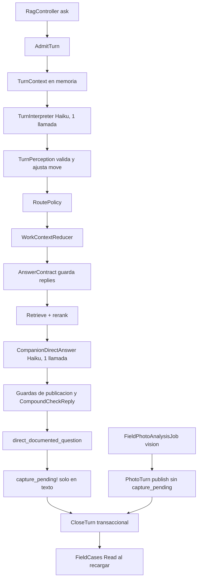
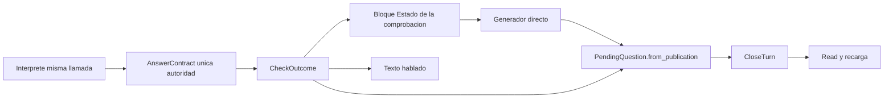

# Rediseño de Danebo Field Companion

Fecha: 19 de noviembre de 2026.
Estado: documento vivo en fase de diseño. No está implementado y no autoriza desplegar ni llamar a producción. Ver [cómo mantener el plan vivo](#7-cómo-mantener-el-plan-vivo).
Base: `32e56ee`. Evidencia: `test/fixtures/files/field_companion/pilot_2026_11_19.json` y `tmp/pilot_exports/2026-11-19_2026-11-19_danebo-pilot-elevator/validation_captures/`. El runner en vivo queda en pausa, incluidos `script/field_companion/run_pilot_elevator_t12.rb`, `stage2_journey_a.rb` y `run_haiku55_http.rb`.

## 1. Cómo viaja hoy un turno

**Decisiones duplicadas** (verificadas en código y trazas):
- **¿Se contestó el pendiente?** Deciden el intérprete (`move`, `part_replies`), `TurnPerception#pending_answer?`/`adjust_move` ([turn_perception.rb](app/services/rag/turn_perception.rb) líneas 1441–1458 y 1596–1602), `WorkContextReducer.open_reply?` en la ruta legacy, `CompoundCheckReply.recover` y `complete_literal_reply`. En Otis T6 y Thyssen T12 del 19 de noviembre, la traza muestra `adjust_move: pending_answer_incomplete` (evento 7) mientras `AnswerContract` guardaba `complete` (evento 9).
- **¿Qué pregunta queda pendiente?** Deciden `direct_documented_question` ([bedrock_rag_service.rb](app/services/bedrock_rag_service.rb) cerca de la línea 2481), `TurnContext#capture_pending!` ([turn_context.rb](app/services/field_cases/turn_context.rb) líneas 58–76) y `CompoundCheckReply.without_redundant_followup`. Los dos primeros cortan la pregunta de forma distinta. `capture_pending!` gana y sintetiza `targets: [{item: pregunta}]` con `document_key` vacío (q4 Otis, q9 Thyssen). La ruta de foto no ejecuta `capture_pending!`.
- **¿Hay que abrir otra comprobación?** Deciden el prompt directo (más de 30 reglas acumuladas en [companion_direct.txt](app/prompts/bedrock/companion_direct.txt)), `referral_note` («indica la siguiente comprobación», [companion_direct_answer.rb](app/services/rag/companion_direct_answer.rb) línea 347) y el filtro léxico posterior.

**Dónde se pierde información:**
- **Interpretación:** una clave escalar extra (`pending_question_note`) invalida todo el turno (`invalid_schema`, Thyssen T11). Solo se descartan como inertes las `*_note` cuyo prefijo es una clave raíz ([turn_perception.rb](app/services/rag/turn_perception.rb) líneas 268–281).
- **Memoria de preguntas:** el episodio guarda un solo `pending_question`. Las respuestas anteriores quedan como `Respuesta r1 a q1.p1 unknown` sin el texto de q1 ([answer_contract.rb](app/services/rag/answer_contract.rb) líneas 178–190). No existe la línea «comprobación activa contestada en este turno» ([companion_case_facts.rb](app/services/rag/companion_case_facts.rb) líneas 108–118 solo lista partes abiertas).
- **Pendiente:** `PendingQuestion.followup_line` recorta a `¿...?` y elimina la condición (Thyssen q9).
- **Foto:** el bloque `Photo Evidence for the active episode` aparece dos veces y solo dice `DEGRADED`. Los residuos sí llegan, pero en la línea `[FOTO]` del historial, sin estructura ([field_photo_observation.rb](app/services/field_photo_observation.rb) `KEYS` descarta `summary`). La nota de referencia cuenta «Turno 4» en el sexto turno porque omite las fotos.
- **Presupuesto de 4 KB:** desde `32e56ee`, una respuesta `complete` puede desplazar contexto. `partial` y `unknown` siguen siendo rechazadas (caso de p3 en Otis del 18 de noviembre).

**Índice:** no es la causa. En Otis T6 y Thyssen T11/T12 se recuperaron y citaron DFC (p. 121), DCL (p. 42) y P28 (p. 9). La evidencia se pierde en la interpretación, el armado del contexto, la generación y la extracción del pendiente. No se proponen cambios de indexación.

**Qué conviene reutilizar sin cambios:** `AdmitTurn`/`CloseTurn` (idempotencia, token, revisión), el esquema `part_replies` con `locate` y offsets, `AnswerContract` (ids, `supersedes`, `contradictory`), `DocumentIdentityScope` con Retrieve y rerank, las guardas de publicación (`CompanionTurnPublication`, `CitationAttributionGuard`, `SourceFidelityGuard`), `ProvenanceSegmenter`, `FieldCases::Read` y el arnés offline (`reduce_and_reload`, `Cassette`, `PilotNov19Rubric`).

**Reglas calcadas del piloto** (los guiones pasan en `32e56ee` gracias a ellas): `CompoundCheckReply` (regex `MANEUVER_CONFIRMED`, `CURRENT_TEST_CLEAR`, «puedes ver el estado de»), `complete_literal_reply` con la frase literal del caso 23, `CompanionDirectAnswer.err14_followup` y `STATED_TEMPERATURE`.

## 2. Qué tomo de Grok y de Codex

- **De Grok:** misma llamada, sin otra pasada de intérprete ni de visión. `episode_delta` con `checks` y `replies`. Una sola proyección visual. Voz primero como salida. Auditoría offline como etapa aparte. **Descarto** `clause_replies` con `asked` como subcadena del texto publicado. Crea una segunda estructura de vínculos paralela a `part_replies` y mide cobertura por coincidencia literal, que falla con la implicación: en el caso 23 T2, «solo la primera vez» cubre «la siguiente abre normal». **Corrijo** «DEGRADED no autoriza residuos»: el resumen visual sí traía residuos. El problema es la procedencia, no el dato.
- **De Codex:** un solo dueño del estado, `unknown` que cierra el intercambio sin cerrar el dato técnico, la regla para abrir otra comprobación y la opción A como punto de partida. **Matizo** «Rails verifica la cobertura»: Rails verifica anclas, ids y procedencia. La cobertura es semántica y la decide el intérprete.
- **Corrección común:** ambos diagnosticaron la corrida del 18 de noviembre. En la del 19, que fija los guiones 28 y 29, el vínculo del intérprete era correcto y los fallos estuvieron aguas abajo.

## 3. Alternativas

- **O1. Conservar el flujo y quitar redundancias puntuales** (Codex A, Grok etapa 1). Reutiliza todo. Elimina el ajuste de `move` y `open_reply?` en la ruta con contrato. No resuelve que el generador ignore el cierre ni que haya dos escritores del pendiente.
- **O2 (elegida). O1 más un objeto de resultado de comprobación único.** `Rag::CheckOutcome` es un PORO determinista de unas 120 líneas, calculado una vez tras el reductor. Lo consumen el contexto del generador, el único escritor del pendiente (texto y foto), la persistencia, la traza y la voz. Elimina `capture_pending!`, `direct_documented_question` como decisión separada y, en la etapa 2, `CompoundCheckReply` y `complete_literal_reply`. Agrega un objeto nuevo, sin migración. El número de llamadas no cambia.
- **O3. Planificación y publicación estructuradas** (Codex B, reactivar `CompanionPlan`). El generador devuelve JSON y Rails renderiza chat y voz. Es lo más verificable, pero reabre una ruta que se retiró por calidad y latencia ([PLAN_EJECUCION_HAIKU55_DIRECTO_20261110.md](docs/field_companion/PLAN_EJECUCION_HAIKU55_DIRECTO_20261110.md)) y requiere reescribir el prompt. Queda como salida si O2 no basta (criterio en la etapa 2).
- **O4. Módulos o puertos y adaptadores, o un `TurnPipeline` explícito.** Mueve código sin corregir ninguna falla observada y sube el costo de pruebas. Lo descarto. El único «puerto» útil es `CheckOutcome` como contrato entre interpretación y publicación.

## 4. Diseño elegido

`CheckOutcome` contiene:
- **Comprobación activa:** id, texto publicado, estado antes y después, `settled_this_turn` y cita del técnico.
- **Datos declarados no verificados o inaccesibles:** checks `not_done` y respuestas `unknown`, con la correlación de cada turno (DCL en T3, T5 y T6).
- **Comprobaciones ya cerradas:** texto reconstruido desde el turno que las publicó, como hace `AnswerContract.reconstruct` con las respuestas. El episodio solo guarda la correlación de publicación.
- **Partes abiertas** y, desde la etapa 2, `missing` por parte.

**Reglas:**
- El `move` sale de lo que `AnswerContract.apply!` guardó, no de una segunda evaluación.
- Un solo escritor del pendiente. Toma la última línea interrogativa completa, con su condición y sin el rótulo («Comprobación:»). Los `targets` salen de las citas `[n]` de esa línea o de su párrafo. Sin citas, no se sintetizan `targets`. Lo usan texto y foto.
- Cuando `settled_this_turn` es verdadero, el bloque del generador lo indica, `referral_note` deja de pedir la siguiente comprobación y la lista de datos no verificados se presenta con la instrucción de no volver a pedirlos.

**Intérprete y conversación** (misma llamada, etapa 2):
- `part_replies[].missing`, opcional y en texto libre: lo que todavía le falta a la comprobación.
- Guía de prompt sin reglas por marca para implicación, alcance de la negación («no X ni Y»), condición compartida, alternativas («A o B») y alcance de la maniobra.
- Correcciones: se mantiene `supersedes`.
- «¿Por qué conviene comprobar X?»: `move: meta`/`follow_up` sin vínculo a la parte, que sigue abierta.

**Pregunta para Fable u Opus (mi respuesta).** Basta con cobertura semántica dentro de la parte, con citas verificables. No hace falta fijar ids de criterio al publicar. En las trazas del 19, el intérprete ya devolvió `complete` correcto en preguntas compuestas, y los fallos fueron aguas abajo.

Los casos que hacen insegura la cobertura, aun con citas válidas, son estos:
- Condición compartida: «con la puerta cerrada y trabada» no aparece en la cita del valor.
- Negación que abarca dos cláusulas: «No llegamos a verificar DCL ni DFC».
- Alternativas («¿se detiene antes o llega al cierre?»).
- Otra maniobra distinta de la preguntada.
- Implicación (caso 23 T2).

Los ids de criterio no resuelven ninguno de esos casos. Todos exigen juicio semántico, polaridad y alcance. Los ids solo ayudan a acumular cobertura parcial entre turnos. **Disparador:** si en los replays autorizados más del 10 % de las comprobaciones compuestas se completa en dos o más turnos, o se reabre una parte cubierta, se agregan ids de criterio al publicar, lo que implica cambiar el publicador.

## 5. Manos libres en la misma conversación

- **Salida (etapa 4):** `response["spoken"]` se arma con Rails desde la respuesta publicada y `CheckOutcome`. Lleva hallazgo o resultado (dos oraciones como máximo), los datos no verificados y la única pregunta. No incluye `[n]`, citas, páginas ni rótulos. Botón grande «Escuchar» con `speechSynthesis` del navegador y lectura automática opcional. La pantalla conserva la burbuja con fuentes, foto y «Ver fuentes». No hay llamada de generación extra, el costo es cero y la latencia es local.
- **Entrada (etapa 5):** botón de pulsar para hablar en el chat, reutilizando la grabación de [voice_dictation_controller.js](app/javascript/controllers/voice_dictation_controller.js) extraída a un módulo compartido. Nuevo endpoint síncrono de transcripción con `SpeechToText::Client` (Groq `whisper-large-v3-turbo`) y `JargonPrompt` ampliado con el vocabulario del caso: identificadores del episodio, alias del manual fijado y términos de la pregunta activa.
- **Corrección de la transcripción:** el texto llega al campo de entrada sin enviarse. Códigos y valores se resaltan (es presentación, no interpretación) y se pueden releer en voz. El técnico envía, edita o vuelve a dictar. Una corrección hablada posterior sigue el contrato normal (`correct` con `supersedes`).
- **Ruido y errores:** grabaciones de 0,8 a 30 s. Si la transcripción viene vacía, aparece «No te escuché» sin enviar. Un error de red permite un reintento local y luego se vuelve al texto. Se guardan el texto bruto y el enviado en `field_turns.attachment["voice"]`, sin audio persistido en esta etapa.
- **Latencia y costo:** Groq agrega 0,5 a 1,5 s y unos USD 0,0002 por clip de 15 s. Amazon Transcribe cuesta USD 0,006 por clip (mínimo de 15 s) y tarda más. Como referencia, hoy la generación toma 6,4 a 10,7 s con 16 000 a 20 000 tokens de entrada. Pendiente de decisión: si Groq, un proveedor fuera de AWS, se acepta para producción. Certificación ya lo usa.

## 6. Etapas y aceptación

Red de regresión: [pilot_nov19_regression_test.rb](test/services/rag/pilot_nov19_regression_test.rb), [pilot_elevator_closure_test.rb](test/services/rag/pilot_elevator_closure_test.rb), [pilot_elevator_t12_test.rb](test/services/field_cases/pilot_elevator_t12_test.rb), [thyssen_ea_measurement_case_test.rb](test/controllers/thyssen_ea_measurement_case_test.rb) y el journey de Haiku 5.5. Se evalúa por significado con `PilotNov19Rubric` y se comprueba el estado tras `reduce_and_reload`. Los casos 22, 26 y 27 completos se agregan como replays con las salidas capturadas.

**Etapa 1. Primer cambio pequeño de punta a punta** (estado: implementada y cerrada offline el 19-nov-2026; ver el registro de la sección 7), bajo la bandera `FIELD_CHECK_OUTCOME` y sin migración:
1. `prepare_tool` descarta como inerte cualquier clave escalar `*_note` o nula.
2. `Rag::CheckOutcome` calculado en `record_owner_turn!` y guardado en el `TurnContext`. `move` se deriva del informe de `AnswerContract.apply!`.
3. `CompanionCaseFacts#prompt_block` reemplaza las líneas `Respuesta rN a qN.pN` por el bloque «Estado de la comprobación». `referral_note` respeta `settled_this_turn`.
4. `PendingQuestion.from_publication` reemplaza a `direct_documented_question` y a `capture_pending!`, y se llama también desde `PhotoTurn#publish`.
5. `episode_delta` incluye `checks` y `replies`. Se registra el evento `check_outcome`.

`CompoundCheckReply` sigue activo en esta etapa para conservar la paridad.

Aceptación de la etapa 1:
- La salida capturada de Thyssen T11 es válida y guarda `complete` en q8/p8 (hoy da `invalid_schema`).
- Otis T6: `settled_this_turn` para q3/p3. DCL figura como no verificado con sus tres correlaciones. El bloque incluye el texto de q1 y no hay líneas de respuesta sin pregunta.
- Thyssen T12: el pendiente conserva «tras varias maniobras en automático» y no lleva `targets` sintéticos con `document_key` vacío. El cierre sigue sin q9.
- Un turno de foto con pregunta deja el mismo pendiente que el texto equivalente tras recargar.
- Toda la red sigue en verde. Las llamadas por turno no cambian. El bloque del generador no crece más del 3 % en los fixtures.

Estado de esos criterios tras la corrección posterior (sección 7, última fila de la etapa 1):
- **Reapertura, resuelta.** La pregunta y la cita se recuperan de `FieldTurn` con la correlación de la respuesta (`TurnContext#case_turn_reference`). El contexto ordinario sigue en tres turnos. Con el vínculo ausente se conserva el estado y `missing_references` dice qué falta.
- **Cierre en el turno actual, resuelto.** La correlación llega a `SessionContextBuilder.companion_case` y a `CompanionCaseFacts#prompt_block`.
- **Crecimiento medido del prompt, aceptado** (autorización del 19-nov-2026, antes de la corrida en vivo acotada). El bloque «Estado de la comprobación» pasa de 156 a 666 bytes en Otis T5 (+327 %) y de 257 a 957 en T6 (+272 %). El prompt completo pasa de 11 115 a 11 625 bytes en T5 (+4,59 %) y de 12 178 a 12 981 en T6 (+6,59 %), frente a `2e498a1` con las mismas entradas. El criterio del 3 % deja de ser puerta de esta etapa: el bloque contiene el texto de la pregunta, la cita del técnico y la lista de no verificados que la etapa exige. La etapa 2 no queda bloqueada por ese porcentaje y no amplía el bloque sin una medición nueva.

**Etapa 2.** Cobertura e intérprete, más retiro de reglas léxicas:
- `missing` en `part_replies` y guía de prompt (sección 4). Las líneas del bloque de `CheckOutcome` deben seguir mostrando el id de la respuesta (`r1`): `CompanionPlan` lo usa para `supersedes`.
- **Prerrequisito de reapertura, resuelto con una condición.** El bloque ya puede fiar el texto de comprobaciones cerradas cuyo turno salió de los últimos tres ([check_outcome_reopen_test.rb](test/services/field_cases/check_outcome_reopen_test.rb), 6 pruebas). La pregunta se infiere por secuencia: es la publicación del turno completado anterior al que contestó. El episodio no guarda la correlación del turno que publicó cada `qN`. Si esta etapa necesita certeza (por ejemplo para `supersedes` o el texto hablado de una comprobación antigua), debe guardar esa correlación en el pendiente al instalarlo (`ActiveEpisodeTurn.install_pending!` ya la recibe) y comprobar que el `published_text` de ese turno contiene la pregunta. Mientras no exista, un caso cuyo turno anterior no publicó una pregunta queda con la línea sin texto de pregunta y `missing_references` con `question_text`.
- **Presupuesto del bloque, aceptado en los tamaños medidos.** El 3 % ya no bloquea esta etapa. `missing` y la prioridad de `partial` y `unknown` siguen sin entrar al bloque hasta que haya una medición nueva.
- **Prerrequisito (hallazgo de la etapa 1):** decidir la activación de `FIELD_CHECK_OUTCOME` por defecto. Eso exige una validación real autorizada. Hasta entonces `capture_pending!`, `direct_documented_question` y la lectura estricta de `PendingQuestion.coerce` siguen vivos, y no se retira nada que dependa de ellos.
- Contrato de salida del generador: una sola pregunta, en la última línea, con rótulo fijo. Tras cerrar la comprobación activa, solo se publica otra si esa línea cita `[n]`. Si no, se quita la línea y no se instala pendiente. `from_publication` ya instala hoy pendientes sin citas (con `targets: []`, ver sección 7). Esta etapa decide si ese caso se elimina en el generador o si se conserva. Los guiones 26 T4 (imperativo sin `?`) y 29 T5 (la cita queda después de la pregunta, ya cubierto) definen los bordes.
- Retirar `CompoundCheckReply` (las dos funciones), `complete_literal_reply`, `open_reply?` en la ruta con contrato, `err14_followup` y `STATED_TEMPERATURE`, cada retiro con su prueba de paridad. La prueba de paridad se corre con la bandera encendida y apagada.
- Prioridad de presupuesto para respuestas `partial` y `unknown`.

Aceptación con dobles: casos sintéticos sin marca (ciclo con tres criterios: completo, parcial con paráfrasis, «sí» ambiguo, desfavorable, contradicción, corrección, otra maniobra, implicación) y los guiones 23 T2, 24 T7, 26 T4, 28 T11/T12 y 29 T5/T6. La calidad del prompt se mide solo con un replay autorizado aparte. **Criterio para pasar a O3:** que persistan pedidos repetidos de datos declarados no verificados o discrepancias entre la pregunta publicada y la guardada.

**Etapa 3. Foto:** una sola proyección con `summary` (300 caracteres como máximo) y su procedencia, sin bloque duplicado. Los turnos de foto cuentan en `referral_note`. Debe conservar el pendiente que `FieldPhotoAnalysisJob` ya pasa a `PhotoTurn#publish` y que `TurnContext#install_published_pending!` instala (etapa 1). Con la bandera encendida, el job completo y el proveedor simulado ya dejan el mismo pendiente que el texto equivalente tras recargar ([field_companion_stage1_photo_job_test.rb](test/controllers/field_companion_stage1_photo_job_test.rb)). Con la bandera apagada el foto no instala pendiente. El foto hace un `Retrieve` de más: la pregunta de recuperación no es el turno crudo y `BedrockRagService#with_turn_candidates` dispara la segunda llamada. Aceptación que sigue abierta: 29 T1/T3 conservan COR/CR y los residuos atribuidos a la foto 59. 28 T1 separa los rótulos de EA.

**Etapa 4.** `spoken` y «Escuchar». Lee `CheckOutcome.current(episode:, session:, correlation_id:)`. Tras recargar, ese objeto recupera la pregunta y la cita desde `FieldTurn` aunque hayan salido de los últimos tres turnos. Si no hay vínculo, `missing_references` lo dice y el texto hablado no debe inventar la pregunta. Hereda la condición de la etapa 2: el vínculo es por secuencia hasta que el pendiente guarde la correlación de publicación. Aceptación: en 29 T3/T5/T6 y 28 T4/T12, el texto hablado contiene el hallazgo, los datos no verificados y como máximo una pregunta, sin `[n]` ni páginas. Es estable al recargar.

**Etapa 5.** Dictado en el chat. Aceptación: transcripción editable antes de enviar, misma ruta `AdmitTurn`, y texto bruto y enviado trazados. Pruebas del controlador y del servicio con un STT simulado.

**Fuera de alcance:** cambios de indexación, una segunda llamada al intérprete o a visión, listas de equipos por fabricante y el modo «cara a cara» sin pantalla.

## 7. Cómo mantener el plan vivo

Al iniciar cada etapa, leer este documento en su versión más reciente y contrastar sus supuestos y dependencias con el código y el registro de cierre. Distinguir la base histórica de diseño del SHA que se usa para medir la etapa.

Al cerrar cada etapa, registrar aquí el estado, el SHA base y el de cierre cuando esté disponible, las pruebas ejecutadas y su resultado, los hallazgos relevantes y sus referencias. Si un hallazgo cambia un contrato, una dependencia, el orden o un criterio de aceptación, editar directamente cada etapa afectada, incluida la siguiente cuando corresponda, antes de iniciarla. Actualizar también el prompt si cambian las instrucciones de ejecución. Si el hallazgo no afecta etapas posteriores, basta con indicarlo en el registro. Cuando queden pruebas pendientes o una dependencia bloqueada, dejar explícito qué falta y qué etapa queda afectada.

| Etapa y estado | SHA y evidencia | Hallazgo y efecto en etapas posteriores |
| --- | --- | --- |
| Diseño | Base histórica `32e56ee` | Documento de diseño. |
| 1 · **Cerrada offline** (19-nov-2026), sin commit, sin corrida en vivo ni despliegue | Base medida `2e498a1` (HEAD al iniciar, árbol limpio). Antes de los cambios: 25 pruebas de la red verdes y suite 5 844 / 0 fallos. Al cerrar, con `FIELD_CHECK_OUTCOME` apagada y encendida: `5859 runs, 47779 assertions, 0 failures, 0 errors, 187 skips` en ambos modos (+15 pruebas nuevas). Rubocop sin ofensas en los archivos tocados. Pruebas nuevas: `answer_contract_test.rb` (resultado de comprobación y recarga, comprobación anterior cerrada, `unknown`, bandera apagada igual al contrato, evento `check_outcome` y `replies` en `episode_delta`, `referral_note`, pendiente sin citas y cierre, foto con `install_published_pending!`, `coerce` vs `coerce_stored`), `pending_question_test.rb` (`from_publication`, pregunta compuesta, cita tras la pregunta, lectura almacenada), `pilot_nov19_regression_test.rb` (Otis 29 T6 desde el fixture) y `turn_perception_test.rb` (notas inertes). Código: `Rag::CheckOutcome`, `Rag::CheckOutcomeFlag`, `PendingQuestion.from_publication`/`question_in`/`coerce_stored`, `TurnContext#install_published_pending!`, `current_replies(except:)` y `part_state_without` en `AnswerContract`, evento `check_outcome` (ver [PILOT_TRACEABILITY.md](docs/PILOT_TRACEABILITY.md)). | **Aceptación.** T11 Thyssen: válido (`prepare_tool` descarta escalares `*_note`, incondicional; hoy no da `invalid_schema`). Otis T6: `settled_this_turn` en q3/p3, DCL no verificado con T3, T5 y T6 y sus tres correlaciones, texto de q1 reconstruido, ninguna línea de respuesta sin pregunta. Thyssen T12: el pendiente es «en operación normal, tras varias maniobras en automático, ¿el EA no vuelve a aparecer?» con `targets: []`, sin `document_key` vacío. Foto: misma función de escritura que el texto, probada a nivel de unidad. Bloque del generador: +510 y +700 caracteres en Otis T5 y T6, es decir, 0,8 a 1,1 % de unos 64 000 caracteres (estimado con 16 000 tokens, no un prompt real medido), con un tope de 1 200 caracteres en la prueba. Llamadas por turno: sin cambio por construcción, porque `CheckOutcome` y `from_publication` son Ruby puro y el código no agrega llamadas a Bedrock. No se midió con contadores de llamadas en una corrida real. **Hallazgos y efecto.** (1) Aceptar un pendiente sin `targets` globalmente cambió la ruta del plan con la bandera apagada (4 fallos en Vf5). Se acotó con `coerce_stored` (solo lectura de lo guardado o publicado) y `coerce` sigue estricto para las aclaraciones. (2) `closable_documented_question?` aceptaba solo `targets`. Ahora acepta también `parts`, para que una comprobación sin citas se cierre. (3) El separador de oraciones corta también tras `]` o `»` antes de `¿`, y se descartan las oraciones con cita que siguen a la pregunta (29 T5). (4) Las líneas del bloque llevan el id de respuesta (`r1`), porque el planificador lo necesita para `supersedes` (etapa 2). (5) `capture_pending!`, `direct_documented_question` y `CompoundCheckReply` siguen activos por la paridad con la bandera apagada. Su retiro (etapa 2) depende de activar la bandera por defecto, que exige una validación real autorizada. (6) 26 T4 es imperativo sin `?`: no deja pendiente (etapa 2 decide el contrato). **Pendiente:** validación en vivo con la bandera encendida, caso de foto completo con el job y medición del prompt real. Siguiente etapa: la 2, con el prerrequisito indicado. |
| 1 · Verificación offline posterior (19-nov-2026). Sin commit, sin corrida en vivo, bandera no activada por defecto. Lógica de producción sin cambios en esta pasada. | Misma base `2e498a1`. Foto: [field_companion_stage1_photo_job_test.rb](test/controllers/field_companion_stage1_photo_job_test.rb), 1 prueba, 22 aserciones, verde. Prompt armado con `CompanionDirectAnswer.prepare` sobre el episodio ya reducido de Otis 29 T5 y T6, los extractos del fixture y el historial del caso, incluido el turno actual. Comparado con un checkout de `2e498a1` y las mismas entradas. Reapertura: [check_outcome_reopen_test.rb](test/services/field_cases/check_outcome_reopen_test.rb), rojo a propósito. | **Foto, verificado.** Con la bandera encendida, tras recargar, el pendiente del job coincide con el del texto: «¿El trinco engancha con la puerta cerrada?» y `targets: []`. Con la bandera apagada el texto guarda esa pregunta con un target sintético (`capture_pending!`) y el foto queda sin pendiente (`install_published_pending!` no corre). **Llamadas, verificado con dobles.** Apagada y encendida dan el mismo conteo. Texto: 1 intérprete, 1 `Retrieve`, 1 generador. Foto: 1 visión, 1 intérprete, 2 `Retrieve`, 1 generador. El segundo `Retrieve` es `BedrockRagService#with_turn_candidates`, porque la pregunta de recuperación del foto no es el turno crudo. No lo introduce la bandera. **Prompt, medido.** Bandera apagada, idéntico a `2e498a1`: T5 usuario 1 602 bytes (sha256 `58905b8d…`), prompt completo 11 115 (`df156be9…`); T6 usuario 2 059 (`5bdbc8f3…`), completo 12 178 (`53a34b73…`). Bandera encendida: T5 usuario 2 051 y completo 11 564 (+449, 4,04 %); T6 usuario 2 766 y completo 12 885 (+707, 5,81 %). El bloque que entra en el prompt pasa de 156 a 470 bytes en T5 y de 257 a 665 en T6. El bloque crudo es mayor (666 y 957) y el presupuesto de 3 500 caracteres del caso descarta una parte. El criterio del 3 % no se cumple sobre este prompt armado. **Divergencia del bloque, para corregir.** `SessionContextBuilder.companion_case` llama a `CheckOutcome.context_lines` sin `correlation_id`. `CompanionDirectAnswer.prepare` sí pasa la correlación, pero solo a `referral_note`. En T6 el bloque lista q3 como comprobación anterior y la nota de derivación sí dice que la comprobación quedó contestada. **Reapertura, falla.** Caso de cinco turnos persistidos. La pregunta «¿La válvula 4 está abierta?» está en el `published_text` del turno 1 y la respuesta «La válvula queda abierta.» en el mensaje del turno 2. `r1` queda en el episodio (`q1.p1`, `complete`, correlación del turno 2). Al reabrir, `TurnContext#restore_history` deja solo los turnos 3 a 5. `CheckOutcome#history_question` no encuentra ese usuario y devuelve nil. `AnswerContract.reconstruct` tampoco encuentra la respuesta. La línea publicada es «- q1.p1: complete (r1).», sin pregunta y sin cita. Primera divergencia: `app/services/field_cases/turn_context.rb` método `restore_history`, límite `EPISODE_MAX_USER_MESSAGES`. El texto sigue en `FieldTurn`. Afecta las etapas 2 y 4. **Sigue pendiente:** validación en vivo y la corrección de esas dos divergencias. |
| 1 · Corrección posterior (19-nov-2026). Sin commit, sin corrida en vivo, bandera apagada por defecto. | Misma base `2e498a1`. Código: `Rag::CheckOutcome` (`question_from_case`, `case_quote`, `missing_references`), `FieldCases::TurnContext` (`case_id`, `case_turn_reference`, `copy_case_window_from`), `Rag::AnswerContract.reply_slice`, y la correlación en `SessionContextBuilder.companion_case`, `CompanionCaseFacts.build` y `CompanionPlan.prepare`. Pruebas: reapertura 6 (101 aserciones), Otis T6 con la correlación en 4 caminos (`companion_case`, `prompt_block`, `companion_context`, `CompanionDirectAnswer.prepare`), foto 1 (22 aserciones). Suite completa: `5867 runs, 47919 assertions, 0 failures, 0 errors, 187 skips` con `FIELD_CHECK_OUTCOME` apagada y con `true`. Rubocop sin ofensas en los 24 archivos tocados. | **Reapertura, resuelta.** La referencia es la correlación de la respuesta: nombra un `FieldTurn` completado del mismo caso con las palabras del técnico (cortadas con `a`/`b`), y el turno completado anterior da la pregunta publicada. Se lee solo cuando la ventana no tiene el turno, con 2 consultas por correlación y 0 en la segunda lectura, y no ensancha `conversation_history`. Otro caso no sirve la referencia. Si falta: línea sin pregunta o sin cita y `missing_references` (`question_text`, `technician_text`) en `to_trace`. **Referencia que falta en los casos existentes:** el episodio no guarda la correlación del turno que publicó cada `qN`; se infiere por secuencia. **Cierre en el turno actual, resuelto.** Con un contexto sin resultado guardado, Otis T6 muestra «Comprobación activa q3.p3 … contestada en este turno (complete, r3)» solo si la correlación viaja; sin ella el bloque la lista como anterior. **Paridad foto/texto con la bandera encendida:** igual pendiente tras recargar. **Llamadas:** igual con y sin bandera (texto: 1 intérprete, 1 `Retrieve`, 1 generador; foto: 1 visión, 1 intérprete, 2 `Retrieve`, 1 generador). **Presupuesto, medido de nuevo** con las mismas entradas y el mismo script contra `2e498a1` (bandera apagada idéntica byte a byte). Bloque «Estado de la comprobación» (líneas dentro del prompt): T5 156→666 bytes (+510, +327 %), T6 257→957 (+700, +272 %). Contexto del caso (`companion_case`, tope 3 500): T5 901→1 411 (+56,6 %), T6 1 308→2 008 (+53,5 %). Bloque de usuario del generador (`Prepared.user`): T5 1 602→2 112 (+31,8 %), T6 2 059→2 862 (+39,0 %); en T6 +103 bytes vienen de la nota de derivación. Prompt completo (sistema + mensajes): T5 11 115→11 625 (+4,59 %), T6 12 178→12 981 (+6,59 %). **Criterio del 3 % sobre el bloque: no cumple** (ni sobre el bloque, ni sobre el contexto del caso, ni sobre el prompt completo). Las cifras anteriores (449 y 707 bytes) eran menores porque el bloque no incluía la línea activa: sin correlación, q3 salía como comprobación anterior. | **Crecimiento aceptado** el 19-nov-2026 (opción de conservar el bloque medido). El 3 % deja de ser puerta. La etapa 2 no añade texto al bloque sin una medición nueva. Efecto en la etapa 4: puede fiar la pregunta y la cita de comprobaciones antiguas, con la condición del vínculo por secuencia. Sigue pendiente: validación en vivo autorizada y la correlación de publicación por pregunta. |
| 1 · Corrida en vivo acotada (19-nov-2026). Sin commit, sin despliegue, bandera apagada por defecto. Detenida en el primer fallo, sin reintento. | Candidata sin commit, base `2e498a159e48e63cd74a4c7ba793b34d7a44e9dd`. Identidad del árbol al arrancar: `diff_sha256` `a8c232ca84473f920c9c75147133ce3645a91ee8ae01e6346545c914d1fa4ddf` en `tmp/field_companion/stage1_live/20261119T212352Z/candidate.json`. Runner `script/field_companion/run_stage1_live.rb`. BD local aislada `smart_deal_stage1_live`. KB `Y7RZWMFJSR` en retrieve. `FIELD_CHECK_OUTCOME=true` solo en ese proceso. | **Thyssen T11, fallo de aceptación.** Correlación `query:fd64494d-15d0-484b-bbdd-14838ece84e3`. Tras recargar, p8 queda `complete` y `settled_this_turn` es verdadero. La respuesta publicada es «No encontré evidencia suficiente en los documentos seleccionados para responder este punto.» y vuelve a preguntar «¿Sigue marcando EA?». El pendiente sigue en q8 con `document_key` vacío. Latencia 24 061 ms. Tokens de entrada 5 918 y de salida 468, solo del intérprete. El generador no se llamó. **Primera divergencia:** el filtro del `Retrieve` (secuencia 18 de la captura) usa `s3://smart-deal-dev-kb/.../THYSSEN (Manual de Maniobra Universal con MCINV4).pdf` porque `KNOWLEDGE_BASE_S3_BUCKET` en el entorno local es `smart-deal-dev-kb` y la clave del catálogo es relativa. La KB de producción no devuelve pasajes con ese URI (`retrieval_results` con 0 filas, secuencias 24 y 28; `direct_reference` `condition: empty`, secuencia 30). `BedrockRagService#reference_fallback` publica el aviso y conserva la pregunta abierta. Hubo un reintento interno de arranque en frío de Aurora (15 s) sobre ese mismo filtro; no se repitió el turno. T12, T5 y T6 no se ejecutaron. Evidencia: `tmp/field_companion/stage1_live/20261119T212352Z/`. Reproducción: `SHARED_SESSION_ENABLED=false FIELD_CHECK_OUTCOME=true STAGE1_LIVE_CONFIRM=1 STAGE1_DATABASE=smart_deal_stage1_live bin/rails runner script/field_companion/run_stage1_live.rb`, con el bucket de producción en el URI del pin. |
| 1 · Comprobación del pin antes de repetir T11 (19-nov-2026). Sin turno nuevo. | Misma candidata y misma BD aislada. El proceso arranca con `KNOWLEDGE_BASE_S3_BUCKET=multimodal-source-destination`, el valor que `run_haiku55_http.rb` asigna en `server_env` antes de que Puma cargue `KbDocument::KB_BUCKET`. KB `Y7RZWMFJSR`. Pin esperado: uid `02ae6128-077b-4c00-8029-f0cf80e0f6c4`, URI `s3://multimodal-source-destination/bulk_uploads/3/2026-08-20/THYSSEN (Manual de Maniobra Universal con MCINV4).pdf`. | **Comprobación detenida antes del Retrieve.** El URI del catálogo ya coincide. `Rag::KnowledgeScopePolicy.authorize_retrieval_set` devuelve `deny` porque las filas locales 131 (`s3_key` relativo, uid `02ae6128-…`) y 134 (`s3_key` absoluto, uid `2365fe86-15d0-4f3e-ae1a-7f3a9cfe2262`) comparten el mismo `canonical_source`. `BedrockRagService#retrieval_filter` devuelve `nil`. Filtro esperado: ese URI de producción. Filtro observado: ninguno. `run_pilot_elevator_t12.rb` rechaza este catálogo con `local manual catalog is ambiguous` y no llama a la KB. No se restauró T10 ni se envió T11. Evidencia: `tmp/field_companion/stage1_live/20261119T213551Z/`. |
| 1 · Catálogo único y T11 (19-nov-2026). Sin commit, sin despliegue, bandera apagada por defecto. | `smart_deal_stage1_live` reconstruida desde el esquema de test y `accounts`, `users`, `kb_documents` de development. Se quitó solo en la base aislada la fila 134. Queda la fila 131, uid `02ae6128-077b-4c00-8029-f0cf80e0f6c4`, y es la única cuyo `canonical_uri` es el pin de producción. Development conserva la fila 134. | **Retrieve previo aceptado; T11 detenido antes del rerank, sin reintento.** El filtro devuelve 16 pasajes y los 16 citan el manual Thyssen esperado. Correlación `query:09061418-62a4-4ad2-80d5-5219b98aefd9`. El intérprete y los dos `Retrieve` del turno también vuelven con pasajes. El ledger bloquea `rerank` antes del SDK: techo `0.118383` USD, tope del proceso `0.059606` USD. El turno queda `pending`, sin respuesta publicada. T12, T5 y T6 no se ejecutaron. Evidencia: `tmp/field_companion/stage1_live/20261119T214335Z/`. |
| 1 · T11/T12 y T5/T6 con presupuesto de rerank (19-nov-2026). Sin commit, sin despliegue, bandera apagada por defecto. | Tope del ledger por turno `1.019606` USD, suficiente para el rerank observado. El intento pending anterior quedó en el caso 1, usuario `stage1-pending-1@danebo.local`, correlación `query:09061418-62a4-4ad2-80d5-5219b98aefd9`. KB `Y7RZWMFJSR` en solo lectura. | **T11 y T5 fallan la aceptación. T12 y T6 no se enviaron porque dependen de ellos.** T11, correlación `query:26694232-5537-4647-8293-0af9befd7585`: p8 queda `complete`, pero al recargar el pendiente sigue siendo q8 «¿Sigue marcando EA?». La respuesta publicada cierra sin pregunta nueva. Primera divergencia de la traza: secuencia 42, `published_answer` sin pregunta; la secuencia 45, `episode_delta`, no cambia el pendiente. T5, correlación `query:86d9d525-d330-4000-b5f6-7a0389d94716`: p2 queda `partial` y la respuesta no pregunta por DFC. Primera divergencia: secuencia 37, `published_answer`; la secuencia 40 deja el pendiente en la pregunta de la pisadera. Gasto medido: 37 333 tokens de entrada, 5 846 de salida, `0.006656` USD de generación y `0.002` USD del rerank de T11. Total `0.008656` USD. Evidencia: `tmp/field_companion/stage1_live/20261119T215845Z/`. |
| 1 · Ronda 1 en vivo, fallo → corrección offline (19-nov-2026). Sin commit, sin despliegue, bandera apagada por defecto. Corrida con `FIELD_CHECK_OUTCOME=true` solo en el proceso, BD aislada `smart_deal_stage1_live`, KB `Y7RZWMFJSR` en solo lectura (`KNOWLEDGE_BASE_S3_BUCKET=multimodal-source-destination`), tope del ledger `1.019606` USD sin ajuste nuevo. | Evidencia `tmp/field_companion/stage1_live/20261119T222529Z/`. Cambios previos a la ronda, con prueba roja primero en `pilot_nov19_regression_test.rb`: `CheckOutcome#leaves_checks_open?` y `CompanionDirectAnswer#open_checks_note` (con parciales sin cerrar y sin datos declarados, «No cierres el caso» y una sola comprobación siguiente, y no se dice «por inercia»), y `AnswerContract.completed_pending?` con `ActiveEpisodeTurn.write_pending!` (con la bandera encendida, una pregunta cuyas partes están todas `complete` no sobrevive a una publicación sin pregunta; `unknown` y `partial` se conservan, por la prueba existente de `corrections`). Antes: corrida `20261119T215845Z`, T11 correlación `query:26694232-5537-4647-8293-0af9befd7585`, `companion_direct` secuencia 37 cerró sin pregunta con la nota «por inercia» y q4/q7 parciales, y la secuencia 45 dejó q8 sin cambios. T5 `query:86d9d525-d330-4000-b5f6-7a0389d94716`, secuencia 33 cerró con p2 parcial. | **Gasto 0,008409 USD.** T11 `query:419be1d7-c303-43da-a2cf-24fc5ebc56bd`: ahora publica una sola pregunta (q9, sin pendiente viejo), pero `perception_applied` secuencia 7 es `invalid_schema` (el intérprete devolvió `pending_questions_part_replies: []` y `pending_resolution_hint`), `route_exit` secuencia 8 cae en `fallback` y `p8 complete` no se guarda. Primera divergencia: secuencia 7. T5 `query:9ff74521-be16-42a3-b318-44a20133459a`: p2 `partial`, publica una pregunta, pero «repite varios cierres», sin cita y sin DFC (secuencia 33 `companion_direct`). T12 y T6 no se enviaron. |
| 1 · Ronda 2 en vivo, fallo → corrección offline. Sin commit, sin despliegue, bandera apagada por defecto. Corrida con `FIELD_CHECK_OUTCOME=true` solo en el proceso, BD aislada `smart_deal_stage1_live`, KB `Y7RZWMFJSR` en solo lectura (`KNOWLEDGE_BASE_S3_BUCKET=multimodal-source-destination`), tope del ledger `1.019606` USD sin ajuste nuevo. | Evidencia `20261119T222949Z/`. Correcciones previas: `TurnPerception.prepare_tool` trata como inerte una lista u objeto **vacío** bajo una clave desconocida, solo con la bandera encendida (prueba con la salida real de T11; lista u objeto con contenido siguen siendo defecto); y la nota de parcial activo de T5 pide una comprobación respaldada por una fuente de este turno, citada `[n]`, sin repetir lo ya reportado. | **Gasto 0,00825 USD.** T11 `query:e37c20fc-33aa-4857-9640-97aa93c5c692`: `perception_applied` válido y `p8 complete` guardado (r7). El generador (secuencia 37) produjo una sola «Siguiente comprobación». La secuencia 43, `answer_presentation` con `fidelity_removed` 1, quitó «Su referencia es RA-94/A-, con 0 V [2]» y la secuencia 44, `companion_publication` `rejected_after_guards` `R5 quote_removed`, sustituyó el turno por el texto de contingencia. Evidencia de la causa: el chunk dice `RA-94/ A- = 0 VOLT`, y `PAIR_PATTERN` exige que no siga una letra a la `V`, así que la fuente no soporta «0 V». Primera divergencia: secuencia 43. T5 `query:6ca75f1d-99a3-41df-903d-66af5e9c6ca7`: el intérprete guardó p2 `complete` y un `not_done` «No llegamos a verificar DCL ni DFC». El bloque lo listó bajo «No lo pidas de nuevo» (también en rondas 0 y 1), el generador escribió «DCL y DFC no verificados… No lo vuelvo a pedir» y preguntó por la guía. Primera divergencia: el bloque de `check_outcome` (secuencia 13). |
| 1 · Ronda 3 en vivo. Sin commit, sin despliegue, bandera apagada por defecto. Corrida con `FIELD_CHECK_OUTCOME=true` solo en el proceso, BD aislada `smart_deal_stage1_live`, KB `Y7RZWMFJSR` en solo lectura (`KNOWLEDGE_BASE_S3_BUCKET=multimodal-source-destination`), tope del ledger `1.019606` USD sin ajuste nuevo. | Evidencia `20261119T223408Z/`. Correcciones previas: `SourceFidelityGuard` lee `N VOLT(S)` de la evidencia como `N V` (solo evidencia, solo con la bandera; «5 V» y «VOLTIMETRO» siguen sin soporte); y `CheckOutcome#lines` separa «Declarado por el técnico como no verificado o inaccesible. No lo pidas de nuevo» (`unknown` y `not_done` de turnos anteriores) de «Declarado en este turno como no hecho todavía. Pide solo lo que no figure arriba como declarado antes, y solo si una fuente de este turno lo respalda y la citas» (`not_done` con la correlación del turno). Pruebas: `source_fidelity_guard_test.rb`, `pilot_nov19_regression_test.rb` (T6 desde el fixture: DCL conserva turnos 3, 5 y 6 y las dos secciones), `turn_perception_test.rb`. | **Gasto 0,012639 USD** (2 rerank, 0,004 USD). **T11 aceptado** `query:e951ce8d-375e-4f31-af99-9e84913013f9`: p8 `complete`, pendiente nuevo q9 «Con la puerta cerrada, ¿el ascensor completa un viaje normal y el display sigue sin mostrar EA?» sin `document_key` vacío, sin repetir q8, `fidelity_removed` 0. **T12 aceptado** `query:b597174a-8def-45d3-8933-a5d3c16cc06e`: p9 `complete`, sin pendiente y sin q9 sintético. **T5 falla la aceptación** `query:73c59b4b-681d-40c5-bb60-035cc68411a1`: p2 `partial`, publica «con la puerta de piso 3 cerrada, ¿el LED DFC del panel está encendido? Según [9]…», sin DCL y sin repetir lo reportado, pero el pendiente guarda el target `{item: título del manual, document_key: "", filename: "", page: ""}`. Causa: `companion_publication_sources` entrega solo `index`, `content`, `document`, `applicability` y `reference_only`, así que `PendingQuestion.cited_targets` no tiene clave, archivo ni página. Primera divergencia: `episode_delta` secuencia 39. **T6 no se envió.** |
| 1 · Cierre de las tres rondas (19-nov-2026). Sin commit, sin despliegue, bandera apagada por defecto. Corrida con `FIELD_CHECK_OUTCOME=true` solo en el proceso, BD aislada `smart_deal_stage1_live`, KB `Y7RZWMFJSR` en solo lectura (`KNOWLEDGE_BASE_S3_BUCKET=multimodal-source-destination`), tope del ledger `1.019606` USD sin ajuste nuevo. | Corrección posterior a la ronda 3, solo offline: `BedrockRagService#companion_source_locator` agrega `document_key`, `filename` y `page` a cada fuente publicada, con la lectura de `CompanionPlan.pending_target`, solo con la bandera encendida (apagada, la fuente conserva sus cinco claves). Prueba `pending_question_test.rb`; se ajustó una expectativa de `companion_direct_route_test.rb` que fijaba los tres campos vacíos con la bandera encendida. Suites completas en primer plano con `FIELD_CHECK_OUTCOME` apagada y con `true`: `5879 runs, 48066 assertions, 0 failures, 0 errors, 187 skips` en ambos modos (base 5867, +12 pruebas). Rubocop sin ofensas. Gasto real de las tres rondas **0,029298 USD** (0,008409 + 0,00825 + 0,012639), más 0,008656 USD de la corrida previa: **0,037954 USD**, solo generación directa y rerank (las llamadas `Retrieve` no se valoran en el ledger). | **T5 y T6 quedan pendientes de validación en vivo.** Se agotaron las tres rondas autorizadas antes de poder comprobar la corrección del target de T5. Pendiente: una ronda más con `STAGE1_TURNS=otis-t5,otis-t6` desde el checkpoint de T4, y confirmar que T6 liquida q3/p3 y no pregunta DFC ni DCL. Riesgo conocido: la separación «declarado antes» y «declarado en este turno» deja la decisión de identidad del dato (DCL ya declarado, DFC nuevo) al generador, sin regla léxica; T6 puede volver a preguntar DCL. Residuo de diseño sin tocar: `R5 quote_removed` sigue descartando el turno entero si el guardián quita una frase con cita, aunque quede otra cita válida y la nota «Omití un valor…». Con la bandera apagada no cambia nada de lo anterior (misma base `2e498a1`). |
| 1 · Ronda 4 en vivo, solo Otis T5 → T6 (20-nov-2026). Sin commit, sin despliegue, bandera apagada por defecto. Corrida con `FIELD_CHECK_OUTCOME=true` solo en el proceso, BD aislada `smart_deal_stage1_live`, KB `Y7RZWMFJSR` en solo lectura, `STAGE1_TURNS=otis-t5,otis-t6`. | Traza de la ronda 3: pregunta publicada «con la puerta de piso 3 cerrada, ¿el LED DFC del panel está encendido?», cita `[9]` = `chunk_p121_2.txt`, p. 121 del manual (p1-123), cuyo texto literal coincide con la cita. El target guardado al recargar traía el título y `document_key`, `filename` y `page` vacíos: la lista de fuentes que lee `PendingQuestion.from_publication` no los llevaba. La condición del runner era `target["document_key"] == ""` (`blank_document_key?`); no compara frases literales ni número de cita (`/\bDFC\b/` es por palabra), así que no se relajó. Cambios offline: `companion_source_locator` normaliza la página `121.0` → `"121"` y cae al `original_source_uri`/`bedrock_source_uri` del chunk; cada fuente lleva `number` (`case_number` o posición) y `cited_targets` resuelve `[n]` por ese número (un caso reabierto numera por `case_number`, no por posición; sin bandera sigue por posición). `observed` del runner nombra ahora el target en blanco. Pruebas: 4 nuevas en `pending_question_test.rb` (réplica de los diez pasajes de la ronda 3 con `[9]`, numeración de caso desplazada, respaldo de URI, paridad sin bandera); 469 pruebas afectadas verdes con la bandera en `false` y en `true`. | **T5 aceptado, T6 aceptado.** T5 `p2 partial`, pregunta DFC sin DCL ni repetición, pendiente `q3/p3`. T6 `p3 complete`, `settled_this_turn=true`, pendiente nulo al recargar, DCL `not_done` sin volver a preguntarlo. **Límite:** en T5 el pendiente quedó con `targets: []` porque el modelo puso la cita `[9]` en un párrafo distinto al de la pregunta, así que `!blank_key` pasó por vacío y el localizador no se ejercitó en vivo; solo está verificado offline. Gasto real de la ronda: 0.005988 USD (T5 0.002846, T6 0.003142; 0 llamadas de rerank). Acumulado de las cuatro rondas: 0.043942 USD. |
| 1 · Rúbrica del caso 29 T5/T6 y correcciones offline (19-nov-2026). Sin commit, sin despliegue, bandera apagada por defecto, sin gasto en vivo. | Rúbrica en `docs/field_companion/DANEBO_GUIONES_REGRESION_2026-11-19.md`: T5 aprueba con `targets: []` si no abre pendiente; si lo abre con cita, el target conserva el documento, el pasaje y la página citados. T5 pide los residuos como explicación más probable, resultado limitado a la maniobra, DCL y DFC no verificados y la sugerencia DFC solo opcional. T6 pide vincular la lectura DFC, registrar la maniobra, DCL no verificado sin repreguntar y estado intacto al recargar. Mensajes y adjuntos originales sin cambios. Evaluación por significado y procedencia, sin frase ni número de cita fijos: `script/field_companion/otis_rubric.rb`, usada por el runner y por 11 pruebas en `otis_case29_rubric_test.rb`. Capturas contra la rúbrica nueva: rondas 3 y 4 de T5 **fallan** (explicación de los residuos y fuente del pendiente); ronda 4 de T6 **pasa**. Trazas: (1) ronda 4 T5, el generador puso `[9]` en «Siguiente comprobación (DFC): …» y la pregunta sola en el párrafo siguiente, y `from_publication` solo leía el párrafo de la pregunta, por eso `targets: []`; (2) el prompt base manda «dejar abierta su relación con la falla», y las dos rondas dijeron solo «hipótesis». Correcciones, ambas con bandera encendida y sin regla de Otis: `PendingQuestion.from_publication` lee también el párrafo inmediato anterior solo si es la etiqueta de la comprobación; `CompanionDirectAnswer#intervention_note` (técnico turno ≥ 4) pide nombrar la intervención como la explicación más probable, sin `[n]`, sin darla por causa confirmada. Se conservan las 4 pruebas del localizador de la ronda 4. | **Offline aprobado en ambos modos.** Pruebas afectadas 483, y suites completas 5897 pruebas, 0 fallos, con `FIELD_CHECK_OUTCOME` apagada y encendida. Rubocop limpio. **Corrida en vivo T1 → T6 pendiente:** T1 y T3 son fotos y el repositorio no tiene los bytes de las fotos 58 y 59 (solo SHA-256 y la visión capturada); `run_stage1_live.rb` no tiene camino de foto. Gasto en vivo de esta etapa: 0. |
| 1 · Corrida en vivo Otis T1 → T6 desde caso nuevo (20-nov-2026, caso local 11). Sin commit, sin despliegue, bandera apagada por defecto. | BD local aislada `smart_deal_stage1_live`, KB `Y7RZWMFJSR` solo lectura, estado encadenado sin checkpoints. Fotos re-codificadas con letterbox 576×448 (no son los bytes originales; `photos.json`). T1 completó; el juez falló por error del runner (`opened` nulo), no del producto; reevaluado con la rúbrica, **pasa**. T2, T3 y T4 **pasan**. T5 completó pero **falla por significado**: `companion_reference_filter` (`operation_unit?` por el verbo «retirar» narrado) borró la oración con el resultado de la prueba; el resto (limpieza como explicación más probable, DCL y DFC no verificados, `targets: []`) es correcto. Varios fallos que marcó el runner en T5 son defectos de la rúbrica (`p2` fijo, regla de pendiente y DFC gruesas, regex de residuos sin «limpieza»). T6 **falla**: repregunta «¿DCL aparece activo…?» aunque el contexto del generador traía DCL tres veces como «No lo pidas de nuevo»; el intérprete no registró el check del turno ni `part_replies` y el pendiente p5 siguió abierto. Evidencia: `tmp/field_companion/stage1_live/20261120T012019Z/`. | Gasto 0.049734 USD (generación 0.016104, rerank 6×0.002, visión 0.02163); acumulado ≈ 0.093676 USD. Corrida consumida; otra requiere autorización. | Pendiente: corregir causas genéricas (filtro de referencia con acciones ya hechas, repregunta de no verificados) y defectos de rúbrica/runner antes de repetir. |
| 1 · Correcciones offline tras la corrida Otis T1 → T6 (20-nov-2026). Sin commit, sin despliegue, bandera apagada por defecto, sin gasto. | **T5.** Causa 1: `operation_unit?` leía «retiré/retirar» narrado como instrucción y `companion_reference_filter` borraba la oración con el resultado. Ahora, con la bandera, una acción que el técnico ya reportó (misma raíz, tras «después de/tras/luego de/al», sin negación) se conserva. Causa 2: «no.volvio» (punto por espacio) no coincidía con el texto literal y el 0102 se perdía de las observaciones; `literal_fragment?` pliega esos puntos. Causa 3: la pregunta «¿Cuántos cierres seguidos…?» salió de la nota de intervención, que no dejaba cerrar sin pedir otra comprobación; ahora cerrar con lo no verificado prevalece y solo se pregunta por una comprobación distinta respaldada por una fuente del turno. Causa 4: un pendiente que nadie vinculó (q4) seguía abierto tras una publicación de cierre; se limpia solo si ningún parte tiene respuesta, la publicación no lo muestra y el turno reportó un resultado de prueba (un `check` con su correlation id); el test piloto «keeps a pending nobody answered» pasa a exigir además que no haya check del turno. **T6.** `Rag::DeclaredUnverified` detecta códigos en mayúsculas declarados no verificados (`not_done`) y no reportados después; si la pregunta publicada los repite, `finish_companion_turn_generation` la descarta (nunca deja texto vacío) y `install_pending!` no la persiste (`pending_declared_unverified`). La lectura de DFC se registra aunque T5 cerrara sin pregunta. **Rúbrica y runner.** La comprobación previa sale del estado real (`pending_before`, sin `p2`); el alcance se evalúa en lo que la respuesta afirma; «limpieza/retiro» son equivalentes; `opened` nulo en T1 ya no rompe el juez; T6 juzga `dcl_kept_unverified` por estado. **Fotos.** `script/field_companion/photo_prep.rb` (letterbox 576×448, fondo gris 128, JPEG q90 sin metadatos, libvips 8.18.0); fuentes en `test/fixtures/files/field_companion/otis_case29/` con SHA-256 de origen y de salida (T1 `2277e269…`, T3 `fb8d4b0f…`) idénticos a los de la corrida; `photos.json` registra parámetros y coincidencia. | Tests nuevos: `declared_unverified_test` (7), `otis_case29_replay_test` (9, borradores reales de T5/T6 con bandera encendida y apagada, recarga), `otis_case29_runner_test` (4), rúbrica (18), filtro, percepción, contrato y piloto. Suites completas, una tras otra: bandera apagada **5930 runs, 0 fallos**; `FIELD_CHECK_OUTCOME=true` **5930 runs, 0 fallos**; rubocop limpio. Una primera pasada con `superseded_pending?` demasiado amplio rompió 4 tests de la jornada Thyssen (limpiaba el pendiente de ruido ante una simple lectura); se acotó a turnos con resultado de prueba. Evidencia: `tmp/field_companion/stage1_offline/20261120-replay/`. | Gasto 0 USD; acumulado ≈ 0.093676 USD. | Pendiente: la siguiente corrida en vivo necesita autorización nueva. Riesgos del modelo que solo ese ensayo mide: que el generador cierre sin pregunta y que el intérprete registre el `check` de T6. |
| 1 · Auditoría de procedencia y correcciones offline tras la corrida Otis T1 → T6 `20261120T121417Z` (20-nov-2026). Sin commit, sin despliegue, bandera apagada por defecto, sin corrida en vivo, sin gasto. | **Trazado capa por capa.** Reproducido offline desde las capturas antes de corregir: `CompanionClaimBacking` con las fuentes guardadas da las mismas eliminaciones; la rúbrica sobre los `summary.json` da los mismos seis veredictos; el replay encadenado con las tres correcciones revertidas da los mismos fallos de T5 y T6. p. 121 en T5: [13] es el chunk `83b621af928e` de B p. 121 (NE300, «Señal "DFC" cortada», otro controlador). La tabla de LED de A p. 121 (`0c89803168c5`) se recuperó pero no llegó al prompt de T5; llegó a T6 como [12]. Primera divergencia: T2 y T3, `companion_claim_backing` (`CitedParaphrase#uncovered?`: «tabla», «ocurre», «faltar», «porque» y «cerró» frente a «desaparecer», «perdido» y «cerrar»); T5, `perception_applied` (`literal_checks` descartaba el check entero por un `result` no literal); T6, `install_pending!` (`pending_overflow`: 3945 de 4096 bytes, y la pregunta de rótulo se mostraba sin guardarse); T1 y T3, `companion_direct` (el borrador repitió «¿frontal o trasera?»); T4, rúbrica (leía DCL solo de observaciones). **Cambios generales.** `CitedParaphrase`: marcos retóricos, raíz verbal, sinónimos de pérdida de señal, y rechazo de nombrar una sola alternativa de «A, B o C» como la perdida. `TurnPerception.literal_checks`: con la bandera, solo se descarta el resultado no literal. `ActiveEpisodeTurn.install_pending!`: con la bandera, cualquier pregunta publicada deja caer los extractos reconstruibles. `BedrockRagService#controller_label_pending`: la regla del rótulo, extraída sin cambiar su lógica. Rúbrica y runner: T1 pide el evento del historial o una lectura equivalente; T2 no impone DCL; T3 exige avanzar y no repetir la pregunta abierta; T4 lee DCL del check persistido; T5 acepta un párrafo de alcance; T5 y T6 conservan el límite de aplicabilidad si citan la tabla de DFC; T6 exige que la pregunta publicada sea el pendiente. Pruebas: `cited_paraphrase_test` (+5), `turn_perception_test` (+3), `otis_case29_rubric_test` (+9 y fixtures con el aviso de referencia), `otis_case29_runner_test` (+1) y `otis_case29_full_replay_test` (9, nuevo; fixture `otis_case29_live_20261120T121417Z.json`; encadena T1 → T6 con percepción, reductor, publicación, recarga y rúbrica reales). Suites completas, una tras otra: `5956 runs, 48493 assertions, 0 failures, 0 errors, 187 skips` con `FIELD_CHECK_OUTCOME` sin definir y con `true`. Rubocop limpio. Evidencia: `tmp/field_companion/stage1_offline/20261120T130556Z/`. | **Replay offline con bandera encendida:** T2, T4, T5 y T6 aceptados; T1 y T3 **siguen fallando** por lo que el modelo redactó (T1 no pide el evento; T3 repite la pregunta abierta), sin etapa determinista que lo cambie. Con la bandera apagada el comportamiento es el de la base (T5 pierde las declaraciones; T6 muestra una pregunta que no guarda). **Indeterminado:** compatibilidad de GECGB y GECB con las páginas citadas (los alias del índice no la prueban; el catálogo declara ambos tomos sin marca ni designador) y las páginas completas de B p. 85, B p. 22 y A p. 121 (solo existen los chunks que `Retrieve` devolvió). | Pendiente: una corrida en vivo autorizada para medir T1 y T3 (candidatas: pedir el evento o código antes de preguntar por una variante del manual; no repetir una pregunta abierta que el técnico no contestó). Hoy no hay prueba de que un cambio de prompt las resuelva. |
| 1 · Validación en vivo de la fase 1: tres replays completos de Otis T1 → T6 (20-nov-2026), un caso nuevo cada uno, mismos adjuntos, BD local `smart_deal_stage1_live`, KB `Y7RZWMFJSR` solo lectura, `FIELD_CHECK_OUTCOME` solo en el proceso, estado encadenado sin checkpoints. Sin commit, sin despliegue, bandera apagada por defecto. | **Resumen entre turnos (explicación).** No sustituye nada de lo que el generador necesita. `CompanionDirectAnswer.prepare` arma el prompt con bloques separados: «Mensaje de este turno» (el último mensaje, literal), la línea de referencia, el bloque «Caso:» (`SessionContextBuilder`: objetivo, identidad, observaciones, reportes de comprobaciones no hechas; `CheckOutcome`: «Estado de la comprobación:»), la evidencia de foto, «Fuentes de este turno» (los chunks numerados que respaldan las citas) y el historial de turnos. La pregunta pendiente viaja como «Comprobación activa qN.pM «…»» dentro de «Estado de la comprobación»; no se pierde. Lo que el resumen sí puede hacer es ocultar al generador que el evento falta (T1) o que su propia pregunta sigue abierta (T3); por eso la línea de referencia (`BedrockRagService#reference_context_text`) añade, solo con la bandera, `REFERENCE_EVENT_REQUEST` y `REFERENCE_OPEN_QUESTION`. Con la bandera apagada la línea es la base. Comparten la ruta de referencia los guiones 25, 26, 28 y 29; el 26 no es reproducible (esquema antiguo de la herramienta). **Resultado por intento** (evidencia en `tmp/field_companion/stage1_live/`): replay 1 `20261120T133511Z`: T1–T4 fallan, T5 y T6 aceptados; replay 2 `20261120T134952Z`: T1–T3 aceptados, T4–T6 fallan; replay 3 `20261120T141251Z`: T1–T4 fallan, T5 y T6 aceptados. Ningún replay pasó los seis turnos; el presupuesto de tres replays está agotado. **Diagnóstico replay 3 (capa por capa).** T1: interpretación, Retrieve, rerank y prompt correctos (el contexto contenía la petición del evento); el borrador pidió el código de la consola; `companion_claim_backing` quitó la única frase citada, una promesa («Si me lo indicas, lo comparo con la tabla [3]»), y como ninguna afirmación citada sobrevivió, `finish_companion_turn_generation` marcó `:abstained` y `reference_fallback` publicó «No encontré evidencia suficiente…» más la pregunta de rótulo. Causa: la caída a rechazo cuando no queda cita, no el generador. Mismo patrón en el replay 1; el replay 2 pasó porque su borrador citaba una frase respaldada. T2: respuesta correcta y citada [1][2] (p. 22 y p. 85 contienen la fila 0102); la rúbrica falló porque exigía el `tooltip_excerpt`, que solo existe si la respuesta cita textualmente; falla de la rúbrica, no de Danebo. T3 y T4: indeterminados como defecto de código. El contexto era el esperado (DCL declarado sin verificar, «No la repitas», foto «Guía/umbral… DEGRADED»); el generador preguntó por «ajustes mecánicos» genéricos (T3) y en T4 no preguntó nada («La guía sucia sigue siendo solo una observación… no la relaciono»). No hay etapa determinista que lo cause y no hay réplica en vivo restante para medir un cambio de prompt; queda pendiente. **Cambios de esta tanda (todos con la bandera; apagada = base).** `BedrockRagService#event_request_result`: si el caso abrió con un síntoma sin evento y el borrador pidió el evento, no se reemplaza por el rechazo; el texto se corta en la pregunta y se guarda como pendiente. `ActiveEpisodeTurn.superseded_pending?`: un pendiente respondido en parte se cierra si el turno trae un resultado de prueba y la publicación no lo muestra. `PendingQuestion.without_citation_tail`: la explicación tras la pregunta no impide guardarla. `CitedParaphrase`: marcos retóricos, `check?`, «alguna/cualquiera», cambio de raíz verbal. `CheckOutcome`: la línea «declarado en este turno». Rúbrica: T5 acepta «se limita a la prueba»; T2 acepta la fuente que recibió el generador (`generator_sources`, ahora registrada por el runner). Test que cambió de expectativa: `pilot_nov19_regression_test` «keeps a partial pending unless the turn reported a test result…» (misma entrada que T5 en vivo, replay 2: antes se esperaba conservar q2; la evidencia muestra que el cierre ya no lo pregunta). Pruebas nuevas: `otis_case29_replay2_test`, `otis_case29_replay3_test`, `otis_case29_live_run2_test`, `pending_budget_test` (guardar una pregunta cerca de 4 KB conserva observaciones y checks: solo se descartan extractos y, si no cabe, `pending_overflow` restaura el estado), rúbrica y `pending_question_test`. Suites completas, una tras otra: `5986 runs, 49451 assertions, 0 failures, 0 errors, 187 skips` con la bandera sin definir y con `true`. | Offline con la bandera encendida: T1 (con el borrador del replay 3), T2 y los seis turnos del replay 2 pasan. **Indeterminado:** compatibilidad de GECGB con las páginas citadas; páginas completas de B p. 85, B p. 22 y A p. 121. | Pendiente: T3 y T4 del replay 3 (el generador no usó la foto ni la pregunta abierta para avanzar); la corrección de T1 y la de T2 no se midieron en vivo. Cualquier replay adicional necesita autorización nueva. |
| 1 · Cierre en vivo de Otis T1 → T6 (20-nov-2026), a partir del replay que más avanzó (`20261120T134952Z`). Hasta 10 replays autorizados. Sin commit, sin despliegue, bandera apagada por defecto. | Cuatro replays nuevos, caso nuevo cada uno, estado encadenado, BD `smart_deal_stage1_live`, KB solo lectura. `20261120T200327Z`: T1 y T6 pasan; T2 cae en `companion_claim_backing` (la fila Premier dice «perdido DCL,DFC ó DW» y la frase añadió «señales»); T5, `companion_reference_filter` borró «Lo más probable es que retirar…» porque «retirar» no iba precedido de «tras». `20261120T201126Z`: T1, T3, T5 y T6 pasan; T2 sigue en la guarda («no aparecieron» no se leía como «desaparecer» ni «perdido»); T4 repreguntó la forma del síntoma. `20261120T201453Z`: T1–T4 pasan; T5, el intérprete no emitió el check «No llegamos a verificar DCL ni DFC» (`interpreter_raw` sin `checks`); T6 hereda la falta de DFC y la rúbrica no reconocía la pregunta guardada cuando el pendiente conserva el texto delante de «¿». `20261120T201931Z`: **T1–T6 aceptados.** EXIT 0. Gasto 0.047097 USD. Al recargar, T5 sin pendiente y con DCL, DFC y el tramo «No llegamos a verificar DCL ni DFC» en `not_done`; T6 solo la pregunta de rótulo (`type: controller`), DCL sigue `not_done` y se conserva el hilo DFC. **Correcciones, bandera encendida.** `CitedParaphrase`: «no aparecieron» cuenta como la pérdida que la fila dice («desaparecer», «perdido»), y sin la negación no. «señales» queda cubierta solo si esa misma cláusula lista al menos dos anclas en mayúsculas unidas por la alternativa (DCL, DFC o DW). Tratar «señal» como marco dejó pasar «la señal es ^DCL» en puerta trasera; la suite con la bandera apagada lo cazó (1 fallo en `OtisCase29FullReplayTest`) y se revirtió antes de otro replay. `DocumentIdentityScope.reported_action_narration?`: «lo más probable es que» más infinitivo de una acción ya reportada no es una instrucción; «debas retirar» sigue siéndolo. `TurnPerception.recover_stated_not_done`: si el intérprete omite «no llegamos a verificar…», el tramo literal del turno se guarda como `not_done`. Rúbrica: la pregunta publicada y el pendiente coinciden por el «¿…?» aunque el pendiente conserve la cláusula anterior. | El objetivo de la fase 1 para este guion quedó cumplido en una misma corrida (`20261120T201931Z`). Quedan 6 de los 10 replays sin usar. **Indeterminado:** compatibilidad de GECGB y las páginas completas de B p. 85, B p. 22 y A p. 121. | Suites de esta tanda, seguidas y en primer plano: `bin/rails test` y `FIELD_CHECK_OUTCOME=true bin/rails test`. Cada una, 5992 corridas, 49470 aserciones, 0 fallos, 0 errores, 187 omisiones. RuboCop limpio en los cuatro archivos tocados. Commit posterior `18e3fc74`, sin despliegue. La bandera sigue apagada por defecto. |
| 1 · Thyssen T11 → T12 sobre `18e3fc74` (20-nov-2026). Una corrida. Sin despliegue, bandera apagada por defecto. | La sesión conservaba `STAGE1_FULL=otis`, así que la primera invocación repitió Otis completo: `20261120T203658Z`, 0.049193 USD. T1, T2, T5 y T6 aceptados; T3 repitió «¿delantera o trasera?» (`advances_from_photo_and_report`); T4 no preguntó el impedimento. No es el ensayo de Thyssen. Con `STAGE1_FULL` fuera y `STAGE1_TURNS=thyssen-t11,thyssen-t12`: `20261120T203919Z`, EXIT 2, 0.005485 USD. T11 `query:1f605982-6be0-4f5b-86cd-62afe0e37587`: p8 `complete`, pendiente nulo. El borrador (`companion_direct`, secuencia 37) ya cerró sin pregunta; las guardas no quitaron ninguna. El prompt traía «No cierres el caso… pide una sola comprobación siguiente» y, a continuación, «esto prevalece sobre pedir la siguiente comprobación». T12 no se envió. | **Corrección offline, bandera encendida.** `CompanionDirectAnswer#intervention_closing`: si la comprobación activa quedó contestada y una parte anterior sigue `partial`, la nota de intervención no autoriza el cierre. Si la activa sigue en parte (Otis T5) o no queda nada abierto (Otis T6), el cierre sigue prevaleciendo. Con la bandera apagada la nota no existe. Pruebas `pilot_nov19_regression_test` y `answer_contract_test`: 76 corridas, 925 aserciones, 0 fallos, en los dos modos. | Medido en `20261120T204305Z`. La bandera no pasa a ser el default. |
| 1 · Remedición T11 → T12 (20-nov-2026), misma corrección de la nota de intervención, sin commit de esa corrección. Sin despliegue. | `20261120T204305Z`. EXIT 2. Gasto 0.010845 USD. T11 aceptado `query:dd750efa-2965-43d7-8ae4-9f3dc4a698d6`: p8 `complete`, pendiente q9 «¿El ascensor arranca, completa el recorrido, y P28 se mantiene en +110 Vcc sin que reaparezca EA?» con target p. 9 del manual Thyssen. T12 `query:bf91f53b-de04-4072-92c8-05bb20255481`: p9 no quedó `complete` y el pendiente se limpió. | **Primera capa: interpretación.** El intérprete marcó q9.p9 `partial` y citó solo «la maniobra se completa». La pregunta publicada en T11 pedía además que P28 siguiera en +110 Vcc; el técnico confirmó la maniobra, el enclavamiento y el display sin EA, y no repitió P28. **Efecto:** `AnswerContract` rechazó ese parcial por presupuesto (`refused: budget`): un parcial no desplaza contexto viejo y, sin extractos, el episodio no cabe en 4096 bytes. `active` quedó vacío, el prompt volvió a «prevalece sobre pedir la siguiente comprobación» y el borrador cerró el caso listando «varios viajes seguidos» como no verificado. | No se fuerza `complete`: el técnico no confirmó que P28 se mantuviera en +110 Vcc. La bandera no pasa a ser el default. |
| 1 · Pregunta de T11 sin repetir la lectura (20-nov-2026). Sin commit, sin despliegue, bandera apagada por defecto. | Corrección en `intervention_closing`, solo cuando la comprobación activa ya quedó contestada y queda una parte anterior en `partial`: la lectura y el cambio de síntoma de este turno se anotan y no entran como condición de la pregunta; la pregunta pide si la maniobra se completa y si esa falla vuelve. Pruebas `pilot_nov19_regression_test` y `answer_contract_test`: 76 corridas, 931 aserciones, 0 fallos, bandera apagada y encendida. Otis T5 conserva el cierre y no recibe esa frase. | `20261120T210829Z`. EXIT 0. Gasto 0.009603 USD. T11 `query:b4502fa1-a62a-4c1f-8177-6a43115728d9`: anota P28 en +110 Vcc y que EA desapareció, y pregunta «¿la maniobra se completa y EA vuelve a aparecer?». T12 `query:2521a9ec-469f-4a2c-a399-18ed833feb94`: p9 `complete`. El texto publicado pide además otro ciclo («la maniobra se completa de nuevo… y EA no reaparece»). El runner lo acepta porque p9 quedó completo y esa pregunta no es la misma que la guardada. El guion pide no ordenar más ciclos. | La bandera no pasa a ser el default. |
| 1 · Suite y Otis T1–T6 antes de encender la bandera por defecto (20-nov-2026). Sin cambio de default, sin quitar el camino viejo. | Suites seguidas: `bin/rails test` y `FIELD_CHECK_OUTCOME=true bin/rails test`. Cada una, 5992 corridas, 49483 aserciones, 0 fallos, 0 errores, 187 omisiones. Vivo `20261120T223742Z`, EXIT 2, 0.049698 USD. T2 y T6 aceptados. T1, T3, T4 y T5 no. | **Primera capa, T1: `answer_safety`.** El borrador preguntó el código o evento de la consola. La guarda lo quitó (señal S3) y, al no quedar un «?», la ruta de referencia agregó la pregunta del rótulo. T3 preguntó el estado de M-3-1-2 y M-3-1-3. T4 y T5 repitieron esa pregunta. | La bandera sigue apagada por defecto. No se retira el camino viejo. |
| 1 · Cierre de la fase: Otis 29 T1–T6 y Thyssen 28 T11–T12 por significado (21-nov-2026). Sin cambio de default, sin quitar el camino viejo, sin despliegue. | Otis en vivo `20261120T232246Z`, EXIT 0, 0.045049 USD: T1–T6 aceptados. Thyssen en vivo `20261121T004735Z`, EXIT 0, 0.009569 USD. T11 anota P28 en +110 Vcc y que EA desapareció, y pregunta si la maniobra se completa y si EA vuelve. T12 deja p9 `complete`, no publica pregunta y no ordena otro ciclo: la maniobra se completa, la confirmación de puerta actúa, el display no muestra EA ni otra falla, y la causa no queda confirmada. Suites seguidas sobre este árbol: `bin/rails test` 6006 corridas, 49639 aserciones, 0 fallos, 187 omisiones; `FIELD_CHECK_OUTCOME=true bin/rails test` 6006 corridas, 49640 aserciones, 0 fallos, 187 omisiones. | **Capas de T12, en el orden en que aparecieron.** El cierre no se publicaba: la nota de T11 seguía mandando cuando el técnico ya había dado el resultado; una cita unida con «y» no era literal; «uso normal» exigía evidencia; el borrador volvía a pedir ciclos con otra redacción; un parcial o una cita no literal dejaban p9 abierto; y, al quedarse sin citas, el filtro de identidad sustituía el cierre por el rechazo y repreguntaba la comprobación. Con la bandera, el resultado reportado cierra esa comprobación y no se publica otra pregunta. Otis T5 no entra en esa rama. **Indeterminado:** compatibilidad de GECGB y las páginas completas de B p. 85, B p. 22 y A p. 121. | La bandera sigue apagada por defecto. `capture_pending!`, `direct_documented_question` y `CompoundCheckReply` siguen. La etapa 2 es la que decide el default. |

## 8. Prompt para ejecutar la etapa autorizada

> Implementa la etapa autorizada del rediseño de Danebo Field Companion. Lee primero `docs/field_companion/DISENO_FIELD_COMPANION_20261119.md` en el HEAD de trabajo, el registro de cierre de las etapas previas y las instrucciones del repositorio. Identifica el SHA real de partida y contrasta el diseño con el código actual. Si el código ya resuelve un punto, reutiliza la solución y actualiza la etapa con evidencia.
>
> Establece la línea base offline de la red de regresión y ejecuta los criterios de aceptación de la etapa. Evalúa la respuesta por significado, procedencia y alcance. Verifica el estado persistido tras recargar donde corresponda. Si aparece una regresión, sigue la traza hasta la primera etapa del turno donde diverge, corrige esa causa y repite las pruebas. Distingue los fallos heredados de los introducidos y separa los resultados con dobles de cualquier validación real del modelo. Mantén las llamadas a servicios en vivo y los despliegues sujetos a autorización explícita.
>
> Antes de dar la etapa por cerrada, actualiza el plan con el estado, las pruebas, los resultados y los hallazgos verificables. Si un hallazgo cambia el trabajo pendiente, corrige en el mismo documento el alcance, las dependencias o la aceptación de las etapas afectadas. Deja el plan listo para continuar desde ese punto.
