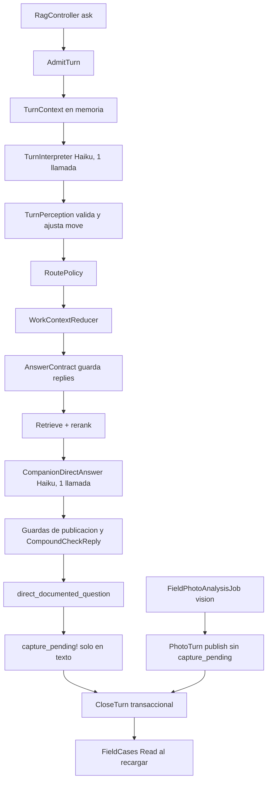
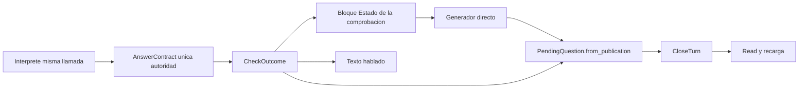

# Rediseño de Danebo Field Companion

Fecha: 19 de noviembre de 2026.
Estado: documento vivo en fase de diseño. No está implementado y no autoriza desplegar ni llamar a producción. Ver [cómo mantener el plan vivo](#7-cómo-mantener-el-plan-vivo).
Base: `32e56ee`. Evidencia: `test/fixtures/files/field_companion/pilot_2026_11_19.json` y `tmp/pilot_exports/2026-11-19_2026-11-19_danebo-pilot-elevator/validation_captures/`. El runner en vivo queda en pausa, incluidos `script/field_companion/run_pilot_elevator_t12.rb`, `stage2_journey_a.rb` y `run_haiku55_http.rb`.

## 1. Cómo viaja hoy un turno

**Decisiones duplicadas** (verificadas en código y trazas):
- **¿Se contestó el pendiente?** Deciden el intérprete (`move`, `part_replies`), `TurnPerception#pending_answer?`/`adjust_move` ([turn_perception.rb](app/services/rag/turn_perception.rb) líneas 1441–1458 y 1596–1602), `WorkContextReducer.open_reply?` en la ruta legacy, `CompoundCheckReply.recover` y `complete_literal_reply`. En Otis T6 y Thyssen T12 del 19 de noviembre, la traza muestra `adjust_move: pending_answer_incomplete` (evento 7) mientras `AnswerContract` guardaba `complete` (evento 9).
- **¿Qué pregunta queda pendiente?** Deciden `direct_documented_question` ([bedrock_rag_service.rb](app/services/bedrock_rag_service.rb) cerca de la línea 2481), `TurnContext#capture_pending!` ([turn_context.rb](app/services/field_cases/turn_context.rb) líneas 58–76) y `CompoundCheckReply.without_redundant_followup`. Los dos primeros cortan la pregunta de forma distinta. `capture_pending!` gana y sintetiza `targets: [{item: pregunta}]` con `document_key` vacío (q4 Otis, q9 Thyssen). La ruta de foto no ejecuta `capture_pending!`.
- **¿Hay que abrir otra comprobación?** Deciden el prompt directo (más de 30 reglas acumuladas en [companion_direct.txt](app/prompts/bedrock/companion_direct.txt)), `referral_note` («indica la siguiente comprobación», [companion_direct_answer.rb](app/services/rag/companion_direct_answer.rb) línea 347) y el filtro léxico posterior.

**Dónde se pierde información:**
- **Interpretación:** una clave escalar extra (`pending_question_note`) invalida todo el turno (`invalid_schema`, Thyssen T11). Solo se descartan como inertes las `*_note` cuyo prefijo es una clave raíz ([turn_perception.rb](app/services/rag/turn_perception.rb) líneas 268–281).
- **Memoria de preguntas:** el episodio guarda un solo `pending_question`. Las respuestas anteriores quedan como `Respuesta r1 a q1.p1 unknown` sin el texto de q1 ([answer_contract.rb](app/services/rag/answer_contract.rb) líneas 178–190). No existe la línea «comprobación activa contestada en este turno» ([companion_case_facts.rb](app/services/rag/companion_case_facts.rb) líneas 108–118 solo lista partes abiertas).
- **Pendiente:** `PendingQuestion.followup_line` recorta a `¿...?` y elimina la condición (Thyssen q9).
- **Foto:** el bloque `Photo Evidence for the active episode` aparece dos veces y solo dice `DEGRADED`. Los residuos sí llegan, pero en la línea `[FOTO]` del historial, sin estructura ([field_photo_observation.rb](app/services/field_photo_observation.rb) `KEYS` descarta `summary`). La nota de referencia cuenta «Turno 4» en el sexto turno porque omite las fotos.
- **Presupuesto de 4 KB:** desde `32e56ee`, una respuesta `complete` puede desplazar contexto. `partial` y `unknown` siguen siendo rechazadas (caso de p3 en Otis del 18 de noviembre).

**Índice:** no es la causa. En Otis T6 y Thyssen T11/T12 se recuperaron y citaron DFC (p. 121), DCL (p. 42) y P28 (p. 9). La evidencia se pierde en la interpretación, el armado del contexto, la generación y la extracción del pendiente. No se proponen cambios de indexación.

**Qué conviene reutilizar sin cambios:** `AdmitTurn`/`CloseTurn` (idempotencia, token, revisión), el esquema `part_replies` con `locate` y offsets, `AnswerContract` (ids, `supersedes`, `contradictory`), `DocumentIdentityScope` con Retrieve y rerank, las guardas de publicación (`CompanionTurnPublication`, `CitationAttributionGuard`, `SourceFidelityGuard`), `ProvenanceSegmenter`, `FieldCases::Read` y el arnés offline (`reduce_and_reload`, `Cassette`, `PilotNov19Rubric`).

**Reglas calcadas del piloto** (los guiones pasan en `32e56ee` gracias a ellas): `CompoundCheckReply` (regex `MANEUVER_CONFIRMED`, `CURRENT_TEST_CLEAR`, «puedes ver el estado de»), `complete_literal_reply` con la frase literal del caso 23, `CompanionDirectAnswer.err14_followup` y `STATED_TEMPERATURE`.

## 2. Qué tomo de Grok y de Codex

- **De Grok:** misma llamada, sin otra pasada de intérprete ni de visión. `episode_delta` con `checks` y `replies`. Una sola proyección visual. Voz primero como salida. Auditoría offline como etapa aparte. **Descarto** `clause_replies` con `asked` como subcadena del texto publicado. Crea una segunda estructura de vínculos paralela a `part_replies` y mide cobertura por coincidencia literal, que falla con la implicación: en el caso 23 T2, «solo la primera vez» cubre «la siguiente abre normal». **Corrijo** «DEGRADED no autoriza residuos»: el resumen visual sí traía residuos. El problema es la procedencia, no el dato.
- **De Codex:** un solo dueño del estado, `unknown` que cierra el intercambio sin cerrar el dato técnico, la regla para abrir otra comprobación y la opción A como punto de partida. **Matizo** «Rails verifica la cobertura»: Rails verifica anclas, ids y procedencia. La cobertura es semántica y la decide el intérprete.
- **Corrección común:** ambos diagnosticaron la corrida del 18 de noviembre. En la del 19, que fija los guiones 28 y 29, el vínculo del intérprete era correcto y los fallos estuvieron aguas abajo.

## 3. Alternativas

- **O1. Conservar el flujo y quitar redundancias puntuales** (Codex A, Grok etapa 1). Reutiliza todo. Elimina el ajuste de `move` y `open_reply?` en la ruta con contrato. No resuelve que el generador ignore el cierre ni que haya dos escritores del pendiente.
- **O2 (elegida). O1 más un objeto de resultado de comprobación único.** `Rag::CheckOutcome` es un PORO determinista de unas 120 líneas, calculado una vez tras el reductor. Lo consumen el contexto del generador, el único escritor del pendiente (texto y foto), la persistencia, la traza y la voz. Elimina `capture_pending!`, `direct_documented_question` como decisión separada y, en la etapa 2, `CompoundCheckReply` y `complete_literal_reply`. Agrega un objeto nuevo, sin migración. El número de llamadas no cambia.
- **O3. Planificación y publicación estructuradas** (Codex B, reactivar `CompanionPlan`). El generador devuelve JSON y Rails renderiza chat y voz. Es lo más verificable, pero reabre una ruta que se retiró por calidad y latencia ([PLAN_EJECUCION_HAIKU55_DIRECTO_20261110.md](docs/field_companion/PLAN_EJECUCION_HAIKU55_DIRECTO_20261110.md)) y requiere reescribir el prompt. Queda como salida si O2 no basta (criterio en la etapa 2).
- **O4. Módulos o puertos y adaptadores, o un `TurnPipeline` explícito.** Mueve código sin corregir ninguna falla observada y sube el costo de pruebas. Lo descarto. El único «puerto» útil es `CheckOutcome` como contrato entre interpretación y publicación.

## 4. Diseño elegido

`CheckOutcome` contiene:
- **Comprobación activa:** id, texto publicado, estado antes y después, `settled_this_turn` y cita del técnico.
- **Datos declarados no verificados o inaccesibles:** checks `not_done` y respuestas `unknown`, con la correlación de cada turno (DCL en T3, T5 y T6).
- **Comprobaciones ya cerradas:** texto reconstruido desde el turno que las publicó, como hace `AnswerContract.reconstruct` con las respuestas. El episodio solo guarda la correlación de publicación.
- **Partes abiertas** y, desde la etapa 2, `missing` por parte.

**Reglas:**
- El `move` sale de lo que `AnswerContract.apply!` guardó, no de una segunda evaluación.
- Un solo escritor del pendiente. Toma la última línea interrogativa completa, con su condición y sin el rótulo («Comprobación:»). Los `targets` salen de las citas `[n]` de esa línea o de su párrafo. Sin citas, no se sintetizan `targets`. Lo usan texto y foto.
- Cuando `settled_this_turn` es verdadero, el bloque del generador lo indica, `referral_note` deja de pedir la siguiente comprobación y la lista de datos no verificados se presenta con la instrucción de no volver a pedirlos.

**Intérprete y conversación** (misma llamada, etapa 2):
- `part_replies[].missing`, opcional y en texto libre: lo que todavía le falta a la comprobación.
- Guía de prompt sin reglas por marca para implicación, alcance de la negación («no X ni Y»), condición compartida, alternativas («A o B») y alcance de la maniobra.
- Correcciones: se mantiene `supersedes`.
- «¿Por qué conviene comprobar X?»: `move: meta`/`follow_up` sin vínculo a la parte, que sigue abierta.

**Pregunta para Fable u Opus (mi respuesta).** Basta con cobertura semántica dentro de la parte, con citas verificables. No hace falta fijar ids de criterio al publicar. En las trazas del 19, el intérprete ya devolvió `complete` correcto en preguntas compuestas, y los fallos fueron aguas abajo.

Los casos que hacen insegura la cobertura, aun con citas válidas, son estos:
- Condición compartida: «con la puerta cerrada y trabada» no aparece en la cita del valor.
- Negación que abarca dos cláusulas: «No llegamos a verificar DCL ni DFC».
- Alternativas («¿se detiene antes o llega al cierre?»).
- Otra maniobra distinta de la preguntada.
- Implicación (caso 23 T2).

Los ids de criterio no resuelven ninguno de esos casos. Todos exigen juicio semántico, polaridad y alcance. Los ids solo ayudan a acumular cobertura parcial entre turnos. **Disparador:** si en los replays autorizados más del 10 % de las comprobaciones compuestas se completa en dos o más turnos, o se reabre una parte cubierta, se agregan ids de criterio al publicar, lo que implica cambiar el publicador.

## 5. Manos libres en la misma conversación

- **Salida (etapa 4):** `response["spoken"]` se arma con Rails desde la respuesta publicada y `CheckOutcome`. Lleva hallazgo o resultado (dos oraciones como máximo), los datos no verificados y la única pregunta. No incluye `[n]`, citas, páginas ni rótulos. Botón grande «Escuchar» con `speechSynthesis` del navegador y lectura automática opcional. La pantalla conserva la burbuja con fuentes, foto y «Ver fuentes». No hay llamada de generación extra, el costo es cero y la latencia es local.
- **Entrada (etapa 5):** botón de pulsar para hablar en el chat, reutilizando la grabación de [voice_dictation_controller.js](app/javascript/controllers/voice_dictation_controller.js) extraída a un módulo compartido. Nuevo endpoint síncrono de transcripción con `SpeechToText::Client` (Groq `whisper-large-v3-turbo`) y `JargonPrompt` ampliado con el vocabulario del caso: identificadores del episodio, alias del manual fijado y términos de la pregunta activa.
- **Corrección de la transcripción:** el texto llega al campo de entrada sin enviarse. Códigos y valores se resaltan (es presentación, no interpretación) y se pueden releer en voz. El técnico envía, edita o vuelve a dictar. Una corrección hablada posterior sigue el contrato normal (`correct` con `supersedes`).
- **Ruido y errores:** grabaciones de 0,8 a 30 s. Si la transcripción viene vacía, aparece «No te escuché» sin enviar. Un error de red permite un reintento local y luego se vuelve al texto. Se guardan el texto bruto y el enviado en `field_turns.attachment["voice"]`, sin audio persistido en esta etapa.
- **Latencia y costo:** Groq agrega 0,5 a 1,5 s y unos USD 0,0002 por clip de 15 s. Amazon Transcribe cuesta USD 0,006 por clip (mínimo de 15 s) y tarda más. Como referencia, hoy la generación toma 6,4 a 10,7 s con 16 000 a 20 000 tokens de entrada. Pendiente de decisión: si Groq, un proveedor fuera de AWS, se acepta para producción. Certificación ya lo usa.

## 6. Etapas y aceptación

Red de regresión: [pilot_nov19_regression_test.rb](test/services/rag/pilot_nov19_regression_test.rb), [pilot_elevator_closure_test.rb](test/services/rag/pilot_elevator_closure_test.rb), [pilot_elevator_t12_test.rb](test/services/field_cases/pilot_elevator_t12_test.rb), [thyssen_ea_measurement_case_test.rb](test/controllers/thyssen_ea_measurement_case_test.rb) y el journey de Haiku 5.5. Se evalúa por significado con `PilotNov19Rubric` y se comprueba el estado tras `reduce_and_reload`. Los casos 22, 26 y 27 completos se agregan como replays con las salidas capturadas.

**Etapa 1. Primer cambio pequeño de punta a punta**, bajo la bandera `FIELD_CHECK_OUTCOME` y sin migración:
1. `prepare_tool` descarta como inerte cualquier clave escalar `*_note` o nula.
2. `Rag::CheckOutcome` calculado en `record_owner_turn!` y guardado en el `TurnContext`. `move` se deriva del informe de `AnswerContract.apply!`.
3. `CompanionCaseFacts#prompt_block` reemplaza las líneas `Respuesta rN a qN.pN` por el bloque «Estado de la comprobación». `referral_note` respeta `settled_this_turn`.
4. `PendingQuestion.from_publication` reemplaza a `direct_documented_question` y a `capture_pending!`, y se llama también desde `PhotoTurn#publish`.
5. `episode_delta` incluye `checks` y `replies`. Se registra el evento `check_outcome`.

`CompoundCheckReply` sigue activo en esta etapa para conservar la paridad.

Aceptación de la etapa 1:
- La salida capturada de Thyssen T11 es válida y guarda `complete` en q8/p8 (hoy da `invalid_schema`).
- Otis T6: `settled_this_turn` para q3/p3. DCL figura como no verificado con sus tres correlaciones. El bloque incluye el texto de q1 y no hay líneas de respuesta sin pregunta.
- Thyssen T12: el pendiente conserva «tras varias maniobras en automático» y no lleva `targets` sintéticos con `document_key` vacío. El cierre sigue sin q9.
- Un turno de foto con pregunta deja el mismo pendiente que el texto equivalente tras recargar.
- Toda la red sigue en verde. Las llamadas por turno no cambian. El bloque del generador no crece más del 3 % en los fixtures.

**Etapa 2.** Cobertura e intérprete, más retiro de reglas léxicas:
- `missing` en `part_replies` y guía de prompt (sección 4).
- Contrato de salida del generador: una sola pregunta, en la última línea, con rótulo fijo. Tras cerrar la comprobación activa, solo se publica otra si esa línea cita `[n]`. Si no, se quita la línea y no se instala pendiente.
- Retirar `CompoundCheckReply` (las dos funciones), `complete_literal_reply`, `open_reply?` en la ruta con contrato, `err14_followup` y `STATED_TEMPERATURE`, cada retiro con su prueba de paridad.
- Prioridad de presupuesto para respuestas `partial` y `unknown`.

Aceptación con dobles: casos sintéticos sin marca (ciclo con tres criterios: completo, parcial con paráfrasis, «sí» ambiguo, desfavorable, contradicción, corrección, otra maniobra, implicación) y los guiones 23 T2, 24 T7, 26 T4, 28 T11/T12 y 29 T5/T6. La calidad del prompt se mide solo con un replay autorizado aparte. **Criterio para pasar a O3:** que persistan pedidos repetidos de datos declarados no verificados o discrepancias entre la pregunta publicada y la guardada.

**Etapa 3. Foto:** una sola proyección con `summary` (300 caracteres como máximo) y su procedencia, sin bloque duplicado. Los turnos de foto cuentan en `referral_note`. Aceptación: 29 T1/T3 conservan COR/CR y los residuos atribuidos a la foto 59. 28 T1 separa los rótulos de EA.

**Etapa 4.** `spoken` y «Escuchar». Aceptación: en 29 T3/T5/T6 y 28 T4/T12, el texto hablado contiene el hallazgo, los datos no verificados y como máximo una pregunta, sin `[n]` ni páginas. Es estable al recargar.

**Etapa 5.** Dictado en el chat. Aceptación: transcripción editable antes de enviar, misma ruta `AdmitTurn`, y texto bruto y enviado trazados. Pruebas del controlador y del servicio con un STT simulado.

**Fuera de alcance:** cambios de indexación, una segunda llamada al intérprete o a visión, listas de equipos por fabricante y el modo «cara a cara» sin pantalla.

## 7. Cómo mantener el plan vivo

Al iniciar cada etapa, leer este documento en su versión más reciente y contrastar sus supuestos y dependencias con el código y el registro de cierre. Distinguir la base histórica de diseño del SHA que se usa para medir la etapa.

Al cerrar cada etapa, registrar aquí el estado, el SHA base y el de cierre cuando esté disponible, las pruebas ejecutadas y su resultado, los hallazgos relevantes y sus referencias. Si un hallazgo cambia un contrato, una dependencia, el orden o un criterio de aceptación, editar directamente cada etapa afectada, incluida la siguiente cuando corresponda, antes de iniciarla. Actualizar también el prompt si cambian las instrucciones de ejecución. Si el hallazgo no afecta etapas posteriores, basta con indicarlo en el registro. Cuando queden pruebas pendientes o una dependencia bloqueada, dejar explícito qué falta y qué etapa queda afectada.

| Etapa y estado | SHA y evidencia | Hallazgo y efecto en etapas posteriores |
| --- | --- | --- |
| 1–5 · Diseño | Base histórica `32e56ee` | Los resultados de implementación se registrarán al cerrar cada etapa. |

## 8. Prompt para ejecutar la etapa autorizada

> Implementa la etapa autorizada del rediseño de Danebo Field Companion. Lee primero `docs/field_companion/DISENO_FIELD_COMPANION_20261119.md` en el HEAD de trabajo, el registro de cierre de las etapas previas y las instrucciones del repositorio. Identifica el SHA real de partida y contrasta el diseño con el código actual. Si el código ya resuelve un punto, reutiliza la solución y actualiza la etapa con evidencia.
>
> Establece la línea base offline de la red de regresión y ejecuta los criterios de aceptación de la etapa. Evalúa la respuesta por significado, procedencia y alcance. Verifica el estado persistido tras recargar donde corresponda. Si aparece una regresión, sigue la traza hasta la primera etapa del turno donde diverge, corrige esa causa y repite las pruebas. Distingue los fallos heredados de los introducidos y separa los resultados con dobles de cualquier validación real del modelo. Mantén las llamadas a servicios en vivo y los despliegues sujetos a autorización explícita.
>
> Antes de dar la etapa por cerrada, actualiza el plan con el estado, las pruebas, los resultados y los hallazgos verificables. Si un hallazgo cambia el trabajo pendiente, corrige en el mismo documento el alcance, las dependencias o la aceptación de las etapas afectadas. Deja el plan listo para continuar desde ese punto.
