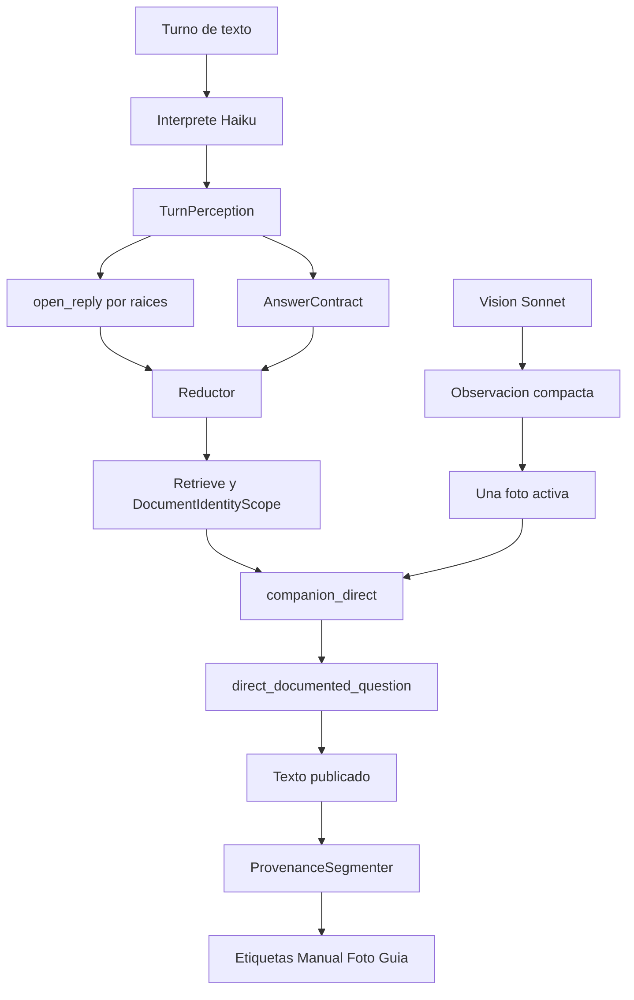

# Contrato de turno, evidencia y lectura en terreno

Fecha: 18 de noviembre de 2026.
Estado: plan de revisión. No está implementado y no autoriza desplegar ni llamar a producción.
Base: `main` en `dcd56e5f448d709097604543065859529b637917`.
Fase de diseño. No se implementa ni se llama a producción hasta la revisión de Codex. Pruebas en Minitest, con el intérprete y el generador guionados, como en [test/controllers/thyssen_ea_measurement_case_test.rb](test/controllers/thyssen_ea_measurement_case_test.rb).

## Diagnóstico verificado

La corrida Otis está en `tmp/pilot_exports/2026-11-18_2026-11-18_danebo-pilot-elevator/report.json`, `source_events.jsonl` y `validation_captures/`, escritos a las 21:08. `report.txt`, `manifest.json`, `valor.json`, `dossier.html` y `SHA256SUMS` siguen siendo el paquete de las 18:59.

Web y worker estaban en `dcd56e5`, que es HEAD. Ese commit desciende de `60275c5` (la pregunta conjunta de resultado en [app/prompts/bedrock/companion_direct.txt](app/prompts/bedrock/companion_direct.txt)), de `c492575` (cerrar +110 Vcc cuando el técnico mide 0 Vcc) y de `3447e9a` (más espacio al intérprete para varios hechos). `dcd56e5` cambia la lectura citada y la identidad del documento, no el cierre del pendiente. `query:c6db0bf4-8829-4ec2-9145-8f639970b119` no está en el export, en el repo ni en los docs. La comparación con el SHA exacto de ese replay queda pendiente. El fixture local de Thyssen es otro id, `query:9d205620-1cfb-473d-93f6-3718412fe359`.

`open_reply?` se ejecutó en local contra el pendiente y el texto de T7 (`query:794be5dd-0519-4be5-95bb-8964aafcddc8`). La compuerta está en [app/services/rag/work_context_reducer.rb](app/services/rag/work_context_reducer.rb) líneas 209-216, y [app/services/rag/turn_perception.rb](app/services/rag/turn_perception.rb) líneas 1404-1407 y 1545-1547 la convierten en `pending_answer_incomplete`.

- El turno completo, el turno sin «No verifiqué DCL» y la cita de las tres cláusulas devuelven `false`.
- La pregunta copiada de forma literal devuelve `true`. La misma frase más «No verifiqué DCL» también devuelve `true`.
- Una paráfrasis de tiempo («completó», «encendió», «mantuvo», «volvió») devuelve `false`.
- `datum_parts` descarta palabras de menos de cuatro caracteres. DCL no entra en las entidades. No disparó la decisión.
- «el 0102 no vuelve a aparecer» devuelve `true` frente a «vuelve a aparecer», porque «no» es una palabra vacía. El cierre por raíces no ve la polaridad.

Haiku sí devolvió `answer_pending`, `pending_resolution: value` y una cita que cubre cierre, DFC y ausencia de 0102. Marcó la única parte `p4` como `partial` y dejó DCL como observación. `AnswerContract` trata `partial` como abierto (`SETTLED` es `complete` y `unknown`). Confiar en ese `partial` tampoco cerraría T7. La pregunta se guardó como una sola parte `main` en [app/services/rag/answer_contract.rb](app/services/rag/answer_contract.rb) `stamp!`, y [app/services/rag/pending_question.rb](app/services/rag/pending_question.rb) `contract_parts` conserva una parte por rol.

Lo que sí se conserva y no se reabre: el manual fijado 192/193, el 0102 dicho por el técnico, la foto 56 en el mismo episodio, la separación entre código y causa en T5, la pregunta conjunta de T6, y la prosa que no da el equipo por bueno. Cerrar la maniobra pedida sigue siendo distinto de resolver la falla o autorizar la puesta en servicio.

## Qué se pierde hoy

- El intérprete y `open_reply?` deciden lo mismo por caminos distintos. En T7 el primero dijo `answer_pending` y el segundo lo bajó a `report`.
- La lectura visual guarda componente, condición, rótulos, `target_visible` y relevancia. El resumen y las notas de incertidumbre no entran en [app/services/field_photo_observation.rb](app/services/field_photo_observation.rb). `photo_vision_raw` no existe en el worker de producción. En T2 el bloque de la foto 55 aparece dos veces y recorta a cuatro rótulos. En T5 el bloque de la foto 56 solo dice `DEGRADED`; el borrador añadió residuos.
- `DocumentIdentityScope` separa otro equipo. No separa, dentro del PDF de Otis fijado, la tabla del 0102 de la rama condicional de puerta PAX / LCB_II. No se agrega una lista de equipos.
- [app/services/rag/active_episode_turn.rb](app/services/rag/active_episode_turn.rb) `changed_fields` omite `checks` y `replies`. El delta de T7 muestra el pendiente nuevo y esconde que el `not_done` «DCL ni DFC» no se movió.
- [app/services/rag/causal_trace.rb](app/services/rag/causal_trace.rb) marca la foto como `mixed` en cuanto el prompt contiene el bloque. Esa marca no distingue lectura, inferencia y publicación.
- [app/javascript/rag/answer_presenter.js](app/javascript/rag/answer_presenter.js) antepone «Manual», «Foto» y «Guía Danebo» a cada grupo. [app/javascript/controllers/voice_dictation_controller.js](app/javascript/controllers/voice_dictation_controller.js) graba dictados de certificación. El chat no tiene voz. No hay backend Node: la orquestación está en los servicios Rails y el JS solo presenta.

No hace falta otra llamada. Enriquecer la herramienta actual del intérprete agrega unos cientos de tokens de salida en la misma ida a Haiku. Una segunda llamada repetiría el turno y el pendiente, sumaría otro viaje y no aporta un dato que el intérprete no pueda devolver ahora. La visión no se vuelve a llamar en T5.

## Contrato mínimo

La misma llamada `turn_perception` puede devolver `clause_replies`. Cada ítem trae `asked` (substring literal de la parte publicada), `quote` (substring literal del turno) y `state`: `complete`, `partial`, `unknown` o `contradictory`. Un dato que no responde ninguna cláusula sigue en `observations`. Si el técnico dice que no verificó algo ajeno a la pregunta, puede ir como respuesta con `part_id` nulo y `state: unknown`; Ruby le asigna id y no cambia las cláusulas ya contestadas.

Ruby solo comprueba ubicación, con `TurnPerception.locate`. No interpreta marca, código ni tiempo verbal. La pregunta queda contestada cuando los `asked` cubren el texto publicado, cada cláusula está `complete` o `unknown`, y ninguna está `partial`, `contradictory` o rechazada. Si faltan `clause_replies`, si una cita no se ubica o si el modelo no cubre el texto, la pregunta sigue abierta. No se cierra por defecto y no se vuelve a `open_reply?` para esa pregunta.

`open_reply?` queda para un turno que no trae cláusulas. El fixture de Thyssen entra por ahí: `part_replies` vacío, 0 Vcc frente a +110 Vcc, y la pregunta siguiente por A4+ sigue citada. Un turno Otis guionado, con tres cláusulas `complete` y DCL en observaciones, cierra la maniobra y no crea el pendiente de varios cierres.

Entrada de T7, abreviada: pendiente «cierre, DFC se mantiene y el 0102 vuelve»; turno con las tres confirmaciones y «No verifiqué DCL». Salida esperada: tres cláusulas `complete` con citas literales, observación de DCL, movimiento `answer_pending`, checks previos de 0102 `done` y DFC separado de DCL. DCL permanece `not_done`. El reductor no parte la frase vieja «DCL ni DFC» por token; solo la reemplaza si el intérprete manda un `supersedes` con cita ubicada. Si no lo manda, el check viejo queda y la traza lo muestra.

El generador resume, conserva lo no verificado y puede preguntar un paso nuevo. Quien cierra es el reductor. Quien persiste la pregunta nueva es `direct_documented_question`. Si este turno acaba de cerrar la comprobación, una pregunta sin cita literal no se guarda ni se publica. Una pregunta con cita de otro pasaje, como A4+ en Thyssen, sí. El pendiente `q5` de Otis quedó con `document_key` vacío; Codex debe confirmar qué escritor borró la fuente antes de fiarse de esa guarda.

La evidencia visual que recibe el generador es una sola proyección: id de foto, rótulos, condición, `target_visible`, relevancia y las notas que hoy se descartan, con el tope que ya tiene la observación. `DEGRADED` no autoriza «polvo» ni «óxido». COR y CR se conservan aunque el 0102 no esté en la pantalla. La segunda foto sustituye la foto activa y guarda su propio id.

## Presentación y voz

Un resultado de turno, dos lecturas. [app/services/rag/provenance_segmenter.rb](app/services/rag/provenance_segmenter.rb) ya parte la respuesta sin otro modelo. La pantalla muestra el texto, las citas y el aviso de verificación. La voz lee el hallazgo, la condición que cambia el paso y una sola pregunta. No lee «Manual», «Guía Danebo», páginas ni la cita completa. Esas quedan en pantalla y bajo petición.

Alcance 1, primero: el servidor arma también `spoken_text` desde los segmentos. El chat puede leerlo en voz alta. No pide micrófono ni un controlador nuevo. Sirve para los tres momentos: observación nueva, corrección y cierre.

- Otis T1, en voz: «En la pantalla se lee COR y CR. No es el 0102 del historial. ¿Qué código muestra el historial?» En pantalla queda la cita de la rama LCB_II con su condición, no como primer paso.
- Otis T5: «La guía del umbral figura degradada. Eso no explica el 0102.» Sin residuos.
- Otis T7: «La puerta cerró, el DFC se mantuvo y el 0102 no volvió. DCL sigue sin verificar. Una maniobra no deja el equipo dado por bueno.» Sin «varios cierres».
- Thyssen T4: «0 Vcc en RA-53/P28 no coincide con +110 Vcc. Con la puerta cerrada y trabada, esa confirmación no llega. ¿Qué tensión lees en RA-30/A4+?» La condición de puerta cerrada se oye. La función en portugués queda en pantalla.

Alcance 2, después: dictado en el chat, con interrumpir, repetir y pedir la fuente. Agrega permiso de micrófono, `MediaRecorder` y un controlador Stimulus del chat. El de certificación no se reutiliza: sube un audio a un informe, no conduce el turno. Mismos textos de voz; lo nuevo es el control, no otra respuesta.

## Etapas

1. Contrato intérprete–reductor. Archivos: [app/services/rag/turn_perception.rb](app/services/rag/turn_perception.rb), [app/services/rag/work_context_reducer.rb](app/services/rag/work_context_reducer.rb), [app/services/rag/answer_contract.rb](app/services/rag/answer_contract.rb), [app/services/rag/active_episode_turn.rb](app/services/rag/active_episode_turn.rb). El delta incluye `checks` y `replies`, y el motivo `clause_settled`, `clause_open` o `legacy_open_reply`. Se elimina la doble decisión solo cuando hay cláusulas. `open_reply?` sigue para Thyssen. Prueba: T7 guionado cierra las tres cláusulas con DCL abierto; una paráfrasis fiel cierra; una parcial y una contradictoria no cierran; omitir cláusulas no cierra; Thyssen T4 sigue cerrando 0 Vcc y preguntando A4+. Caso sintético, sin marca: «el contactor actuó, el contacto auxiliar no, y no medí la bobina» frente a una pregunta de tres cláusulas.
2. Misma llamada, prompt y esquema del intérprete. Sin desplegar hasta un experimento offline sobre el texto congelado de T7 y un turno Thyssen. Coste: tokens de salida de las cláusulas. Si el modelo omite o contradice las citas, la etapa 1 deja la pregunta abierta.
3. Pregunta siguiente. [app/services/bedrock_rag_service.rb](app/services/bedrock_rag_service.rb) `direct_documented_question` no instala ni publica una pregunta sin cita cuando la comprobación acaba de cerrarse. Conserva la pregunta citada de otro punto. Depende de la etapa 1.
4. Una sola evidencia visual. [app/services/rag/active_photo_context.rb](app/services/rag/active_photo_context.rb) y la observación persistida. El prompt de T2 deja de duplicar el bloque. Una frase enmarcada como foto que no contiene un campo de esa observación se retira en publicación, reusando el segmentador. Una traducción fiel de la condición se acepta con el criterio de `1949f9e`, no con una lista de residuos. COR/CR pueden publicarse con el objetivo no visible.
5. `spoken_text` en la respuesta del chat, a partir de los segmentos. Sin micrófono. La prueba compara chat y texto hablado en T1, T5, T7 y Thyssen T4, y al reabrir el episodio.
6. Manos libres, solo si el texto de la etapa 5 ya se entiende sin mirar la pantalla.
7. Auditoría fuera del turno, leyendo el export. Reconstruye visión, bloque recibido, publicación y estado. En Otis señala ilegible con rótulos presentes, residuos ausentes del bloque, y el pendiente de varios cierres. En Thyssen no señala el cierre de 0 Vcc ni la pregunta de A4+.

Aplicabilidad dentro del PDF fijado queda fuera de la etapa 1. No hay lista GECB/PAX. La rama citada se publica con su condición, usando el completado de citas condicionales que ya existe. Codex verifica si T1 citó la condición de LCB_II o solo el paso.

## Qué va primero

La etapa 1. Quita la decisión duplicada que convirtió T7 en `report` y es el punto común de Otis y Thyssen. La voz no corrige un resultado equivocado; se apoya en este contrato. El alcance 2 espera. La comparación del SHA `c6db0bf4` espera a que aparezca esa corrida.

Criterios de aceptación, en los tres planos: significado (tres confirmaciones cierran la maniobra y no la falla; DCL sigue abierto; degradada no es residuos; COR/CR no es 0102), procedencia (rótulo de la foto, frase del técnico, cita literal, inferencia no publicada) y estado tras recargar (pendiente saldado o el mismo pendiente, checks separados, foto activa, `spoken_text` estable). Continuidad: reabrir el episodio no pide otra vez la maniobra ya contestada. Comprensión sin pantalla: el texto hablado dice el hallazgo, la condición y una sola pregunta, y no dice las etiquetas ni la página.

## Encargo para Codex

Contrasta este plan con `dcd56e5` y con la captura `36a0e340-3670-4a8a-a1c9-7551acc15fd6` antes de implementar. Comprueba que `open_reply?` rechaza la paráfrasis de T7 y acepta la literal más DCL. Revisa que `AnswerContract` no puede guardar tres partes `main`. Confirma qué escritor dejó vacío el `document_key` de `q5`. Verifica que el fixture Thyssen sigue cerrado por el camino sin cláusulas y que A4+ sigue publicado. No apruebes una excepción por DCL, una lista de equipos, una segunda llamada de visión o de interpretación, ni el dictado de certificación como entrada del chat.
