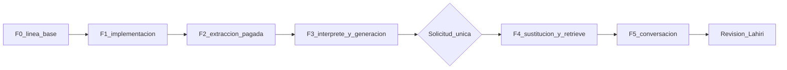

# Corrección y validación del companion sobre el VF5

Documento vivo. Grok 4.7 lo ejecuta tras la orden de ejecución, y actualiza este mismo archivo al cerrar cada fase. No se abren planes secundarios. Redactar o revisar este archivo no implementa, no llama modelos y no modifica S3, la KB ni los ledgers.

## Objetivo y alcance

Conseguir, por la ruta normal y sobre artefactos corregidos del VF5, una primera orientación pertinente con pocas preguntas, documentación aplicable, caso conservado y distinción entre observación, comprobación, hipótesis y pendiente. El criterio sale del guion [Danebo guion intuitibilidad.pdf](/Users/lahirisan/Downloads/Danebo%20guion%20intuitibilidad.pdf). Sus diálogos son ilustrativos. Los comentarios de Gonzalo son requisitos de producto: el primer mensaje debe bastar, una o dos intervenciones, y nada que no tenga relación con la falla. No son procedimientos del fabricante.

El VF5 es la muestra para corregir mecanismos generales. No se añaden reglas de este manual ni se declara válida la biblioteca. Se conservan las capacidades ya demostradas: foco, continuidad de episodio y corrección del LED.

Dentro de este ciclo:

- Ingesta: instrucción por página, texto de página en la fusión, procedencia de lo movido entre páginas, cobertura determinista y sustitución acotada del prefijo del VF5.
- Caso: estado de comprobaciones en el episodio, ampliando la misma llamada del intérprete.
- Generación: contexto de avería sin bloques de plano y sin la contradicción de formato.
- Validación por capas, de menor a mayor costo, sobre los artefactos que cada capa produce.

Fuera de este ciclo (siguen en [docs/PLAN_FIELD_COMPANION_CONVERSACION_2026-10-07.md](../PLAN_FIELD_COMPANION_CONVERSACION_2026-10-07.md)): orden 3 (plano Elemont, `EPISODIO_VALIDADO`), órdenes 4 y 5 (fotos, cambio de tema y retorno), selección automática por foto o código, rescate, escalamiento a ingeniería y cierre ante Gonzalo. Los hábitos generales de Gonzalo (serie de seguridad, reinicio de 380 V y 220 V, puertas abiertas en falla) no se codifican: no están en el pasaje VF5 y no autorizan una maniobra. Reprocesar otros manuales ya indexados tampoco entra.

Este documento sustituye, solo como ruta de ejecución del orden 2 textual, los replays de fidelidad, continuidad, sección 5.6, Haiku contra Sonnet y partición system/user; la matriz de siete turnos; y los párrafos de «siguiente acción» del orden 2 que apuntan a ellos. No sustituye el archivo padre, sus evidencias ni sus aceptaciones parciales.

## Estado inicial

Verificado el 21 de octubre de 2026 en la revisión de Opus:

- `HEAD` y `origin/main`: `f8d70b7d404c40a9c60909f55f4d829ddbfeb071` (commit de este plan sobre `b5fba1c`). Cinco rutas sin seguimiento del experimento system/user: `app/services/rag/vf5_system_role_admission.rb`, `app/services/rag/vf5_system_role_comparison.rb`, `script/field_companion/vf5_system_role_comparison.rb`, `test/fixtures/files/field_companion/vf5_bound_20261020T1728Z/` (solo `b0005.txt`) y `test/services/rag/vf5_system_role_admission_test.rb`. Ningún archivo seguido las referencia. `RAG_DOCUMENT_IDENTITY_SYSTEM_ROLE` queda apagado; la ruta normal arma un solo mensaje `user`.
- PDF [docs/field_companion/fuentes/VF5.pdf](fuentes/VF5.pdf): SHA-256 `be7a39a3490c92c8381cb883402760cb07d10b0a3beda5348bed22f72abedf72`, 22 páginas, con capa de texto en todas. La portada no imprime folio. PDF 2–22 imprimen «Pág. N / 21», N = 1–21. `SectionPageContinuity::PRINTED_PAGE` ya lee esa forma.
- Artefactos vivos del VF5, según los 30 sidecars copiados en `tmp/review_vf5/` (30 cuerpos y 30 sidecars, 112 `FIELD_RECORD`): `account_id` 1, `document_id` `be7a39a3490c92c8381cb883402760cb07d1`, `ingestion_path` `manual_batch_v1`, contrato `field_records_v8`, `original_source_uri` `s3://multimodal-source-destination/bulk_uploads/1/2026-08-31/VF5.pdf`, sin `topology_edge_count`. Prefijo derivado por `BatchResultsParserService::CHUNK_PREFIX_TPL`: `bulk_chunks/1/be7a39a3490c92c8381cb883402760cb07d1/`. No hay chunk de la página 3.
- Ledger de asignación `tmp/field_companion/vf5_generator_benchmark/assignment_spend.json`: 70 intentos, US$0,945161 comprometidos, `open: {}`, `unknown` 0, topes 96 y US$4. Última entrada: 2026-10-21T01:08:09Z.
- Evidencia de referencia: informe de Codex y revisión de Opus del 21 de octubre, captura `vf5-bound-20261020T1728Z`, sonda local de p5 y p13 en `tmp/field_companion/local_ingestion/` (Sonnet 5.5 directo, 2849/5859 y 3140/5937 tokens). Con el prompt de sistema actual, p5 ya salió sin el encabezado S4 y sin la nota inventada, y p13 conservó su apertura. Esa sonda no certifica ingesta, índice ni recorrido.

Código que sostiene la dirección:

- El total de la instrucción es el número de páginas conservadas, no el del PDF: [bulk_cost_v2_request_builder.rb](../../app/services/bulk_cost_v2_request_builder.rb) y [manual_batch_ingestion_service.rb](../../app/services/manual_batch_ingestion_service.rb) (`total = kept_pages.size`), [single_file_chunking_service.rb](../../app/services/single_file_chunking_service.rb) (`kept_pages.size`), [batch_page_retry_service.rb](../../app/services/batch_page_retry_service.rb) (`total_kept`) y [batch_chunking_prompt.rb](../../app/prompts/batch_chunking_prompt.rb) (`Page N of M`). El p14 histórico dice que «el contenido de esta página (p. 14/21) no ha sido transmitido» y añade un 9.5 que la página no imprime. Ese es el conflicto esperado entre índice y folio. Sigue siendo una hipótesis: la cobertura es obligatoria aunque falle.
- `ChunkMergerService` solo llama a `SectionPageContinuity` si recibe `page_texts`. Ningún llamador normal se los pasa: [ingest_batch_results_job.rb](../../app/jobs/ingest_batch_results_job.rb), [ingest_manual_batch_results_job.rb](../../app/jobs/ingest_manual_batch_results_job.rb) y [single_file_chunking_service.rb](../../app/services/single_file_chunking_service.rb). `release_internal!` borra `_page`, así que el parser renderiza un registro movido con la página del chunk que lo recibe. `PageChunkFidelity.strip_running_matter` reconoce cabeceras con patrones de este manual («Módulo electrónico», `DOC-…`). En otro manual, la cabecera impide detectar la apertura a media lista.
- El prompt de sistema de extracción ya prohíbe añadir encabezados o notas, ya exige conservar la apertura literal y ya mantiene los ejemplos como ejemplos (`BatchChunkingPrompt`, reglas de apertura, de etiquetas S y de ejemplos). La instrucción de usuario no debe repetirlo.
- La deduplicación es `(cuenta, SHA-256, field_records_v8)` ([content_dedup_service.rb](../../app/services/content_dedup_service.rb)). Volver a subir el PDF no re-parsea. [script/AGENTS.md](../../script/AGENTS.md) prohíbe subir `INGESTION_CONTRACT_VERSION` para sortearlo.
- `BatchResultsParserService#call` con `ingestion_path: "manual_batch_v1"` valida el JSON, exige `account_id` y `document_uid`, borra el prefijo con `S3DocumentsService#delete_prefix` y lo reescribe como `chunk_p<página>_<n>.txt` y sus sidecars. Tanto el borrado como la escritura invalidan `SectionNeighborExpander`. Un fallo del borrado solo deja un aviso, así que pueden quedar claves sobrantes.
- La sincronización de la KB es `start_ingestion_job` sobre la fuente de datos, como en [script/patch_elemont_chunk_p5_1_botonera_branch.rb](../../script/patch_elemont_chunk_p5_1_botonera_branch.rb). La fuente abarca todo `bulk_chunks/`, no un documento: el job es incremental, pero recoge cualquier otro cambio pendiente del bucket.
- Turno web con identidad conocida, pin y modo `owner`: una llamada de intérprete (`TurnInterpreter`, hasta 3 intentos solo ante error transitorio) y una `generate_text`. `Retrieve` va aparte. `RagRetrievalProfile::PINNED_DOCUMENT_RESULTS = 3`. La consulta compuesta cabe en 442 caracteres (`FollowupQueryRewriter::MAX_COMPOSED_CHARS`).
- `TurnPerception` ya devuelve `observations` como fragmentos literales del turno, e `InterpreterPayloadContract` rechaza lo que no es literal. `WorkContextReducer` ya sustituye y recorta observaciones corregidas. `SessionContextBuilder` las muestra en `## Active Field Problem`, con topes de caracteres.
- Generación: `generation.txt` pide «Use at most three logical sections» y `web_delivery_channel_directive` pide «No headings or section titles». Las reglas de `TOPOLOGY_EDGE` de `generation.txt` y las viñetas de plano y etiquetas de `DOCUMENT_IDENTITY_ATTRIBUTION_CONTRACT` («Según el plano», distinguir dos etiquetas) entran en cada turno de identidad, haya o no un plano. `FIELD_REPORT_PARAGRAPH` ya prohíbe cerrar una comprobación no reportada y jerarquizar causas sin respaldo; la captura lo incumplió. Más prosa de reglas no es la corrección.
- Caso nuevo: si el intérprete devuelve `new_work`, `ConversationSession` abre un episodio nuevo en la misma sesión, y `start_new_case!` conserva los pins (`pins_after = pins_before`). `field_companion:start_clean_case` es un reinicio operativo: además vacía `document_focus` y `active_entities`, y con ellos el pin.
- Control de gasto real: `LocalPassLedger` (con `RAG_LOCAL_PASS_GUARD=1`, topes de proceso, `AWS_MAX_ATTEMPTS=1` y base local) protege las llamadas de `BedrockClient` antes del SDK. Con `RAG_ASSIGNMENT_SPEND_PATH`, además reserva en el ledger acumulado de 96 intentos y US$4. El filtro Haiku (`PageRelevanceFilter`) y la extracción (`ClaudeChunkingClient`) van a la API de Anthropic sin ese guardia. Sus clientes se crean con los reintentos por defecto del SDK, y `ClaudeChunkingClient` reintenta además dos veces ante un *overload*. Ambos clientes se pueden inyectar (`haiku_client:` y `client:`). `TrackBedrockQueryJob` escribe `bedrock_queries` de forma asíncrona: en local solo aparece si corre un worker.

## Archivos experimentales: se conservan, fuera de alcance

Los cinco archivos sin seguimiento se conservan en su sitio, con su contenido. No se borran, no se mueven, no se modifican y no se commitean. Primer paso del ejecutor:

1. Añadir las cinco rutas a `.git/info/exclude`. Es local y no se commitea. Así no aparecen en `git status`, y un `git add` por directorio no las recoge.
2. Commitear solo con rutas explícitas (`git add <ruta>`), nunca con `git add -A` ni `git add .`.
3. Correr la suite solo con los tests seguidos: `bin/rails test $(git ls-files 'test/**/*_test.rb')`. El test experimental no entra en la señal de este ciclo. Si un cambio de este ciclo lo rompe, se anota y no se toca.

La hipótesis system/user ya se cerró: tres controles y tres tratamientos del primer mensaje fallaron, y el tratamiento añadió una maniobra no autorizada. Sus respuestas y su ledger están en `tmp/field_companion/vf5_system_role/` y en `assignment_spend.json`. No se restaura ese arnés y su `RESERVE_CALLS = 15` no rige en este plan.

## Decisiones

1. **Dirección.** Alineación selectiva del pipeline existente. No basta reparar la página 12. No hay contrato nuevo ni verificador universal.

2. **Semántica del caso.** `#21` pertenece a «La puerta se abre pero no se cierra» (PDF 12, impresa 11, sección 8.2), junto con el LED, `#8` y `#12`. «La puerta se re-abre sola» tiene tres comprobaciones: sensibilidad `#54`, fotocélula no activada y ausencia de obstrucción mecánica. Su continuación condicional abre la PDF 13: «En caso que el problema persista, desconectar la fotocélula…». El chunk de p12 debe contener `#21` bajo su síntoma. La respuesta del caso «se reabre sola» no lo presenta como paso de ese síntoma. La disyunción del LED está en 5.6 (PDF 7): fotocélula o entrada de reapertura. Se usa cuando ese pasaje está en el contexto. La inversión conocida de `#8` y `#12` frente a las secciones 4 y 5.2 no rechaza este ciclo.

3. **Instrucción por página.** `page_user_content` dice solo lo que el sistema no dice: el documento adjunto es exactamente la página a extraer; su número es el índice del PDF; el total es el número de páginas del PDF, no el de páginas conservadas; el folio impreso puede diferir del índice. Los cuatro llamadores (los tres de ingesta y `BatchPageRetryService`) pasan el total del PDF. Las reglas de apertura, encabezados y ejemplos siguen solo en el prompt de sistema. `INGESTION_CONTRACT_VERSION` no cambia.

4. **Texto de página y procedencia.** El texto de página es el que ya extrae la ingesta con `PDF::Reader`: `SplitPage#text` de `PdfPageSplitterService`, o `PageRelevanceFilter.extract_page_text` si la página no lo trae. Se obtiene una vez por página y por proceso, y lo usan la fusión y la cobertura. En la ruta síncrona y en el envío por Batch ya está en memoria. Los jobs de resultados Batch corren en otro proceso: lo re-extraen una vez del PDF fuente, con el mismo extractor y la misma descarga que ya usa `BatchPageRetryService`. No se guarda en S3 ni en argumentos de job.
   - El texto movido a la página anterior conserva en el cuerpo las marcas `[PDF_PAGE]` y `[PRINTED_PAGE]` que `SectionPageContinuity` ya escribe.
   - Los registros movidos guardan su página en un campo real (`source_pdf_page`) que el parser renderiza. El campo interno `_page` desaparece.
   - El `page_number` del sidecar sigue siendo uno por chunk, porque Bedrock lo filtra como valor único. Una cita del texto movido apunta a la página del chunk y la marca en línea la precisa.
   - El folio se lee con `PRINTED_PAGE`. Si la página no imprime un folio con esa forma, la marca se omite. Nunca se calcula folio = índice − 1.
   - Cabecera y pie: las líneas que se repiten en al menos la mitad de las páginas (y en un mínimo de tres) se tratan como texto corrido, calculado sobre el `page_texts` del documento. Esta regla sustituye los patrones propios del VF5 de `strip_running_matter`. El patrón general de folio se mantiene.

5. **Cobertura: qué verifica y qué no.** Reutiliza las funciones de alineación de `Rag::PageChunkFidelity` (normalización, `aligned_line?`, comprobación de `EVIDENCE` en la página). Se añade ahí, no en una clase nueva. No lee el PDF. Mide cuatro cosas:
   - **Contabilidad:** toda página tiene un chunk o un descarte registrado en memoria y en el informe local. Nada se escribe bajo `bulk_chunks/`. Una página sin chunk ni descarte es un defecto. Un descarte prueba que la página quedó contabilizada, no que su contenido sobrase.
   - **Precisión**, por página y antes de fusionar: proporción de tokens significativos de la narrativa que están en esa página. Quedan fuera la cabecera de identidad, el chunk S0 de la página ancla y el bloque de registros.
   - **Líneas añadidas:** líneas de narrativa sin alineación con la página. Así se detectan un encabezado inventado o una nota.
   - **Recall**, después de fusionar: la apertura de la página y sus números e identificadores (`#21`, `0,12`, tensiones) aparecen en sus chunks o en lo movido con `source_pdf_page`.

   **Gate de producción (ruta normal).** Solo contabilidad y precisión. Un cuerpo con precisión muy baja no se indexa: cubre la página «no recibida» y el contenido inventado sin buscar frases. Se reintenta una vez a la misma cota de tokens, dentro de la escalera existente: `call_with_page_cap_retry` en la ruta síncrona y `BatchPageRetryService` en Batch. Si sigue mal, queda la marca de página degradada que ya existe (`ChunkMergerService::DEGRADATION_MARKER`). Recall y líneas añadidas solo se informan: bloquear por ellos destruiría contenido útil ante cualquier desorden de la capa de texto.

   **Criterio de este ciclo.** Para el VF5, los cuatro controles tienen que salir limpios en las páginas que se certifican.

   **Límites declarados.**
   - Sin capa de texto (página escaneada): continuidad y cobertura no verifican. Solo se exige contabilidad, y el informe marca la página como «no verificable».
   - Medidas por presencia: no detectan un cruce de columnas ni el orden de una tabla. Por eso p6 y p22 se leen contra `pdftotext -layout` y la imagen de la página.
   - No se aplica `PageChunkFidelity.correct` en la ingesta. Reescribiría tablas con la capa de texto, y ese riesgo no está medido.

6. **Ejemplos.** `promoted_example?` se mide sobre los 112 registros históricos. Se ajusta solo si descarta un registro que no es un ejemplo. La regresión de ese ajuste es el caso ya visto de la salida FOTOCÉLULA.

7. **Estado del caso: misma llamada, validación determinista.** No se añade un clasificador por reglas. Interpretar «no he mirado el 54», «ya revisé la fotocélula y nada» o «sin mediciones» con reglas de negación en español duplicaría el intérprete, dependería del idioma y competiría con la maquinaria de correcciones literales que el reducer ya tiene.
   - El tool `turn_perception` gana un arreglo `checks` con elementos `{subject, status, result}`. `status` es `done` o `not_done`. `subject` es un fragmento literal del turno. `result` es literal o `null`.
   - `InterpreterPayloadContract` valida la literalidad, el enum y los topes. Un payload sin `checks` equivale a `[]`, para que los fixtures existentes sigan siendo válidos.
   - Observación y comprobación quedan separadas. Una observación es lo que el técnico vio o no vio, con su negación literal («no veo obstrucción»). No implica una comprobación ni la crea. Una comprobación es algo que el técnico dice haber hecho o no haber hecho, con su resultado si lo da. «Sin mediciones» es `not_done`.
   - Lo pendiente no se guarda: es toda comprobación documentada que no figura como `done`. El modelo lo deduce del pasaje y del bloque de estado, sin que el estado enumere el manual.
   - El reducer guarda `checks` en el episodio con topes pequeños (6 elementos y 120 caracteres orientativos), dentro de `MAX_BYTES`. Son lo primero que se recorta después de los conflictos.
   - Un `subject` igual, según la normalización existente (`FollowupQueryRewriter.normalize_label` / `ObservationText`), sustituye al anterior: un resultado posterior o una corrección reemplazan el estado. `new_work` abre un episodio sin `checks`.
   - `SessionContextBuilder` añade una línea por comprobación dentro de `## Active Field Problem`. No hay bloque nuevo.
   - Identificadores: diferido, no resuelto. No se aplica la regla que dejaría fuera un span de dos o tres palabras sin dígito, sin `#` y que no sea un código en mayúsculas. Esa redacción también quita nombres que el episodio ya guarda. El almacén conserva el comportamiento anterior. Evidencia e impacto: ejecución de F1-B. F3 anota, dentro de las pruebas ya previstas, si «Modo esclavo» guardado como identificador afecta al estado o a la respuesta.

8. **Prompt y contexto de avería.** No hay llamada de clasificación nueva.
   - Las reglas de `TOPOLOGY_EDGE` de `generation.txt`, las viñetas de plano y etiquetas de `DOCUMENT_IDENTITY_ATTRIBUTION_CONTRACT` y `literal_label_rules` entran solo si se cumple una de estas condiciones: algún chunk seleccionado trae un registro `TOPOLOGY_EDGE` o una sección de diagrama o tabla de etiquetas; el turno o el objetivo del episodio pide un plano, esquema o etiqueta. La decisión depende de la evidencia y del caso, no solo de las palabras del turno, y no impide consultar un esquema cuando hace falta.
   - Sin plano, la viñeta de información documentada queda en su forma general: lo que el cuerpo recuperado respalda, con [n], y la advertencia de que `ACTION` y `EXPECTED_RESULT` son anotaciones de extracción.
   - Se elimina «Use at most three logical sections». En web manda la directiva de canal: prosa, sin títulos.
   - `FIELD_REPORT_PARAGRAPH` no cambia. El bloque tipado le da los datos que antes faltaban. No se añade otra lista de prohibiciones.
   - Menos caracteres no garantiza menos tokens ni más fidelidad. Ambas cosas se miran con el `usage` de las llamadas que ya se hacen.

9. **Recuperación.** No se toca salvo evidencia. Tras sincronizar, un `Retrieve` de solo lectura usa la consulta compuesta del primer turno de la captura, el filtro de pin por la URI original, k = 3 y sin rerank, y guarda request, score, URI y cuerpo.
   - Si el 8.2 corregido está entre los tres primeros, no se cambia nada.
   - Si falta, se repite con k = 5.
   - Si falta y la consulta salió truncada sin el síntoma, el candidato es `QueryComposer`.
   - Si el pasaje está en las posiciones 4 o 5 con la consulta íntegra y el síntoma nombrado, el cambio permitido es `PINNED_DOCUMENT_RESULTS` de 3 a 5. Encarece cada turno con pin (un 20–30 % más de tokens de entrada, estimado y no medido); se anota con el `usage` real.
   - Si no aparece ni en el top 5, se inspeccionan la consulta y el cuerpo, y no se cambia nada en este ciclo.
   - La consulta de la captura es una sonda del índice. El contexto real se comprueba en el primer turno integrado, cuya consulta sale del estado nuevo.

10. **Integración local.** Un replay no valida S3, el índice ni `POST /rag/ask`. La conversación corre en local contra la KB `Y7RZWMFJSR` con el código nuevo, sin editar `.env` y sin desplegar. El proceso exporta la KB, el modo `owner`, los flags de episodio y turno y el alcance de identidad, como en la captura `vf5-bound-20261020T1728Z`. Deja sus capturas con `ValidationCapture` y `WebRequestCapture`, sin instrumentación nueva.

11. **Aceptación.** Son los cuatro turnos de la fase 5, no la matriz de siete. Conservar una comprobación no obliga a recitarlas todas. La condición de la PDF 13 no se prescribe en la primera respuesta. Los tests de estado miran campos. Las respuestas se juzgan por significado con la rúbrica escrita aquí. No hay tests de frase exacta ni tests que solo reproduzcan la implementación.

12. **Preguntas nuevas, no repeticiones.**
    - Extracción: si la instrucción corregida, el parser normal, la fusión con `page_texts` y la cobertura sostienen las 22 páginas.
    - Generación: si el estado de comprobaciones y el prompt sin plano, sobre chunks certificados, dejan de cerrar comprobaciones y de jerarquizar `#54`.
    - La captura histórica es referencia, no control contemporáneo: difieren a la vez chunks, prompt y estado. Este ciclo evalúa el conjunto corregido y no atribuye efectos a una sola pieza.

## Compromisos del diseño

- **Piezas.** Sin servicio nuevo de interpretación ni verificador nuevo: la cobertura vive en `PageChunkFidelity`, el estado en el episodio y el intérprete existentes, y la sustitución en el parser normal. Las únicas piezas de esta corrida son el pegamento de la extracción y el informe local. Si el pegamento supera unas 40 líneas, va a `app/services` con test, como pide [script/AGENTS.md](../../script/AGENTS.md).
- **Latencia del turno.** Cero llamadas nuevas. El intérprete emite unas decenas de tokens más y el prompt de generación pierde los bloques de plano cuando no aplican. Es lo esperado y no está medido: la fase 3 lo compara con el `usage` de la captura, como referencia y no como control.
- **Ingesta.** Fuera del camino del usuario. La ruta síncrona reutiliza el texto ya extraído. Los jobs Batch hacen una extracción de texto por documento. La cobertura es aritmética local.
- **Transporte de esta corrida.** La extracción local usa la API directa (ruta síncrona), no Batch. Prompt, fusión, parser y cobertura son el mismo código, y la escritura final usa `manual_batch_v1` para conservar el prefijo y el nombre de las claves. Batch costaría la mitad, pero exige un worker y una espera; en 22 páginas no compensa.
- **Procedencia.** El sidecar sigue teniendo una sola página por chunk. La procedencia exacta del texto movido va en el cuerpo y en el registro.
- **Trazabilidad.** Cada corrida conserva el SHA del código, el SHA del documento, las páginas de origen, los cuerpos que llegan al generador y el estado del caso que sustenta la respuesta. Sirven los campos y capturas ya existentes: `source_pdf_page`, `page`, `correlation_id`, `ValidationCapture` y `WebRequestCapture`. No se recorta el contexto técnico de una respuesta para ahorrar tokens. Un vacío que exija otro diseño se anota y no se improvisa.

## Autorizaciones y presupuesto

### Qué autoriza la orden de ejecución

- Cambios de código y tests locales. Commits locales con rutas explícitas. Base local y servidor local.
- Lecturas remotas: `list` y `get` del prefijo VF5 en S3, y `ListIngestionJobs` y `GetIngestionJob` de la fuente de la KB.
- Llamadas pagadas dentro de los techos de abajo.

No autoriza: escritura en S3, sincronización de la KB, consultas a la base de producción, despliegue, push, cambios de configuración AWS, edición de `.env` ni subir el contrato. La escritura y la sincronización van en la solicitud única de más abajo. El plan por sí solo no concede gasto ni cambios remotos.

### Ingesta (API de Anthropic, fuera del ledger de 96)

Techo: 32 llamadas facturables y US$2,50, lo que ocurra antes.

- Filtro Haiku sobre las 22 páginas: 2 ventanas, más un reintento de JSON cada una, como máximo 4.
- 22 extracciones Sonnet 5.5, en dos tandas (8 de sonda y 14 de resto). El total informado al modelo es 22.
- Hasta 6 reintentos entre las dos tandas: escalera de truncado o JSON, o un reintento por precisión baja, con un máximo de uno por página. La cifra de planificación es la de la sonda: unos US$0,065 por página.

Control efectivo:

- `Rag::AssignmentSpend` sobre un archivo propio, `tmp/field_companion/vf5_correction/ingest_spend.json` (`call_cap` 32, `cost_cap_usd` 2,50).
- Antes de cada llamada lógica, `reserve!` con un techo igual a `LocalPassLedger.price(modelo, tokens de entrada estimados, max_tokens)`. Después, `settle!` con el `usage` real. El caché de escritura y de lectura se cobra con las tarifas `cache_creation` y `cache_read` de `BedrockQuery::BEDROCK_PRICING` (`claude-sonnet-5-5-direct`, `claude-haiku-4-5-20251001-direct`).
- Los clientes Anthropic se inyectan con `max_retries: 0`: `haiku_client:` en `PageRelevanceFilter.filter_pages` y `client:` en `ClaudeChunkingClient`. Así no hay reintentos ocultos del SDK. Grok confirma el valor por defecto en la gema instalada.
- Los *overloads* que reintenta `ClaudeChunkingClient` (2 por llamada) devuelven error sin tokens. Se anotan, pero no suman dólares.
- Si `bedrock_queries` aparece (con un worker local corriendo), sirve de contraste. No es requisito.
- Flags de topología y visión apagados en el proceso (`INGESTION_LAYOUT_DIGEST_ENABLED`, `INGESTION_VISION_TIER_ENABLED`, `INGESTION_VISUAL_TRIAGE_ENABLED`), como en la ingesta histórica, que no tiene `topology_edge_count`. Así no hay llamadas Opus de visión fuera de presupuesto.
- Si el filtro manda una página a Opus (`force_opus`), se recalcula su techo con esa tarifa antes de llamar. Si no cabe, esa página se detiene.

### Ledger de asignación (Bedrock, cuenta en los 96)

Techo: 21 intentos y US$0,60 adicionales sobre el saldo leído al arrancar. El tope acumulado de 96 intentos y US$4 sigue vigente.

- **Fase 3:** 2 intérpretes y 3 `generate_text`, en un proceso con `RAG_LOCAL_PASS_CALL_CAP=5` y `RAG_LOCAL_PASS_COST_CAP_USD=0.15`. Una sola corrección permite otra tanda igual, como máximo de 5 intentos más.
- **Fase 5:** 4 turnos por 2 llamadas, ocho previstas, más una de reserva para un fallo transitorio. Nueve llamadas. El tope de proceso sigue en US$0,30. No se le vuelven a asignar tres de reserva.

Control efectivo:

- `RAG_LOCAL_PASS_GUARD=1`, `AWS_MAX_ATTEMPTS=1` y `RAG_ASSIGNMENT_SPEND_PATH` apuntando al ledger acumulado. `LocalPassLedger` rechaza la llamada antes del SDK si se pasaría del tope del proceso o del acumulado.
- Un `ServiceUnavailable` cuenta como intento aunque no cueste nada.
- La reserva por llamada es el techo de precio, unos US$0,045 según la entrada 70. El gasto esperado es de unos US$0,013 por llamada.

Si el saldo cambió por otra actividad, se recalcula y se continúa mientras los 21 intentos y los US$0,60 quepan bajo 96 y US$4. Si no caben, se renuncia primero a la segunda tanda de la fase 3 y después a la reserva de transitorios. Si aun así no cabe, la fase se detiene y se anota.

### Retrieve

Fuera de ambos ledgers; costo bajo. Como máximo 3 de medición tras sincronizar (k = 3, k = 5 si hace falta, y uno tras el único ajuste permitido), más los de los 4 turnos integrados. Se cuentan desde la captura. Sin reranker. Ninguno se lanza sobre los chunks viejos.

### Solicitud única de autorización remota

Se redacta una sola vez, al cerrar la fase 3, con la evidencia local ya revisable. Si se concede, no se vuelve a pedir.

Contenido:

- Informe de cobertura de las 22 páginas, con la nota visual de p6 y p22.
- Resultado de la fase 3.
- Gasto real de la ingesta y del ledger.
- Diferencia de claves entre `tmp/review_vf5/` y el directorio nuevo.

Pide:

1. Sustituir el prefijo `bulk_chunks/1/be7a39a3490c92c8381cb883402760cb07d1/` mediante `BatchResultsParserService#call` con el JSON fusionado y certificado, `ingestion_path: "manual_batch_v1"`, la misma cuenta, el mismo `document_uid` y un `ChunkAsset` con el `s3_key` y el bucket originales, escribiendo con `S3DocumentsService`.
2. Borrar, por el mismo servicio, las claves sobrantes si el borrado previo falló.
3. Lanzar un `start_ingestion_job` sobre la fuente de la KB `Y7RZWMFJSR`. La solicitud dice expresamente que la fuente abarca todo `bulk_chunks/` y que el job recogerá también cualquier otro cambio pendiente.
4. Restaurar la copia y resincronizar una vez si la sustitución o la sincronización fallan.

El inventario certificado tiene 45 chunks: 45 cuerpos `.txt` y 45 sidecars `.metadata.json`. La página 3 no tiene objeto. El parseo no se vuelve a pagar. Los embeddings son los de esos 45 cuerpos.

Sin esa concesión, la validación termina en la fase 3. El trabajo local queda commiteado y anotado.

## Fases



### F0. Línea base sin modelos

- Excluir los archivos experimentales como se indica arriba. Leer el ledger. Correr la suite seguida como línea base.
- Extraer `page_texts` del PDF local con el extractor de la decisión 4.
- Calibrar la cobertura candidata sobre los 30 cuerpos históricos. Debe marcar: p3 sin chunk ni descarte, líneas añadidas en p5 (S4 y nota), apertura perdida en p12 y p13, precisión baja en p14 y números ausentes en p19. No debe dar por resueltos el cruce de columna de p22 ni el borne 9 de p6.
- Aplicar `promoted_example?` a los 112 registros.
- Evidencia: tabla corta en este documento y tests Minitest de la cobertura sobre esos cuerpos y sobre un fixture sintético de otro formato (otra cabecera repetida, sin folio y con una página sin capa de texto).
- Fallo: no marca un defecto conocido, o marca como malo un pasaje que el diagnóstico da por fiel. Se ajustan los umbrales con reglas generales y sin rama `if vf5`. No se relaja el fixture.

### F1. Implementación local, cero llamadas

**Bloque A, ingesta:** decisiones 3 a 6 en los cuatro llamadores, en `ChunkMergerService`, `SectionPageContinuity`, el parser y la escalera de reintento.

Tests:

- Texto de la instrucción y total del PDF.
- Descarte registrado.
- Apertura trasladada con `source_pdf_page` renderizado.
- Folio presente y ausente.
- Cabecera repetida no VF5.
- Página sin capa de texto.
- Gate de precisión que reintenta una vez y degrada.

**Bloque B, caso y prompt:** decisiones 7 y 8.

Tests de reducer y episodio con payloads fijos, sin modelo:

- No observación, que no crea comprobación.
- `not_done`.
- `done` con resultado.
- Resultado posterior que sustituye.
- Corrección.
- `new_work` sin `checks`.
- Tope de bytes.
- «Modo esclavo» no entra como identificador. Diferido, no resuelto: no se cambia el almacén ni los tests que conservan «Elemont MH», «Tablero norte», «Tablero sur» y «operador de puerta».
- Payload sin `checks`, válido.

Tests de prompt:

- La avería muestra la línea de comprobaciones y no contiene bloques de plano ni «three logical sections».
- Con un chunk `TOPOLOGY_EDGE` o con la palabra «plano» en el objetivo, los bloques vuelven.

Salida: suite seguida en verde y commit local por bloque.

Fallo: un test de comportamiento en rojo que el fixture no explica. Se corrige el mecanismo. Si el estado no cabe en `MAX_BYTES`, se reducen los topes en este documento.

### F2. Extracción pagada del VF5

Se ejecuta con el código de F1 y el control de la ingesta. Filtro real sobre las 22 páginas, con su decisión guardada.

**Tanda 1, sonda:** PDF 3, 5, 6, 12, 13, 14, 19 y 22, fusionando 12 y 13 con `page_texts`. Por significado y presencia, no por igualdad literal:

- p3 tiene chunk o un descarte registrado.
- p5 no tiene encabezado S4 ni nota añadida, y los ejemplos de SW4 siguen marcados como ejemplos.
- p12 contiene 8.1 y los síntomas de 8.2, con `#21` bajo «se abre pero no se cierra».
- p13 contiene la apertura condicional de «se reabre sola», unida a 8.2 con su procedencia.
- p14 contiene 9.1 a 9.4, sin 9.5 inventado y sin decir que la página no llegó.
- p19 contiene las cifras de 11.1 y 11.2.
- p6 y p22 se leen contra `pdftotext -layout` y la imagen de la página. La presencia de `0,12` no acredita la columna.

Se anota si la hipótesis de paginación queda confirmada, debilitada o sin observar.

**Tanda 2, resto:** las 14 páginas que faltan, sin volver a pagar las 8. Fusión del documento, cobertura completa y nueva lectura de p6 y p22 si la fusión los mueve. p8 no se queda con el pasaje de p9 como si fuera suyo.

Evidencia: directorio `tmp/field_companion/vf5_correction/ingest/` (requests reducidos, `usage`, cuerpos, JSON fusionado, informe de cobertura, ledger de ingesta) y un párrafo de resultado en este documento. El manifiesto de esa carpeta guarda el SHA del código, el SHA del PDF y la página de cada llamada. El pegamento de esta corrida queda ahí y no entra en `app/services`: no es una pieza de producto y no se commitea.

Fallos:

- Más de cuatro páginas de la sonda fallan, o p6 o p22 siguen cruzando columnas: no hay tanda 2. Se ajusta la instrucción una vez dentro del cupo de reintentos. Una segunda sonda completa necesita una pregunta nueva escrita aquí.
- En la tanda 2, toda página con cuerpo infiel indexable impide la solicitud remota. Las páginas sanas no se reextraen.
- F3 puede correr si las páginas que usa (5, 7, 12 y 13) están certificadas, aunque otra página falle. No por eso se da por aceptada F2.

### F3. Intérprete y generación aislada

Tiene que demostrar dos cosas:

- Que el intérprete real, sobre los mensajes de los turnos 1 y 3, produce el estado esperado.
- Que el generador, con el pasaje correcto presente, cumple la rúbrica.

No demuestra que la recuperación traiga ese contexto. Eso lo comprueba F5.

Entradas:

- Mensajes de los turnos 1 y 3 de F5.
- Episodio reducido por el código nuevo a partir de la percepción real.
- Contexto armado a mano con los cuerpos certificados de p12, p13, p7 (5.6) y p5 (SW4), como mucho cuatro, con la cabecera que devuelve la recuperación y pasados por `DocumentIdentityScope.generation_context`.
- Prompt construido por `document_identity_generation_prompt` y `SessionContextBuilder`.
- Modelo, temperatura (0,1) y `max_tokens` de producción.

Se reutiliza el cliente de generación bajo `LocalPassLedger`, o `CapturedGenerationReplay` alimentado con el prompt nuevo. No se construye un arnés nuevo.

Rúbrica (cada muestra):

- No da por hecha una comprobación sin resultado.
- No jerarquiza `#54`.
- Mantiene condicional la frase de la PDF 13, u omite esa frase.
- No asigna `#21` a «se reabre sola».
- No convierte el ejemplo de SW4 en una orden.
- No habla de plano ni de conexiones trazadas.
- Escribe prosa sin títulos.
- Sus citas corresponden a los pasajes enviados.

Una sola muestra que cierre la obstrucción, jerarquice `#54` o mande desconectar ya la fotocélula impide la salida. Omitir una comprobación no falla.

Estado tras el intérprete:

- Turno 1: obstrucción como observación literal, sin comprobación; `#54` y mediciones en `not_done`; sin identificador de síntoma.
- Turno 3: la comprobación reportada en `done` con su resultado; las demás no aparecen como hechas.

En esas mismas pruebas se anota, sin fase nueva, si «Modo esclavo» guardado como identificador cambia el estado o la respuesta, y si una comprobación pendiente pasa a hecha cuando el técnico la reporta. El reemplazo exige que el sujeto normalizado coincida. Si eso impide la rúbrica, se pausa solo esa parte.

Evidencia: prompts, `usage` (tokens de entrada frente a la captura, solo como referencia), respuestas y veredicto en este documento.

Fallo: una corrección local (de prompt o de interpretación) y una segunda tanda. Si vuelve a fallar, se describe el fallo restante y no hay solicitud remota. No se prueba otro modelo ni la partición system/user.

Al cerrar F3, Grok envía la solicitud única.

### F4. Sustitución, sincronización y Retrieve

Solo con la concesión.

**Antes de escribir (lecturas):**

- Listar el prefijo y comparar tamaños y contenido con `tmp/review_vf5/`. Si difieren, se refresca esa copia, que es la que se restaura en caso de fallo.
- Confirmar que los sidecars nuevos conservan `account_id`, `document_id`, `original_source_uri`, `doc_sha256`, `manual_batch_v1` y `field_records_v8`.
- Confirmar que ningún job de la fuente está en `STARTING` ni en `IN_PROGRESS`. Si lo hay, se espera a que termine.

**Escritura y sincronización:** según la solicitud.

Comprobación:

- El listado del prefijo coincide exactamente con las claves nuevas: sin residuos ni duplicados.
- El job termina en `COMPLETE`, y se guardan sus estadísticas e identificadores. Si las estadísticas muestran cambios ajenos al VF5, se anotan.
- Después, el `Retrieve` de la decisión 9: los cuerpos devueltos son los nuevos (marcas de página y texto corregido) y ninguna clave borrada reaparece.

Fallo: escritura, sincronización o verificación fallida, con una restauración y una resincronización. El informe local sigue valiendo como parseo, no como índice. Si el 8.2 corregido no aparece ni en el top 5 tras el único ajuste permitido, no hay F5. Se anotan la consulta y los cuerpos.

### F5. Conversación integrada

Servidor local, según la decisión 10.

- Arranque: `field_companion:start_clean_case` (orden 1, ya comprobado).
- Pin del VF5 puesto por el endpoint que usa la interfaz. Es una condición de prueba y no acredita selección automática.
- Cuatro turnos por `POST /rag/ask`, sin replays como sustituto.

Turnos:

1. **Primer mensaje completo.** Marca, modelo, «se reabre sola», estado del LED, «no veo obstrucción», `#54` sin comprobar y sin mediciones. Se espera:
   - Orientación sobre las comprobaciones de ese síntoma, abiertas y con su respaldo de sección y página.
   - Como mucho una pregunta.
   - Ni la condición de la PDF 13 como primer paso, ni `#21` en este síntoma, ni causas ordenadas.
   - Que los cuerpos recuperados contengan el 8.2 corregido. Si no lo contienen, el fallo se registra como de recuperación, no de generación.
2. **Corrección del LED.** El episodio sustituye la observación del LED, conserva el síntoma y las comprobaciones, y la respuesta usa el dato corregido.
3. **Resultado de una comprobación** (por ejemplo, la fotocélula no está activada). Esa comprobación pasa a `done` con su resultado, las demás siguen abiertas y el caso no se cierra.
4. **Otro equipo en la misma sesión.** Equipo conocido, ni VF5 ni Elemont, sin `start_clean_case`. Se espera:
   - El intérprete devuelve `new_work` y se abre un episodio nuevo sin hechos, comprobaciones ni correcciones del VF5.
   - El pin queda según la política real (se conserva) y se registra, sin cambiar su semántica para la prueba.
   - Si se recuperan pasajes del VF5, llevan la marca `REFERENCE ONLY — OTHER EQUIPMENT` y no se aplican sus pasos, bornes ni valores.
   - La respuesta continúa como orientación Danebo para el síntoma nuevo.

Cada turno conserva en las capturas existentes:

- Intérprete y estado.
- Consulta efectiva y si se truncó.
- Cuerpos recuperados.
- Prompt y respuesta.

Se corren los cuatro turnos aunque uno falle, salvo un fallo de infraestructura: cada uno mide algo distinto y el costo es fijo. No se alarga a siete turnos.

Salida: si los cuatro cumplen, el recorrido queda técnicamente estable para revisión de producto. No queda aceptado como episodio ni como demo. Cuatro turnos no prueban estabilidad estadística.

### Revisión de Lahiri

Solo con F5 estable. Lahiri lee las cuatro respuestas: si la orientación le sirve a un técnico, si escribe poco, si la primera respuesta es útil y si el caso es reconocible. No opera pruebas, no revisa logs y no aprueba fases. Su comentario se escribe aquí. No es la demo del guion ni `EPISODIO_VALIDADO`.

## Ante un fallo

- **Corrección local:** test rojo, umbral de cobertura, redacción del prompt dentro de las decisiones, o un detalle del pegamento. Grok corrige, vuelve a probar y sigue sin consultar.
- **Cambio de alcance:** otro modelo, la partición system/user, subir el contrato, un cambio de recuperación fuera de la decisión 9, codificar hábitos de Gonzalo o reprocesar otros manuales. Esa rama se detiene y se anota aquí. Sigue el trabajo independiente que no dependa de ella.
- **Bloqueo real:** presupuesto agotado tras el recálculo, concesión denegada, error de AWS o de Anthropic que persiste fuera de lo transitorio, o un estado remoto distinto del esperado al leerlo. Se detiene la fase, se anota la causa y el siguiente paso posible, y se avisa a Lahiri una sola vez.

## Estado de ejecución

### F0. Cerrada el 21 de octubre de 2026

HEAD al empezar: `fa815a31775c7c93b49c2352272267ea4678d842` (`Companion plan improved`), no el `f8d70b7` citado arriba. El único delta entre ambos es este documento. `origin/main` coincide con HEAD. Los cinco archivos experimentales siguen en su sitio y están en `.git/info/exclude` (local, sin commit). `git status` no los lista.

Ledger leído, sin tocarlo: 70 intentos, US$0,945161 comprometidos, `open: {}`, `unknown` 0, topes 96 y US$4. Última entrada 2026-10-21T01:08:09Z. F0 no llamó modelos. Gasto de la fase: US$0.

Suite seguida, semilla 56630: 4929 corridas, 34917 aserciones, 0 fallos, 18 errores, 186 skips. Los 18 errores son `ArgumentError` al parar Selenium (`Net::HTTP.start` con 6 argumentos) en tests de sistema ya existentes (`VoiceDictationCaptureTest` y vecinos). No los introduce esta fase. Log: `tmp/field_companion/vf5_correction/f0_baseline_suite.log`.

Textos de página con `PdfPageSplitterService` (y `PageRelevanceFilter.extract_page_text` si la capa viniera vacía): 22 páginas, ninguna vacía. Copia local en `tmp/field_companion/vf5_correction/page_texts/`.

Cobertura en `Rag::PageChunkFidelity.assess_coverage`. Tests: `test/services/rag/page_chunk_coverage_test.rb` (cuerpos históricos si `tmp/review_vf5/` está, y un fixture sintético con otra cabecera, sin folio y con una página sin capa). 14 corridas con el test de fidelidad previo, 186 aserciones, 0 fallos.

| Página | Qué marca |
|---|---|
| 3 | Sin chunk ni descarte |
| 4 | Capa insuficiente (1 token significativo): no verificable. No es precisión baja |
| 5 | Tres líneas añadidas, entre ellas `S4 — SAFETY SYSTEM` y `NOTA DE SEGURIDAD`. Precisión 0,908. La frase del ejemplo no es línea añadida. Apertura presente |
| 6 y 22 | `layout_order_verified` es false en las 22. La presencia no da por resuelto el borne ni el cruce de columnas |
| 11 | Apertura presente. La frase de anti-banging no es línea añadida |
| 12 | Apertura ausente. Falta `#21`. Precisión 0,714, por encima del suelo |
| 13 | Apertura ausente. Precisión 0,956 |
| 14 | Precisión 0,221, por debajo del suelo |
| 19 | 24 literales ausentes, entre ellos `0,12`. Precisión 0,371, también bajo el suelo |

`promoted_example?` sobre los 112 registros: 3 positivos. Los tres reescriben el ejemplo de SW4, incluida la salida FOTOCÉLULA y el rótulo de terminales que está dentro de esa frase. Ninguno es la comprobación de obstrucción mecánica. No se ajustó el método.

Ajustes de evidencia, sin rama del VF5:

- La bolsa de `aligned_line?` daba la apertura de p13 por presente (0,85): las mismas palabras están en otros síntomas. La apertura exige una ventana ordenada de 8 tokens dentro de los 40 primeros del primer párrafo sustancial. Las líneas añadidas siguen usando `aligned_line?`.
- Menos de 12 tokens significativos en la capa, ya sin cabecera corrida, no se verifica. Es el mismo límite que una página sin capa. Si no, el diagrama de p4 (precisión 0,09 contra un título) caería en el gate de «página no recibida».
- Suelo de precisión 0,40. p12 (0,714) y p16 (0,51) quedan por encima. p14 y el resumen inventado de p19 quedan por debajo.

También salen aperturas ausentes en p2, p10 y p15. No son los defectos que esta fase tenía que marcar; la precisión de esas páginas no está bajo el suelo. No se relajó el fixture.

Siguiente: F1, bloques A y B, sin llamadas. Única interacción prevista con Lahiri: la solicitud remota al cerrar F3 y, si F5 sale estable, la revisión de producto.

### F1-A. Cerrada el 21 de octubre de 2026

Sin llamadas. Gasto US$0. El ledger de asignación no se tocó.

La instrucción de `page_user_content` dice solo lo que el sistema no dice: el documento adjunto es esa página, el número es el índice del PDF, el total es el número de páginas del PDF y el folio impreso puede diferir. La continuación a mitad de sección sigue solo en el prompt de sistema. Los cuatro llamadores pasan el total del PDF. `gate9_final_manual` también: construye la misma instrucción, y en su fixture de reintento el PDF y el conjunto conservado tienen las mismas 4 páginas. `INGESTION_CONTRACT_VERSION` no cambia.

La ruta síncrona reutiliza `SplitPage#text` (y `extract_page_text` si viene vacío) y lo pasa a la fusión, con el motivo de cada descarte. Los jobs de resultados leen el PDF una vez con `BatchPageRetryService#load_source_pages` y reutilizan ese binario en el reintento. El manual web anota como descarte las páginas fuera de `kept_pages`. No se escribe nada bajo `bulk_chunks/`.

El registro movido guarda `source_pdf_page`. El parser lo renderiza y lo admite. `_page` no sale en el JSON. El `page` del chunk no cambia. La cabecera corrida es la línea repetida en al menos la mitad de las páginas y en tres o más; el folio con total se sigue quitando siempre. Un título que no se repite se queda, incluido «Módulo electrónico».

El gate de precisión reintenta una vez a la misma cota, en `call_with_page_cap_retry` y en `BatchPageRetryService`. Si sigue baja, la página queda en el marcador de extracción parcial y el cuerpo no se indexa. Una capa fina o vacía no dispara el gate.

Tests de este bloque en verde: continuidad, cobertura, fidelidad, prompt, fusión, reintento Batch, builders, jobs de resultados, parser y chunking de un archivo. RuboCop sin ofensas en esos archivos.

Siguiente: F1-B, comprobaciones del episodio y prompt sin plano, sin llamadas.

### F1-B. Comprobaciones y prompt, 21 de octubre de 2026

Sin llamadas. Gasto US$0. El ledger de asignación no se tocó.

`checks` es opcional en `turn_perception`. Si falta, vale `[]`. El contrato rechaza un sujeto o un resultado que no esté en el turno, un `status` fuera de `done`/`not_done`, más de 6 elementos o un texto de más de 120 caracteres. El producto descarta la comprobación que no es literal y no la fabrica desde una observación. El reducer la guarda antes de una aclaración. El mismo sujeto, normalizado, sustituye al anterior. `new_work` abre otro episodio: las comprobaciones anteriores no pasan. El contexto de la avería lleva una línea `Check:` dentro de `## Active Field Problem`.

Sin plano, el prompt quita el párrafo de `TOPOLOGY_EDGE`, deja la viñeta documentada en su forma general y no añade `literal_label_rules`. Esas tres piezas vuelven si el turno o el objetivo piden plano, esquema o etiqueta, o si un chunk trae `TOPOLOGY_EDGE` o una sección de diagrama o tabla de etiquetas. Se eliminó «Use at most three logical sections». `FIELD_REPORT_PARAGRAPH` no cambió. El SHA del template con el contrato parcial apagado pasa a `cc875e4132b4391d2d581fe50e37170a3da302bca0432cc81343af1d6f4c9a39`. La captura histórica de atribución ya no reconstruye el prompt (`prompt_delta`): perdió esa línea y una pregunta con «etiqueta» ahora recibe las reglas de etiqueta.

Diferida, no resuelta: la regla de identificadores de la decisión 7 y del criterio de F1. No se aplicó. El almacén queda como estaba. No se cambiaron los tests para aceptar la pérdida de «Elemont MH», «Tablero norte», «Tablero sur» ni «operador de puerta».

Evidencia: la redacción «dos o tres palabras, sin dígito, sin # y que no sea un código en mayúsculas» también deja fuera identificadores que el episodio ya guarda. Con el filtro puesto fallan 15 tests. Salen «Elemont MH», «Tablero norte», «Tablero sur» y «operador de puerta». «Elemont MH» es el equipo del caso. «Tablero norte» mantiene abierta una aclaración de referente. «operador de puerta» sigue en el episodio de la puerta Fermator.

Impacto: la regla cambia qué nombres de equipo conserva el episodio, no solo «Modo esclavo». Una negación posterior de «Tablero norte» ya no lo encontraría. Las comprobaciones y el prompt sin plano no dependen de esta regla y quedan aplicadas.

F3 anota, en las pruebas ya previstas, si «Modo esclavo» guardado como identificador afecta al estado o a la respuesta, y si una comprobación pendiente se actualiza cuando el sujeto normalizado coincide. Si eso impide la aceptación, se pausa solo esa parte.

Señal de este bloque: los tests funcionales de comprobaciones, reducer, episodio y prompt quedaron en verde. La suite seguida (seed 6371) dio 4951 corridas, 35111 aserciones, 2 fallos y 18 errores. Los 2 fallos eran pines de hash del prompt; se actualizaron a `cc875e4132b4391d2d581fe50e37170a3da302bca0432cc81343af1d6f4c9a39` y al archivo `1844024b18bb9c373c8e42e0617e32cde68166c85ad0345ac51f495f9b9e1638`, y esos dos archivos volvieron a salir en verde (32 corridas). Esa suite no queda aprobada por completo: los 18 errores son de sistema, Selenium, previos a este ciclo (en el sandbox, `Errno::EPERM` hacia 8.8.8.8:53; la línea base de F0 ya traía 18 errores de sistema). No se reparan ni se añaden tests Selenium. No bloquean F2.

Arnés experimental, fuera de alcance y sin bloqueo de F2. Las cinco rutas siguen en `.git/info/exclude` y fuera del repositorio. El fixture `vf5_bound_20261020T1728Z/b0005.txt` sigue en disco. Los tres fallos no son una regresión del producto: `admit` devuelve `control` cuando el SHA del prompt renderizado no es `6702ca30a2bca73688a81e5c8f9de1d585d4108d9e4db3cdf80ecdc254761500`, y `Vf5SystemRoleComparison` convierte esa negativa en `admission_refused` antes de la reserva y de las muestras. Ese SHA es el ensamblado anterior al prompt ya commiteado. El test local quedó comentado para que `bin/rails test` sin filtro no lo ejecute. No se restauran sus expectativas ni se tocan los otros cuatro archivos. La ruta normal no llama a `Vf5SystemRoleAdmission`.

Siguiente: F2, con el ledger de ingesta y sin escritura en S3. La escritura en S3 espera la autorización de F4.

### F2. Sonda, 21 de octubre de 2026

Sin escritura en S3. Filtro Haiku de las 22 páginas y extracción síncrona. El ancla real es la página 1, así que se extrajo antes de la sonda y no se vuelve a pagar. Flags de layout, visión y triaje apagados. El SDK de Anthropic trae `max_retries` 2; los clientes se inyectaron con 0. Código de la sonda: `ca545d6`. Evidencia: `tmp/field_companion/vf5_correction/ingest/` y ledger `tmp/field_companion/vf5_correction/ingest_spend.json`.

Gasto de la sonda, 10 llamadas, US$0,526390. El reintento de la página 22 suma la llamada 11: US$0,583192 comprometidos, 0 en abierto, techo 32 y US$2,50. No se reextrayeron las páginas sanas.

Paginación: la diferencia índice/folio está comprobada (la 12 imprime 11/21, la 13 imprime 12/21, la 22 imprime 21/21) y la extracción ya no trata esa diferencia como una página ausente. La 14 no inventa un 9.5 ni dice que la página no llegó. Eso no demuestra que el fallo histórico tuviera solo esa causa.

- p3: descarte registrado. La página es el objetivo del documento y el registro de modificaciones.
- p5: sin encabezado S4 ni nota de seguridad. Los ejemplos de SW4 siguen marcados como ejemplos.
- p6: no cruza columnas. En el texto y en la imagen, 12 es abrir, 11 es 0 V, 10 es común, 9 es 12 V y 8 es cerrar. La figura 3 imprime N—7, un símbolo en 6 y L—5, hacia 230 V. El cuerpo lo dice así.
- p12: contiene 8.1 y los síntomas de 8.2. `#21` queda bajo «se abre pero no se cierra», junto con el LED, `#8` y `#12`.
- p13: la frase «En caso que el problema persista, desconectar la fotocélula…» queda unida a 8.2 «se re-abre sola», con `[PDF_PAGE: 13]`, `[PRINTED_PAGE: 12/21]` y `source_pdf_page` 13.
- p14: contiene 9.1 a 9.4, sin 9.5 inventado y sin decir que la página no llegó.
- p19: contiene las cifras de 11.1 y 11.2, entre ellas 29,46, 31,61 y 0,12 en la fila EW 60. La cobertura marca ausentes los rótulos 11.1 y 11.2; las cifras no. `layout_order_verified` sigue en falso.
- p22: no cumple. En el ejemplo 2 la página imprime 36,61 x (−0,17) = −6,13 Kg solo en «Diferencia por apertura» y «Son iguales» en «número de paneles». 0,12 = 4,39 Kg está en «tipo de panel». La primera extracción metió −6,13 en una celda combinada de esas dos columnas. El cuerpo original de esa llamada se perdió al reintentar y no se reconstruye. Quedan el request de `calls/010.json` y el usage de la llamada 10. El segundo intento está en `attempts/p22/2/`. Esta referencia queda retirada: ver la rectificación de más abajo.

Segundo intento, commit `b15078c`, llamada 11, US$0,056802. Añadía una prohibición: no fundir celdas vecinas. El modelo respondió que la página imprime esa fusión y puso «ver celda anterior» en la segunda columna. Archivado en `attempts/p22/2/`.

Tercer intento, autorizado aparte, commit `f5e212a`, llamada 12, US$0,063222. No repite esa prohibición. Sustituye «Use compact tables» por una lectura encabezado por encabezado, de izquierda a derecha, con el texto alineado bajo cada encabezado. El modelo vuelve a decir que hay una única celda impresa bajo apertura y número de paneles, y en la segunda columna escribe «misma celda combinada». 0,12 sigue bajo tipo de panel. Archivado en `attempts/p22/3/`, con request, respuesta, usage y evaluación. El cuerpo del primer intento sigue perdido y no se reconstruye.

Ahí se detiene esa rama. No hay más intentos de la página 22 ni tanda 2. F2 no se acepta. No hay escritura en S3 ni sincronización.

Revisión acotada con Opus, solo esta rama:

- Evidencia: la imagen y `pdftotext -layout` separan ocho celdas. La primera es 36,61 x (−0,17) = −6,13 Kg y la segunda es «Son iguales». Esta premisa queda retirada: la página no separa esas dos celdas. Tres entradas distintas, el mismo modelo `claude-sonnet-5-5`, y las dos respuestas conservadas afirman que la página funde esas columnas.
- Impacto: el ejemplo 2 de la página 22 no se puede indexar. Este impacto queda retirado: el ejemplo 2 se indexa con el cuerpo del intento 2. El resto de la sonda que ya cumplió no se reextrae. El documento remoto no se sustituye.
- Alternativas: otra frase del mismo tipo en el prompt; acompañar el PDF con el texto ya dispuesto en columnas; activar el digest de layout o la visión, que este ciclo dejó apagados; o leer la cuadrícula fuera del modelo.
- Recomendación: no añadir otra prohibición. Si se sigue, el cambio es una lectura de columnas fuera de esa frase, y conviene decidirlo antes de pagar.

La página 7 se extrajo aparte, llamada 13, US$0,073499, código `f5e212a`. El texto de 5.4, 5.5, 5.6 y 5.7 coincide con la página. 5.6 dice que el LED y el relé se activan cuando la fotocélula o la entrada de re-apertura está activada. La glosa de la figura no asigna el emparejamiento que el texto no imprime. Sirve como fuente de F3 y no acepta F2. Archivada en `attempts/p07/1/`.

Gasto acumulado: 13 llamadas, US$0,719913, techo 32 y US$2,50, abierto en cero.

### F2. Rectificación de la página 22, 21 de octubre de 2026

La página imprime siete celdas en la fila de cálculos del ejemplo 2. La fórmula 36,61 x (−0,17) = −6,13 Kg ocupa una sola celda bajo «Diferencia por apertura» y «Diferencia por número de paneles». Las dos notas (2) describen un mismo factor. El render a 300 dpi y las cajas de `pdftotext -bbox` coinciden: la fórmula va de x 77,0 a 156,8 y cubre los dos encabezados; no hay «Son iguales» bajo ninguno de ellos. PL y HL son «Son iguales», el tipo de panel es 36,61 x 0,12 = 4,39 Kg y la homologación es «Son iguales». El ejemplo 1 sigue con ocho celdas separadas. Las evaluaciones de los intentos 2 y 3 conservan su veredicto `column_cross`; esa lectura queda retirada. El intento 1 sigue sin evidencia. `calls/001.json` guarda la llamada 11: el request de la llamada 1 se perdió en esa sobrescritura y no se reconstruye.

La línea del prompt de extracción vuelve a la de `ca545d6`: tablas compactas, sin lectura encabezado por encabezado y sin la prohibición de fundir celdas. El texto del sistema queda idéntico al de `calls/003.json`. No se añade una instrucción sobre celdas combinadas. p7 se extrajo con el prompt de `f5e212a` y no se reextrae; su SHA de prompt es otro.

El intento 2 se reutiliza. No tiene «Nota de lectura». La fórmula aparece una vez, marcada como celda que abarca las dos primeras columnas, y el resto de la fila coincide con el PDF. La cobertura de ese cuerpo da `missing_numbers` vacío y `precision_low` en falso. En `added_lines` quedan la fila, por el marcador, y la etiqueta «Notas al pie»; las dos se juzgan a ojo y no mueven un valor. Su prompt es el de `b15078c`, no el de la tanda 2. Procedencia: llamada 11, US$0,056802, `attempts/p22/2/`. La copia de trabajo apunta ahí. El intento 3, con la nota añadida, queda archivado y no se indexa. No se paga otra extracción de esta página. El criterio «p22 sigue cruzando columnas» ya no frena la tanda 2.

F3 sigue en pausa: sin nuevas generaciones y sin cambios del prompt de respuesta. Sus evidencias quedan donde estaban.

### F2. Tanda 2, 21 de octubre de 2026

Doce páginas nuevas: 2, 4, 8, 9, 10, 11, 15, 16, 17, 18, 20 y 21. Llamadas 14 a 25, US$0,419589. No se volvieron a pagar 1, 5, 6, 7, 12, 13, 14, 19 ni 22. La 3 sigue descartada. El texto de sistema de esas llamadas es el mismo que el de `calls/003.json`. El `git` de la corrida es `1cf0f17`, con la línea ya restaurada en el árbol; el commit de esa línea es posterior. Ledger: 25 llamadas, US$1,139502, techo 32 y US$2,50, abierto en cero.

La fusión no mueve las páginas 6, 8, 9 ni 22. La 8 no se queda con el pasaje de la 9. 45 chunks, nombre «Módulo electrónico VF5+ Fermator», sin páginas degradadas. Ninguna página queda con precisión baja. Los números que la cobertura marca ausentes —300 V, 144 V, 200 V, 125 V, 11.1, 11.2 y 11.3— están en los cuerpos; el aviso junta la cifra con la unidad o con el encabezado siguiente. No hay escritura en S3 ni sincronización. F2 queda cerrada en local. La solicitud remota no se envía.

### F3. Intérprete y generación, 21 de octubre de 2026

Sin escritura en S3 y sin sincronización. En ese momento la página 22 seguía detenida y no había tanda 2. La rectificación de arriba levanta solo ese freno. F3 sigue en pausa. p5, p12 y p13 se extrajeron en `ca545d6`, antes de la lectura por encabezados, y no prueban ese cambio. p7 es la prosa de 5.6, extraída en `f5e212a`.

Ledger de asignación: de 70 llamadas y US$0,945161 a 77 y US$0,989452. Siete llamadas, US$0,044291. Cabe en los 21 intentos y US$0,60. Abierto en cero. Las dos llamadas del intérprete y las tres de generación no compartieron proceso: la evaluación de la primera se cortó después de guardar las respuestas. Cada proceso quedó bajo su tope de 5 llamadas y US$0,15. La generación gastó 3.

Mensaje del turno 1: marca Fermator, modelo VF5+, «la puerta se reabre sola», LED de fotocélula apagado, «No veo obstrucción», «No he comprobado el #54» y «No hice mediciones». Turno 3: «Ya revisé la fotocélula y no está activada.» El foco de la ruta es el URI original del VF5, sin escribir un pin. Evidencia: `tmp/field_companion/vf5_correction/f3/`.

Primera pasada, código `8f26b63`, prompt del intérprete `bb274d3ebe9b16232dd2b993a2b368b76712b5544a74bc4a689a2ee2cc3c4428`, llamadas 71 y 72. `#54` y mediciones quedaron `not_done`. «No veo obstrucción» quedó como identificador, no como observación. No se generó. Archivada en `attempts/1/`.

Corrección única, en el prompt del intérprete: lo que el técnico ve o no ve es una observación, no un identificador ni una comprobación. No es la regla de identificadores diferida, que sigue sin aplicarse.

Segunda pasada, prompt `317c2cee2f251e9f667e9c31b79a6b7763e6fb9a6b08ed3eb8be5b1fc8af3b1a`, llamadas 73 y 74. El `git` de esa pasada sigue en `8f26b63`: el prompt ya estaba en el árbol y el commit de esta fase es posterior. «No veo obstrucción» es observación y no es comprobación. `#54` y mediciones siguen `not_done`. El identificador guardado es «Fermator VF5+». El modelo también marcó «La puerta se reabre sola» como identificador; el reducer no lo guarda porque tiene cinco palabras, y no entró en las observaciones. La pregunta compuesta sí lo lleva. El objetivo del episodio no.

Turno 3: la fotocélula queda `done` con resultado «no está activada». `#54` y mediciones siguen `not_done`. No hubo reemplazo: el sujeto normalizado no coincide. La regla hace lo que dice.

«Modo esclavo» no está en estos turnos y no se guardó. Si se añade al almacén, el contexto cambia y aparece en `Identifiers`. La respuesta no se midió: no hubo una llamada aparte. No bloquea la rúbrica por sí solo. La captura `vf5-bound-20261020T1728Z` sí lo guardó cuando el turno lo traía.

Generación, llamadas 75 a 77. Haiku de producción, temperatura 0,1, 3000 tokens. Tres muestras del mismo prompt, SHA `cc1c72e9c853fdd21904018da105b4f2d6a95265b15c7b2d529a4b0725ae612d`. Entrada 7562 tokens; la captura del turno 1 tuvo 8129. Es referencia, no control. Cuatro cuerpos, todos `THIS JOB'S EQUIPMENT`: SW4, «abre pero no se cierra» con `#21`, «se re-abre sola» con la apertura de la PDF 13 y `SOURCE_PDF_PAGE: 13`, y 5.6. El prompt no trae bloques de plano. La cita `[3]` es el fragmento de «se re-abre sola».

La rúbrica no cierra. Las tres escriben títulos, aunque el canal pide prosa. La instrucción de idioma todavía nombra encabezados de sección. No se corrige: la corrección de esta fase ya se usó. La muestra 1 da la obstrucción por verificada y nombra `#21` en este síntoma. La 2 llama al `#54` el primer elemento del procedimiento. La 3 manda seguir por el `#54`. Las tres dejan condicional la desconexión de la fotocélula. Ninguna convierte el ejemplo de SW4 en una orden ni habla de plano. Una muestra que cierra la obstrucción o jerarquiza el `#54` impide la salida. No hay otra tanda ni solicitud remota. F2 no se aceptaba en ese momento; cerró después en local (ver «F2. Tanda 2»). F3 sigue pendiente.

### F3. Revisión acotada con F2 cerrada, 21 de octubre de 2026

Referencia `be73744`. Sin llamadas a modelos, sin cambios de implementación y sin tocar la ingesta. Se contrastaron los mensajes, las percepciones, los episodios, el prompt efectivo, los cuatro cuerpos y las tres respuestas de `tmp/field_companion/vf5_correction/f3/` y `attempts/1/`. La consulta compuesta se reconstruyó en local con `Rag::QueryComposer.explain` sobre los episodios guardados (cero llamadas). Las evaluaciones anteriores no se toman como conclusión.

**Síntoma fuera del objetivo.** Es el defecto principal, y lo introdujo la corrección de esta fase.

- `WorkContextReducer#durable_goal_text` une las observaciones del turno. El síntoma no tiene otro sitio duradero: como `assert` sin slot pasa a identificador, y `durable_identifier?` lo descarta por tener cinco palabras.
- Primera pasada (prompt `bb274d3…`): observaciones «La puerta se reabre sola» y LED. Objetivo «La puerta se reabre sola El LED de fotocélula está apagado».
- Segunda pasada (prompt `317c2ce…`, temperatura 0, mismo turno): observaciones «No veo obstrucción» y LED. Objetivo «No veo obstrucción El LED de fotocélula está apagado». El esquema admite tres observaciones y el modelo devolvió dos. La frase añadida («What the technician sees or does not see is an observation…») desplazó el síntoma. Es una sola muestra por prompt, pero solo cambió el prompt.
- Impacto comprobado en el turno 1: ninguno en la respuesta, porque la consulta lleva el turno crudo. La consulta repite «No veo obstrucción El LED…» al final: el objetivo invierte el orden del turno y `said_in_turn?` no lo reconoce.
- Impacto comprobado en el turno 3, por reconstrucción determinista: la consulta queda «Ya revisé la fotocélula y no está activada. Fermator VF5+ No veo obstrucción El LED de fotocélula está apagado», sin el síntoma. Con el episodio de la primera pasada incluía «La puerta se reabre sola». En F5 los turnos 2 y 3 recuperarían sin el síntoma. El efecto en el `Retrieve` y en la respuesta no está medido.
- El evaluador de F3 no lo detectó: `turn1_gaps` solo busca el síntoma en los identificadores ya filtrados, no exige que esté en el objetivo o en las observaciones. `turn_1_ok: true` no prueba que el estado sea el esperado.

**«No veo obstrucción» presentado como hecho.** Solo la muestra 1 lo hace: «Usted ha verificado visualmente que no hay obstrucción». Aun así deja la comprobación en la lista de pendientes y menciona la prueba condicional de la PDF 13. Las muestras 2 y 3 lo dejan abierto («Usted reporta que no ve obstrucción visible»). La regla de `FIELD_REPORT_PARAGRAPH` existe y se cumplió en 2 de 3: no falta prosa. Lo que favorece el fallo:

- En `## Active Field Problem` la observación solo aparece dentro de `Goal:`. `SessionContextBuilder.visible_observations` omite la observación que el objetivo ya cubre, así que no hay línea `Obs:`. La única línea con estado es `Check:`, y está para `#54` y para las mediciones. La obstrucción queda rotulada como objetivo y sin estado.
- El turno y el pasaje casi coinciden («No veo obstrucción» y «Comprobar que no hay una obstrucción mecánica»). Mapear uno sobre el otro es la lectura natural.
- El formato con títulos y una lista numerada con estado por ítem obliga a escribirle un estado a cada comprobación.

Con tres muestras no se puede separar el peso de cada factor.

**Prioridad, probabilidad y orientación.** Ninguna muestra ordena causas por probabilidad. Las tres proponen el `#54` como siguiente comprobación. Por separado:

- Prioridad documental: el pasaje enumera tres comprobaciones sin orden ni preferencia. La muestra 2 («el primer elemento listado en el procedimiento») convierte la posición en la lista en precedencia. La muestra 1 titula «Próximo paso recomendado según documentación» y luego dice que la documentación no ordena los pasos. Las dos atribuyen al manual una prioridad que no imprime.
- Probabilidad causal: ninguna la afirma.
- Orientación práctica: la muestra 3 propone el `#54` porque «aún no ha sido realizada». Con el LED apagado (y 5.6, que liga ese LED a la fotocélula o a la entrada de re-apertura) y sin obstrucción visible, el `#54` es la única comprobación de las tres sobre la que el reporte no dice nada. Es una orientación defendible si se presenta como propia y con la razón tomada del reporte. La rúbrica «No jerarquiza `#54`» mezcla las tres cosas y queda corregida abajo.
- Ninguna usa 5.6 para el LED con su cita [4]. No es un fallo, pero es la inferencia documentada más útil del caso.
- El `#21` de la muestra 1 aparece en la información que falta («señales de re-apertura (#21) … para descartar un fallo electrónico»). No es un paso de este síntoma, pero liga `#21` a este síntoma sin que el pasaje lo haga.

**Instrucciones contradictorias que quedan.**

- `language_directive_header`: «Section headers, bullet labels … must all be in Spanish» da por supuestos los títulos. El canal web dice «No headings or section titles: running prose only». Las tres muestras abren con `#`.
- `DOCUMENT_IDENTITY_ATTRIBUTION_CONTRACT`: «fixed headings are not required» admite títulos. Las etiquetas entre comillas («Falta en los pasajes») salieron como pseudotítulo en negrita («Información no documentada en estos pasajes:»).
- `generation.txt` (STRICT_ONLY): «Use short paragraphs or numbered lists» frente a «running prose only». Una lista corta no es el problema. Se resuelve en la rúbrica y no en el código.
- `DOCUMENT_IDENTITY_ROLE_REPLACEMENT`: «The technician's words are … not a completed check». En el turno 1 no choca. En el turno 3 contradice `Check: fotocélula (done): no está activada`. Esa generación no se hizo.
- El prompt solo prohíbe: no dice que se pueda proponer una siguiente comprobación. El modelo lo hace igual y lo atribuye a la documentación.
- Turno 3: el intérprete guardó «la fotocélula y no está activada» también como observación. Es un fragmento cortado, que duplica el resultado de la comprobación. Es redundante, no contradictorio. Impacto no medido; no entra en la corrección.

**Secuencia de turnos y actualización de comprobaciones.**

- El turno 3 de F3 se aplica sobre una copia del episodio del turno 1, sin la corrección del LED del turno 2. Las tres generaciones usan solo el estado del turno 1 (`modo_esclavo.json` lo dice; el párrafo de generación de arriba no). El estado del turno 3 no tuvo ninguna respuesta.
- «No hubo reemplazo: el sujeto normalizado no coincide» es una frase vacía: el turno 1 no tenía ningún sujeto «fotocélula». Lo que se demuestra es que una comprobación nueva entra en `done` con su resultado y que `#54` y las mediciones siguen en `not_done`. El paso de pendiente a hecha con el intérprete real no se probó. Con payloads fijos lo cubre el test de F1-B. Sigue abierto si un sujeto real como «el #54» o «el potenciómetro» normaliza igual que «#54». Si no, el estado tendría a la vez `not_done` y `done` para la misma comprobación.

**Corrección mínima para Grok.** Una sola tanda, sin clasificador, verificador ni regla del VF5. Se sustituyen frases y no se añaden bloques.

1. `Rag::TurnInterpreter` (prompt de sistema): sustituir «What the technician sees or does not see is an observation, not an identifier and not a check.» por «The reported fault and what the technician sees or does not see are observations, not identifiers and not checks.»
2. `WorkContextReducer#durable_goal_text`: si alguna observación del turno cumple `problem_statement?` (el predicado que ya usa `adopt_problem_goal!`), el objetivo son esas. Si ninguna lo cumple, sigue la unión actual. «La puerta se reabre sola» lo cumple. «No veo obstrucción» y el LED no, así que vuelven a `Obs:`. Límite: `SIGNAL_RE` es léxico en español. En otro idioma se cae a la unión actual, sin regresión.
3. `BedrockRagService`, cuatro frases sustituidas:
   - `DOCUMENT_IDENTITY_ROLE_REPLACEMENT`: «not a completed check and not a documented procedure» → «not a documented procedure; a check is done only when the technician reports doing it».
   - `FIELD_REPORT_PARAGRAPH`: «State the documented checks that fit the report, with their conditions, and which remain open.» → la misma frase seguida de «You may suggest which open check to do next, with the reason taken from the report, as your own orientation and not as an order or likelihood the passages do not state.»
   - `DOCUMENT_IDENTITY_ATTRIBUTION_CONTRACT`: «fixed headings are not required» → «without headings».
   - `language_directive_header`: «Section headers, bullet labels, time estimates…» → «Labels, time estimates…».
4. Pines de hash de los prompts y tests de comportamiento. No hay tests de frase exacta.

**Rúbrica aclarada para la próxima tanda.** Sustituye las líneas correspondientes de F3:

- No presenta un «no veo» como comprobación hecha ni descartada.
- No convierte una comprobación documental en un ajuste. Comprobar la sensibilidad no es ajustar el potenciómetro.
- Un estado puntual del LED no es la comprobación de la fotocélula durante la falla. Un LED apagado con la puerta parada no basta para dar esa comprobación por hecha.
- No atribuye al manual un orden, una prioridad ni una probabilidad causal que el pasaje no imprime. Puede proponer una siguiente comprobación como orientación, con la razón tomada del reporte.
- Sin títulos en el texto que ve el técnico, después de `sanitize_answer`. Una etiqueta con dos puntos queda; CG-D19, 15 de octubre, la admite. Se conserva la salida original del modelo. Se admite una lista corta.
- Turno 3: no vuelve a pedir la fotocélula como pendiente, mantiene abiertas las otras y no cierra el caso.
- Siguen en vigor: la PDF 13 condicional, `#21` fuera de este síntoma, el SW4 como ejemplo, sin plano y citas correctas.

**Validación acotada.**

- Local, cero llamadas:
  - Reducer, con el turno 1 como payload fijo: objetivo = síntoma, y `Obs:` con LED y obstrucción. Sin síntoma, cae a la unión actual.
  - `QueryComposer`: con ese episodio, la consulta del turno 3 lleva el síntoma.
  - Normalización: `#54` `not_done` seguido de «el #54» `done`. Se anota si sustituye o si duplica, sin cambiar la regla en esta tanda.
  - Tests de prompt: sin «Section headers» ni «fixed headings are not required», y con la frase de rol nueva.
  - El evaluador de F3 exige el síntoma en el objetivo o en las observaciones.
- Pagada, en dos procesos:
  - Intérprete: turnos 1 y 3, 2 llamadas.
  - Generación: 2 muestras del turno 1 y 1 del turno 3 con su estado, 3 llamadas.
  - Total 5 intentos. Gasto esperado de unos US$0,04: unos US$0,004 por intérprete y US$0,009–0,010 por generación, según las llamadas 73 a 77. Cada proceso va con tope de 5 llamadas y US$0,15.
  - El ledger pasaría de 77 a 82 intentos y de unos US$0,99 a unos US$1,03, bajo 96 y US$4.
  - Supera en 2 intentos la asignación de F3 (10, de los que se usaron 7). Si no se amplía, la reserva de transitorios de F5 baja de 3 a 1. Lahiri autorizó exceder el presupuesto lo mínimo para pruebas. Esta tanda se corre solo con la corrección aplicada: sin ella repetiría el resultado actual.
- Fallo: una muestra que presenta la obstrucción como hecha, atribuye un orden al manual, ordena causas o escribe títulos. Se describe y no hay otra tanda.

### F3. El intérprete no devolvió percepción, 21 de octubre de 2026

La corrección mínima de arriba entra en este registro, sobre `8c63483`. `normalize_label` y `upsert_check!` no cambian: `#54` y «el #54» siguen como dos sujetos. F2 sigue cerrado en local. No hay escritura a S3 ni sincronización de la KB.

Local, cero llamadas. El objetivo del turno 1 fijo es el síntoma, y el LED y la obstrucción quedan como observaciones. Sin frase de problema, el objetivo sigue siendo la unión. La consulta del turno 3 conserva el síntoma. El prompt ya no pide «Section headers» ni «fixed headings are not required», y el rol dice que una comprobación está hecha solo cuando el técnico la reporta. El evaluador de esta tanda exige el síntoma en el objetivo o en las observaciones.

Pagada. El preflight de `tmp/field_companion/vf5_correction/f3/attempts/3` leyó el ledger en 77 intentos, committed US$0,989452, open vacío y unknown 0. El proceso del intérprete no guardó episodio. `TurnInterpreter` hizo tres converse del turno 1: el cliente SDK sigue en un intento HTTP y `TransientBackoff` reintenta un error transitorio hasta tres veces. Las tres devolvieron `Aws::BedrockRuntime::Errors::ServiceUnavailableException`. El ledger quedó en 80 intentos, committed US$0,989452, open {} y unknown US$0,025851. Las entradas 78, 79 y 80 son `converse`, cada una con techo US$0,008617, sin tokens y sin `actual_usd`. Ese techo no se reescribió a cero: no hay evidencia de factura. `attempts/3` solo tiene el preflight y los cuatro cuerpos. No hay `t1/`, `t3/` ni muestras. Los intentos 1 y 2 y las muestras 1 a 3 siguen como estaban.

No se abrió el proceso de generación. Con unknown distinto de cero esta tanda no llama otra vez. No hay respuesta nueva que juzgar y no se prepara la solicitud remota. Esta corrida no certifica la corrección del LED del turno 2 ni la conversación de F5. Los tres intentos salen del cupo adicional; no se cuentan como la tanda de cinco que debía bajar la reserva de transitorios de F5 de 3 a 1.

### F3. El servicio volvió; el turno 3 no trae el resultado, 21 de octubre de 2026

Las entradas 78, 79 y 80 siguen en unknown. No se pusieron a cero y el contador no se reinició. `AssignmentSpend#unknown!` ya las había reconciliado: sin tokens no hay `actual_usd`, y el techo US$0,008617 de cada una queda como exposición. `unknown!` solo actúa mientras el hold está abierto; no hay un segundo método que les añada la clase de error después. La evidencia que sí hay es de esta corrida, no de Aurora.

Operación y endpoint. Las tres filas dicen `turn: converse`. El cliente es `Aws::BedrockRuntime::Client#converse`, región `us-east-1`, modelo `global.anthropic.claude-haiku-4-5-20251001-v1:0`, endpoint `bedrock-runtime.us-east-1.amazonaws.com` en `POST /model/…/converse`. Es la invocación del intérprete. No es `Retrieve`, no es `retrieve_and_generate` y no es `invoke_model`. El mensaje no contiene el patrón de reanudación de Aurora (`aurora…auto-paused`). Las esperas de `AuroraColdStartRetry` son 15, 30 y 45 segundos; el cierre de cada intento quedó a 4 segundos. Esa configuración no se tocó.

Backoff. Las tres admisiones salen de un solo proceso y de `TurnInterpreter#converse_with_recovery`, que usa `TransientBackoff` (tope 3, esperas 0,4 s y 0,8 s más un jitter de hasta un cuarto, tope 8 s). El SDK de ese cliente sigue en `max_attempts` 1. La captura con `wait_seconds` no se guardó: el runner cortó antes de escribir `capture.json`. Con la resolución de un segundo, los 4 s caben en una respuesta de unos 3 s más esas esperas, y no caben en 15 s. En las llamadas 81 y 82, ya con el servicio de vuelta, cada turno tuvo un solo `interpreter_attempt` y ninguna `interpreter_failure`: no hubo espera porque el primer converse respondió. `generate_text` sigue sin ese backoff; traga el error y devuelve nil. El runner de generación, si llega a usarse, reintenta solo ese nil transitorio con el mismo `TransientBackoff`, sin subir los reintentos del SDK.

Presupuesto. Unknown US$0,025851 se suma a committed US$0,989452. La exposición era US$1,015303, bajo US$1,545161 y bajo US$4, con 11 intentos libres. El techo pendiente cabe. El corte anterior era la regla del runner que exigía unknown en cero, más estricta que `AssignmentSpend#exposure`.

Intérprete recuperado, en `f3/attempts/3`, git `2b8e806`, prompt `9735f4fc…`. Llamadas 81 y 82, US$0,003983 y US$0,003267. Ledger: 82 intentos, committed US$0,996702, unknown US$0,025851, open {}. Turno 1: objetivo «La puerta se reabre sola»; observaciones con el síntoma, el LED y «No veo obstrucción»; `#54` y mediciones en `not_done`. La consulta del turno 3 lleva el síntoma. El modelo emitió el síntoma también como identificador; el almacén no lo guardó. «Modo esclavo» no vino en el turno: el almacén lo acepta y el contexto cambia; la respuesta no se midió.

Turno 3: la fotocélula quedó `done` con `result` null. «no está activada» quedó como observación, no como resultado de la comprobación. `#54` y las mediciones siguen `not_done`. No hubo otro sujeto cerrado: `other_done` aparece porque el evaluador solo acepta la fotocélula si trae resultado. No se generó. No se prepara la solicitud remota. `#54` frente a «el #54» no se ejerció en este turno; la regla sigue sin cambiar y esa prueba sigue pendiente. F2 sigue cerrado en local. No hay escritura a S3.

### F3. Contexto del turno 3 y dos respuestas del turno 1, 21 de octubre de 2026

No se repitieron los intérpretes 81 y 82. El contexto se reconstruyó en local, cero llamadas, sobre el episodio ya guardado.

```
Goal: La puerta se reabre sola
Check: #54 (not_done)
Check: mediciones (not_done)
Check: fotocélula (done)
Obs: El LED de fotocélula está apagado; No veo obstrucción; no está activada
```

El síntoma está en el objetivo. La fotocélula figura realizada. `#54` y las mediciones siguen sin realizar. «no está activada» está entero, pero es un fragmento en la lista de observaciones: no nombra la fotocélula, y la línea `Check` no lleva resultado. La consulta sí junta las dos cosas («Ya revisé la fotocélula y no está activada»); el contexto no. No se rellenó `result`. Con eso, la generación del turno 3 queda en pausa. No se añadió una heurística que ate el fragmento a la fotocélula.

La limitación estructural sigue abierta y no está corregida: el resultado de la comprobación no viaja en `result`, y «#54» frente a «el #54» no se ha probado. La forma del payload no se toma como aceptación ni como rechazo del companion.

Generación del turno 1, dos muestras, llamadas 83 y 84, US$0,010088 y US$0,009718, 7593 tokens de entrada, sin reintento. Prompt `f07f384e…`, git `aca246f`. El orden de citas del prompt es [1] SW4, [2] el síntoma de `#21`, [3] «re-abre sola», [4] el apartado 5.6. Las dos muestras citan [3] para las tres comprobaciones y la muestra 1 cita [1] para SW4. No usan `#21` como paso de este síntoma.

Las dos fallan la rúbrica. Las dos abren con título. Las dos dan por hecha la obstrucción («esta observación visual está hecha»). Las dos atribuyen al manual un orden que el pasaje no imprime («primer paso documentado», «primer elemento documentado»). La muestra 1 además pide verificar SW4 y ajustar el `#54`. No hay tercera muestra ni otra tanda. No se prepara la solicitud remota.

Ledger: 84 intentos, committed US$1,016508, unknown US$0,025851, open {}. Las entradas 78–80 siguen como techo. Exposición US$1,042359. F2 sigue cerrado en local. No hay escritura a S3 ni sincronización. Esta corrida no certifica el turno 2 ni F5.

### F3. Cerrada como fallida en generación, 21 de octubre de 2026

Sin llamadas nuevas. El ledger sigue en 84 intentos, committed US$1,016508, unknown US$0,025851 y open vacío. Exposición US$1,042359. Ingesta: 25 llamadas, US$1,139502, unknown 0. F2 sigue cerrada en local.

**Formato, medido otra vez.** `sanitize_answer` (`RagQueryConcern`, canal web) pasó por las cinco salidas originales. Las copias quedaron en `sanitized.txt`. Los `response.txt` no se tocaron. `normalize_label("#54")` es `54` y `normalize_label("el #54")` es `el 54`.

Ninguna de las cinco conserva un título `#` después del sanitizador. Quedan etiquetas con dos puntos: «Comprobaciones documentadas:», «Próximo paso recomendado:» y equivalentes. CG-D19 las admite. El criterio de títulos se juzga sobre ese texto, no sobre la salida cruda de `AiProvider.query`. Quitar las frases de encabezado del prompt no evitó que el modelo abriera con `#`; el técnico no llega a ver esa línea. El formato no es el cierre de F3.

**Contenido, sobre el mismo texto.** El resto de la rúbrica se juzga en la respuesta, que el sanitizador no reescribe.

| Muestra | Obstrucción dada por hecha | Fotocélula dada por hecha por el LED | Orden atribuido al manual | Ajuste del #54 |
| --- | --- | --- | --- | --- |
| 75, prompt `cc1c72e9` | sí: «ha verificado visualmente» | no: «sugiere» | pide el #54 antes de desconectar y luego dice que el manual no ordena | no; habla de valores que faltan |
| 76 | no: deja el reporte | no: «sugiere» | sí: «primer elemento listado en el procedimiento» | no |
| 77 | no | no: «sugiere» | no: el siguiente paso es porque aún no está hecha | no |
| 83, prompt `f07f384e` | sí: «está hecha» | sí: «esta condición se cumple» | sí: «primer paso documentado» | sí: «Ajuste el potenciómetro #54» |
| 84 | sí: «está hecha» | sí: «se cumple» | sí: «primer elemento documentado» | sí: «medición o ajuste» |

La 75 nombra `#21` entre lo que falta, ligado a este síntoma. La 83 pide verificar SW4. El pasaje dice comprobar la sensibilidad del `#54`, no ajustarlo. Un LED apagado con la puerta parada no descarta que la fotocélula se active al cerrar. Esas dos líneas entran en la rúbrica de arriba.

**Cierre.** El estado del turno 1 cumple: el objetivo es el síntoma y el LED y la obstrucción siguen como observaciones. El turno 3 no trae `result`. La generación falla por dar comprobaciones por hechas, por atribuir un orden al manual y por pedir un ajuste que el manual no documenta. Tres redacciones (la captura histórica, `cc1c72e9` y `f07f384e`) fallan ese criterio de contenido. No se vuelve a tocar el prompt de respuesta en este ciclo y no hay otra tanda.

**Pendiente, sin darlo por corregido.** El `tool_input` del turno 3, a temperatura 0, trae la fotocélula en `done` y `result` null, y guarda «no está activada» como observación. Ni el contrato ni el reducer lo quitaron. En el intento 2 el mismo turno sí trajo `result`. Entre medias cambió la frase del intérprete y el contexto de trabajo, con una muestra por versión: la causa no está probada. No se rellena `result` desde la observación. «#54» y «el #54» no coinciden al normalizar; si el intérprete copiara «el #54», el episodio tendría la misma comprobación en `not_done` y en `done`. No se sabe qué fragmento copiaría. «Modo esclavo» sigue sin medirse en una respuesta.

**Opciones presupuestadas, sin ejecutar.** Quedan 7 intentos del cupo adicional (tope 91) y 12 del tope de 96. En dólares quedan US$0,502802 del adicional (tope US$1,545161) y US$2,957641 del tope de US$4. Unknown sigue dentro de la exposición.

- Intérprete de los turnos 1 y 3, dos llamadas, unos US$0,007, techo de unos US$0,018. Cabe en los 7 intentos autorizados que quedan. La frase propuesta, aún no aplicada, sustituye «result is a literal substring of the turn, or null» por «result is the outcome the technician states for that check, copied literally from the turn, or null; that outcome is the result even when it also reads as an observation». Sin regla nueva en el reducer. Si `result` vuelve null, esa hipótesis queda descartada.
- F5: ocho llamadas previstas y una de reserva, nueve en total, tope de proceso US$0,30. Los US$0,30 caben en los US$0,502802 autorizados que quedan y en el tope global de US$4. Las nueve llamadas no caben en los 7 intentos autorizados que quedan. Sí caben en los 12 que deja el tope global de 96. No se amplía ninguno de los dos. No empieza.

**F4, separada de la rúbrica de generación.** Sigue siendo una propuesta pendiente de decisión. No es una autorización remota. Si se concede, F4 comprueba la sustitución documental y el Retrieve. No declara aceptado el companion. F5 sigue siendo la fase que mide la continuidad de los turnos 2 a 4. Es probable que el turno 1 de F5 repita estos fallos de generación; si ocurre, se anota como defecto conocido.

La solicitud queda redactada y no se envía. Sin escritura en S3 ni sincronización.

### Solicitud remota preparada, sin enviar

Pide autorización para sustituir el prefijo del VF5 y sincronizar la fuente. No pide aceptar el companion ni reescribir el prompt de respuesta.

Evidencia ya revisable en local: cobertura de las 22 páginas, con la nota visual de p6 y p22; F2 cerrada en local; F3 fallida en generación, con el estado del turno 1 cumplido y el turno 3 sin `result`. Ingesta: 25 llamadas, US$1,139502. Asignación: 84 intentos, committed US$1,016508, unknown US$0,025851. Esta redacción no autoriza el envío. La diferencia de claves entre `tmp/review_vf5/` y el directorio nuevo se adjunta al ejecutar; este paso no lee S3.

Inventario del JSON certificado `merged_document.json`, sin reauditar la ingesta: 45 chunks, nombre «Módulo electrónico VF5+ Fermator». `BatchResultsParserService#write_chunks_to_s3` escribe un cuerpo `.txt` y un sidecar `.metadata.json` por chunk: 45 cuerpos y 45 sidecars. La página 3 no aporta objeto. El prefijo histórico de `tmp/review_vf5/` era de 30 cuerpos y 30 sidecars. Los embeddings de la sustitución son los de los 45 cuerpos. Los sidecars acompañan a cada cuerpo y no se vuelven a extraer.

1. Sustituir `bulk_chunks/1/be7a39a3490c92c8381cb883402760cb07d1/` con `BatchResultsParserService#call`, ese JSON, `ingestion_path: "manual_batch_v1"`, la misma cuenta, el mismo `document_uid` y un `ChunkAsset` con el `s3_key` y el bucket originales, escribiendo por `S3DocumentsService`.
2. Borrar por ese servicio las claves sobrantes si el borrado previo falló.
3. `start_ingestion_job` en la fuente `Y7RZWMFJSR`. La fuente abarca todo `bulk_chunks/` y el job recogerá también cualquier otro cambio pendiente.
4. Restaurar la copia y resincronizar una vez si la sustitución o la sincronización fallan.

Si esa decisión se concede, F4 anota si el Retrieve devuelve los cuerpos nuevos. Eso no acepta el companion.

### Decisión pendiente: generación

El estado ya se renderiza. `SessionContextBuilder#check_lines` mete en el prompt `Check: sujeto (estado)` y, si hay `result`, el resultado. El fallo de las muestras 75 a 84 es posterior: el mismo prompt le pide al modelo que vuelva a decir qué queda abierto y que proponga el siguiente paso, y la respuesta que ve el técnico es solo el párrafo del modelo. El código no compara ese párrafo con la línea `Check` ni con el verbo del pasaje. `sanitize_answer` quita el título y deja el contenido.

La propuesta de Grok (estado desde el episodio, párrafo del modelo limitado a la condición del pasaje) se corrigió el 21 de octubre sobre `82d25e7`, sin llamadas y sin implementar. Tenía tres defectos:

- **Rúbrica.** Solo rechazaba dar por hecha una comprobación en `not_done`. En el turno 1, la obstrucción y la fotocélula no tienen línea `Check`. Las muestras 83 y 84 fallaron justo ahí («esta condición se cumple», «esta observación visual está hecha»). Con ese criterio las dos habrían pasado.
- **Garantía.** Atribuía al código una garantía del estado, el resultado y el referente. El código copia el episodio; no lo corrige ni lo completa. En el turno 3 la fotocélula está en `done` con `result` vacío, y «no está activada» es una observación sin referente.
- **Utilidad.** Un párrafo con solo la condición del pasaje y su cita parafrasea el manual y no orienta. Esa salida evita los errores porque omite la ayuda, y la prueba la habría aceptado. El guion pide orientación con el primer mensaje, una o dos intervenciones, la causa y sus subsistemas sin concluir, la página, y nada ajeno a la falla.

Diseño corregido. Misma llamada, mismos pasajes y mismo contexto. Sin servicio, clasificador ni verificador. Sin reglas del VF5.

| | Ahora | Propuesta de Grok | Corregido |
| --- | --- | --- | --- |
| Estado visible | Ninguno propio; lo escribe el modelo | La línea `Check` | Registro breve generado del episodio: equipo, síntoma, observaciones literales entre comillas y comprobaciones del técnico, con plantilla fija en español. `done` sin `result` dice «sin resultado registrado». No enumera el manual |
| Tarea del modelo | Comprobaciones, cuáles quedan abiertas y siguiente paso opcional | Solo condición y cita | Comprobaciones del pasaje con su verbo y su condición, sin estado; una orientación propia (observación o comprobación siguiente), con la razón tomada del reporte y de los pasajes; como mucho una pregunta |
| Prompt | — | Quitar dos frases | Sustituir esas dos frases por una. No se añade bloque |

Sustitución en `FIELD_REPORT_PARAGRAPH`. Sale «State the documented checks that fit the report, with their conditions, and which remain open. You may suggest which open check to do next, with the reason taken from the report, as your own orientation and not as an order or likelihood the passages do not state.» Entra «The Active Field Problem record is shown to the technician with your answer; do not restate whether a check is done or open. State the documented checks that fit the report with the passage's own verb and condition. Then give one next observation or check as your own orientation, with its reason taken from the report and the passages, not as an order or likelihood the passages do not state, and ask at most one question.»

Registro: se antepone al texto ya pasado por `sanitize_answer`, solo en la ruta de identidad documental con episodio activo y con observaciones o comprobaciones. Reutiliza la compactación de observaciones de `SessionContextBuilder`, que ya omite la que repite el objetivo. No entra en el texto que el historial reinyecta: el historial guarda los primeros 200 caracteres de la última respuesta, y el registro los llenaría con un estado que el turno siguiente puede corregir (el LED en F5). Tests sin modelo: fragmentos literales, `done` sin resultado, ningún resultado rellenado, episodio vacío sin registro.

**Qué garantiza el código.** El registro es el episodio de ese turno, con los fragmentos literales que el contrato admitió. No rellena un `result`. El texto final no lleva títulos `#`. El prompt ya no pide repetir el estado.

**Qué depende del modelo.** Que el párrafo no contradiga el registro, no convierta una observación en comprobación hecha, no cambie «comprobar» por «ajustar», no ordene causas y oriente de verdad. Las muestras 83 y 84 ya tenían la prohibición del ajuste y lo escribieron igual. Que el episodio sea correcto y completo depende del intérprete: el turno 3 sin `result` y «#54» frente a «el #54» siguen abiertos. En el turno 3 el registro mostraría «fotocélula: hecha, sin resultado registrado» y «no está activada» entre las observaciones. Es visible y honesto. No está corregido ni se rellena.

**Turno 1, ilustrativo.** No es una salida del modelo ni una respuesta validada. Parte del episodio real (`attempts/3/t1/episode.json`) y de los pasajes [3] (8.2, PDF 12 y 13, impresas 11 y 12) y [4] (5.6). Páginas en folio impreso.

> Registro del caso. Equipo: Fermator VF5+. Síntoma: «La puerta se reabre sola». Observaciones: «El LED de fotocélula está apagado», «No veo obstrucción». Sin hacer: #54, mediciones.
>
> Para «la puerta se re-abre sola», el manual del VF5+ (8.2, pág. 11) da tres comprobaciones y no indica un orden: comprobar la sensibilidad del potenciómetro de regulación de fuerza de re-apertura (#54), comprobar que la fotocélula no esté activada y comprobar que no hay una obstrucción mecánica en la puerta [3]. Lo que reportas son observaciones: no ver obstrucción no es haber comprobado la mecánica de la puerta, y el LED apagado vale para el momento en que lo miraste. El LED de fotocélula se activa cuando la fotocélula o la entrada de re-apertura está activada (5.6) [4]. Orientación mía, no del manual: mira ese LED en el momento en que la puerta reabre. Si se enciende, apunta a la fotocélula o a la entrada de re-apertura; si sigue apagado, no las señala y siguen por comprobar el #54 y la obstrucción mecánica. Si el problema persiste, el manual indica desconectar la fotocélula y volver a pulsar TEST; si entonces la puerta no abre o cierra completamente, debe haber una obstrucción mecánica (pág. 12) [3]. ¿Se enciende el LED cuando la puerta reabre?

La primera línea la escribe el código. El resto es lo que el modelo debería poder escribir. La orientación es una inferencia sobre 5.6 y 8.2, marcada como propia. Es una observación que separa la fotocélula de las otras dos comprobaciones y se responde con sí o no. No es un orden de causas. La rúbrica no exige esta orientación concreta, sino una con razón tomada del reporte y de los pasajes.

**Rúbrica de la respuesta completa.** Sustituye el rechazo anterior de esta sección. Se juzga el registro más el texto pasado por `sanitize_answer`. Las líneas de «Rúbrica aclarada» que no se repiten aquí siguen vigentes.

Rechazo, basta una muestra:

1. Presenta como hecha, cumplida, verificada, descartada o resuelta cualquier comprobación de los pasajes que el episodio no tenga en `done`. Vale tenga o no línea `Check`, y también cuando la deduce de una observación («no veo», el estado del LED).
2. Contradice el registro.
3. Cambia el verbo del pasaje por ajustar, regular, calibrar, girar o reemplazar. O da como orden un paso que los pasajes no traen («verifique SW4»).
4. Atribuye al manual un orden, una prioridad o una probabilidad, u ordena causas.
5. Da la condición de la PDF 13 como primer paso o sin condición, liga `#21` a este síntoma o toma el ejemplo de SW4 como hecho del equipo.
6. No orienta: solo parafrasea las comprobaciones o el estado, sin una observación o comprobación siguiente ligada al reporte. También falla si hace más de una pregunta o pide algo que el turno ya trae (marca, modelo, LED, obstrucción, `#54`, mediciones).
7. Lleva un título después del sanitizador, una cita que no corresponde al pasaje o más de 300 palabras.

Aceptación, cada muestra cumple todo:

- Las comprobaciones de «se re-abre sola» con su verbo y [3]. Omitir una no falla.
- Lo que reportó el técnico queda como observación.
- Una orientación propia, marcada como tal, con razón del reporte y de los pasajes, y como mucho una pregunta que se responde en pocas palabras.
- La PDF 13 condicional u omitida.
- Coherente con el registro.

**Prueba mínima.** Antes, en local y sin llamadas: el registro, la sustitución, sus tests y los pines de hash. Después, dos `generate_text` del turno 1 con el episodio `attempts/3/t1/episode.json` y los cuatro pasajes de `attempts/3/chunks/`, en el mismo orden ([1] SW4, [2] «abre pero no se cierra», [3] «re-abre sola», [4] 5.6). Haiku de producción, temperatura 0,1 y 3000 tokens. Sin intérprete nuevo. Un proceso con `RAG_LOCAL_PASS_CALL_CAP=2` y US$0,10. Un error transitorio cuenta como intento y no se reintenta por encima del tope. Se guardan la respuesta cruda, el texto sanitizado y la respuesta completa con el registro.

Presupuesto: gasto esperado de unos US$0,020, el de las llamadas 83 y 84. Techo de unos US$0,082. El ledger pasaría de 84 a 86 intentos, dentro de los 7 que quedan del cupo autorizado y de los US$0,502802. Quedan 5. Si además se prueba el intérprete del turno 3 (2 llamadas), quedan 3. F5 (nueve llamadas) no cabe en ningún caso y necesita otra decisión de Lahiri. Este plan no amplía nada. Las entradas 78 a 80 siguen en unknown.

Lectura: una muestra rechazada rechaza el diseño y no se sustituye por otra frase equivalente. Dos muestras aceptadas solo dan evidencia preliminar: no prueban estabilidad, no miden el turno 3 y no aceptan el companion. F5 sigue siendo la medida de la conversación.

### F3. La configuración de registro y orientación queda rechazada, 21 de octubre de 2026

La propuesta de esta sección quedó aplicada en el árbol de trabajo, sobre `4e5a12e`, sin commit. `FIELD_REPORT_PARAGRAPH` sustituye las dos frases indicadas por la frase única. Su SHA es `0992a841c2e7f9ef0c5a417753c449eae5a232df90c7926c7e2685d0d1e0f2a6`. El prompt reconstruido del turno 1 es el de `attempts/3` con solo ese cambio: SHA `8be5f9861ac9c4a07f5e7cd29a61647a8e626e1369363c367d975eddf741f5a6`, frente a `f07f384e7c0d28b9fed90f2475dcef6ef39b1e728db4c7794b9bf9f05af3b92a`. `Rag::FieldCaseRecord` antepone el registro después de `sanitize_answer`. El historial guarda en `prompt_reply` el texto sanitizado, y ese es el que se reinyecta. Los tests locales del registro, de la sustitución y del corte de historial pasaron antes de las llamadas.

**Qué garantiza el código, y estas dos salidas lo muestran.** El registro copia el episodio del turno 1: Fermator VF5+, el síntoma, las dos observaciones literales, y `#54` y mediciones en «sin hacer». Omite la observación que repite el objetivo. No rellena un resultado. No enumera el manual. Las dos respuestas crudas abren con `# Diagnóstico…`. El sanitizador quita esa línea. El texto presentado no lleva `#`; conserva etiquetas con dos puntos, que CG-D19 admite. `history_reply.txt` es igual a `sanitized.txt` y no contiene el registro. El prompt ya no pide repetir qué está hecho o abierto.

**Qué depende del modelo.** Las dos muestras vuelven a decir que el `#54` no está hecho. El registro ya lo dice. Esa repetición coincide con el registro y no da la comprobación por hecha: la rúbrica no la usa como rechazo. El párrafo, el verbo, la orientación y el uso de los pasajes siguen siendo del modelo. El ejemplo ilustrativo de arriba no se usó como salida exigida ni como texto del fabricante. «sugiere», en la muestra 1, se lee igual que en las muestras 75 a 77: no cierra la fotocélula. Preguntar el LED en el momento de la reapertura habría sido válido; ninguna de las dos lo pregunta, y la rúbrica no exige esa orientación.

Generación. Dos `generate_text`, sin intérprete, sin reintento y sin escritura en S3. Haiku `global.anthropic.claude-haiku-4-5-20251001-v1:0`, temperatura 0,1, 3000 tokens. Episodio `attempts/3/t1/episode.json`. Pasajes de `attempts/3/chunks/` en el orden [1] SW4, [2] «abre pero no se cierra», [3] «re-abre sola», [4] 5.6. Tope de proceso: 2 llamadas y US$0,10. Llamadas 85 y 86, 7626 tokens de entrada cada una, 460 y 466 de salida, US$0,009926 y US$0,009956. Gasto de la prueba: US$0,019882. Ledger: de 84 intentos y committed US$1,016508 a 86 intentos y committed US$1,036390. Unknown sigue en US$0,025851. Open vacío. Exposición US$1,062241. Quedan 5 intentos del cupo de 91 y US$0,482920 del tope US$1,545161. Del tope de 96 quedan 10 intentos; del de US$4 quedan US$2,937759. Las entradas 78 a 80 siguen en unknown.

Copias en `tmp/field_companion/vf5_correction/f3/attempts/4/samples/`: `response.txt`, `sanitized.txt`, `presented.txt`, `history_reply.txt`. 231 y 246 palabras en el texto presentado.

Muestra 1, texto presentado:

```
Registro del caso. Equipo: Fermator VF5+. Síntoma: «La puerta se reabre sola». Observaciones: «El LED de fotocélula está apagado», «No veo obstrucción». Comprobaciones: #54, sin hacer; mediciones, sin hacer.

Según la documentación del VF5+, para la reapertura automática de la puerta se documentan tres comprobaciones iniciales [3]:

Comprobaciones documentadas:

1. **Potenciómetro de regulación de fuerza de re-apertura (#54)** — No realizada. La documentación indica comprobar la sensibilidad de este componente [3].

2. **Fotocélula activada** — Usted reporta que el LED de fotocélula está apagado. La documentación establece comprobar que la fotocélula no esté activada [3]. Un LED apagado sugiere que la fotocélula no está detectando obstrucción en este momento.

3. **Obstrucción mecánica en la puerta** — Usted reporta no ver obstrucción. La documentación indica comprobar que no hay obstrucción mecánica [3].

Información adicional relevante:

El módulo VF5+ tiene un interruptor SW4 (Máster/Esclavo) que controla el comportamiento de re-apertura [1]. En posición ON (Máster), la unidad ejecuta instrucciones directamente: la activación de la fotocélula provoca re-apertura inmediata sin control de la maniobra. En posición OFF (Esclavo), no hay movimientos de re-apertura automáticos; la puerta solo responde a instrucciones del módulo de control del ascensor [1].

Próximo paso:

¿Cuál es la posición actual del interruptor SW4 en el módulo VF5+? Esto determinará si la re-apertura es controlada localmente por el operador de puerta o si debe ser controlada por la maniobra del ascensor.
```

Muestra 2, texto presentado:

```
Registro del caso. Equipo: Fermator VF5+. Síntoma: «La puerta se reabre sola». Observaciones: «El LED de fotocélula está apagado», «No veo obstrucción». Comprobaciones: #54, sin hacer; mediciones, sin hacer.

Según la documentación del VF5+, para el síntoma "la puerta se reabre sola" se documentan tres comprobaciones [3]:

Comprobaciones documentadas:

1. **Comprobar la sensibilidad del potenciómetro de regulación de fuerza de re-apertura (#54)** — Usted aún no ha realizado esta comprobación.

2. **Comprobar que la fotocélula no esté activada** — Usted reporta que el LED de fotocélula está apagado, lo que indica que la fotocélula no está activada en este momento.

3. **Comprobar que no hay una obstrucción mecánica en la puerta** — Usted reporta que no ve obstrucción.

Siguiente paso documentado:

Si el problema persiste después de estas tres comprobaciones, la documentación indica: "desconectar la fotocélula y volver a pulsar el botón de TEST. Si la puerta no se abre o cierra completamente, debe haber una obstrucción mecánica en la puerta" [3].

Observación sobre la configuración:

La documentación también documenta que el interruptor SW4 controla si la unidad opera en modo Máster (ON) o Esclavo (OFF) [1]. En modo Máster, la activación de la fotocélula provoca re-apertura inmediata sin control de la maniobra. Aunque el LED de fotocélula está apagado, conviene verificar la posición de SW4 y el estado del potenciómetro #54, que es la comprobación pendiente más directa para este síntoma.

¿Ha verificado ya la posición del interruptor SW4 y el ajuste del potenciómetro #54?
```

La primera lectura rechazó la muestra 1 por pedir la posición de SW4 y por «tres comprobaciones iniciales». Esa lectura se retira. Preguntar la posición no es ordenar cambiar el interruptor, y «iniciales» no demuestra por sí solo una prioridad entre las tres. Esta relectura no llama al modelo, no cambia código y no escribe en S3.

Texto general de [1], «SW4.- Máster y Esclavo». ON: «La unidad de control de la puerta ejecutará la instrucción directamente.» OFF: «No hay movimientos de re-apertura automáticos. Las puerta solo responden a las instrucciones dadas por el módulo de control del ascensor.» El ejemplo de ON, marcado como tal en el pasaje: «la activación de la fotocélula provocará una re-apertura inmediata sin el control de la maniobra.» El ejemplo de OFF, también marcado: con la fotocélula obstruida la unidad envía señal por FOTOCÉLULA (36, 37, 38) y la maniobra desactiva el cierre y activa la apertura.

| Criterio | Muestra 1 | Muestra 2 |
| --- | --- | --- |
| 1. Comprobación dada por hecha, también si se deduce del LED o de «no veo» | No se demuestra. «sugiere» no cierra la fotocélula. «Usted reporta no ver obstrucción» deja la mecánica como reporte. «No realizada» coincide con el registro | Falla. «lo que indica que la fotocélula no está activada en este momento» da por indicada la condición de 8.2 a partir del LED. El episodio no tiene esa comprobación en `done` |
| 2. Contradice el registro | No se demuestra. «No realizada» coincide con `#54, sin hacer` | No se demuestra en una frase que niegue un hecho guardado. El cuerpo dice que el `#54` aún no está hecho |
| 3. Cambia el verbo, o manda cambiar o hacer un paso ajeno | No se demuestra. El `#54` queda en «comprobar la sensibilidad». La pregunta pide la posición actual de SW4; no pide cambiarla | Falla por el verbo. «el ajuste del potenciómetro #54» convierte «comprobar la sensibilidad» en un ajuste. Pedir la posición de SW4, por sí, no es ese fallo |
| 4. Orden obligatorio, prioridad o probabilidad | No se demuestra. «Iniciales» y la lista 1, 2, 3 enumeran el conjunto. No hay «primero», «más directa» ni una actuación posterior puesta en secuencia | Falla. «Siguiente paso documentado» y «después de estas tres comprobaciones» convierten la condición de la PDF 13 en una secuencia. «la comprobación pendiente más directa» prioriza el `#54`. La lista numerada, sola, no sería este fallo |
| 5. PDF 13 sin condición o como primer paso, `#21` en este síntoma, o el ejemplo de SW4 como hecho de este equipo | No se demuestra. La PDF 13 se omite. No hay `#21`. No afirma que este equipo esté en máster o esclavo | No se demuestra en este ítem. La cita de la PDF 13 conserva «Si el problema persiste» y reproduce el pasaje. No hay `#21`. No afirma el modo de este equipo |
| 6. No orienta, más de una pregunta, o pide lo que el turno ya trae | No se demuestra. Una pregunta, la posición de SW4, que el turno no traía. La respuesta del técnico cambia la orientación, como se detalla abajo | Falla. La pregunta vuelve a pedir el `#54`, que el registro ya trae en «sin hacer». La parte de SW4 no es este fallo |
| 7. Título tras el sanitizador, cita que no corresponde, o más de 300 palabras | No se demuestra. Sin `#`. [3] son las tres comprobaciones de 8.2. [1] es el pasaje de SW4. 231 palabras | No se demuestra. Sin `#`. [3] y [1] apuntan a esos pasajes. 246 palabras |

**Muestra 1, SW4 contra [1].** «no hay movimientos de re-apertura automáticos; la puerta solo responde a instrucciones del módulo de control del ascensor» sigue el texto general de OFF. «la unidad ejecuta instrucciones directamente» sigue el texto general de ON; el pasaje dice «la instrucción», en singular y en futuro. Los dos puntos que siguen pegan el ejemplo de la fotocélula como si fuera ese texto general, y el pasaje lo marca con «Ejemplo». «que controla el comportamiento de re-apertura» resume el OFF general y el ejemplo de ON; la frase general de ON no dice eso. El ejemplo de OFF, el de los bornes 36, 37 y 38, no se usa.

La pregunta pide la posición actual. Si el técnico dice OFF, el texto general dice que no hay movimientos de re-apertura automáticos y que la puerta solo responde al módulo de control del ascensor: el caso deja de mirarse como reapertura automática de la unidad. Si dice ON, la unidad ejecuta la instrucción directamente y el ejemplo, no la frase general, es la re-apertura inmediata por fotocélula sin control de la maniobra: siguen en juego las tres comprobaciones de 8.2. Esa respuesta cambia la orientación. No es una orden de cambiar SW4 ni una intervención.

La frase que cierra la pregunta no es del fabricante: «operador de puerta», «localmente» y «debe ser controlada». El pasaje dice «unidad de control de la puerta» y «ejecutará la instrucción directamente», y en OFF «solo responden a las instrucciones». No añade un mecanismo, una comprobación hecha ni un ajuste. Queda como paráfrasis, no como fallo de los ítems 3 o 5.

«Tres comprobaciones iniciales» nombra el conjunto que 8.2 enumera con guiones, sin orden. No dice cuál va primero ni cuál es más probable. La PDF 13 no aparece, así que no hay actuación posterior presentada como secuencia.

**Muestra 2, lo que sigue en pie.** El LED apagado «indica que la fotocélula no está activada»: da la condición de 8.2 por sabida. La pregunta pide «el ajuste del potenciómetro #54» y, además, algo que el turno ya trajo como sin hacer. «Siguiente paso documentado» más «después de estas tres comprobaciones» atribuye al manual una secuencia que el pasaje no imprime: allí dice «En caso que el problema persista», y la cita entre comillas sí es la del pasaje. «más directa» prioriza el `#54` entre comprobaciones que el pasaje no ordena.

En SW4, la muestra 2 solo escribe el ejemplo de ON y lo presenta como el modo máster, sin la frase general y sin decir qué hace el OFF. «conviene verificar la posición de SW4» no es, por sí, el rechazo. La muestra no llega a mostrar que la respuesta del técnico cambiaría la orientación, porque el OFF no está.

**Aceptación.** La muestra 2 no la cumple: el LED no queda solo como observación, el `#54` pasa a ajuste, y el paso de la PDF 13 se atribuye al manual como siguiente. La muestra 1 sí cubre las balas de esta rúbrica en esta lectura: las tres comprobaciones van con «comprobar» y [3], el LED y la obstrucción quedan como reporte, la PDF 13 está omitida, el párrafo no contradice el registro, y hay una pregunta propia. No lleva la etiqueta «orientación mía». Va como «Próximo paso», sin atribuirla al manual. La razón es el síntoma de reapertura más el contraste ON/OFF de [1]. No usa el LED, el «no veo» ni el `#54` abierto. Eso no se convierte en un ítem de rechazo.

**Qué mejora respecto de las muestras 83 y 84.** El registro coincide con el episodio y no entra en el texto reinyectado. El título `#` no llega al texto presentado. La obstrucción queda como reporte. `#21` no se ata a este síntoma. La PDF 13 se omite o conserva la condición. El listado del `#54` usa «comprobar».

**Qué queda sin resolver.** La muestra 1 no está certificada como salida estable: la separación entre texto general y ejemplo queda incompleta, y «operador de puerta» no es la palabra del pasaje. La muestra 2 falla, y con una muestra basta para rechazar esta configuración. No hay evidencia preliminar y el companion no queda aceptado. No se escribe otra frase ni se lanza otra generación. No se concluye que la arquitectura sea inviable. El turno 3 de los intentos 1 a 3 sigue sin `result` en su `tool_input`. «#54» y «el #54» siguen sin equivaler. «Modo esclavo» no está en este episodio y esta corrida no lo mide. F5 no se ejecutó. F2 no se repitió. S3, la KB y la configuración AWS no se tocaron.

### F3. El contrato de checks exige result, 21 de octubre de 2026

La unidad de registro y orientación no entró en `main`. Quedó en la rama local `fc/registro-orientacion`, `5a5a4ce`, y en `tmp/field_companion/vf5_correction/f3/attempts/4/registro_orientacion.patch`. El parche incluye los dos archivos nuevos. Durante esta prueba esa unidad sigue activa en el árbol y no está en el `git_sha` del intérprete. El intérprete no llama a `FieldCaseRecord`.

El contrato va en la rama local `fc/contrato-checks`, `d104d5b`, sin push. Cambia `TurnPerception.tool_schema`: cada check exige `subject`, `status` y `result`. `result` sigue pudiendo ser null. La frase de `TurnInterpreter::PROMPT` pasa de «result is a literal substring of the turn, or null» a «result is the outcome the technician states for that verification, copied literally from the turn, or null; that outcome stays the result even when it also reads as an observation.» SHA del prompt: `2ba8dc425a17b920a04925c924ae8b497886cffcd941cdece078860bcc461ea4`. `checks_failure` no cambia. Un payload anterior sin la clave sigue siendo aceptado por el parser y por `InterpreterPayloadContract`. Eso es compatibilidad. No es una validación estricta del esquema ni una garantía de que el valor sea el resultado correcto. El test guarda también un `result` literal que no es el desenlace. El esquema obliga a decidir el campo. No certifica el valor.

**Regresión Elemont, sin tocarla.** `FieldCompanionLongitudinalJourneysTest` línea 162 sigue en FAIL con la unidad de registro activa. En `tmp/mvp_continuity/f1/ledger.json`, A sin foco y A con Elemont marcan `repeated_critical_request` en los turnos 6 a 14. El detector exige que el estado ya contenga «guía de la puerta» y que la respuesta mencione la guía y un verbo de comprobar. La respuesta de esos turnos es el registro más `STUB_ANSWER`. El registro cita la observación guardada «comprobé visualmente la guía de la puerta». No es una solicitud nueva de repetir la revisión. El recorrido B no marca esa bandera. Su L1 sale FAIL porque la falta estructural es global. El detector no se cambió.

**Prueba.** Intento 5, fase `interpret`. T1 abre un episodio nuevo. T3 parte de una copia de ese T1. Dos `converse`, sin reintento, sin generación, sin F4, sin F5, sin escritura en S3. `SHARED_SESSION_ENABLED=false`. Tope de proceso: 2 llamadas y US$0,03. `AWS_MAX_ATTEMPTS=1`. Recuperación, modelo y configuración AWS sin cambios. Preflight en `attempts/5/preflight.json`. El diff activo de la unidad experimental tiene SHA `a8922538f1415a688aa32ccf8e3f24d20161e79e59c3375a4fbac17bd7f964ce`.

Llamadas 87 y 88. T1: 2399 tokens de entrada y 293 de salida, US$0,003864. T3: 2469 y 173, US$0,003334. Gasto US$0,007198. Ledger: 88 intentos, committed US$1,043588, unknown US$0,025851, open vacío. Exposición US$1,069439. Quedan 3 intentos del cupo de 91 y US$0,475722 del tope US$1,545161. Del tope de 96 quedan 8 intentos. Las entradas 78 a 80 siguen en unknown.

T1, `tool_input` con `result: null` en `#54` y mediciones. El episodio guarda esas dos en `not_done` y no escribe la clave. Objetivo «La puerta se reabre sola». Observaciones: el síntoma, «El LED de fotocélula está apagado» y «No veo obstrucción». No hay comprobación de obstrucción, fotocélula ni LED, y ninguna en `done`. Movimiento `report`.

T3, `tool_input`: sujeto «fotocélula», `done`, `result` «no está activada». El episodio lo guarda así. `#54` y mediciones siguen `not_done`. No hay otra comprobación en `done`. Movimiento `report`, no `new_work`. El contexto trae `Check: fotocélula (done): no está activada`. `generation_allowed` es true. La consulta conserva «reabre». «no está activada» sigue también como observación. Eso es la doble lectura que la frase admite, no un `result` rellenado por el reducer. El archivo `turn3_context.json` conserva además la frase vieja «El resultado no está en result»: el arnés la escribía fija. Los campos medidos de ese mismo archivo dicen lo contrario.

**Cierre de esta prueba.** Este recorrido del intérprete quedó demostrado aquí: el esquema trae el campo y, en estas dos llamadas, el valor del turno 3 es el literal pedido y el turno 1 no fabrica comprobaciones ni resultados. No queda resuelta la generación. El companion no queda aceptado. «#54» y «el #54» siguen sin equivaler. F4 y F5 no se ejecutaron. No se amplía el presupuesto.

### F3. Checkpoint de consolidación, 21 de octubre de 2026

Las dos unidades quedan juntas en la rama `fc/contrato-checks`. `d104d5b` trae el contrato de checks. El commit de checkpoint añade la unidad de registro y orientación y este plan. El contenido de esa unidad es idéntico al de `fc/registro-orientacion`, `5a5a4ce`. El diff con los seis archivos seguidos dio vacío, y los dos archivos nuevos coinciden byte a byte. `5a5a4ce` es un commit de stash (`stash@{0}`) y no se borra. Los cinco archivos del experimento system/user siguen en `.git/info/exclude`, fuera del commit. `tmp/` tampoco entra.

Es un checkpoint, no una aprobación. El intérprete quedó comprobado en T1 y T3 (llamadas 87 y 88). La generación del turno 3 con ese estado no se midió. El registro sigue siendo experimental: hubo una muestra sin rechazo demostrado y otra con defectos. La regresión de evaluación Elemont sigue documentada y sin corregir.

Suite completa en este árbol, sin llamadas a modelo y con `LiveAwsBlock` activo: 4948 ejecuciones, 35260 aserciones, 1 fallo, 0 errores y 186 omitidas. El fallo es el conocido: `FieldCompanionLongitudinalJourneysTest#test_known_controls_capture_managed_and_structured_prompts_without_a_model_call`, `test/script/field_companion_longitudinal_journeys_test.rb:162`, «Expected PASS, Actual FAIL». No se cambió código ni expectativas para obtener una suite verde.

Ledger `tmp/field_companion/vf5_generator_benchmark/assignment_spend.json` sin cambios: 88 intentos, committed US$1,043588, unknown US$0,025851, `open` vacío. Del tope de 96 quedan 8 intentos. Pendiente en este punto: separar en Elemont el registro informativo de una solicitud nueva, la equivalencia «#54» y «el #54», una corrección de generación medida en T1 y T3, F4 y F5.

### Evaluador y secuencia local de tres turnos, 21 de octubre de 2026

**Veredicto: fallo de producto.** La infraestructura completó los tres turnos. Esta corrida no demuestra un recorrido local correcto, ni estabilidad general, ni Retrieve, ni F4. No se abre otro rediseño ni otra tanda.

**Evaluador, sin llamadas.** `repeated_request?` puntuaba `result.answer`, el texto presentado. Con la unidad de registro, ese texto empieza por el registro y cita la observación guardada. El detector pasa a leer `history_answer` cuando no es nil, y `answer` cuando el historial no existe. Una respuesta en blanco o igual a `STUB_ANSWER` no cuenta. El resto de criterios no cambia. La aplicación no se tocó para acomodar el detector.

`FieldCompanionLongitudinalJourneysTest` vuelve a exigir faltas y ausencias vacías y PASS en L1 y L2 de A sin foco, A con Elemont y B. El test nuevo cubre tres casos sobre `RagResult`: citar «comprobé visualmente la guía de la puerta» dentro del registro, con historial «Sigo con el síntoma de la puerta.», no dispara la petición; «Revisa otra vez la guía de la puerta.» sí la dispara aunque el registro vaya delante; la misma solicitud con `history_answer` nil también la dispara. Archivo completo: 20 ejecuciones, 131 aserciones, 0 fallos, semilla 44278. Commit `b6af5eb48fd3078805f0997cb0d11bdf4e7bca0c`, publicado en `origin/main`. Rutas: `script/field_companion/longitudinal_journeys.rb` y `test/script/field_companion_longitudinal_journeys_test.rb`.

**Ruta de la secuencia.** Una sesión nueva, la 199, episodio `ep_3411b921375f5547` en los tres turnos. Flujo normal: `record_user_turn!`, intérprete, reducer, composición, `execute_rag_query`, generación y `record_assistant_turn!` con `prompt_reply` igual al historial. El historial reinyectado no contiene «Registro del caso». Los cuerpos son los cuatro de F2 ya certificados, inyectados en `retrieve_with_retry`. `retrieve_and_generate_with_retry` queda sustituido por una excepción. No hubo escritura en S3, ni Retrieve, ni sincronización. Orden de cita de esta inyección: [1] SW4, [2] «abre pero no se cierra», [3] «se re-abre sola», [4] 5.6. Preflight, sin modelo: 4 conservados, 4 compatibles, identidad conocida, estado `scoped`. Tope de proceso: 8 llamadas y US$0,50. `AWS_MAX_ATTEMPTS=1`. Modelo sin cambios. Código probado: `b6af5eb48fd3078805f0997cb0d11bdf4e7bca0c`. Este párrafo del plan es posterior a esa corrida.

El turno 1 es el mensaje de la última prueba válida del intérprete. El turno 2 corrige solo ese LED, de apagado a encendido, para poder retirar el valor anterior. El turno 3 es el resultado de la fotocélula. No se repitieron las llamadas 87 y 88.

**Gasto.** Seis llamadas, ninguna `ServiceUnavailable`, ningún reintento. 89: intérprete T1, 2399/293, US$0,003864. 90: generación T1, 7823/434, US$0,009993. 91: intérprete T2, 2501/166, US$0,003331. 92: generación T2, 7936/453, US$0,010201. 93: intérprete T3, 2477/173, US$0,003342. 94: generación T3, 7958/438, US$0,010148. Delta: 6 intentos y US$0,040879 comprometidos. Ledger: 94 intentos, committed US$1,084467, unknown US$0,025851, `open` vacío, exposición US$1,110318. Del cupo de este encargo quedan 2 intentos y unos US$0,46. De los topes de 96 y US$4 quedan 2 intentos. Unknown no se movió.

**Turno 1.** Pregunta: «Estoy con un operador de puerta Fermator VF5+. La puerta se reabre sola. El LED de fotocélula está apagado. No veo obstrucción. No he comprobado el #54. No hice mediciones.»

Respuesta presentada:

```
Registro del caso. Equipo: Fermator VF5+, operador de puerta. Síntoma: «La puerta se reabre sola». Observaciones: «El LED de fotocélula está apagado», «No veo obstrucción». Comprobaciones: #54, sin hacer; mediciones, sin hacer.

Según la documentación del VF5+, para el síntoma "la puerta se reabre sola" se documentan tres comprobaciones [3]:

**1. Comprobar la sensibilidad del potenciómetro de regulación de fuerza de re-apertura (#54).**
Usted aún no ha realizado esta comprobación. Es el primer paso documentado.

Usted reporta que el LED de fotocélula está apagado, lo que indica que la fotocélula no está activada en este momento. Esta condición se cumple.

Usted reporta que no ve obstrucción. Esta observación visual está hecha.

Paso adicional si el problema persista:
Si después de las tres comprobaciones anteriores el problema continúa, la documentación indica desconectar la fotocélula y pulsar el botón de TEST. Si la puerta no se abre o cierra completamente en ese caso, debe haber una obstrucción mecánica [3].

Próximo paso recomendado:

Realice la comprobación del **potenciómetro #54** (regulación de fuerza de re-apertura). La documentación no especifica en estos pasajes cuál es el rango de ajuste, el valor esperado, ni cómo medir o ajustar este potenciómetro. ¿Dispone de instrucciones de ajuste del #54 o puede acceder al potenciómetro en el módulo para inspeccionar su posición?
```

Episodio: objetivo «La puerta se reabre sola». Observaciones: el síntoma, «El LED de fotocélula está apagado», «No veo obstrucción». Comprobaciones: `#54` y mediciones, `not_done`. Fabricante Fermator, identificadores «Fermator VF5+» y «operador de puerta». Historial 0 → 2. Intérprete: `report`. Telemetría: observaciones aplicadas, el síntoma, el LED apagado y «No veo obstrucción».

Criterios. Síntoma e identidad, sí. LED aún no corregido: el valor dicho queda vigente. El episodio no convierte el LED ni la obstrucción en comprobaciones. La fotocélula no está hecha, como corresponde antes del tercer mensaje. La pregunta no repite un dato ya recibido: pide instrucciones de ajuste del `#54` o acceso al potenciómetro. La cita [3] corresponde a «La puerta se re-abre sola» y el texto del TEST está en ese pasaje. Fallan tres criterios. «lo que indica que la fotocélula no está activada. Esta condición se cumple» cierra la comprobación de la fotocélula a partir del LED. «Esta observación visual está hecha» cierra la obstrucción. «Es el primer paso documentado» y «Si después de las tres comprobaciones anteriores» atribuyen al manual un orden que el pasaje no imprime: allí dice «En caso que el problema persista». El registro y el episodio coinciden entre sí. El párrafo no coincide con ellos: da por cumplidas una comprobación y una observación que el registro deja abiertas.

**Turno 2.** Pregunta: «Corrijo solo el estado del LED: el LED de fotocélula está encendido, no apagado.»

Respuesta presentada:

```
Registro del caso. Equipo: Fermator VF5+, operador de puerta. Síntoma: «La puerta se reabre sola». Observaciones: «No veo obstrucción». Comprobaciones: #54, sin hacer; mediciones, sin hacer.

Gracias por la corrección. Con el LED de fotocélula **encendido**, el diagnóstico cambia.

Según la documentación del VF5+, el LED de fotocélula se activa cuando "la fotocélula o la entrada de re-apertura está activada" [4]. Esto significa que el módulo está recibiendo una señal de re-apertura.

Para el síntoma "la puerta se reabre sola" con el LED de fotocélula encendido, la documentación indica estas comprobaciones [3]:

**1. Comprobar la sensibilidad del potenciómetro de regulación de fuerza de re-apertura (#54).**
No realizado aún.

El LED encendido sugiere que sí está activada o que hay una entrada de re-apertura activa. Verificar físicamente que el sensor no está obstruido o desalineado.

Usted reporta que no ve obstrucción, pero la documentación también menciona: "En caso que el problema persista, desconectar la fotocélula y volver a pulsar el botón de TEST. Si la puerta no se abre o cierra completamente, debe haber una obstrucción mecánica" [3].

Próximo paso: ¿Ha verificado el estado físico de la fotocélula (alineación, limpieza, conexión)? Si está correctamente alineada y limpia pero el LED sigue encendido, el siguiente paso documentado sería ajustar el potenciómetro #54 o desconectar la fotocélula para aislar si la señal proviene de ella o de otra entrada de re-apertura.
```

Episodio, mismo id. Objetivo y fabricante iguales. Observaciones: «La puerta se reabre sola» y «No veo obstrucción». No hay LED. `#54` y mediciones siguen `not_done`. Historial 2 → 4. Consulta compuesta: la corrección, más «Fermator VF5+ operador de puerta No veo obstrucción La puerta se reabre sola». Intérprete: `correct`. La única observación aplicada fue «el LED de fotocélula está encendido, no apagado».

Criterios. Síntoma e identidad, sí. El valor anterior, apagado, salió del episodio. El valor corregido, encendido, no quedó ni en el episodio ni en el registro. La fotocélula sigue sin hacerse. La pregunta no repite un resultado ya dado. La cita [4] reproduce la disyunción de 5.6 y la cita [3] reproduce el TEST. Fallan el resto. «sugiere que sí está activada» deduce la comprobación de la fotocélula desde el LED. «ajustar el potenciómetro #54» cambia el verbo del pasaje, que dice «Comprobar la sensibilidad». «el siguiente paso documentado» ordena ese ajuste y, como alternativa, desconectar la fotocélula. El registro no menciona el LED. El párrafo lo da por encendido. Esa frase llega por el mensaje de este turno, no por el estado guardado.

**Defecto del LED, reproducido sin modelo.** Con el episodio del turno 1 y la percepción registrada —movimiento `correct`, observación única «el LED de fotocélula está encendido, no apagado», corrección activa, afirmación «el LED de fotocélula está encendido», retracción «apagado», decisión `ready`— `WorkContextReducer` termina con las mismas dos observaciones de la corrida. `recover_stated_correction` solo retira la observación larga cuando `correction_tail?` reconoce una cola «no de/del/el…». «no apagado» es el estado desnudo de `BARE_STATE`, y esa condición no lo reconoce. La frase corta queda contenida en la observación larga, así que no se escribe aparte. La excisión borra después toda observación que contiene «apagado»: la vieja y la nueva. El reemplazo desaparece con el valor retirado. Los tests que conservan el LED parten de una afirmación limpia y de observaciones vacías. Esta forma de entrada no está cubierta. Se pausa este mecanismo para revisión con Opus. No se cambia el reducer ni la percepción en este encargo.

**Turno 3.** Pregunta: «Ya revisé la fotocélula y no está activada.»

Respuesta presentada:

```
Registro del caso. Equipo: Fermator VF5+, operador de puerta. Síntoma: «La puerta se reabre sola». Observaciones: «No veo obstrucción», «no está activada». Comprobaciones: #54, sin hacer; mediciones, sin hacer; fotocélula, hecha, «no está activada».

Usted reporta que ya revisó la fotocélula y **no está activada**, pero el LED de fotocélula está **encendido**. Esto es importante porque la documentación del VF5+ establece que el LED de fotocélula se activa "cuando la fotocélula **o la entrada de re-apertura** está activada" [4].

Según el procedimiento de diagnóstico para "La puerta se re-abre sola", la documentación requiere comprobar [2]:

1. **La sensibilidad del potenciómetro de regulación de fuerza de re-apertura (#54)** — usted aún no lo ha hecho.
2. **Que la fotocélula no esté activada** — usted ya lo verificó.
3. **Que no hay obstrucción mecánica** — usted reporta no verla.

Dado que el LED de fotocélula está encendido pero la fotocélula no está activada, la documentación sugiere que podría ser **la entrada de re-apertura (#21) la que está activada** [4]. La documentación también menciona comprobar "si la señal de re-apertura (#21) está activada" en el contexto de problemas de cierre [2].

Próximo paso documentado: Compruebe la sensibilidad del potenciómetro #54 según el procedimiento del VF5+. Si el problema persiste después de esa verificación, la documentación indica desconectar la fotocélula y pulsar el botón de TEST; si la puerta no se abre o cierra completamente, habría obstrucción mecánica [2].

¿Ha podido acceder al potenciómetro #54 en el módulo? ¿Qué posición tiene actualmente?
```

Episodio, mismo id. Objetivo, fabricante e identificadores iguales. Observaciones: el síntoma, «No veo obstrucción» y «no está activada». Comprobaciones: `#54` y mediciones, `not_done`; fotocélula, `done`, resultado «no está activada». Historial 4 → 6. Consulta compuesta: el mensaje, más «Fermator VF5+ operador de puerta No veo obstrucción La puerta se reabre sola». El LED corregido no entra en esa consulta. Intérprete: `report`. Observación aplicada: «no está activada». La comprobación de la fotocélula queda hecha con ese resultado.

Criterios. Síntoma e identidad, sí. La fotocélula queda realizada con «no está activada»; que la misma frase siga también como observación es la doble lectura ya conocida de esa frase. Las dos preguntas piden acceso y posición del `#54`, datos que no se habían recibido. «usted reporta no verla» deja la obstrucción como reporte. La disyunción citada de [4] está en 5.6. La frase de comprobar `#21` está en [2], bajo «La puerta se abre pero no se cierra». Fallan los demás. El LED corregido sigue ausente del episodio y del registro, y el párrafo lo afirma encendido. Las tres comprobaciones de la reapertura se citan como [2]; ese cuerpo es el del otro síntoma. «la documentación sugiere que podría ser la entrada de re-apertura (#21) la que está activada» [4] concluye una causa: 5.6 no nombra `#21` y el otro pasaje manda comprobar la señal, no afirma que esté activada. «Próximo paso documentado» y «después de esa verificación» atribuyen al manual una secuencia que el pasaje condiciona con «En caso que el problema persista».

**Cierre.** El evaluador queda corregido y publicado. La secuencia local se ejecutó una vez, con los fallos conservados. El defecto que corta la continuidad es la pérdida del LED corregido cuando la observación trae el estado desnudo «no apagado». La generación repite, en los tres párrafos, cierres y atribuciones que esta rúbrica rechaza, y en el tercero cita el cuerpo del otro síntoma. Esas dos partes quedan en pausa para revisión con Opus. No se cambia el prompt, no se lanza otra secuencia y no se amplía el presupuesto. «#54» y «el #54» siguen sin equivaler. F4 y F5 no se ejecutaron. S3, la KB y la configuración AWS no se tocaron.


