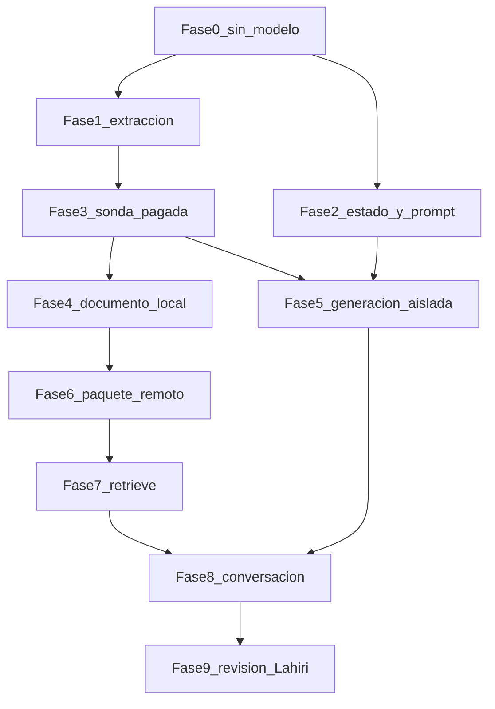

# Corrección y validación del companion sobre el VF5

Documento vivo. Opus lo revisa en este archivo. Tras esa revisión y la orden de ejecución, Grok 4.7 implementa, comprueba y actualiza este mismo documento. No se abren planes secundarios. Redactar este archivo no implementa, no llama modelos y no modifica S3, la KB ni el ledger.

Archivo: `docs/field_companion/PLAN_CORRECCION_VF5_COMPANION.md`.

## Objetivo y alcance

Conseguir, en la ruta normal y sobre artefactos corregidos del VF5, una orientación inicial pertinente, con pocas preguntas, documentación aplicable, caso conservado y distinción entre observación, comprobación, hipótesis y pendiente. El criterio sale del guion [Danebo guion intuitibilidad.pdf](/Users/lahirisan/Downloads/Danebo%20guion%20intuitibilidad.pdf): los diálogos son ilustrativos; los comentarios de Gonzalo son requisitos de producto, no procedimientos del fabricante.

El VF5 es la muestra para corregir mecanismos generales. No se añaden reglas de este manual ni se declara válida la biblioteca. No hay episodio aceptado. Se conservan las capacidades ya demostradas: foco, continuidad de episodio y corrección del LED.

Dentro de este ciclo:

- Instrucción de extracción por página, cobertura determinista, continuidad en la ruta normal con procedencia persistida, ejemplos y `FIELD_RECORD`, re-procesamiento acotado sin subir el contrato, estado tipado del caso, y el contexto de generación de una avería.
- Validación por capas, de menor a mayor costo, sobre los artefactos que cada capa realmente produce.

Fuera de este ciclo, y siguen en [docs/PLAN_FIELD_COMPANION_CONVERSACION_2026-10-07.md](../PLAN_FIELD_COMPANION_CONVERSACION_2026-10-07.md):

- Orden 1, ya comprobado: `field_companion:start_clean_case`. Se reutiliza; no se reabre.
- Orden 3, plano Elemont, y el nombre `EPISODIO_VALIDADO`.
- Órdenes 4 y 5: fotos, cambio de tema y retorno.
- Selección automática desde foto o código, rescate de personas, escalamiento completo a ingeniería y cierre de campo ante Gonzalo.
- Los hábitos generales que Gonzalo describe (serie de seguridad, reinicio de 380 V y 220 V, puertas abiertas en falla) no se codifican. No están en el pasaje VF5 del caso y no autorizan una maniobra.

Qué sustituye este documento, solo como ruta de ejecución del orden 2 textual:

- Tratar el fallo restante como un retoque único del contrato de generación.
- Repetir los replays de fidelidad, continuidad, sección 5.6, Haiku contra Sonnet y la partición system/user.
- Exigir la matriz de siete turnos o la variante de dos mensajes antes de juzgar el mecanismo.
- Los párrafos de «siguiente acción» del orden 2 que apuntan a esos replays.

No sustituye el archivo padre, sus evidencias ni sus aceptaciones parciales. El viernes 23 de octubre sigue anotado allí; este plan no lo reabre ni lo usa para saltarse un gate.

## Estado inicial

Verificado al redactar este archivo, el 21 de octubre de 2026:

- `HEAD` y `origin/main`: `b5fba1cf16fc364323cb57d8454a24889a201821`. `git diff` vacío de archivos seguidos. Cinco rutas sin seguimiento, todavía en disco para que Opus pueda abrirlas durante esta revisión: `app/services/rag/vf5_system_role_admission.rb`, `app/services/rag/vf5_system_role_comparison.rb`, `script/field_companion/vf5_system_role_comparison.rb`, `test/fixtures/files/field_companion/vf5_bound_20261020T1728Z/`, `test/services/rag/vf5_system_role_admission_test.rb`. No se commitean. Al empezar la ejecución se borran, antes de cualquier otro cambio, para que el diff de implementación nazca de un árbol limpio. La ruta normal arma un solo mensaje `user` salvo `RAG_DOCUMENT_IDENTITY_SYSTEM_ROLE=1`. Ese flag queda apagado.
- PDF [docs/field_companion/fuentes/VF5.pdf](fuentes/VF5.pdf): SHA-256 `be7a39a3490c92c8381cb883402760cb07d10b0a3beda5348bed22f72abedf72`, 22 páginas. La portada no tiene folio. PDF 2–22 imprimen Pág. 1–21.
- Ledger leído en `tmp/field_companion/vf5_generator_benchmark/assignment_spend.json`: 70 intentos, US$0,945161, `open: {}`, tope 96 intentos y US$4. Quedan 26 intentos y US$3,054839 de holgura acumulada. Los 15 intentos de la asignación histórica no son una reserva: `open` está vacío. Última entrada: 2026-10-21T01:08:09Z. Antes de la primera llamada de este plan, el ejecutor vuelve a leer ese archivo. Si el saldo cambió, recalcula y no parte.
- Los 30 objetos históricos y la captura del primer turno siguen siendo la evidencia de Codex y de Opus. No se recopilan aquí. Copias locales de lectura: `tmp/review_vf5/` y la sonda previa de dos páginas en `tmp/field_companion/local_ingestion/` (p5 y p13, Sonnet 5.5, fuera de la ruta normal). Esa sonda no certifica ingesta, índice ni recorrido.

Diagnóstico de referencia, sin copiar sus inventarios: el informe de Codex del 21 de octubre de 2026 y la revisión de Opus de la misma fecha. Código que sostiene la dirección:

- La instrucción usa el índice PDF y el total de páginas conservadas: [app/services/bulk_cost_v2_request_builder.rb](../../app/services/bulk_cost_v2_request_builder.rb) (`total = kept_pages.size`), [app/services/manual_batch_ingestion_service.rb](../../app/services/manual_batch_ingestion_service.rb), [app/services/single_file_chunking_service.rb](../../app/services/single_file_chunking_service.rb) (`kept_pages.size`), [app/services/batch_page_retry_service.rb](../../app/services/batch_page_retry_service.rb) (`total_kept`) y [app/prompts/batch_chunking_prompt.rb](../../app/prompts/batch_chunking_prompt.rb) (`Page N of M`). Es una hipótesis fuerte de conflicto con el folio impreso. No es una causa demostrada. p14 la ilustra; no la prueba.
- `SectionPageContinuity` solo corre si hay `page_texts`. Los llamadores normales no lo pasan: [app/jobs/ingest_batch_results_job.rb](../../app/jobs/ingest_batch_results_job.rb), [app/jobs/ingest_manual_batch_results_job.rb](../../app/jobs/ingest_manual_batch_results_job.rb), [app/services/single_file_chunking_service.rb](../../app/services/single_file_chunking_service.rb). `_page` se borra en [app/services/section_page_continuity.rb](../../app/services/section_page_continuity.rb) antes de entregar el registro. Un texto que el modelo nunca emitió no lo restaura la continuidad.
- La deduplicación es `(cuenta, SHA-256, field_records_v8)` en [app/services/content_dedup_service.rb](../../app/services/content_dedup_service.rb). La huella del system prompt no entra en la clave. Cambiar la instrucción de usuario no evita el hit. [script/AGENTS.md](../../script/AGENTS.md) prohíbe subir `INGESTION_CONTRACT_VERSION` para sortear un defecto de parseo. No se sube.
- Un turno web con identidad conocida, pin y modo `owner` hace una llamada de intérprete (`TurnInterpreter`, hasta 3 intentos solo si el error es transitorio) y una `generate_text`. `Retrieve` va aparte y no entra en el ledger de 96 ni en `bedrock_queries`. En modo `owner`, `SemanticQueryAnalyzer.observe` no llama al modelo. El pin usa `RagRetrievalProfile::PINNED_DOCUMENT_RESULTS = 3`. La consulta compuesta cabe en 442 caracteres (`FollowupQueryRewriter::MAX_COMPOSED_CHARS`); el turno puede quedar íntegro y aun así marcar `truncated` al soltar otros componentes.
- El prompt ya prohíbe dar por hecha una comprobación no reportada y jerarquizar causas sin respaldo (`FIELD_REPORT_PARAGRAPH`). La captura lo incumplió. También contradice «como máximo tres secciones lógicas» con «sin encabezados», y mete «Según el plano» y `TOPOLOGY_EDGE` en una avería de puerta. Añadir más reglas de prosa no es la corrección.
- `PageRelevanceFilter.filter_pages` manda todo PDF multipágina a Haiku por ventanas de 20. El VF5 son 2 llamadas de filtro, con un reintento si el JSON no parsea. La extracción de página es Sonnet 5.5 directo (`claude-sonnet-5-5-direct`: US$0,002 / US$0,01 por mil tokens). La sonda local midió p5 en 2849/5859 tokens (unos US$0,064) y p13 en 3140/5937 (unos US$0,066). Esos input no demuestran si el system prompt iba en caché. El techo de abajo cubre esa duda. Esas llamadas van a `bedrock_queries` (`ingestion_parse` / filtro), no al ledger de 96. El cliente puede reintentar dos veces un overload.
- La ingesta no escribe manifiestos bajo `bulk_chunks/`. Un reemplazo de objetos pasa por `S3DocumentsService`, que invalida `SectionNeighborExpander`.

## Decisiones ya tomadas

1. Dirección: alineación selectiva del pipeline existente. No basta reparar la página 12. No se crea un contrato nuevo ni un verificador universal de documentos.
2. `#21` pertenece al síntoma «La puerta se abre pero no se cierra» (PDF 12, impresa 11, sección 8.2), junto con el LED, `#8` y `#12`. No es una comprobación de «La puerta se re-abre sola». Esa sí tiene las tres comprobaciones de sensibilidad `#54`, fotocélula y obstrucción, más la continuación condicional al abrir la PDF 13. El chunk de la página 12 debe contener `#21` bajo su síntoma. La respuesta del caso «se reabre sola» no debe presentarlo como paso de ese síntoma. La disyunción del LED está en 5.6 (PDF 7, `chunk_p7_3` histórico): fotocélula o entrada de reapertura. Se usa cuando ese pasaje está en el contexto; su ausencia en el top 3 histórico no se corrige metiendo `#21` en el caso equivocado. La inversión conocida de `#8` y `#12` frente a las secciones 4 y 5.2 no rechaza este ciclo.
3. La instrucción dirá que el adjunto es exactamente la página a extraer, que el número es el índice PDF, que el total es el de las páginas del PDF y que el folio impreso puede diferir. No dirá «página N de páginas conservadas». Pedirá emitir solo lo visible, no declarar que la página no llegó, no inventar encabezados ni notas, conservar la apertura y marcar los ejemplos como ejemplos. La cobertura sigue siendo obligatoria aunque la hipótesis de paginación falle.
4. Continuidad en la ruta normal: los tres llamadores de ingesta pasan `page_texts` extraídos con la misma capa de texto que ya usa el filtro. La procedencia movida se guarda en un campo real (`source_pdf_page`), no en `_page`. El folio impreso se lee del texto (`Pág. N`) y queda vacío si la página no lo imprime. No se calcula folio = índice − 1.
5. Un descarte del filtro es un resultado registrado en memoria y en el informe local de la corrida. No se sube un manifiesto a `bulk_chunks/`. Página sin chunk y sin descarte es defecto. Un cuerpo que dice no haber recibido la página no se indexa: se reintenta una vez con `BatchPageRetryService` y, si sigue mal, queda la marca de página degradada ya existente.
6. `promoted_example?` se mide sobre los 112 registros históricos. Se ajusta solo si descarta un registro que no es un ejemplo. Un ejemplo sigue siendo ejemplo; una etiqueta que está en la página y no es ejemplo se conserva. El caso ya visto de la salida FOTOCÉLULA es la regresión de ese ajuste.
7. El estado tipado se hace primero con lógica determinista sobre el texto literal del técnico: observado, no observado, comprobado con resultado, no comprobado, sin intervenciones. Persiste en el episodio, cabe en el tope de bytes actual y no añade una llamada. Ampliar el tool del intérprete, dentro de la misma llamada, solo si un resultado reportado no cabe en esas formas. «Modo esclavo» y otros síntomas dejan de guardarse como identificador de equipo. El reducer ya rechaza identificadores de cuatro palabras o más; este hueco es el de dos o tres palabras que no son designador.
8. En un turno de avería que no pregunta por plano, esquema o etiqueta, el prompt de identidad no inyecta el bloque de plano ni las reglas de `TOPOLOGY_EDGE`. Se elimina la contradicción entre «tres secciones» y «sin encabezados»: la respuesta web de avería es prosa, sin títulos exigidos. El bloque tipado del caso es la fuente de qué está abierto. No se añade otra lista de prohibiciones.
9. La posición en top 3 o top 5 no elige sola el componente. Después de sincronizar, un `Retrieve` de solo lectura con la consulta exacta del primer turno, top 3 y top 5, sin rerank, guarda request, score, URI y cuerpo. Si el pasaje corregido está en el top 3, no se toca la recuperación. Si falta y la consulta salió truncada a 442 caracteres, el primer candidato es `QueryComposer`, no `RagRetrievalProfile`. Subir el top-k solo si el pasaje está en el top 5, la consulta ya nombra el síntoma y no fue truncada. Si no está en el top 5, se inspeccionan consulta y texto del chunk antes de cambiar nada. No se cambian a la vez documento, estado, prompt y recuperación en la corrida que debe aislar un efecto.
10. Un replay local no valida S3, índice ni `POST /rag/ask`. La conversación integrada corre en local contra la KB `Y7RZWMFJSR`, con el código nuevo, sin editar `.env` y sin desplegar. El proceso exporta la KB, el modo `owner`, episodio, turno y alcance de identidad, como en la captura `vf5-bound-20261020T1728Z`.
11. La aceptación de este ciclo no es la matriz de siete turnos. Son cuatro intervenciones, descritas en la fase 8. Conservar una comprobación no obliga a recitarlas todas. La condición de la PDF 13 no se prescribe en la primera respuesta. La conversación nueva, vía `start_clean_case`, no arrastra hechos ni el pin del VF5. No hay tests de frase exacta ni tests que solo reproduzcan la implementación: los de estado miran campos; los de respuesta se juzgan por significado.
12. No se repiten los experimentos ya fallidos. La pregunta nueva de extracción es si la instrucción corregida, el parser normal, la fusión con `page_texts` y la cobertura sostienen las páginas que la sonda de octubre no cubrió. La pregunta nueva de generación es si el estado tipado y el prompt sin bloques de plano, sobre esos chunks certificados, dejan de cerrar comprobaciones y de jerarquizar `#54`.
13. Los cinco archivos de la partición system/user no se commitean y no se conservan en el árbol de trabajo. La hipótesis ya se ejecutó: tres controles y tres tratamientos del primer mensaje, con `RAG_DOCUMENT_IDENTITY_SYSTEM_ROLE=1` solo en el tratamiento. Los dos brazos fallaron; el tratamiento añadió una maniobra y un ajuste que el contexto no autorizaba. `t2` era otra muestra, no el turno 2. El código vive en `app/services` y en el suite de tests, así que un commit lo dejaría como camino cargable, no como archivo de laboratorio. Además fija `RESERVE_CALLS = 15`, que este plan ya descartó como reserva. La referencia queda en este párrafo. El prompt capturado sigue en la captura `vf5-bound-20261020T1728Z`; las seis respuestas y el ledger están en `tmp/field_companion/vf5_system_role/` y en `assignment_spend.json`. Esos `tmp` no se commitean. No se restaura el arnés.

## Presupuesto que autoriza la orden de ejecución

La orden de ejecución autoriza solo estos techos. Llegar al tope detiene la fase y se anota aquí. No autoriza el paquete remoto.

Ingesta, fuera del ledger de 96, techo 33 llamadas y US$2,50, lo que ocurra antes:

- 2 llamadas Haiku de filtro sobre las 22 páginas, más hasta 2 reintentos de JSON.
- 8 extracciones Sonnet de la sonda: PDF 3, 5, 6, 12, 13, 14, 19 y 22. El total informado al modelo es 22, no 8.
- Hasta 4 reintentos de cobertura. Si fallan más de 4 páginas de la sonda, no se reintenta el resto: se para y se actualiza este documento.
- 14 extracciones del resto solo si la sonda sale. No se vuelven a pagar las 8. 8 + 14 = 22.
- Hasta 3 llamadas extra por overload en toda la ingesta.
- Cifra de planificación: unos US$0,07 por página Sonnet según la sonda local, más US$0,40 de techo para el filtro. El ejecutor sustituye la cifra por la suma real de `bedrock_queries` de esa correlación antes de abrir la tanda siguiente. El proceso de ingesta no define la ruta del ledger de 96.

El techo de 33 es 2 filtros + 2 reintentos de JSON + 8 de sonda + 4 de cobertura + 14 del resto + 3 de overload.

Ledger de asignación, techo 17 intentos y US$0,50 adicionales sobre el saldo leído al arrancar:

- Generación aislada: 3 `generate_text`. Si fallan, una corrección y otras 3. Máximo 6. Si la segunda terna falla, no hay fase 8.
- Conversación: 4 turnos por 2 llamadas (intérprete y generación) = 8, más 3 intentos de reserva para un único fallo transitorio del intérprete.
- El SDK no añade reintentos por encima de lo que el proceso ya fija en 1. Un `ServiceUnavailable` cuenta intento aunque el costo real sea cero, como ya ocurrió en el ledger.

`Retrieve`: máximo 8, fuera de ambos presupuestos. 2 de medición tras sincronizar y 1 por turno integrado. Sin reranker. No se lanza ninguno sobre los chunks viejos para «ver el top 5».

Quedan al menos 9 intentos del tope de 96 si se usa el techo entero. Esa holgura no es otro experimento.

## Paquete que sí pide autorización expresa

Se redacta una sola vez, después de la fidelidad local de las 22 páginas, y no se vuelve a pedir si se concede. No forma parte de la orden de ejecución inicial.

- `SELECT` de solo lectura en la base Rails de producción: SHA del VF5, cuenta 1, contrato `field_records_v8`, estado y prefijo. El plan padre prohíbe esa lectura; por eso va aquí. La base local no tiene la fila. Sirve para no crear un segundo prefijo y para saber si una subida normal no re-parsearía. No bloquea las fases locales.
- Sustituir el prefijo S3 ya conocido del VF5 con los artefactos locales certificados, borrar las claves que ya no existan y sincronizar solo esa fuente de la KB `Y7RZWMFJSR`. Escritura por `S3DocumentsService`. Sin subir el contrato, sin re-upload que caiga en deduplicación y sin despliegue.
- Costo remoto esperado: la sincronización de KB no re-paga el parseo. El ejecutor adjunta el informe local (páginas, descarte, cobertura, nota visual de p6 y p22) y el saldo de ingesta ya gastado.

Sin ese paquete, la validación termina en la generación aislada.

## Fases

La fase 2 puede avanzar en paralelo con la 1 y la 3. Si la 3 falla, no se ejecutan 4, 5, 6, 7 ni 8. La 2 puede terminar sus pruebas locales. No se adelanta una validación que dependa de una fase fallida.

### Fase 0. Línea base sin inferencia

Resultado: el detector señala los defectos históricos ya conocidos, `#21` queda en el síntoma correcto dentro del fixture, y el filtro de ejemplos tiene un recuento sobre los 112 registros.

Entradas: PDF local, copia `tmp/review_vf5/` o lectura S3 del prefijo ya identificado, parser y `PageChunkFidelity` actuales. Sin modelos.

Trabajo: borrar primero las cinco rutas de la decisión 13 y comprobar que `git status` no las lista. Después extraer la capa de texto; correr la cobertura candidata sobre los 30 cuerpos históricos; aplicar `promoted_example?` a cada registro contra su página; confirmar el saldo del ledger. El detector debe marcar página 3 ausente, encabezados añadidos en p5, pérdida de apertura en p12 y p13, autoinforme de p14 y números ausentes en p19. No debe declarar resuelto el cruce de columna de p22 ni el borne 9 de p6.

Evidencia: informe corto en este documento, con páginas marcadas y registros de ejemplo descartados. Tests Minitest del detector contra esos cuerpos, sin frase de la respuesta del companion.

Salida insuficiente: el detector no marca un defecto conocido, o marca como malo un pasaje histórico que el diagnóstico da por fiel en su contenido principal. Se ajusta el detector antes de cualquier llamada. No se relaja el fixture para que el código pase.

### Fase 1. Extracción, cobertura y continuidad

Resultado: la ruta normal puede extraer una página sin contradecir el folio, fusionar con texto de página y rechazar un cuerpo que declara no haber recibido la página.

Entradas: los llamadores citados y `BatchPageRetryService`.

Trabajo: cambiar la instrucción y el total que cada llamador pasa; pasar `page_texts` en los tres llamadores de ingesta; persistir `source_pdf_page` y folio impreso; invocar la cobertura después de fusionar. El gate de producción usa señales generales. El fixture VF5 vive en el test de esta muestra, no como rama `if vf5`.

Comprobación: tests del texto de instrucción, de un descarte registrado, de una apertura trasladada con página de origen, y del detector sobre un fixture mínimo. Cero llamadas.

Salida insuficiente: un test de comportamiento en rojo que no se explica por el fixture. Se corrige el mecanismo. No se entra en la fase 3 con el total todavía igual al número de páginas conservadas.

### Fase 2. Estado del caso y prompt de avería

Resultado: un turno literal deja persistidos los cinco tipos de afirmación, y el prompt de avería muestra ese estado sin el bloque de plano ni la contradicción de secciones.

Entradas: `WorkContextReducer`, `ActiveEpisode`, `SessionContextBuilder` / bloque Active Field Problem, `document_identity_generation_prompt` y las directivas de formato en [app/services/bedrock_rag_service.rb](../../app/services/bedrock_rag_service.rb).

Trabajo: clasificador determinista; dejar de promover un síntoma a identificador; omitir los bloques de plano cuando el turno no es de plano; alinear formato y canal web. El ejecutor elige el campo del episodio siempre que quepa en `MAX_BYTES` y no añada una llamada.

Comprobación: tests del episodio tras frases de no observación, no comprobación, resultado reportado y corrección. Test de que el prompt de avería contiene el estado tipado y no contiene el bloque de plano. Ningún test exige una frase de respuesta.

Salida insuficiente: el estado tipado no sobrevive un segundo turno o no cabe en el episodio. Se reduce el diseño en este documento y no se llama a generación. Esta fase no espera a la sonda.

### Fase 3. Sonda pagada de páginas decisivas

Resultado: con el código de la fase 1, las páginas 3, 5, 6, 12, 13, 14, 19 y 22 salen fieles en lo que la cobertura puede afirmar, y queda escrita la lectura visual de p6 y p22.

Entradas: PDF completo como total 22; filtro real de las 22 páginas; extracción solo de esas ocho; fusión de 12 y 13 juntas, con `page_texts`.

Trabajo: guardar request reducido, uso, texto y decisión de filtro. Criterios de la muestra, por significado y presencia, no por igualdad literal: p3 con chunk o descarte registrado; p5 sin encabezado S4 ni nota añadida, y los ejemplos siguen siendo ejemplos; p12 contiene 8.1, ambos síntomas de 8.2 citados arriba y `#21` bajo «se abre pero no se cierra»; p13 contiene la apertura condicional de «se reabre sola»; p14 contiene 9.1 a 9.4 y no inventa 9.5 ni dice que la página no llegó; p19 contiene las cifras de 11.1 y 11.2; p6 y p22 se leen contra el PDF. La presencia de `0,12` no acredita la columna.

Evidencia: directorio local de la corrida y el párrafo de resultado en este documento. Suma de `bedrock_queries`.

Salida insuficiente: más de cuatro páginas fallan, o p6/p22 siguen cruzando columnas. No hay fase 4 ni 5. Se anota la hipótesis de paginación como confirmada, debilitada o no observada, según diga el texto de p14 y de las demás, y se ajusta la instrucción una vez dentro del cupo de reintentos. Una segunda sonda completa no se lanza sin una pregunta nueva escrita aquí.

### Fase 4. Resto del VF5 en local

Resultado: las 22 páginas tienen chunk o descarte, la fusión no reintroduce los defectos de la sonda, y p8 no se queda con el pasaje de p9 como si fuera suyo.

Entradas: las ocho salidas ya pagadas más las catorce páginas restantes. Misma ruta normal.

Trabajo: extraer solo lo que falta, fusionar el documento, correr la cobertura general. Revisar de nuevo p6 y p22 si esa fusión los mueve.

Evidencia: informe de cobertura por página y costo acumulado.

Salida insuficiente: cualquier página con cuerpo infiel indexable. No se prepara el paquete remoto. Las páginas sanas no se reextraen. La generación aislada puede haber corrido ya con los chunks de la sonda; su resultado no se promociona a fidelidad del documento.

### Fase 5. Generación aislada

Resultado: tres muestras, con los chunks certificados de la sonda y el estado tipado, no dan por hecha una comprobación sin resultado, no jerarquizan `#54`, mantienen condicional la frase de la PDF 13, no asignan `#21` a «se reabre sola» y no convierten el ejemplo de SW4 en una orden para este equipo.

Entradas: prompt de la fase 2; cuerpos de p12, p13 y p5 certificados; el texto histórico de 5.6, marcado como histórico y fiel en esa cláusula, para ver si el LED sigue colapsando cuando el pasaje sí está. No es un `Retrieve`. Temperatura y modelo de la ruta de producción. El control es la captura ya existente, no una terna nueva del prompt viejo.

Comprobación: rúbrica semántica sobre las tres muestras. Omitir una comprobación no falla. Recitarlas todas no es obligatorio. Una sola muestra que cierre la obstrucción, jerarquice `#54` o mande desconectar ya la fotocélula impide la salida.

Evidencia: prompts enviados, respuestas y decisión en este documento. Intentos descontados del ledger.

Salida insuficiente: la segunda terna también falla. No hay fase 8. Se describe el fallo que quedó y se detiene. No se prueba otro modelo ni la partición system/user.

### Fase 6. Paquete remoto

Resultado: una solicitud única, con alcance, costo ya gastado y el informe local de la fase 4. El ejecutor espera. No consulta producción ni escribe S3 mientras no esté concedida.

Si se concede, sustituye el prefijo, invalida el expansor por la vía del servicio de S3 y sincroniza la fuente. Guarda los identificadores del job. Una concesión no se repite.

Salida insuficiente: la sincronización no termina. No hay fase 7. El informe local sigue siendo válido como parseo, no como índice.

### Fase 7. Recuperación sobre el índice nuevo

Resultado: se sabe si la consulta real del primer turno trae el cuerpo corregido de 8.2 y, si el LED entra en esa consulta, el de 5.6.

Entradas: consulta exacta de la captura, KB sincronizada, filtro por la URI original, top 3 y top 5, sin generación.

Trabajo: aplicar la decisión 9. Un cambio de composer o de perfil, si hace falta, se prueba con un `Retrieve` adicional dentro del cupo de 8, no con una conversación.

Salida insuficiente: el pasaje de «se reabre sola» no aparece ni en el top 5 después de ese único ajuste. No hay fase 8. Se anota el cuerpo y la consulta. No se sube el top-k «por si acaso».

### Fase 8. Conversación integrada

Resultado: un episodio nuevo, pin del VF5 puesto por la interfaz como condición de prueba. Eso no acredita selección automática. Cuatro turnos por `POST /rag/ask`.

Turnos:

1. Marca, modelo, síntoma «se reabre sola», estado del LED, obstrucción no observada, `#54` no comprobado, sin mediciones. Orientación sobre las comprobaciones de ese síntoma, abiertas; condición de la página siguiente no prescrita; `#21` no atribuido a este síntoma; sin causa ordenada.
2. Corrección del LED. El episodio conserva síntoma y corrección.
3. El técnico reporta el resultado de una sola comprobación. Esa pasa a comprobada; las otras siguen abiertas; el caso no se cierra.
4. `start_clean_case` y un equipo que no es el VF5 ni el caso Elemont. El episodio y el bloque de caso no llevan hechos ni la corrección del VF5. Si la respuesta aplica pasos del VF5 a ese otro equipo, la separación falla.

Cada turno guarda captura de intérprete, estado, consulta efectiva, truncado, cuerpos, prompt y respuesta. Cero replays como sustituto.

Salida insuficiente: el turno 1 o 3 vuelve a cerrar una comprobación, o el turno 4 arrastra el caso. No se alarga a siete turnos para compensar. Se anota el fallo y se detiene. Si los cuatro salen, el recorrido queda técnicamente estable para revisión, no aceptado como episodio ni como demo.

### Fase 9. Revisión breve de Lahiri

Solo con la fase 8 estable. Lahiri mira si la orientación le sirve a un técnico: poca escritura, primera respuesta útil, caso reconocible. No opera las pruebas ni aprueba las fases anteriores. Su comentario se escribe aquí. No es la demo en vivo del guion ni `EPISODIO_VALIDADO`.

## Estado de ejecución

- Estado: plan escrito en el repositorio, pendiente de revisión de Opus. Sin implementar.
- Siguiente acción: Opus revisa este documento, en especial las decisiones 2, 9, 11 y 13 y los techos de presupuesto. Después, y solo con orden de ejecución, Grok borra los cinco archivos sin seguimiento y sigue por la fase 0. Actualiza esta sección al cerrar cada fase.
- No pedir confirmación entre fases que sigan dentro de los techos. Informar cada cierre en pocas líneas: qué salió, qué evidencia quedó y cuál es la fase siguiente.
- Para la revisión, no para impedir este archivo: el conflicto de página sigue sin estar demostrado; el `SELECT` de producción y la sustitución del prefijo siguen sin autorización; la fidelidad de columna de p6 y p22 no la cubre un control numérico; Aurora no se volvió a comprobar al redactar y no hace falta para empezar la fase 0.
