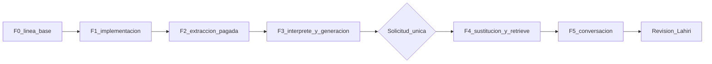

# Corrección y validación del companion sobre el VF5

## Respaldo del componente — 27 de octubre de 2026, 15:00

**Precedencia.** Esta sección es el estado local vigente. No reabre F2, F3 ni F4. No aprueba F5. No cambia S3, la base, los embeddings, fuentes, ingesta, prompts, modelos ni las etiquetas «Manual / Guía Danebo». El plano Elemont no arranca.

La corrida de las 15:00, episodio `ep_bd974d75c0b6d6fb`, imagen `e45088f`, está en [INFORME_GUI_VF5_F5_2026-10-27_15h.md](INFORME_GUI_VF5_F5_2026-10-27_15h.md). Producción leyó `candidate_r2`. El técnico dijo que el LED estaba encendido y no dijo cuál. T3 y T5 usaron ese LED como el de fotocélula. El catálogo del replay era el espejo anterior a F4 y no explica ese uso.

La reparación es el respaldo de la entidad y la propiedad en la afirmación, sea pregunta o lectura, y venga de una observación o de una comprobación. Una comprobación de un componente no identifica otro. Escribir «LED de fotocélula» o «el LED encendido es el de fotocélula» en una lectura no identifica ese LED. Preguntar si el observado es el de fotocélula sigue. Si el técnico ya lo identificó, la lectura puede usarlo. La hipótesis que pregunta por el indicador sigue. #21 y la orientación que no usan ese LED siguen. La pregunta de cuál LED, cuando se publica, queda en `shown` y no ocupa el puesto de #21; si #21 se responde, esa pregunta queda. El catálogo del replay pasa a los 45 cuerpos de la candidata publicada. Los JSON históricos no se reescriben.

La regresión recorre la entrada, el estado, el plan, el checker y la publicación de las 15:00 con las respuestas capturadas. Compara T3 y T5 con la guarda apagada. Mañana y mediodía siguen. Un caso de piloto y válvula cubre otra entidad. Nada llama a Bedrock.

F5 sigue abierta. La comprobación web mínima es el mismo guion de cinco frases sobre la imagen de esta reparación: T2 sin «apagado» y sin parpadeo, con la pregunta del indicador junto a #21; T3 sin fundar #21 en el LED genérico; T5 sin la lectura que le aplica la función de fotocélula, con el desconocimiento en #21 y la pregunta del indicador todavía en el episodio.

## Continuidad T3–T5 — 27 de octubre de 2026, tarde

**Precedencia.** Esta sección es el estado vigente de la corrección VF5. No reabre F2, F3 ni F4. No aprueba F5. T2 queda como lo demostró la GUI del mediodía sobre `a829713`. No cambia fuentes, ingesta, prompts, modelos, perfiles, costes ni las etiquetas «Manual / Guía Danebo». El empaquetado general de capturas sigue aparte.

El cruce [INFORME_CRUCE_VF5_2026-10-27.md](INFORME_CRUCE_VF5_2026-10-27.md) mostró que mañana (`4eca6b3`) y mediodía (`a829713`) reproducen T3–T5 con las herramientas capturadas. El código de producto entre `a829713` y `038c552` no cambia ese resultado. La variación del modelo deja al descubierto el contrato y el estado.

Tres causas, ninguna atada al turno, al guion ni a los números del VF5:

- Una pregunta aceptada sobre otro dato sustituía el pendiente. La conservación solo ocurría si Ruby marcaba `question_role=led_context`. La misma pregunta, si la proponía el modelo con `question_role` vacío, reemplazaba el dato abierto.
- «¿Qué sigue?» del mediodía no trae `checks: null`. La herramienta es `follow_up` con `clarification_target: documented_context`, valor fuera de contrato, y la percepción lo resume como `invalid_schema`. El fallback guardaba esa petición como observación porque parecía un síntoma corto. Un `checks: null` que sea el único defecto estructural se normaliza a lista vacía y deja la nota `null_as_empty`. El destino inválido se sigue rechazando.
- El desconocimiento se ligaba al pendiente por compartir una raíz o un número. En el mediodía eso era la pregunta del LED, no #21 ni el contacto. Un «no sé» sin referente sigue pudiendo responder la única pregunta abierta.

El pendiente conserva el dato no resuelto. La pregunta que se presenta ahora, si nombra otro dato y está en el texto, queda en `pending.question.shown`. El intérprete sigue recibiendo solo la pregunta pendiente. Un episodio anterior, sin `shown`, no cambia. Si el técnico nombra otro dato, el `r: unknown` no se asigna al pendiente; si nombra los dos asuntos abiertos sin elegir, se pregunta a cuál se refiere usando las dos preguntas ya guardadas. Una petición de continuidad no se guarda como hecho del equipo ni como objetivo. Un apartado largo que no es el caso y que la pregunta no usa deja de ser el dato que falta; un apartado que la pregunta sí usa se conserva.

La regresión recorre las dos muestras con `record_user_turn!`, el reducer, el plan, el checker y la publicación. Los cuerpos están en `test/fixtures/vf5_continuity_20261027/`. No llama a Bedrock. Un caso de válvula, indicador y sensor, fuera del VF5, cubre la misma asociación. F5 sigue abierta: esta reproducción local no es la GUI. La recuperación en vivo, después de que la consulta de T2 deja de incluir «apagado», no se ha medido. El plano Elemont no arranca.

Una propiedad compartida no une dos componentes. «¿La válvula está abierta?» no recibe «No sé si la compuerta está abierta». «Está abierta» y «No sé» siguen respondiendo cuando hay un solo asunto. Si los dos asuntos abiertos encajan, se conservan y se pregunta a cuál se refiere.

## GUI del 27 de octubre de 2026

**Precedencia.** Esta sección es el estado vigente de la corrección VF5. No reabre F2, F3 ni F4. No aprueba F5. No cambia fuentes, ingesta, prompts, modelos ni las etiquetas «Manual / Guía Danebo».

La muestra es el guion web de cinco mensajes, caso `ep_1f3018d3f7f12e8c`, sesión 128, VF5 documento 212, imagen `4eca6b32451583c29c5d705946cd40b12ab6e15e`, perfil `global.anthropic.claude-haiku-4-5-20251001-v1:0`. El informe está en [INFORME_GUI_VF5_F5_2026-10-27.md](INFORME_GUI_VF5_F5_2026-10-27.md).

T3 y T4 publican la orientación del síntoma. T5 guarda el desconocimiento de #21 y del contacto #21–#23 y no vuelve a pedirlo. En esa GUI, T2 no cerró el criterio: la observación «el LED está encendido, no apagado» no retiraba «apagado» y se publicó como el LED parpadeante de Estado. El mensaje llegó como «orrijo un dato…»; el intérprete devolvió `correct`.

Esa observación queda reconocida en local. Encendido es el valor vigente, apagado deja de ser un dato actual y el mensaje original sigue en el historial. El reporte no se publica como parpadeo ni como el LED de Estado; si el manual distingue indicadores, se pregunta cuál y esa pregunta no sustituye la de #21. La regresión recorre la captura real con `record_user_turn!`. F5 sigue abierta: esta corrección no es una conversación nueva. El plano Elemont no arranca.

## Orientación recuperada — 26 de octubre de 2026, noche

**Precedencia.** Esta sección es el estado vigente de la corrección VF5. No reabre F2, F3 ni F4. No aprueba F5. La confirmación en la GUI sigue pendiente. No cambia fuentes, ingesta, prompts, modelos ni las etiquetas «Manual / Guía Danebo».

La orientación que ya había funcionado es la de T3 `query:6356039c-528c-4a06-b859-2f24f19f17d9` y T4 `query:e4cebfe4-8fc1-4316-af3f-81d5fef131b5`, en `docs/field_companion/INFORME_GUI_VF5_2026-10-26.md`, y la continuidad T1–T4 de `20261023T182442Z-conversation`. Esa corrida no era un caso limpio y no guardó la propuesta. El episodio limpio `ep_48cf56840172b621` sí guardó las cinco propuestas y se abstuvo en T3 y T4.

La causa demostrada es el objetivo guardado. «La puerta se reabre sola» hace aplicable el síntoma «La puerta se re-abre sola». «La puerta se reabre sola durante el cierre» añade tallos que la fórmula anterior exigía cubrir al 60 %. El síntoma deja de ser aplicable, sus pasos salen `case_unresolved`, la pregunta operativa de #54 se rechaza y la publicación cae en R5. `CompanionPlanCheck` no cambió entre `1bdf5eb` y `91018b9`. `CompanionCaseFacts` y `WorkContextReducer` sí, y no explican esa abstención. La corrida limpia usó el perfil `us.` por un arreglo temporal del contenedor, ya revertido; sin otra llamada no se separa ese perfil de la propuesta. La fórmula rechaza esos pasos con la propuesta capturada.

Recuperado en local, sin llamada al modelo: un síntoma cuyos tallos están en el objetivo sigue aplicable aunque el objetivo nombre una circunstancia. T3 y T4 vuelven a citar el paso documentado, dejan #54 pendiente, tratan «no veo obstrucción» como observación y no repiten la pregunta de #21 para tapar el vacío. «Encendido» no se publica como parpadeante ni como LED de Estado: si el manual distingue indicadores, se pregunta cuál, y esa pregunta no sustituye la de #21. El desconocimiento de #21 y del contacto #21–#23 queda en el episodio, ligado a la pregunta publicada por el recorrido, y no se vuelve a pedir. Siguen Fermator, el VF5 elegido, la fotocélula distinta de #21, las mediciones pendientes y la captura de requests reales.

La regresión está en `test/services/rag/vf5_gui_replay_test.rb`, con los cuerpos capturados en `test/fixtures/vf5_gui_replay/`. Recorre percepción, estado, plan, checker y publicación. Con la fórmula anterior, T3 no publica; sin la distinción de LED, T2 dice parpadeante; sin el cruce de designadores, T5 vuelve a preguntar el contacto. F5 no queda aceptada: falta el mismo guion en la GUI después del deploy.

## Reparación local — 26 de octubre de 2026, tarde

**Precedencia.** Esta sección es el estado vigente de la corrección VF5. No reabre F2, F3 ni F4. No aprueba F5. No cambia fuentes, ingesta, prompts ni las etiquetas «Manual / Guía Danebo».

La ejecución GUI de las 14:58, informe `INFORME_GUI_VF5_2026-10-26.md`, no acepta F5. Tres reparaciones quedaron comprobadas en local, sin llamada al modelo:

- La captura web lee `current_account` aunque el método es privado. `try` devolvía nil y la cuenta 1 no abría captura. Otra cuenta sigue sin abrirla.
- La pregunta publicada y sus destinos se conservan hasta que el turno nombra ese dato. El «No sé cómo…» de #21 guarda `r: unknown` sobre esa pregunta. La fotocélula y el #54 no la reciben, y la respuesta no vuelve a preguntarla.
- Tras corregir el LED a encendido, «apagado» deja de ser una observación vigente. El antecedente sigue en el historial de la conversación.

Sigue pendiente la captura de un request web real, después del deploy. Sigue pendiente el guion completo desde un caso limpio. Ninguno de los dos queda hecho por estas pruebas.

## Captura del recorrido web — 26 de octubre de 2026, noche

**Precedencia.** Esta sección recupera lo que ya estaba guardado de la corrida de la tarde y deja la captura lista para un turno nuevo. No reabre F2, F3 ni F4. No aprueba F5. No cambia interpretación, preguntas, prompts, modelo, guards, sesión 128, S3 ni el presupuesto. Los ensayos locales no son conversación de Haiku.

### Inventario de la corrida de la tarde

El paquete `tmp/pilot_exports/2026-10-26_2026-10-26_danebo-legacy/` se dejó como estaba. No hay archivos de `ValidationCapture` que integrar: en el contenedor web `92c2b50843a2`, imagen `5f0c5b0262b1b6b7b8dc96962fc5584290e735c6`, `tmp/field_companion/validation_captures` no existe. `RAG_VALIDATION_CAPTURE_RUN` y `RAG_VALIDATION_CAPTURE_ACCOUNT_IDS` no estaban cargadas. `KAMAL_VERSION` de ese proceso es `5f0c5b0262b1b6b7b8dc96962fc5584290e735c6`. La fila actual de la sesión 128 no se leyó como si fuera el antes o el después.

El log de ese contenedor sí tiene cinco líneas `[COMPANION_PLAN]`. El request id de la línea es el mismo que ya está en `source_events.jsonl` junto a la correlación. Esa unión no es por hora.

| Request | Correlación | Plan en el log |
|---|---|---|
| `14b059a9-09ad-4628-ad29-ae82e1701b74` | `query:6de7bbc8-4ef0-4a08-a0a7-1ae1ac94fc9d` | sin línea |
| `2505bca4-4171-4f53-9d34-0a697d8f80ab` | `query:0b3e763e-1445-4f64-8b87-c8eb3f4dae58` | usable, 5 rechazos |
| `7b9c2046-52ed-4888-b908-1de793fd86bb` | `query:1ccdab33-3e2b-4b50-8b4c-33d0a95fbe0d` | usable, 1 rechazo |
| `bd258c35-3bf4-4f40-87b4-27df8953bb74` | `query:abb98732-0f09-4086-9576-d69c5b902571` | usable, 3 rechazos |
| `7fc442a3-170f-48ab-856e-602383c3e03d` | `query:7cbbda0c-5751-42f1-9566-34f1a6aa1c11` | usable, 6 rechazos |
| `4653c11c-d953-4a13-8286-063e465afecf` | `query:1eb6a214-066d-4b7b-ab83-c9efa26d8122` | usable, 5 rechazos |

Esas líneas no se copiaron al JSONL del exportador: el marcador no las incluye y el texto no es JSON. Un contador no es el motivo. El inventario privado, modo 600 y fuera de git, está en `tmp/pilot_exports/2026-10-26_vf5_capture_inventory.json`.

| Dato | Dónde se buscó | Estado | Consecuencia |
|---|---|---|---|
| Episodio y pendiente antes y después | Directorio de captura del contenedor; el paquete no trae el JSON | No capturado | El hash igual del quinto turno sigue sin mostrar el pendiente ni `answers` |
| Request y respuesta cruda del intérprete | Misma captura | No capturado | El estado `meta_incompatible` sí está en los eventos ya exportados |
| Percepción y rechazos de campos | Misma captura | No capturado | No se ve qué aceptó el intérprete en cada turno |
| Propuesta del plan | Log `[COMPANION_PLAN]` unido por request id | Solo usable y cantidad | La pregunta de #21, si el modelo la propuso, no está en esa línea |
| Motivos del checker | Esa línea y el paquete | No capturado | La ausencia de la pregunta en el texto publicado sigue sin causa observada |
| Fuentes con cuerpo | `TURN_EVIDENCE` y citas del informe | Metadatos sí; cuerpo no | Las páginas 12, 12, 10, 7, 8, 8 y 8 siguen siendo solo metadatos |
| Render, guards y diff | Captura de publicación | No capturado | El texto publicado sí está en el archivo de la sesión |
| Texto presentado e historial | `full_content` y `prompt_reply` del archivo | Presentes; `content` corta a 600 | El quinto texto publicado no tiene la frase de límite ni la pregunta |
| Modelo, parada, uso y latencia | Informe y filas de generación | Modelo, tokens y latencia sí; `stop_reason` no | El coste de la tarde no cambia |
| SHA de los seis turnos | Imagen y `KAMAL_VERSION` del proceso web | `5f0c5b0` | Una sola versión atendió la corrida |

### Qué queda confirmado y qué sigue en hipótesis

Confirmado: los cinco turnos con generación ejecutaron el plan y el checker lo dejó usable. El primer turno, el que se abstuvo, no tiene línea de plan. El quinto request es el de cinco rechazos. La imagen fue la misma. El texto publicado del quinto turno no pide #21 y no abre con «Indicaste que no puedes distinguirlo».

Corregido respecto del informe de la tarde: el plan no estaba ausente del contenedor. Estaba ausente del paquete porque el exportador no guarda esa línea. La cantidad de rechazos no dice por qué se rechazó cada parte.

Sigue en hipótesis: que `remember_unknown_clarification!` volvió sin escribir porque la pregunta publicada no estaba en el episodio. El hash sin cambio encaja con esa salida y también con cualquier otra salida anterior a `touch!`. Sin el pendiente y sin la propuesta, no se cierra.

Solo un turno nuevo, con esta captura ya activa, puede mostrar la propuesta, los motivos, el episodio antes y después, y el texto que llegó al historial.

### Captura que queda armada

`WebRequestCapture` sigue abierto en un proceso local. Fuera de él se abre solo si `RAG_VALIDATION_CAPTURE_RUN` tiene id y `RAG_VALIDATION_CAPTURE_ACCOUNT_IDS` nombra la cuenta. La lista vacía no abre producción y no arma el ledger local. El despliegue de la cuenta 1 usa el id `web-danebo-legacy`. El worker no hereda el cubo del request.

En el request, la correlación se asigna al cubo cuando la captura está abierta. El plan, la recuperación y la respuesta publicada quedan en ese id. Al guardar la respuesta se registran el texto presentado, `content`, `full_content`, `prompt_reply` y si alguno se cortó, y el episodio antes y después de esa escritura. Un texto de más de 2000 caracteres sale del JSON a `bodies/`, completo. El directorio queda en modo 700 y los archivos en 600, bajo `tmp/`, fuera de git.

`bin/pilot_metrics` trae ese árbol si el contenedor web lo tiene y escribe `validation_capture_index.json`. El índice dice `complete` solo cuando el turno tiene episodio, intérprete, percepción, propuesta, motivos, texto publicado y antecedente. Si el directorio no está, el estado es `absent` y la exportación sigue. Terminar sin error no declara la captura completa.

## Prueba web del quinto turno — 26 de octubre de 2026, tarde

**Precedencia.** Esta sección registra la corrida de producción posterior al despliegue de `5f0c5b0`. No reabre F2, F3 ni F4. No aprueba F5. F5 sigue siendo el recorrido local de cuatro `POST /rag/ask`. Esta corrida es otra cosa: el guion web de cinco mensajes, más el primer intento que se agotó en la espera.

**Veredicto: recorrido parcialmente conforme.** El caso, el manual y las respuestas del técnico se conservaron, y la quinta respuesta dejó de repetir la pregunta de #21. El desconocimiento no quedó en el episodio y la frase «Indicaste que no puedes distinguirlo…» no se publicó. Completar las seis interacciones no aprueba el arreglo ni F5.

### Ejecución

Imagen `docker.io/lahirisan80/smart-deal:5f0c5b0262b1b6b7b8dc96962fc5584290e735c6`. Cuenta `danebo-legacy`, id 1. Usuario 3, `lahiri.sanchez@danebo.ai`. Sesión 128. Episodio `ep_66034212da76420a` en las seis interacciones. Filtro de cada Retrieve: `s3://multimodal-source-destination/bulk_uploads/1/2026-08-31/VF5.pdf`. Modelo de las cinco generaciones: `global.anthropic.claude-haiku-4-5-20251001-v1:0`.

Paquete local, fuera de git: `tmp/pilot_exports/2026-10-26_2026-10-26_danebo-legacy/`. Generado `2026-10-26T16:13:14Z`. Seis interacciones de la sesión 128 entre 12:49:44 y 12:54:30, hora de Santiago. Cinco llamadas de generación, 33828 tokens de entrada, 2582 de salida, coste atribuido 0,046738 USD. La primera espera no está en ese percentil: el Retrieve tardó 101242 ms y la interacción cerró en 108897 ms, sin fila de generación.

No está en el paquete el JSON del episodio, la propuesta del modelo ni los motivos del checker. La lectura posterior del contenedor, en la sección de captura, encontró las cinco líneas `[COMPANION_PLAN]` con la cantidad de rechazos y sin los motivos. `checks` entra en el hash del episodio y no entra en `episode_fields_changed`. Un hash igual antes y después sí alcanza para decir que observaciones, pendiente y comprobaciones no cambiaron.

### Qué se vio

El primer mensaje, `query:6de7bbc8-4ef0-4a08-a0a7-1ae1ac94fc9d`, interpretó `report` y guardó equipo Fermator, síntoma, LED apagado, «No veo obstrucción» y `#54` sin hacer. El Retrieve devolvió 3 fragmentos a los 101 s. No hubo generación. Lo publicado antepone el registro del caso a «Ese dato no aparece en los fragmentos de manual recuperados para esta consulta.» `prompt_reply` guarda solo esa segunda frase. Un segundo después, `query:0b3e763e-1445-4f64-8b87-c8eb3f4dae58` repitió el mismo texto. El intérprete falló con `ServiceUnavailableException` y el episodio no cambió. Con la base ya despierta, el Retrieve tardó 511 ms y la respuesta orientó el síntoma, dejó el `#54` pendiente y preguntó si estaba activada la fotocélula o la entrada #21.

La corrección del LED, `query:1ccdab33-3e2b-4b50-8b4c-33d0a95fbe0d`, sustituyó el estado apagado por encendido en la lectura publicada y no lo revirtió. Cambió `pending_question` y `observations`. Siguió con el `#54` pendiente y preguntó solo por #21. La fotocélula, `query:abb98732-0f09-4086-9576-d69c5b902571`, quedó como «También informaste: «Ya revisé la fotocélula y no está activada»», sin decir que la causa quedó descartada. «No veo obstrucción» siguió como observación, no como comprobación hecha. El `#54` no se volvió a preguntar. La pregunta de #21 se publicó otra vez, así que el resultado de la fotocélula no cerró esa duda en el texto. «¿qué sigue?», `query:7cbbda0c-5751-42f1-9566-34f1a6aa1c11`, repitió esa orientación. El hash del episodio cambió y `episode_fields_changed` quedó vacío: encaja con un `updated_at`, que está en el hash y no en esa lista.

El quinto mensaje, `query:1eb6a214-066d-4b7b-ab83-c9efa26d8122`, llegó con `turn_interpreter_status=meta_incompatible` y `turn_interpreter_fallback=true`. El hash del episodio quedó igual (`89843051934730b8b1f77cd4f92a4c93ea7c1ec1a3fcb7df3504cb1ea1ed61d1`). La respuesta mantiene el `#54` pendiente, la obstrucción como observación y la frase literal de la fotocélula. No contiene «¿Está activada la entrada de re-apertura (#21)?», «Para orientar falta distinguir», «Lo que ves coincide» ni ningún `?`. Tampoco contiene «Indicaste que no puedes distinguirlo».

### Asociación y capa

Observado: la fotocélula y el desconocimiento de #21 no se intercambiaron en el texto. El reporte de la fotocélula no contestó #21, y el «No sé cómo…» no se publicó como respuesta de la fotocélula ni del `#54`.

Inferido del código desplegado: `remember_unknown_clarification!` sale sin escribir si no hay un pendiente `documented_context` con uno o dos destinos, ni una observación con `answers.q`, destinos y sin `r`. El texto cumple `UNKNOWN_CLARIFICATION` y el episodio no estaba vacío. El hash no se movió, así que esa salida fue no encontrar la pregunta. La frase de límite solo se publica si ese hecho entra a los hechos del plan. La prueba local partía de la observación que ya tenía `answers.q`; esta corrida no dejó ver ese estado. No se afirma que el modelo haya vuelto a proponer la pregunta: la propuesta no está en el paquete.

La primera transformación que falta es esa: la pregunta visible en los turnos anteriores no estaba recuperable en el episodio cuando llegó el desconocimiento. Lo posterior —no guardar `r=unknown` y no publicar el límite— es consecuencia. La desaparición de la pregunta en el texto publicado queda sin causa observada.

### Corrección mínima, sin hacerla

Hacer que la pregunta ya publicada, con sus destinos, siga en el episodio hasta que ese dato se conteste. El «No sé cómo…» solo puede atarse a esa pregunta si el texto es el de #21, no a la fotocélula ni al `#54` por compartir «activada» o «no sé». No hace falta otra llamada ni otro pendiente equivalente. La prueba local que falta parte del estado en que el pendiente está vacío y ninguna observación tiene `answers.q`, que es lo que esta corrida dejó ver, y comprueba que el quinto texto guarda el límite de #21.

## Corrección del quinto turno — 26 de octubre de 2026

**Precedencia.** Esta sección cierra la reparación hecha en el código y en la prueba local. No reabre F2, F3 ni F4. No aprueba F5. No cambia flags, prompts, ingesta, índice ni las etiquetas «Manual / Guía Danebo». Al escribirla no hubo mensajes, inferencias de producción ni despliegue. La corrida web posterior está en la sección anterior y no confirma que el límite haya quedado guardado.

### Veredicto

El respaldo de `meta_incompatible` guarda el límite cuando el texto cumple `UNKNOWN_CLARIFICATION`, aunque el pendiente ya esté vacío. El desconocimiento queda en una observación nueva: `answers.q` es la pregunta ya publicada y `answers.r` es `unknown`. La fotocélula sigue en `done` con «no está activada» y esa fila no recibe `r`. La observación nueva sobrevive a `companion_observations`, así que el checker la ve. Si el plan vuelve a traer esa pregunta, no se publica y no se sustituye por «¿Lo que ves coincide con…?». `remember_limit` y `limit_lines` escriben «Indicaste que no puedes distinguirlo…» como primera frase. Siguen los pasos que no dependen de #21. No se instala otro pendiente con la misma pregunta.

### Prueba

`test/services/rag/unknown_clarification_turn_test.rb` recorre `record_user_turn!` con el intérprete en `meta` y el texto exacto de 168 caracteres. El estado de partida es el posterior al cuarto turno: pendiente vacío, fotocélula hecha con «no está activada», y la observación de ese resultado con la pregunta de #21 y sin `r`. Con el código anterior el episodio no guardaba el límite. Ahora lo guarda, la respuesta empieza por el límite, nombra el `#54` que sigue pendiente y no contiene la pregunta ni la elección entre las dos citas.

La corrida de esa prueba más `meta_incompatible_turn_test`, `companion_plan_test`, `pending_question_test`, `companion_f3_disambiguation_test`, `work_context_reducer_test`, `work_context_goal_test` y `conversation_session_turn_interpreter_test` dio 157 corridas y 2413 aserciones, sin fallos. RuboCop sin ofensas en los archivos tocados. Sin red.

## Diagnóstico del quinto turno — 24 de octubre de 2026

**Precedencia.** Este registro cierra el diagnóstico pedido sobre la prueba web. No reabre F2, F3 ni F4. No aprueba F5. No cambia producto, flags, fuentes, índice ni despliegue. La reparación de este diagnóstico está en la sección anterior.

La quinta intervención del técnico es la consulta adicional. No hubo un sexto turno. La sesión 128 no se limpió ni se volvió a escribir desde aquí.

### Veredicto

Danebo volvió a pedir el dato de la entrada #21 porque el quinto mensaje no entró al episodio. Ruby lo rechazó como `meta_incompatible` y el respaldo dejó el estado igual. El plan recibió el texto literal, la frase publicada no es una plantilla de Ruby, y el checker dejó usable el plan. Al cerrar el turno se instaló otro pendiente con la misma pregunta.

La hipótesis de que solo se acepta el «no sé» exacto no se confirma. La expresión «No sé cómo identificar…» ya coincide con la regla larga, y esa regla no llegó a ejecutarse.

### Interacción y versión

Cuenta `danebo-legacy`, id 1. Usuario 3, `lahiri.sanchez@danebo.ai`. Sesión 128, identificador `3`, canal web. Episodio `ep_6a97307088a3b106` en los cinco turnos. Pin `VF5`, documento 212, URI `s3://multimodal-source-destination/bulk_uploads/1/2026-08-31/VF5.pdf`, puesto a las 14:40:51 hora de Santiago.

Imagen y `KAMAL_VERSION`: `4a356b8cba27ad12eefb3cb6322fa2fb0383d29f`. El código del companion en ese commit es el de HEAD salvo este documento. Zona `America/Santiago`, desplazamiento −10800. La ventana del día cubre desde `2026-10-24T03:00:00Z` hasta `2026-10-25T02:59:59Z`. Los cinco turnos caen entre 14:41 y 14:57 hora local.

Quinto turno: correlación `query:65cffa26-b575-499e-ad3c-aac5e02aac46`. Mensaje a las 14:56:52. Respuesta a las 14:57:15. Modelo `global.anthropic.claude-haiku-4-5-20251001-v1:0`.

### Evidencia

Paquete nuevo, sin tocar el de `tmp/pilot_exports/2026-10-24_2026-10-24_danebo-legacy`:

`~/Library/Application Support/Cursor/AgentStores/cursor_agent_stores/u475498680/files/field_companion_web_trial/exports/20261024T1811Z/2026-10-24_2026-10-24_danebo-legacy/`

Ahí están `report.json`, `source_events.jsonl`, el informe, el valor, el dossier, el CSV, el manifiesto y `SHA256SUMS`. Modo 600. Fuera de git. La lectura de la sesión y las cinco líneas `[COMPANION_PLAN]` están en el mismo directorio padre. `[COMPANION_PLAN]` no entra en los marcadores de `bin/pilot_metrics`; se leyó del log del contenedor web.

`PILOT_AUDIT` y `RAG_QUALITY` no salieron en esta ruta. `ValidationCapture` no estaba activo. No hay propuesta cruda, motivos del checker, `stop_reason`, cuerpos de chunk ni diff de guards.

### Causa

Observado: el mensaje tiene 168 caracteres y es el texto íntegro. `turn_interpreter_status=meta_incompatible`, `turn_interpreter_fallback=true`, sin aserciones. El episodio no cambió en esa fase (`12de77f3…` antes y después). La respuesta guardada, 1366 caracteres, repite la pregunta. `content` corta a 600 y no alcanza a la pregunta; `full_content` y `prompt_reply` son el texto completo y coinciden con `[TURN_EVIDENCE]`. El checker quedó `usable=true` con 2 rechazos. El pendiente final es esa misma pregunta, destino «Fotocélula.», página 7, `chunk_p7_3.txt`.

Reproducción local, con el episodio capturado y sin red: «No sé cómo identificar…» normaliza a una frase que cumple `UNKNOWN_CLARIFICATION` y no es una de las tres respuestas cerradas. Con un pendiente `documented_context` devuelve `r=unknown`. Sin pendiente devuelve nil. La observación que guardaba la pregunta como `answers.q` no entra a los hechos del plan, porque coincide con el resultado de la fotocélula; `repeated_ask` no la ve.

Inferido del código: ese estado solo se escribe cuando el movimiento parseado fue `meta`. El respaldo no guarda el turno como observación ni llama al vínculo del pendiente. La frase de la pregunta no la genera ninguna plantilla de Ruby; el preámbulo de dos citas sí. Las dos citas son pasajes del mismo origen, no dos casos que el técnico tenga que distinguir. En el turno 3 el resultado de la fotocélula quedó asociado a la pregunta y el pendiente se limpió; por eso en el quinto turno no había un pendiente que responder.

### Corrección pedida

El respaldo de `meta_incompatible` tiene que conservar el límite cuando el texto cumple la aclaración de desconocimiento, aunque la frase no sea «no sé» a secas y aunque el pendiente ya se haya limpiado. El dato se ata a la pregunta publicada. No se vuelve a pedir y no se sustituye por otra pregunta que obligue al técnico a interpretar las citas. La prueba usa el estado posterior al cuarto turno y el texto exacto del quinto: el episodio debe registrar el desconocimiento sobre #21 y la respuesta no debe contener esa pregunta. Eso quedó hecho en «Corrección del quinto turno — 26 de octubre de 2026».

## Preparación de la prueba web — 24 de octubre de 2026

F5 no está aprobada. No se envió el guion, no se fabricó una pregunta y no se pineó el VF5. Esta sección deja el espacio listo para que Lahiri empiece.

### SHA y procesos

Imagen en ejecución: `4a356b8cba27ad12eefb3cb6322fa2fb0383d29f`. Web y worker de ese SHA están en marcha. Kamal marcó el web sano antes de arrancar el worker, y el worker quedó sano. `KAMAL_VERSION` dentro de ambos contenedores es ese SHA. Región `us-east-1`. Bucket `multimodal-source-destination`. Knowledge base `Y7RZWMFJSR`. Datasource `PJ0N58DMHG`. Modelo `global.anthropic.claude-haiku-4-5-20251001-v1:0`. No hubo otra sincronización documental.

La caché de producción no tenía catálogo ni índice de vecinos para `bulk_chunks/1/be7a39a3490c92c8381cb883402760cb07d1`. El primer turno que necesite esas páginas las lee del prefijo publicado.

### Companion por defecto

Leído en el proceso web, no en un archivo: episodio, turno, alcance de episodio, identidad documental y turno companion activos. Modo `owner`. Sesión compartida apagada. Una variable ausente o en blanco activa esas compuertas; `false`, `off` o `0` las apaga. El ejemplo de despliegue versionado nombra los mismos valores. `RAG_STRUCTURED_EVIDENCE_ROUTE_ENABLED` y `RAG_FAMILY_AMBIGUITY_GUARD_ENABLED` quedaron en `false` en el despliegue: con un solo pin, un designador como `SW4` hacía elegible la ruta estructurada y esa ruta devolvía antes del companion. El código de esa ruta no se rediseñó. El menú de hilo sigue en su default anterior, activo si no está en `false`.

`field_companion:start_clean_case` sigue rechazando producción.

### Espacio de prueba

Cuenta `danebo-legacy`, id 1. Usuario `lahiri.sanchez@danebo.ai`, id 3, `account_id` 1. Canal web. La petición autenticada resuelve `ConversationSession` 128, identificador `3`. Tras la limpieza, `find_or_create_for` sigue devolviendo la 128.

Episodio inicial: `ep_6a97307088a3b106`. Historial 0. Foco 0. Entidades 0. Procedimiento vacío. Hechos vacíos. Foto activa ausente. Estado `active`. Trabajos pendientes de esa fila: 0. Limpieza de la fila y de esa lectura de cola: `limpio`. El navegador no se recorrió.

Se limpiaron, solo en esa fila: historial, foco, entidades activas, procedimiento y episodio anterior `ep_6c7fb8597f373d40`. El foco que había era el documento 213. Se conservaron la fila 128, el usuario, la cuenta, 2 fotos, 492 `bedrock_queries`, 1456 `pilot_events`, los manuales y las sesiones de humo 132–142. No se destruyó la sesión.

Respaldo local, modo 600, SHA-256 `c84e6a002059b02cb8ffc77661347ff6f99e47379dad4473b3cc673920c73055`:

`~/Library/Application Support/Cursor/AgentStores/cursor_agent_stores/u475498680/files/field_companion_web_trial/20261024T165458Z_4cc30006_session_128.json`

Contiene 20 mensajes, 1 foco y 2 referencias de foto. La copia que quedó en el contenedor se borró después de comprobar el hash. No está en git.

### Captura

`PILOT_AUDIT_CAPTURE=true` y `PILOT_AUDIT_CAPTURE_ACCOUNT_IDS=1`. El texto crudo entra para la cuenta 1 y no para otra cuenta. Aplica al controlador web y al job de foto, no solo al runner. Errores que ya pasan por `emit_interaction_completed` quedan en el mismo registro.

La exportación existente es `bin/pilot_metrics --from 2026-10-24 --to 2026-10-24 --account danebo-legacy`. El paquete copia el trazo a `source_events.jsonl` y el informe trae `session_archive` y, por correlación, `session_turns`. Ahí van el `content` recortado, `full_content` cuando el mensaje lo guardó, y `prompt_reply` cuando existe. Una respuesta mostrada de más de 600 caracteres se guarda en `full_content`, con tope de 16000. El antecedente del turno siguiente sigue siendo `prompt_reply`.

Identificar la prueba por cuenta `danebo-legacy`, usuario 3, sesión 128 y episodio `ep_6a97307088a3b106`, desde `2026-10-24T16:54:58Z`. Lahiri no opera logs.

Esto no es una captura comprobada con una interacción real. Falta el primer mensaje.

### Límites que siguen

- `ValidationCapture` no corre en este contenedor. La propuesta del modelo, el detalle del checker y el registro de publicación no entran en la exportación. El log deja la línea `[COMPANION_PLAN]` con usable y cantidad de rechazos. `stop_reason` no está en la lista de `pilot_events`.
- `pilot_events` recorta cadenas a 500 caracteres. `[RAG_QUALITY]` recorta la pregunta a 300 y el fragmento de respuesta a 600. El texto completo observado está en `[PILOT_AUDIT]`, `[TURN_EVIDENCE]` y en `session_archive`.
- El cuerpo de un chunk en `[PILOT_AUDIT]` sigue acotado a 4000 caracteres y la línea a 8 KB.
- Tokens, modelo, latencia y coste atribuido salen de `BedrockQuery`. El coste de autoridad sigue siendo `bedrock_daily_costs`. `[TURN_EVIDENCE]` no es una fuente de coste.
- No se recorrió el navegador. Un turno ya pintado en una pestaña abierta no se borra al limpiar la fila.

### Instrucción para Lahiri

Abrir `https://elevator.danebo.ai`, recargar la página o volver a entrar con `lahiri.sanchez@danebo.ai`. En la biblioteca, buscar `VF5` y marcar la casilla del manual cuyo nombre es `VF5`. Esa casilla usa `POST /pinned_documents`. El documento autorizado es el id 212, UID `126cda62-64ad-4469-8674-a29f12e38d48`, cuenta 1. El manual Variodyn de otra cuenta no está autorizado para esta cuenta. No hace falta escribir todavía: el primer mensaje es el de la prueba.

## Consolidación vigente — F4 ejecutada (24 de octubre de 2026)

**Precedencia.** Esta sección cierra la ejecución autorizada de F4. La consolidación anterior sigue vigente para F3 y para el diseño C1–C7. F2 no se reabre. F5 no se ejecuta aquí.

Partida: `2db230f0a56366a0ff80b5e57f04114cd9cdd457` en `main`. La candidata sigue identificada por su `git_sha` interno `cebd7de6ff95dbd110b6017afc4f76cb828718e2`. No se sustituyó por el HEAD nuevo. Manifest `3472b6310640454cb79db75c0a5e9b97cdb9e0f8a7fa1eefebc6498ee8d0abc0`. Adjudicación `6b6b0d214486704a9a48a2b1c7da354a530d47d3eb5542b1c471e114636c24f4`. 90 archivos, 45 cuerpos y 45 sidecars, verificados contra el manifest antes de escribir. No hubo reextracción ni otra generación.

### Veredicto de F4

**F4 cumple la sustitución, la sincronización y la recuperación del grupo.** El cuerpo publicado de `chunk_p12_5.txt` tiene SHA-256 `aeab3d5afb150beaad789399355d2c500f746f41ee7183e2a58283122ebbca48`, medido al releer los bytes. El Retrieve real, k = 3, sin reranker, lo devolvió en el puesto 1. El catálogo real rehidrató ese destino. No hizo falta el segundo ni el tercer Retrieve, ni cambiar `PINNED_DOCUMENT_RESULTS`. No hubo restauración.

### Cambios locales y pruebas

Si el datasource configurado no aparece, `KbSyncService#find_data_source_id` e `IngestionStatusService#find_data_source_id` se detienen y no eligen `summaries.first` ni otra fuente. El listado sigue páginas. Una lista vacía, un id ausente, un error de listado o una paginación que no termina no inician `start_ingestion_job` ni leen un job de otra fuente. Sin id configurado se mantiene la primera fuente, como ya estaba cubierto.

`S3DocumentsService#replace_prefix!` y `#restore_prefix!` se detienen si el borrado o la subida quedan incompletos, o si el listado y los bytes releídos no coinciden. `BatchResultsParserService#delete_existing_chunks` lanza `ParseError` en ese caso y no sube el lote. La publicación de F4 no pasó por el parser: subió los bytes de la candidata con `upload_binary`.

`Vf5F4Publication` hace la copia, la comparación, la sustitución, la verificación, una sincronización, el Retrieve y la rehidratación. `script/vf5_f4_publish.rb` solo fija el destino, carga el perfil y llama al servicio.

Pruebas en verde: `kb_sync_service_test`, `ingestion_status_service_test`, `s3_documents_service_test`, `batch_results_parser_service_test` y `vf5_f4_publication_test`. Cubren id presente, id ausente, lista vacía, error de listado, página posterior, paginación inconclusa, borrado incompleto, subida incompleta, lectura distinta, restauración y las tres ramas del Retrieve. La última corrida conjunta de sincronización, S3 y publicación dio 77 corridas y 200 aserciones, sin fallos. RuboCop sin ofensas en los archivos tocados.

### Destino efectivo

Región `us-east-1`. Bucket `multimodal-source-destination`. Prefijo exclusivo `bulk_chunks/1/be7a39a3490c92c8381cb883402760cb07d1/`. Knowledge base `Y7RZWMFJSR`. Datasource `PJ0N58DMHG`.

`get_data_source` confirmó el bucket en el ARN `arn:aws:s3:::multimodal-source-destination` y el prefijo de inclusión `bulk_chunks/`. Ese prefijo cubre el VF5 y también el resto de `bulk_chunks/`. El `.env` local sigue apuntando a la KB y al bucket de desarrollo; este proceso no los usó. La base escrita por la caché local es `smart_deal_development`. No se escribió la base de producción.

El usuario de aplicación `bedrock-integration-user` puede leer el datasource y no puede `bedrock:ListIngestionJobs`. Los dos primeros intentos se detuvieron en esa lectura, antes de la copia y de cualquier borrado. El proceso siguió con el perfil `default` ya existente. STS devolvió `arn:aws:iam::935142957735:user/Lahiri`. No se imprimieron claves.

### Copia anterior y diferencia

Antes de borrar había 60 objetos. No había un job `STARTING` ni `IN_PROGRESS`. La copia nueva está en `tmp/field_companion/vf5_correction/f4/20261024T013041Z/restore/`: 60 cuerpos con sus `content_type` y metadatos, y manifest SHA-256 `9b60d938cae35fe20401a4c7d72f69636e806ce65a61557b30edabcfa3d285ee`. `tmp/review_vf5/` coincidía con esos 60 objetos. No se usó como fuente de restauración; la copia nueva es la que habría servido. No se tocó otro prefijo.

La candidata no coincidía. Solo en el remoto: `chunk_p7_4.txt`, `chunk_p8_4.txt` y sus sidecars. Solo en la candidata: 34 claves, entre ellas `chunk_p12_5.txt`. Las 56 claves comunes tenían otro SHA-256. Por eso se reescribió el prefijo.

### Publicado

Tras el borrado el prefijo quedó vacío y se subieron los 90 archivos. El listado posterior es exactamente ese conjunto. `chunk_p7_4.txt` y `chunk_p8_4.txt` no siguen. Un `GetObject` aparte de `chunk_p12_5.txt` devolvió el SHA-256 aceptado. Su `ContentType` es `text/plain; charset=utf-8`. No trae metadatos de usuario. El ETag `"8701fa0c1be9ed7665d2306d8e9938eb"` no es ese SHA-256.

La invalidación de vecinos y de definiciones corrió en la caché local de este proceso (`SolidCache::Store`): las dos claves quedaron ausentes. Esa escritura no alcanza a la caché de otro servidor.

### Sincronización

Una sola llamada `start_ingestion_job`. Job `PTNRRF0BZJ`. Knowledge base `Y7RZWMFJSR`. Datasource `PJ0N58DMHG`. Pasó por `STARTING` e `IN_PROGRESS` y terminó `COMPLETE`.

| Dato | Valor |
| --- | --- |
| Escaneados | 14933 |
| Nuevos indexados | 17 |
| Modificados | 28 |
| Borrados | 2 |
| Fallidos | 1 |

Los 17 nuevos y los 28 modificados suman los 45 cuerpos del VF5. Los 2 borrados coinciden con los dos cuerpos que salieron del prefijo. El fallo no es de este prefijo: `bulk_chunks/3/5b1859a0bfe1c5b11e58214555f8c2fe93e6/chunk_p5_1.txt` superó 8192 tokens de entrada (9048). No se revirtieron objetos ajenos ni se lanzó otro job. Ese archivo queda revisado en [Incidencia Wiring 905, página 5](INCIDENCIA_WIRING_905_P5_2026-10-24.md). Esta aceptación no cambia.

### Retrieve

La consulta quedó fijada antes de llamar. Es el primer turno de `vf5-bound-20261020T1728Z`, correlación `query:0688864e-134f-4f9b-92d7-ead86845c6a6`. El síntoma «vuelve a abrirse sola» está en el texto. `truncated` de esa captura no corta el síntoma, así que el ajuste de `QueryComposer` no aplica. Filtro `or_all` por `x-amz-bedrock-kb-source-uri` y `original_source_uri` iguales a `s3://multimodal-source-destination/bulk_uploads/1/2026-08-31/VF5.pdf`. `HYBRID`. Sin reranker.

| k | Puesto | URI | Score | Grupo |
| --- | --- | --- | --- | --- |
| 3 | 1 | `.../chunk_p12_5.txt` | 0,5 | Presente |
| 3 | 2 | `.../chunk_p12_4.txt` | 0,49193548387096775 | Ausente |
| 3 | 3 | `.../chunk_p5_3.txt` | 0,48412698412698413 | Ausente |

En el puesto 1 están «La puerta se re-abre sola», «Comprobar la sensibilidad», «fotocélula», «obstrucción mecánica», «En caso que el problema persista» y «Si la puerta no se abre o cierra completamente». No está «La puerta no alcanza la posición de apertura completa». No se llamó con k = 5. `PINNED_DOCUMENT_RESULTS` sigue en 3.

El texto devuelto por Retrieve mide 2555 bytes y su SHA-256 es `536d252d19a1803a1ad4e692d34791632339149ee5999dc2efdb0da2c16eb2c9`. El objeto en S3 mide 2556 bytes. La única diferencia es el salto de línea final, que Retrieve no devuelve. No es corrupción del objeto. El hash del cuerpo almacenado es el de 2556 bytes.

### Rehidratación

Con el catálogo leído del prefijo publicado, `CompanionDefinitionExpander` añadió `chunk_p12_5.txt` para el destino del pendiente. El catálogo estaba presente. No hubo `target_not_loaded` ni la frase de apartado no cargado. El SHA-256 del texto añadido, ya sin los registros terminales de evidencia, es `33441a6305bd7ed8cbaa62e25027081144340d56d95dae54f316a94077a9b540`. No es el hash del archivo. El archivo sigue siendo el SHA-256 aceptado. Esta comprobación no depende de que el Retrieve lo hubiera rankeado: el catálogo lista y descarga el directorio.

### Límites

- El datasource indexa todo `bulk_chunks/`. El job vio 14933 documentos y dejó sin indexar un chunk ajeno por exceso de tokens.
- La caché invalidada es la de este proceso local. Un servidor que ya tenga el directorio cacheado no queda invalidado por esta corrida.
- La página 4 sigue en `certified_visual_review`. No era el bloqueo de F4.
- No hubo despliegue ni recorrido web.

### Restauración

No se usó. La copia de los 60 objetos anteriores permanece en el directorio de evidencia citado.

### F5, pendiente

F4 no lo ejecuta. El paso ya escrito está en «F5. Conversación integrada»: servidor local, pin del VF5 por el endpoint de la interfaz, y cuatro `POST /rag/ask`. La configuración de KB, bucket y datasource ya es la de `config/deploy.yml`. No hace falta otro manual ni otra sincronización para ese recorrido. Sigue sin hacerse. La prueba web de la tarde del 26 de octubre no es ese paso y no lo aprueba.

## Consolidación anterior — F3 aceptada en el alcance demostrado; F4 preparada (23 de octubre de 2026)

**Precedencia.** Esta sección decide el cierre funcional de F3 y la preparación de F4. El diseño C1–C7 de la validación de Opus sigue en pie. El resto del archivo es evidencia e historia. Una frase anterior que deja F4 a la espera de estabilidad estadística, de Retrieve real o del recorrido web no gobierna este arranque: esas comprobaciones son F4, F5 o un límite de cobertura.

HEAD de esta consolidación: `3d1d01904d827bfdc3ffa984777f82f62266bb3c`, `main`, igual a `origin/main`. No hubo inferencias, cambios de modelo o prompts, escrituras en el ledger, escrituras en S3, sincronización ni despliegue. No se repitieron las tandas ya capturadas.

### Veredicto de F3

**F3 queda aceptada en el recorrido funcional de alcance que Lahiri acepta.** El alcance es exactamente este, observado en las dos últimas ejecuciones reales:

1. El producto publicó «Dijiste «No veo obstrucción». ¿Qué revisaste?». Replay `a20f426`, correlación `query:7d0ed419-7478-4393-b151-40cd6e67cd91`.
2. Guardó el pendiente `documented_context`, aspecto `scope`, `about` «No veo obstrucción», destino `chunk_p12_5.txt`, página 12.
3. Recibió el reporte hipotético «Revisé solo el marco de la puerta; no revisé el resto». Ejecución `3d1d019`, correlación `query:576d29e9-1f41-4271-b7af-526c18c0c96f`.
4. La respuesta publicada usó ese límite: «reportaste «No veo obstrucción», limitado a «Revisé solo el marco de la puerta; no revisé el resto»: esta comprobación no consta como hecha.»
5. La comprobación mecánica de toda la puerta sigue sin constar como hecha. No se creó un check de obstrucción en `done`.
6. Siguieron el episodio `ep_ebaad52adc01a534`, el equipo Fermator VF5+, el LED encendido, `#54` en `not_done` y la fotocélula hecha con «no está activada».
7. La pregunta ya contestada no volvió a publicarse.

Cuando el contexto permite orientar con documentación aplicable y el límite queda explícito, no se exige otra pregunta. La pregunta de Haiku que contenía «descartar» fue rechazada por `exclusion` y no forma parte de la aceptación.

Esta aceptación es funcional y acotada. No declara estabilidad estadística, ni la resolución de la avería, ni dominio de todas las conversaciones posibles.

### Qué queda demostrado, qué es límite y qué se transfiere

| Clase | Hecho |
| --- | --- |
| Criterio funcional demostrado | Continuidad del guion T1–T4 en `20261023T182442Z-conversation`, episodio único, LED corregido, resultado de fotocélula conservado y «No veo obstrucción» como observación. Pregunta de alcance publicada, pendiente persistido y respuesta usada, en `a20f426` y `3d1d019`. Publicación y `prompt_reply` coinciden. |
| Criterio funcional demostrado en local | Separación temporal: «antes de que el patín empiece a cerrar» queda `incompatible` con el apartado del patín (`companion_f3_disambiguation_test`). Rehidratación: un destino ausente del top se añade desde el catálogo, y si el catálogo o el presupuesto no alcanzan se publica «ese apartado no está en la documentación cargada en este turno» con motivo `target_not_loaded`. |
| Limitación conocida, no bloquea F4 | Repetición y extensión de las respuestas. Preguntas del modelo retiradas por controles (`modality`, `exclusion`, `ungrounded`, y en la tanda anterior `repeats_fact`). `content` corta a 600 caracteres; el antecedente siguiente es `prompt_reply`. Cobertura limitada de conversaciones y paráfrasis. La marca inferior del dial 54 en la página 4 sigue sin leerse; F2 la aceptó como `certified_visual_review`. |
| Límite de cobertura | No se observaron aclaraciones sucesivas generales. La rama A real de la tanda de doce llamadas publicó el apartado del patín para un momento anterior al cierre; esa captura es anterior a la regla temporal y no se repitió. La rama B de esa misma tanda sí nombró el momento del apartado. No se declara demostrada la desambiguación sucesiva general. El producto sigue pidiendo contexto cuando la orientación depende de un dato que falta. |
| Se transfiere a F4 | Sustitución del prefijo VF5, sincronización del datasource exacto y Retrieve real. Ahí se comprueba que el destino publicado `chunk_p12_5.txt` vuelve con el hash aceptado, o que el límite `target_not_loaded` queda visible si ese cuerpo no está cargado. El BM25 local no acredita el índice. |
| Se transfiere a F5 | Recorrido web, pin por el endpoint de la interfaz y cuatro `POST /rag/ask`. No entra en F4. |
| Sigue después | Órdenes 3 a 5 del plan padre: plano, fotos y cambio o retorno de tema. |

No queda un criterio obligatorio de F3 sin demostrar que impida F4. La estabilidad, el Retrieve real y el recorrido web no bloquean esta etapa.

### Evidencia y versiones

| Pieza | Versión |
| --- | --- |
| Aceptación de F2 en local | `cebd7de`. Candidata `candidate_r2`. Manifest SHA-256 `3472b6310640454cb79db75c0a5e9b97cdb9e0f8a7fa1eefebc6498ee8d0abc0`. `git_sha` interno `cebd7de6ff95dbd110b6017afc4f76cb828718e2`. Adjudicación SHA-256 `6b6b0d214486704a9a48a2b1c7da354a530d47d3eb5542b1c471e114636c24f4`. |
| Tanda real del guion y ramas hipotéticas | `26777e2` más el registro. Doce invocaciones, Retrieve local. |
| Pregunta de alcance publicada | `a20f426`. |
| Uso de la respuesta de alcance y cap `164 → 166` | `3d1d019`. Checker, render y prompts del companion iguales a la medición: `companion_plan_check.rb` `72e20e087cd127ae3e9784a78ccd19fa144ee10809751c0ead043f064729d1f6`, `companion_plan_render.rb` `b81dbd5c20b88c59fe5ed3b59d9ad7230e8102ec683b0a3a22f2d1660b4f8f1d`. |
| PDF | SHA-256 `be7a39a3490c92c8381cb883402760cb07d10b0a3beda5348bed22f72abedf72`. |
| Destino publicado | `chunk_p12_5.txt`, SHA-256 `aeab3d5afb150beaad789399355d2c500f746f41ee7183e2a58283122ebbca48`. Contiene «La puerta se re-abre sola». |

Las pruebas locales usan fixtures y dobles. Las dos ejecuciones de alcance usan Haiku real y el Retrieve local de `candidate_r2`. Ninguna de las dos lee el índice de Bedrock.

### Frases históricas que ya no frenan F4

Siguen escritas en el registro y no se borran. Dejan de ser compuerta:

- «Sigue sin demostrarse» el aprovechamiento de una aclaración, en la conclusión de la tanda de doce llamadas y en la lista posterior a la validación de Opus. Ese aprovechamiento quedó observado y Lahiri lo acepta en el alcance de arriba.
- «F4 no arranca» al cierre de la muestra de alcance, cuando el motivo era la estabilidad, el Retrieve o la web.
- «Hasta dejar cerrado este punto no hay F4» referido al defecto visual de la página 4. La adjudicación la dejó en `certified_visual_review`, con el cuerpo sin cambios y la marca inferior del dial 54 sin lectura. F2 aceptó ese límite.
- La tabla que llama a F3 «aceptación pendiente» dentro de la revisión de Codex. Describe el estado de aquella revisión.

Sigue en pie, y es el impedimento de la escritura remota, la frase sobre `KbSyncService#find_data_source_id`: si el id configurado no está en el listado, la sincronización se detiene. El código actual todavía no hace eso.

### Preparación local de F4, leída el 23 de octubre de 2026

El alcance de F4 sigue siendo el original: sustituir el prefijo documental del VF5, sincronizar la fuente exacta y comprobar el Retrieve real, incluida la rehidratación del destino publicado. No se reduce a esa rehidratación.

Comprobado en local, sin red:

- Candidata `tmp/field_companion/vf5_correction/f2f3_joint/f2/candidate_r2/`. 45 cuerpos y 45 sidecars. Los 90 hashes del manifest coinciden con los archivos. Cero ausentes y cero distintos.
- Los 45 sidecars traen los mismos valores: `account_id` `1`, `document_id` `be7a39a3490c92c8381cb883402760cb07d1`, `original_source_uri` `s3://multimodal-source-destination/bulk_uploads/1/2026-08-31/VF5.pdf`, `doc_sha256` el del PDF, `ingestion_path` `manual_batch_v1`, `ingestion_contract_version` `field_records_v8`, nombre «Módulo electrónico VF5+ Fermator».
- Prefijo previsto: `bulk_chunks/1/be7a39a3490c92c8381cb883402760cb07d1/`. Bucket de esos objetos: `multimodal-source-destination`. KB `Y7RZWMFJSR`. Datasource `PJ0N58DMHG`. Región `us-east-1`.
- No hay chunk de la página 3. La página 3 está en `discard_accepted`. Hay un cuerpo de la página 4, `chunk_p4_1.txt`.
- `tmp/review_vf5/` conserva 30 cuerpos y 30 sidecars. No es la candidata. Le faltan 17 cuerpos, entre ellos `chunk_p12_5.txt`, `chunk_p12_2.txt`, `chunk_p12_3.txt`, `chunk_p12_4.txt`, `chunk_p13_3.txt`, `chunk_p6_2.txt` y `chunk_p6_3.txt`. Le sobran `chunk_p7_4.txt` y `chunk_p8_4.txt`, con sus sidecars. Esa copia solo restaura el prefijo si un listado remoto acaba de confirmar que sigue siendo el contenido actual. Si el listado difiere, se refresca antes de escribir.
- `S3DocumentsService#upload_text`, `#upload_binary` y `#delete_prefix` invalidan `Rag::SectionNeighborExpander` y `Rag::CompanionDefinitionSource` para el prefijo `bulk_chunks/`. La invalidación ya está integrada.
- C6 está en `CompanionDefinitionExpander#add_answer_targets`. El catálogo local de la candidata puede cargar `chunk_p12_5.txt` por `document_key` y `filename`. Con catálogo nulo o presupuesto lleno, la omisión es `target_not_loaded` y el render dice que el apartado no está cargado en el turno. Eso está probado con fixture. El índice remoto no se ha leído en esta preparación.
- El `.env` de desarrollo nombra otra KB, `QGVYLPTEGT`, otro bucket, `smart-deal-dev-kb`, y `BEDROCK_BULK_DATA_SOURCE_ID` `1ICX1LL7A5`. No define `BEDROCK_DATA_SOURCE_ID`, que es el id que lee `KbSyncService`. Un proceso arrancado con ese entorno no es el destino del VF5.

### Impedimento concreto antes de la escritura

`KbSyncService#find_data_source_id` (`app/services/kb_sync_service.rb`) y `IngestionStatusService#find_data_source_id` buscan el id preferido y, si no está en el listado, siguen con `summaries.first`.

Criterio vigente: la sincronización usa `PJ0N58DMHG` dentro de `Y7RZWMFJSR`, o se detiene. Captura: las dos métodos, leídos en `3d1d019`, conservan el aviso y el primer elemento. Consecuencia: un `start_ingestion_job` puede abrir otra fuente del mismo knowledge base. Esa fuente indexa `bulk_chunks/` completo, así que el job también recogería cambios ajenos al VF5. Hasta que ambos métodos se detengan cuando el id configurado no aparece, no se llama a `start_ingestion_job`.

Control de la misma ejecución, porque el código no lo impone solo: `BatchResultsParserService#delete_existing_chunks` registra un fallo de borrado y continúa, y `delete_prefix` devuelve 0 si la llamada falla. Después del borrado hay que listar el prefijo y detenerse si quedó algún objeto. Después de la subida, el listado tiene que ser exactamente las 90 claves del manifest.

La página 4 no es este impedimento. Tampoco lo son la estabilidad, el ranking ni F5.

### Operación remota que queda pendiente de autorización

Una sola concesión, en este orden. Cada paso se detiene si la verificación no coincide. No incluye F5, ni otra inferencia de generación, ni otro manual.

1. **Cambio local previo, sin red.** `find_data_source_id` en los dos servicios devuelve ausencia cuando el id pedido no está en el listado. Un test cubre el id presente, el id ausente y la lista vacía. `summaries.first` deja de usarse en ese caso.
2. **Lectura.** Listar solo `s3://multimodal-source-destination/bulk_chunks/1/be7a39a3490c92c8381cb883402760cb07d1/`. Listar los datasources de `Y7RZWMFJSR` y los jobs de `PJ0N58DMHG`. Verificar que `PJ0N58DMHG` está en la lista y que ninguno está en `STARTING` ni en `IN_PROGRESS`. Si el listado del prefijo difiere de `tmp/review_vf5/`, refrescar esa copia local: es la restauración. No descargar otros prefijos.
3. **Sustitución, solo si el listado no es ya el de las 90 claves.** Borrar el prefijo. Volver a listarlo y detenerse si queda algún objeto. Subir los 90 archivos de `candidate_r2/kb` con `S3DocumentsService`, sin reextraer y sin pasar por el parser si eso cambiaría los bytes. Verificar que cada objeto subido conserva el hash del manifest y que el listado final es exactamente ese conjunto, sin `chunk_p7_4.txt` ni `chunk_p8_4.txt`. La invalidación de caché ocurre en la subida y en el borrado.
4. **Sincronización.** `start_ingestion_job` solo con `knowledge_base_id` `Y7RZWMFJSR` y `data_source_id` `PJ0N58DMHG`, después del cambio del paso 1 y de ver ese id en el listado. Guardar `job_id`, estado y estadísticas. Si las estadísticas incluyen cambios fuera del VF5, se anotan y no se revierten objetos ajenos.
5. **Retrieve real, sin reranker.** Como máximo tres mediciones: k = 3, k = 5 si la primera no trae el grupo, y una después del único ajuste que el plan ya permite. La comprobación del destino publicado pide el grupo de la página 12. Verificación: el cuerpo de `chunk_p12_5.txt` vuelve con SHA-256 `aeab3d5afb150beaad789399355d2c500f746f41ee7183e2a58283122ebbca48`, o el turno muestra `target_not_loaded` y la frase de apartado no cargado. `chunk_p7_4.txt` y `chunk_p8_4.txt` no reaparecen. Esta medición no acepta el ranking como tasa y no abre F5.
6. **Restauración, solo si la escritura o la sincronización fallan.** Reponer la copia listada en el paso 2 y lanzar un único `start_ingestion_job` sobre el mismo par KB y datasource. Una restauración y una resincronización.

El proceso que ejecute esos pasos fija bucket, KB y datasource en el entorno de esa corrida. No hereda `QGVYLPTEGT` ni `smart-deal-dev-kb`.

## Validación de Opus — F3: desambiguación progresiva (23 de octubre de 2026, diseño)

**Precedencia.** El diseño de esta sección sigue en pie. La consolidación de arriba decide el cierre de F3 y la preparación de F4. Dentro del diseño, esta sección manda sobre la «Revisión para Opus» y sobre el historial. Esta validación no implementa producto, no invoca modelos, no toca el ledger ni los caps, no escribe en S3, no sincroniza la KB y no autoriza gasto.

### 1. Veredicto

**La dirección de Codex se acepta y su diseño se sustituye por uno menor.** Los seis defectos capturados se corrigen sin proposiciones, sin `requirements_for` y sin un intérprete de conectores. Las piezas son cuatro:

- quitar una regla de repetición y un rescate léxico;
- añadir una comprobación temporal cerrada sobre el sustantivo que distingue el caso;
- añadir un campo `question_about` al plan;
- añadir el tipo de pendiente `documented_context`, transportado por el camino de publicación que ya existe.

Los motivos:

- **T3.** El modelo **sí** propuso la pregunta pertinente en T3, T4, A y B («¿Está activada la entrada de re-apertura (#21)?»). La bloquearon dos reglas concretas: el identificador I4 y la inclusión de raíces del hecho dentro de la pregunta. Quitar esas dos reglas basta para que se publique. No hace falta un motor semántico.
- **A/B.** El paso del patín no pasó por una lectura temporal errónea de Ruby. Pasó porque `case_distinguishes?` lo **autoriza** cuando comparte raíces. Basta con que el descubrimiento léxico deje de autorizar y con una regla cerrada: el marcador temporal más cercano antes del sustantivo que distingue el caso. Con los textos literales capturados, A sale `incompatible` y B `compatible` (prueba en seco, sección 7).
- **Las preguntas de T1 y T2 no eran preguntas de desambiguación perdidas.** T1 pedía la «posición actual» del #54, que es la comprobación misma del paso y acerca un ajuste. T2 presuponía que la fotocélula estaba bloqueada, aunque 5.6 dice fotocélula **o** entrada 21, y añadía «línea de visión», un concepto que no está en la fuente. Esos rechazos son aceptables. Lo que falta es una salida segura cuando una pregunta pertinente falla solo por redacción, y eso se resuelve con una pregunta derivada de la cita literal, no relajando el vocabulario.

Lo que el modelo interpreta: qué observación corresponde a qué síntoma documentado, qué pregunta hace falta y a qué apartado apunta. Lo que Ruby comprueba: procedencia y literalidad, que haya un sustantivo distintivo compartido, que no choque el marcador temporal cerrado ni la negación sobre ese sustantivo, que la pregunta no repita lo ya respondido, y que pregunta y pendiente lleguen publicadas. Si Ruby no puede confirmar un caso, no lo publica como aplicable y pregunta. No lo da por bueno ni bloquea la orientación general.

### 2. Qué se conserva, qué se corrige y qué se difiere de la propuesta de Codex

| Punto de Codex | Decisión |
| --- | --- |
| 1. Resultado de check promovido a identificador | **Se conserva**, reducido a una regla exacta (C1). |
| 2. Sujeto, atributo y alcance en la repetición | **Se sustituye.** Se quita la dirección «hecho contenido en la pregunta» y se conserva «pregunta contenida en un hecho». Se añaden la repetición por destino ya resuelto y por texto ya preguntado (C2). Sin proposiciones. |
| 3. Decisión única de aplicabilidad | **Se conserva** como núcleo (C3). El check decide y el render solo consume. |
| 4. Proposiciones, requisitos, negación y temporalidad generales | **Se sustituye** por `CompanionCaseRelation`: sustantivo distintivo tras artículo, marcador temporal más cercano de una lista cerrada y negación cercana. Lo que no puede confirmar queda `unresolved`. |
| 5. Schema `context.bindings/ask` | **Se sustituye** por `question_about` (hasta dos ids). Las asociaciones reutilizan `links`. |
| 6. Aclaración como respuesta suficiente | **Se conserva** (C4). |
| 7. Pendiente `documented_context` | **Se conserva, reducido** (C5): pregunta y destinos. Se instala solo al publicar, una respuesta breve se ata en el reducer y no se retiene una pregunta ignorada. |
| 8. Contexto hermano desde el catálogo, con herencia de apartado entre páginas | **Se sustituye** por la rehidratación del chunk destino de la pregunta publicada, por `filename` (C6). La reconstrucción general de apartados se difiere. |
| 9. Siete recorridos, 36 llamadas, US$1,50 | **Se sustituye** por la tanda Q1 de la sección 6 (≤ 12 invocaciones, sobre de US$0,30), sin autorizar. |
| Rúbrica de Opus anterior: acción de otro caso «condicionada (si…)» detrás de una pregunta | **Se retira** por la decisión de Lahiri: no se indica una acción cuya aplicabilidad sigue incierta. Desaparece el encabezado «Si lo que ves es…». |

**Diferido, sin fecha en F3:** proposiciones y requisitos en `ReportedOperation`; `case_candidates` y `requirements_for`; herencia de apartados entre páginas; recordar una vez una pregunta ignorada; atributos de checks más allá de la familia de operación; recorridos R3, R5 y R6 con modelo real; cambio de `MAX_TOKENS`. Cada uno entra solo si una captura real demuestra el defecto.

### 3. Diseño mínimo para Grok

Sin migración, sin llamada nueva, sin gema y sin cambios de F2, de ingesta, de modelo ni de presupuesto. Una sola clase nueva: `Rag::CompanionCaseRelation`. Cada cambio empieza por un test que falla.

#### C1. Un resultado no es identidad (P1)

- **Defecto.** En T3, `episode_after.json` contiene el identificador «no está activada» con la misma `correlation_id` que el check `{fotocélula, done, no está activada}`. `CompanionCaseFacts` lo publica como I4.
- **Cambio.** `WorkContextReducer#write_assertions`: antes de `append_identifier!`, se omite el identificador cuyo `FollowupQueryRewriter.normalize_label` sea igual al de un `result` de `@perception.checks` del mismo turno. En lectura histórica, `SessionContextBuilder.companion_identity`, o `CompanionCaseFacts#initialize` si es más local, omite un identificador cuya etiqueta sea igual a un `result` de un check guardado **con la misma correlation_id**. No se migran sesiones.
- **Pruebas.** El raw del intérprete de T3 da un episodio sin ese identificador y con el check intacto. `t3/episode_after.json` histórico da `CompanionCaseFacts` sin I4. Caso negativo: la misma etiqueta con otra correlation_id se conserva, y «Fermator VF5+» se conserva.
- **Si no se puede resolver:** el comportamiento es el actual. C2 ya impide que ese identificador bloquee preguntas.

#### C2. Repetición: lo preguntado, no lo mencionado (P2)

- **Defecto.** `fact_covered_by_question?` rechaza toda pregunta que contenga el núcleo de un hecho, aunque lo use como premisa o pregunte por otro componente: I4 = {`activ`} ⊂ la pregunta sobre #21.
- **Cambio.** En `CompanionPlanCheck#repeated_fact` se elimina la rama `fact_covered_by_question?`. Se conserva `question_covered_by_fact?`: lo preguntado, sin las palabras interrogativas, cabe en el núcleo de un hecho. Se añaden dos motivos más:
  - `repeats_ask`: el texto normalizado es igual a una pregunta ya respondida (`answers.q`, ver C5).
  - `already_answered`: un destino de `question_about` ya tiene respuesta cerrada, o asociación `compatible` o `incompatible` (C3).
- **Entrada y salida.** El plan, los hechos y las afirmaciones entran. Sale la pregunta o un rechazo con su motivo.
- **Pruebas** con `tool_input` capturados:
  - T3: «¿Está activada la entrada de re-apertura (#21)?» se conserva.
  - T4: «¿El LED de fotocélula encendido se debe a la entrada… (#21)…?» se conserva. La observación O3 es premisa, no repetición.
  - «¿Está activada la fotocélula?» con C1 da `repeats_fact:C1`. «¿Está encendido el LED de fotocélula?» con O3 da `repeats_fact:O3`.
  - Fuera del VF5: con «Revisé la válvula V1 y no está activada», «¿Está activada la válvula V2?» se conserva y «¿…V1?» se rechaza.
- **Si no se puede resolver:** sin destino ni antecedente, solo rige `question_covered_by_fact?`.

#### C3. Asociación de caso: una sola decisión que vincula check y render (P3, P6)

- **Defecto.** En A, el link O4→S1.3 se rechazó por casualidad (`order`), y S1.4 sobrevivió por `case_distinguishes?` (raíces «patín» y «cerrar»). El render recalculó esa función y escribió «Para este síntoma». En B, el link correcto cayó por `ungrounded:sintoma`.
- **Nueva `app/services/rag/companion_case_relation.rb`.** `.call(fact_text:, item_text:, goal_text:)` devuelve `{relation: :compatible | :incompatible | :unresolved, reason:, anchors:}`:
  1. *Anclas* = raíz (`CompanionPlanCheck.stem`) de la palabra que sigue a un artículo (`el la los las un una unos unas del al`) en el texto del ítem, menos `symptom_stems(goal)`, `GENERIC_STEMS` y `CONNECTORS`. Si no hay anclas: `unresolved/no_anchor`.
  2. Anclas compartidas con cualquier palabra del hecho. Si no hay ninguna: `unresolved/anchor_missing`.
  3. Para cada ancla compartida se busca el marcador más cercano en las 8 palabras anteriores, en el hecho y en el ítem. La lista es cerrada:
     - `before`: «antes de», «antes del», «antes que»;
     - `during`: «cuando», «mientras», «durante»;
     - `after`: «después de», «después del», «después que», «tras», «una vez que».

     También se mira la negación (`CompanionPlanCheck::NEGATION`) en las 4 palabras anteriores.
  4. `incompatible` si los dos marcadores existen y son distintos, o si la negación difiere. `unresolved/condition_not_stated` si el ítem tiene marcador y el hecho no. En los demás casos, `compatible`.

  No se amplía la lista para hacer pasar un caso. Una forma no reconocida da `unresolved`, que lleva a preguntar y nunca a publicar.
- **`CompanionPlanCheck#call`.**
  - Para cada link de un hecho `observation` (incluidas las respuestas de C5) a un `item` o a un paso o texto de un ítem que no supera `item_applicable?`, se calcula la relación **antes de `reading_reason` y con independencia de él**. El link solo sigue en `links` (y se renderiza como «lectura») si su reading pasa. La asociación se guarda aparte.
  - Si para el mismo ítem hay una asociación `incompatible` y otra `compatible`, gana `incompatible`.
  - `Result` gana `associations` (`[{fact, statement, item, relation, reason}]`) y `confirmed_items` (ítem → `"goal"` o id del hecho).
- **Autorización de pasos.** `#keep_step?` queda así: el ítem del paso es `item_applicable?`, o tiene asociación `compatible`, o tiene una respuesta `yes` atada (C5). Se eliminan como autorización `case_distinguishes?`, `linked_to_item?` y `distinguishing_question?` (si nadie más las usa, se borran). Los motivos de rechazo son `case_incompatible`, `case_unresolved` y `case_unconfirmed`.
- **`CompanionPlanRender`.**
  - `#step_heading` lee `check.confirmed_items`: `"goal"` da «Para este síntoma, «ítem», la documentación indica [s]:»; un hecho da «Para lo que informaste, «hecho», la documentación indica en «ítem» [s]:». Se borra la rama «Si lo que ves es…», y `self.case_distinguishes?` si queda sin uso.
  - Una asociación `incompatible` produce una línea: «La documentación trata aparte «ítem» [s]; lo que informaste, «hecho», no coincide con esa condición, así que esa indicación no se aplica aquí.»
- **Pruebas.**
  - A capturado: S1.4 cae por `case_incompatible`. No aparece el paso del patín ni un encabezado de confirmación para la p13. Sí aparece la línea de incompatibilidad, y se mantiene el grupo de la p12. Lo mismo con el link retirado (`case_unconfirmed`) y con el reading vacío.
  - B capturado: `compatible`, S1.4 se conserva con «probablemente» y el encabezado cita el hecho, aunque el reading falle.
  - `CompanionCaseRelation` con los casos de la sección 7, incluido el fixture de la bomba.
  - La pregunta sobre #21 no libera S1.4 en A.
- **Si no se puede resolver:** `unresolved`. Los pasos de ese ítem no se publican y se aplica la pregunta derivada de C4.

#### C4. Pregunta con destino documental; la aclaración puede ser todo el turno (P4)

- **Defecto.** Ninguna pregunta llegó publicada. `Result#usable?` exige links o steps.
- **Schema y prompt.** `CompanionPlan::TOOL_SCHEMA` gana `question_about`: un array de 0 a 2 ids de afirmaciones `item` o `text`, que pasa a ser obligatorio aunque esté vacío. En `companion_plan.txt` cambian tres frases:
  - links: «si una observación corresponde a un síntoma documentado distinto del objetivo, enlázala al título de ese síntoma; el sistema comprueba si coincide»;
  - steps: «no incluyas pasos de un síntoma que el caso todavía no distingue; pregunta»;
  - question: «question_about son los ids del síntoma o afirmación que la pregunta distingue; una pregunta puede ser toda la respuesta del turno».

  Se quita «la acción que depende de ese dato queda condicionada». `MAX_TOKENS` sigue en 1200.
- **Check.**
  - `question_targets` son los ids válidos: existen, son `item` o `text` y son distintos.
  - La pregunta libre pasa por `question_reason` y por C2, sin cambios en el vocabulario.
  - Si falla **solo** por `ungrounded:*`, `too_long` o `not_one_question`, y hay uno o dos destinos `item`, se usa la pregunta derivada:
    - con un destino: «¿Lo que ves coincide con «ÍTEM» [s]?»;
    - con dos: «¿Lo que ves coincide con «A» [x] o con «B» [y]?».
  - Un rechazo por `operation`, `prescription` o `exclusion` no se deriva y la pregunta se elimina.
  - Sin pregunta válida del modelo, con exactamente un ítem `unresolved` en C3 y sin respuesta previa sobre él, el check deriva la pregunta de un destino.
  - Una pregunta sin destino solo puede acompañar links o steps, como hoy.
  - `usable?` = `links.any? || steps.any? || (question.present? && question_targets.any?)`.
- **Render.** Con destinos, la pregunta lleva antes una línea:
  - con un destino: «Para orientar falta un dato: la documentación trata «T» [s].»;
  - con dos: «Para orientar falta distinguir: la documentación trata por separado «A» [x] y «B» [y].».

  Las citas son literales y con fuente.
- **Publicación.** `CompanionTurnPublication` no cambia de criterio. Grok comprueba con un test que un turno de solo preámbulo y pregunta se acepta. Si R1–R5 exigieran pasos, solo se admite como evidencia la cita del preámbulo.
- **Pruebas.**
  - `links=[]` y `steps=[]` con pregunta y destino: el texto se publica y `accepted`.
  - Pregunta con «actual» y un destino ítem: se publica la derivada. Sin destino: se elimina.
  - «¿Ajustaste el #54 a 100?»: se elimina y no se deriva.
  - Fuera del VF5, «aparece ya en marcha» frente a «La alarma aparece durante la marcha»: se deriva la pregunta de ese ítem.
- **Si no se puede resolver:** sin destino válido no hay turno de solo pregunta. Se publica la orientación general o la abstención actual.

#### C5. Pendiente `documented_context` y respuesta breve o parcial (P7)

- **Defecto.** El companion no devuelve `pending_question`. Un «sí» o «no sé» no se puede atar a lo preguntado.
- **Pendiente.** `PendingQuestion::TYPES` incluye `documented_context`. `coerce` conserva `{"type", "question" (≤ 240), "targets" => [{"item" (≤ 160, literal), "document_key", "filename", "page"}] (1–2)}` y rechaza el pendiente si falta la pregunta o los destinos. No entra en `CONVERSATIONAL_TYPES` ni en `FACT_TYPES`. Grok revisa los usos en `route_policy.rb`, `turn_perception.rb` y `active_episode_turn.rb` con un test: este pendiente no cambia la ruta ni la decisión respecto a no tener pendiente.
- **Transporte.**
  - `CompanionPlan.compose` construye `Composed#pending` a partir de la pregunta final y sus destinos. `Prepared` conserva los chunks para mapear la fuente al `filename` y al `document_key`.
  - `BedrockRagService#companion_plan_answer` lo guarda, y `#finish_companion_turn_generation` devuelve `pending_question:` solo si `accepted` y el texto publicado contiene la pregunta.
  - Desde ahí sigue el camino existente: `RagQueryConcern` → `RagResult` → controller → `record_assistant_turn!` → `ActiveEpisodeTurn.write_pending!`. Si un guard elimina la pregunta, no queda pendiente.
- **Respuesta.** `WorkContextReducer#bind_documented_answer` se llama después de `write_checks` y **antes** de las salidas de `clarify_first` y `unclear`, cuando el pendiente es `documented_context` y el movimiento no es `new_work`:
  - `PendingQuestion.parse_reply` admite una lista cerrada de respuestas: «sí», «si», «no», «no sé», «no lo sé», «no puedo verlo». «Sí» y «no» solo cuentan con un destino; «no sé» vale con uno o dos.
  - Las observaciones de este turno reciben `"answers" => {"q", "t", "r"}`, con `r` ∈ yes, no, unknown o nil.
  - Si no hay observación y hay respuesta cerrada o `answer_pending`, se guarda el mensaje literal (≤ 160) como observación con `answers`.
  - Después, `clear_pending_unless_meta` actúa como hoy. Una pregunta ignorada no se retiene.
- **Episodio.** `ActiveEpisode.sanitize_observations` admite `answers` truncado. `fork` y `to_h` lo conservan. La expulsión por `MAX_BYTES` funciona como hoy, y con la observación se va la respuesta. Si el pendiente no cabe, no se instala y se registra `pending_overflow`.
- **Uso.**
  - `CompanionCaseFacts::Fact` gana `answers`, y el bloque del prompt muestra «O5 [respuesta del técnico a «q»]: «sí».».
  - En el check, `yes` confirma el destino si su texto normalizado y su documento coinciden con un ítem de este turno. `no` lo excluye con `case_excluded_by_answer`. `unknown` retiene sus pasos y renderiza «Indicaste que no puedes distinguirlo; la indicación de «ítem» [s] depende de ese dato.» Con `already_answered` no se vuelve a preguntar por ese destino.
  - Una respuesta libre (`r` nil) pasa por C3 con el link del modelo.
- **Intérprete.** `TurnInterpreter#pending_payload` devuelve `{"clarification_target" => "documented_context", "question" => q}`. El prompt del intérprete gana una frase: el mensaje puede responder a esa pregunta y lo observado se registra con las palabras del técnico.
- **Pruebas.** Pregunta publicada → pendiente instalado (owner y no owner). Guard que quita la pregunta → sin pendiente. Después:
  - «sí» confirma el ítem y permite su paso;
  - «no» lo excluye;
  - «no sé» deja la línea del límite y no repregunta;
  - «Mientras se está cerrando; no distingo qué parte» → `anchor_missing` → la pregunta siguiente no repite el texto (`repeats_ask`);
  - «¿qué sigue?» no se guarda como respuesta;
  - `new_work` descarta el pendiente;
  - el episodio y el equipo no cambian.
- **Si no se puede resolver:** sin pendiente, una respuesta breve queda como observación sin ancla y lleva a `unresolved`. Nunca se publica un caso.

#### C6. Rehidratar el destino de la pregunta (top-k)

- **Defecto.** `chunk_p13_1` estuvo en T3, A y B, y faltó en T4. Una respuesta al destino no puede usarse si su chunk no llega.
- **Cambio.**
  - `CompanionDefinitionCatalog` expone `page(document_key, filename)` sobre las filas que `CompanionDefinitionSource` ya lee.
  - `CompanionDefinitionExpander.expand(chunks, catalog:, targets: [])` añade primero el chunk de cada destino ausente, buscado por `document_key` y `filename`. Comparte el presupuesto de 4 / 6000 y usa `companion_context: "answer_target"`.
  - Los destinos son los de las observaciones de este turno con `answers` (el pendiente ya se limpió). `BedrockRagService#companion_assembled_chunks` los recibe del episodio.
  - No hay Retrieve, búsqueda por vecindad, recursión ni otro documento.
- **Pruebas.** Destino ausente en el top 8 → añadido con su página y su hash. Catálogo nil o presupuesto lleno → `target_not_loaded`, el paso no se autoriza y se renderiza «Tu respuesta apunta a «ítem», pero ese apartado no está en la documentación cargada en este turno.».
- **Si no se puede resolver:** queda la omisión trazada y el límite reconocido.

#### C7. Una observación no se anota en otro atributo (P5)

- **Cambio.** `CompanionPlanRender#observation_step` exige además que el hecho contenga la primera ancla (sustantivo tras artículo) del texto del paso, con el mismo helper de C3.
- **Prueba.** «No veo obstrucción» se anota en «Comprobar que no hay una obstrucción mecánica…» (ancla `obstr`) y no en «Verificar si los LEDs de obstrucción se encienden» (ancla `leds`).
- **Si no se puede resolver:** la observación no se anota en ningún paso.

**Tests existentes que cambian a propósito:** `companion_plan_test.rb:182` («Si lo que ves es «El motor no arranca»») y las aserciones de `companion_f3_sequence_test` sobre la pregunta del patín que importaba pasos y sobre «Para este síntoma» por raíces. Se reescriben con la conducta nueva y cada cambio se anota en el registro de ejecución. Los cuatro mensajes de `TURNS` no se editan.

### 4. Pruebas locales que deben pasar antes de pagar

Red denegada, clientes falsos que fallan si se les invoca y ledger intacto. Fixtures pequeños y versionados, con hash y procedencia de `20261023T182442Z`. Los textos nuevos llevan la etiqueta `fixture`.

1. **Replay de capturas.** Se reconstruye cada turno capturado (T1–T4, A, B) con el `tool_input` real del plan, los hechos y los chunks guardados, y se pasa por el check y el render nuevos. Resultado esperado:
   - T3 y T4 publican la pregunta sobre #21;
   - A no publica el paso del patín ni lo confirma;
   - B lo publica con «probablemente»;
   - T1 y T2 conservan su orientación;
   - se mantienen el LED encendido, el resultado de la fotocélula sin descarte causal, que no se atribuye TEST, y el conflicto C1 con N/Nm.
2. Las unidades de C1–C7 descritas arriba, incluido el fixture de la bomba.
3. La secuencia encadenada sin red: los cuatro mensajes históricos más «sí», «no sé» y la respuesta parcial sobre una pregunta publicada. Se comprueba publicación, pendiente e historial en ambos caminos de `write_pending!`.
4. Las pruebas focales de `test/services/rag/companion_*`, `reported_operation_test`, `work_context_reducer_test`, `active_episode_test`, `session_context_builder_test` y de publicación y controller. Después, la suite completa, documentando los fallos Selenium ya conocidos. RuboCop sin ofensas en los archivos tocados.
5. Preflight en seco del request del plan con el schema nuevo: tokens de entrada y techo con `LocalPassLedger.price`.

Estos tests prueban contrato, control, render y persistencia. **No prueban qué hará Haiku.**

### 5. Qué verifiqué personalmente y qué procede de informes

Lo verificado:

- **Repositorio.** `HEAD` = `4601df138d3fb42baa730adcdebdf1ceed2b65e1` en `main`, árbol limpio antes de editar. `4601df1` y `47cb3c7` solo cambian este plan respecto a `26777e2`.
- **Capturas.** Leí `plan.tool_input` y `plan.check` de los seis `turn.json` de `20261023T182442Z-conversation`:
  - las preguntas y sus motivos de rechazo son los de la sección 1;
  - `t2/episode_after.json` no tiene identificador de estado;
  - `t3/episode_after.json` añade «no está activada» con la correlation_id del check;
  - `chunk_p13_1` está en T3, A y B, y falta en T1, T2 y T4.
- **Código.** Leí `CompanionPlanCheck`, `CompanionPlanRender`, `CompanionPlan`, `companion_plan.txt`, `PendingQuestion`, `CompanionCaseFacts`, el reducer (`write_assertions`, `durable_identifier?`, `clear_pending_unless_meta`, `write_pending`), `ActiveEpisodeTurn.apply_assistant/write_pending!`, el tramo de `RagQueryConcern` que pasa `pending_question`, `companion_plan_answer`, `finish_companion_turn_generation`, el expander, el catálogo y la fuente de definiciones. Comprobé dos cosas: `finish_companion_turn_generation` no devuelve `pending_question`, y el camino de escritura desde `RagResult` ya existe.
- **Regla de C3, prueba en seco** con Ruby puro, sin Rails ni red y sin archivos del producto. Con los textos literales:

  | Texto | Resultado |
  | --- | --- |
  | A | `incompatible patin:before/during` |
  | B | `compatible` |
  | «se reabre mientras cierra el patín» | `compatible` |
  | «Se reabre al cerrar» | `unresolved/anchor_missing` |
  | la respuesta parcial | `unresolved/anchor_missing` |
  | «el patín roza» | `unresolved/condition_not_stated` |
  | «no es cuando el patín está cerrando» | `incompatible` (negación) |

  Con la bomba: antes/antes `compatible`; durante/antes `incompatible`; «ya en marcha» `unresolved`. La primera ancla de C7 es `leds` frente a `obstr`. Es una prueba de la regla, no del código que implementará Grok.
- **Ledger.** `assignment_spend.json` SHA-256 `c04d9859…446f`, el mismo que leyó Codex: 152 intentos, open vacío, autorización `f2f3-joint-after-134` y ejecución `f3-vf5-20261023`. No sumé las entradas: los US$1,476693 committed y US$0,102140 unknown proceden del registro de Grok y de la lectura de Codex, con el mismo hash.

De informes, no verificado: el coste por llamada, las latencias, el contenido de los PDF de las páginas 12 y 13 (lo cubrió la validación anterior de Opus) y cualquier comportamiento de Haiku con el schema nuevo. No ejecuté tests de Rails.

### 6. Primera validación real propuesta (Q1), finita y no autorizada

**Objetivo.** Refutar o confirmar, con Haiku real, cuatro cosas: (a) se publica una aclaración pertinente; (b) se incorpora una respuesta desconocida o parcial; (c) hay orientación compatible; (d) no reaparece el error A/B. No se repite el benchmark.

**Punto de partida.** El estado y el historial **reales** posteriores a T2 de `20261023T182442Z`: `t2/episode_after.json`, más los mensajes y las respuestas publicadas de T1 y T2. Grok lo reconstruye en local y comprueba el hash del episodio frente a la captura. T1 y T2 no se vuelven a llamar. El checkpoint se declara en el manifest. Base local, candidata F2 `candidate_r2` (manifest `3472b631…`), Retrieve stub local, `global.anthropic.claude-haiku-4-5-20251001-v1:0`, dos invocaciones por turno, sin reintentos.

**Ficha fijada antes de llamar.** Solo responde a la dimensión que Danebo publicó:

| Dimensión publicada | Respuesta |
| --- | --- |
| Entrada 21, re-apertura o qué activa el LED | «No sé cómo ver si la entrada 21 está activada.» |
| Momento de la reapertura o patín, primera vez | «Mientras se está cerrando; no distingo qué parte.» |
| Momento o patín, de nuevo y más concreta | «Antes de que el patín empiece a cerrar; la puerta todavía se está cerrando.» |
| Cualquier otra | Se registra `unanswered_question` con su pertinencia y se cierra el recorrido. No se inventa respuesta. |

**Secuencia.** Máximo 6 turnos y 12 invocaciones:

1. **Recorrido principal**, hasta 4 turnos. Empieza con «Ya revisé la fotocélula y no está activada.» y sigue respondiendo con la ficha mientras Danebo publique una pregunta prevista. Termina cuando Danebo orienta sin pregunta, cuando pregunta algo no previsto o al cuarto turno.
2. **Texto A.** Si el recorrido no envió ya el texto de la tercera fila, se envía una vez, voluntario, desde el estado final: «Se reabre durante el cierre de la puerta, antes de que el patín empiece a cerrar.».
3. **Rama B.** Un turno desde el estado inmediatamente anterior al envío del texto A, con «Se vuelve a abrir justo cuando el patín está cerrando.».

**Aceptación por significado:**

- **E1.** Se publica al menos una pregunta pertinente con su preámbulo documental. No se exige cuál ni en qué turno.
- **E2.** Tras «no sé», no se vuelve a pedir ese dato. Se reconoce el límite y se mantiene la orientación independiente.
- **E3.** Tras la respuesta parcial, no se repite la pregunta. Si sigue preguntando, la pregunta es más concreta.
- **E4.** Con el texto A no se publica el paso del patín ni se confirma su apartado.
- **E5.** En B se publica ese paso con «probablemente» y con el encabezado que cita el hecho.
- **E6.** Se conservan los avances de la ejecución de F3: LED encendido, «no está activada» sin descarte, ninguna atribución de TEST, ningún I4, publicación aceptada y `answer == history_answer`.

E1, E4, E5 y E6 son obligatorios. E2 y E3 lo son si se llegó a enviar esa respuesta; si no, quedan «no demostrado».

**Parada.** Las condiciones de la Decisión 3 (ruta, estado, transporte, seguridad, presupuesto), más la publicación de un paso de un ítem `incompatible` o no confirmado, que se trata como fallo de seguridad. No se regenera, no se reintenta, no se añaden ramas y no se repone cupo.

**Presupuesto propuesto, sin escribir.**

| Concepto | Valor |
| --- | --- |
| Invocaciones adicionales | 12; cap acumulado 164 si el ledger sigue en 152 |
| Sobre incremental | US$0,30 |
| Coste real estimado | US$0,08–0,10, extrapolando US$0,0124 por turno con algo de crecimiento |
| Techo por turno | El preflight lo recalcula sobre los requests reales; histórico ≈ US$0,034 |
| Exposición global máxima | US$1,578833 + US$0,30 = US$1,878833, por debajo de US$4 |

La autorización se pide aparte, después de que las pruebas locales estén en verde y con el diff entregado.

**Si Q1 falla sin riesgo de seguridad**, se registra qué capa falló (modelo, check, render o transporte) con la captura por capa de Codex (sección 9 de su revisión). Una tanda Q2 exige un defecto reproducido en local y su corrección. Si Q1 pasa, la cobertura adicional es opcional, con un máximo de 8 invocaciones y US$0,20 y autorización propia: la bomba sintética de dos o tres turnos y la corrección R6. No condiciona F4.

### 7. Evidencia para cerrar F3 y pasar a F4/F5

- **F3 se cierra** con las pruebas locales de la sección 4 en verde y Q1 aceptada según E1–E6, en revisión humana por significado de la respuesta cruda y de la publicada. `accepted=true` y las regex del runner no bastan.
- **F4** hereda una comprobación concreta: con Retrieve real, el destino de una pregunta publicada se rehidrata (C6) o queda `target_not_loaded` visible. El ranking no se da por validado con el stub.
- **F5** comprueba en la web que la pregunta publicada instala el pendiente, que la respuesta del técnico se ata a ella y que el pin no cambia.
- **Los órdenes 3 a 5 del plan padre** siguen después, sin cambios.

**Riesgos aceptados.** La regla de C3 es léxica y conservadora:

- una paráfrasis sin artículo o con un marcador no listado da `unresolved` y produce una pregunta, no un error publicado;
- una asociación compatible depende de que el modelo proponga el link correcto: Ruby veta la contradicción detectable, pero no prueba que el caso sea ese;
- la conducta ante una pregunta ignorada queda para cuando una captura la muestre.

Orden para Grok: C1 → C2 → C3 → C7 → C4 → C5 → C6, cada uno con su test que falla. Después, la sección 4, el diff y el preflight en seco. Ninguna llamada sin autorización nueva.

---

## Revisión para Opus — F3: desambiguación progresiva (23 de octubre de 2026)

**Estado: validada por Opus con sustituciones; ver la sección anterior, que prevalece.** Texto original de Codex:

**Estado: propuesta pendiente de validación de Opus; no implementada.** Esta revisión integra la corrección en F3 del rediseño original. La prioridad y el alcance que Lahiri acaba de fijar sustituyen las instrucciones anteriores incompatibles: terminar en cuatro turnos, una sola continuación, admitir acciones de otro caso por tener una pregunta, y exigir vocabulario literal para toda pregunta. No se revoca la aceptación local de F2 ni se reabren su ingesta, adjudicación o PDF. La aprobación histórica de Opus no equivale a aprobar este cambio. Grok implementará el diseño concreto siguiente después de esa validación.

**Criterio rector:** ante cualquier ambigüedad o aparente contradicción que pueda cambiar el pasaje o procedimiento aplicable, solicitar el dato de contexto antes de indicar la acción dependiente. Si la aclaración es parcial, incorporarla y preguntar por la diferencia restante. Una pregunta documentada y pertinente puede ser todo el avance necesario del turno. No hay un máximo de preguntas de producto; los límites de la futura tanda son límites de evaluación y gasto.

### 1. Base verificada y continuidad

Lectura local, sin inferencias, Retrieve remoto, escrituras en S3, sincronización de KB ni cambios de configuración. Repositorio `/Users/lahirisan/smart_deal`, rama `main`, HEAD `47cb3c7392232de2bde68487633bc69bb97fbd1f`; árbol limpio antes de editar este plan. Se leyeron `AGENTS.md` y los ámbitos de app, RAG, prompts y tests; el plan padre `docs/PLAN_FIELD_COMPANION_CONVERSACION_2026-10-07.md`, sus órdenes 2–5 y las capas citadas abajo. No se hizo fetch: no se afirma sincronización actual del remoto. Algunas referencias arquitectónicas de `AGENTS.md` (`docs/ARCHITECTURE.md`, `docs/RAG.md`, `docs/TENANCY.md`) no existen en este checkout; se contrastaron README, reglas RAG e instrucciones de ingesta existentes, sin reconstruir esos documentos.

| Referencia | Qué acredita y qué no |
| --- | --- |
| `cebd7de` | Cierre local de F2, registrado en «Ejecución de F2» de este mismo archivo. Se mantiene aceptado. |
| `26777e2473c0b86a78b185c75f25cf8d570ca089` | Implementación local de F3: ruta, correspondencia de operaciones, check, render y presupuesto. Es el código congelado para la última tanda, no una aceptación semántica. |
| `47cb3c7` | Añade el registro de la tanda; solo cambia este plan respecto a `26777e2`. Los diez hashes de producto de `frozen.json` coinciden con los archivos actuales. |
| `f2/candidate_r2/manifest.json` | SHA-256 `3472b6310640454cb79db75c0a5e9b97cdb9e0f8a7fa1eefebc6498ee8d0abc0`, igual al congelado. Se consulta como procedencia; no se regenera. |

Todas las rutas abreviadas de capturas en esta revisión parten de `tmp/field_companion/vf5_correction/f2f3_joint/runs/20261023T182442Z-conversation/`; las de la candidata parten de `tmp/field_companion/vf5_correction/f2f3_joint/`. `summary.json`, `frozen.json`, los seis `turn.json`, `question.txt`, `answer.txt`, `episode_after.json` y las salidas crudas del intérprete permiten seguir las transformaciones. Las ramas A/B están marcadas `hypothetical`; `branch_point.json` dice `question_asked: false`. Son continuaciones hipotéticas desde T4, **no respuestas a una pregunta realmente publicada ni reportes de campo**.

| Fase | Estado vigente después de esta revisión |
| --- | --- |
| F0/F1 | Antecedentes conservados; no se repite benchmark ni comparación de modelos. |
| F2 | **Aceptada en local** en `cebd7de`; sin nuevo trabajo documental general. |
| F3 | Implementada parcialmente y con defectos reproducibles en capturas; aceptación pendiente. Esta corrección pertenece aquí. |
| F4 | **Pendiente:** sustitución/sincronización y recuperación real de Bedrock. El BM25 local de la tanda no valida su ranking. |
| F5 | **Pendiente:** conversación web integrada y pin por interfaz, más revisión de Lahiri. |

Los órdenes 3 (plano Elemont), 4 (fotos) y 5 (cambio de tema/retorno) del padre siguen pendientes; no se crea F6, otro rediseño ni otro plan subordinado.

### 2. Diagnóstico por defecto: modelo → estado → control → publicación

| ID | Captura y frase | Transformación localizada | Consecuencia y corrección que debe validarse |
| --- | --- | --- | --- |
| P1: resultado convertido en identidad | `t3/calls/01-interpreter-1-query_3b1387bd-a65a-4791-b5cf-ffdea4806678/raw_response.txt`: assert «no está activada»; observación «la fotocélula no está activada»; check `{subject: fotocélula, status: done, result: no está activada}`. | La observación no es una subcadena continua de «Ya revisé la fotocélula **y** no está activada». `TurnPerception#literal_observations` la descarta por literalidad; el assert sí es literal, no encuentra identidad de catálogo y `#remainder_identity` lo tipa como identifier. `WorkContextReducer#durable_identifier?` admite la frase de tres palabras sin observación conservada que la contenga. `#write_assertions` la guarda. `SessionContextBuilder.companion_identity` exporta todos esos identifiers y `CompanionCaseFacts` genera `I4`. | El episodio conserva **también** el check correcto; no perdió el resultado. El defecto adicional es un identificador sin componente/atributo. Evitar su promoción basándose en el check validado del mismo turno, sin relajar la literalidad ni prohibir identificadores técnicos desconocidos. |
| P2: pregunta de otro componente rechazada como repetición | `t3/turn.json`: el plan propone «¿Está activada la entrada de re-apertura (#21)?»; check: `repeats_fact:I4`. Mismo motivo en T4 y A/B. | `CompanionPlanCheck#repeated_fact` compara conjuntos de raíces. Para I4, `fact_core` acaba prácticamente en `activ`; `no` y `está` se eliminan como conectores. `fact_covered_by_question?` considera ese conjunto incluido en la pregunta sobre #21. No exige mismo sujeto, atributo, operación ni momento. | El modelo sí intentó preguntar; **el control** la eliminó. Exigir equivalencia del dato consultado, no un estado suelto. La respuesta sobre fotocélula no responde por #21. |
| P3: temporalidad incompatible convertida en caso confirmado | `branch_A/question.txt`: «Se reabre durante el cierre de la puerta, **antes de que el patín empiece a cerrar**». Intérprete crudo: misma frase literal; `episode_after.json`: observación O4 conservada. `turn.json` enlaza O4→S1.3 leyendo «…la puerta se vuelve a abrir **cuando el patín está cerrando**». | La primera asociación incompatible aparece en `tool_input.links` del **modelo del plan**, no en el intérprete ni en el reducer. `check_links#reading_reason` rechaza ese link por `order` («antes de»), no por una comparación temporal que el código no tiene. `CompanionPlanCheck#call/#keep_step?` mantiene S1.4 porque `case_distinguishes?` encuentra raíces distintivas de «patín/cerrar» en O4. | `CompanionPlanRender#step_heading` vuelve a calcular `case_distinguishes?` y publica «**Para este síntoma**» junto al paso del patín, aunque el link fue rechazado. `answer.txt` e `history_answer` lo confirman. Hace falta una decisión única de aplicabilidad vinculante para links, pasos y encabezados; una coincidencia de raíces no puede rescatarla. |
| P4: cero preguntas publicadas y estancamiento | Los seis `plan.tool_input.question` no están vacíos; los seis `plan.check.question` son null. T1 cae por `ungrounded:actual`, T2 por `ungrounded:vision`, T3/T4/A/B por P2. `t3/answer.txt` y `t4/answer.txt` son **idénticos**, incluidas citas y «También informaste…». | Prompt/schema piden pregunta; `question_reason` impone lista de palabras. `Result#usable?` exige links o steps y no admite pregunta sola. El renderer solo recibe lo superviviente; no puede rescatar la pregunta válida ni explicar la diferencia pendiente. | No toda pregunta rechazada era necesariamente fiel: «línea de visión» de T2 no queda validada por existir una pregunta. Sustituir el filtro léxico de preguntas por destino documental estructurado y render seguro; mantener el bloqueo de supuestos y maniobras sin fuente. Admitir turno de aclaración sin pasos. |
| P5: separación insuficiente de componente/atributo y operación/resultado | A/B: «No veo obstrucción» se anota al paso compuesto «Comprobar la regulación del patín… Verificar si los **LEDs de obstrucción se encienden**». El propio texto aclara que no es comprobación hecha, pero lo asocia por «obstrucción». | `CompanionPlanRender#observation_step` puntúa solapamiento; no distingue obstrucción mecánica observada de estado de LEDs. `ReportedOperation` y `ActiveEpisode#upsert_check!` ya distinguen familia de operación, pero no todos los atributos ni alcances temporales. | Conservar el avance ya implementado de operación; extender el contrato común al atributo y al alcance. Si no consta equivalencia, mostrar el reporte por separado. |
| P6: aplicar otro caso o sus condiciones por vías alternativas | `CompanionPlanCheck#step_grounded?` acepta `item_applicable?`, `case_distinguishes?` **o** `linked_to_item?`; `#keep_step?` añade `distinguishing_question?` como otra vía. `Render.applicable?` usa proporción léxica 0,6; `reading_reason` controla palabras y negación cercana. | Basta un link a cualquier afirmación del ítem, una raíz distintiva o una pregunta para importar sus acciones. Ninguno demuestra las condiciones del procedimiento. Citar literalmente «En caso que el problema persista…» conserva el texto pero no acredita su antecedente en el equipo. | Esos caminos sirven para descubrir candidatos, nunca para autorizar acciones. Separar condición de entrada del procedimiento y condición para interpretar su resultado; mantener acciones dependientes pendientes mientras falte cualquiera de las de entrada. |
| P7: falta un pendiente conversacional del companion | `CompanionPlan::TOOL_SCHEMA` solo contiene links/steps/question; `Composed` no transporta pending. `BedrockRagService#finish_companion_turn_generation` no devuelve `pending_question`. | `PendingQuestion.coerce` solo admite los tipos actuales; `TurnInterpreter#pending_payload/#work_context` no describe una duda documental. En owner, `ActiveEpisodeTurn.write_pending!` requiere objeto tipado; no deduce una pregunta de contexto del texto. `WorkContextReducer#clear_pending_unless_meta` puede borrar el pendiente al procesar un reporte. | El historial de prosa no es un contrato suficiente para una respuesta breve o parcial. Extender el pendiente existente y su transporte completo, sin otra máquina de estados ni llamada. |

**Avances que se conservan:** T1→T4 usa `companion_turn: true`; en T2 desaparece «apagado» del estado vigente y queda «encendido»; el check de fotocélula conserva «no está activada» sin convertirlo en causa descartada; no se atribuye desconexión/TEST como hecha. En los seis turnos `answer == history_answer`, con publicación aceptada. En B, «Se vuelve a abrir justo cuando el patín está cerrando» se conserva en intérprete/episodio y se publica el paso de ese apartado con **«probablemente»** intacto. Su link O4→S1.3 cae por `ungrounded:sintoma`, pero el paso queda por la misma vía léxica que deja pasar A. B es evidencia positiva limitada; no absuelve A ni demuestra que el sistema discrimine ambos momentos.

**Límite de los guards:** `CompanionTurnPublication` comprueba fuente/cita, condición local de fragmento y conservación tras guards; no comprueba si el caso observado satisface el encabezado citado. Por eso una cita literal y `accepted: true` pueden acompañar una orientación temporalmente incorrecta. La corrección principal va antes del render; se transportará el resultado estructurado hasta publicación para impedir omitirlo.

### 3. Recomendación única: condiciones explícitas dentro del contrato actual

Conservar el flujo **intérprete → percepción → reducer/episodio → contexto/fuentes → CompanionPlan → Check → Render → guards/publicación → historial**. No agregar llamadas, auditor generativo, embeddings, gemas, tabla de casos ni máquina de estados. Extender los PORO y JSON existentes. El modelo de plan propone asociaciones; Ruby determina si son suficientes para publicar cada acción usando las condiciones y los datos con procedencia. No se usan confidence, porcentajes de certeza ni la frecuencia de palabras como prueba de aplicabilidad.

**Suficiencia documental por acción:** una fuente compatible y citable contiene esa operación, su encabezado/condición de caso y sus condiciones de entrada completas; los hechos vigentes del mismo equipo satisfacen las condiciones que cambian su aplicación; no hay una relación incompatible o dato pendiente relevante; no se aplica un resultado sin la operación completa y su condición de interpretación. No hace falta resolver todas las dudas del diagnóstico para dar información independiente. Dos alternativas conocidas con instrucciones iguales para la acción considerada no obligan a preguntar por su diferencia.

La ausencia de un segundo caso recuperado no prueba que el primero sea aplicable. Tampoco todo caso específico invalida el grupo general: se permite una acción de este último solo si sus condiciones siguen satisfechas y su utilidad no depende de la distinción abierta; no se publican dos listas como si ambos casos estuvieran confirmados. En A, «antes» excluye el procedimiento cuyo antecedente es «cuando el patín está cerrando», pero no demuestra otra causa. En B se puede usar ese procedimiento; se mantiene la probabilidad del fabricante y no se añaden prioridades ni ajustes.

#### 3.1 Datos derivados y anclaje literal

Ampliar **`ReportedOperation`**, ya compartido por check/render/episodio, con `proposition`, `requirements` y `relation`. No crear un motor semántico separado. Mantener sus familias de operación y añadir el análisis conservador de **relaciones**, no excepciones por modelo de equipo:

- Proposición de campo: `{subject, attribute_or_operation, value, polarity, temporal_scope, evidence_ref}`. `evidence_ref` contiene correlation_id, campo del episodio y tramo literal; las normalizaciones son derivadas y nunca sustituyen el texto del técnico. Subject y atributo son tramos de texto, con identificador/catálogo cuando exista; «fotocélula/activación» y «entrada #21/activación» son destinos distintos.
- Proposición documental: mismo núcleo, más `source_ref` y `role: case_condition | entry_condition | operation | result_condition | documented_outcome`. Referencia estable = identidad de documento, chunk/hash, página, tramo literal y rol. Los ids S…/O… son locales a un turno y se remapean; no se guardan como referencias durables.
- Representar `antes`, `durante/cuando … está …`, `después` como relación entre **eventos y sus sujetos**, no entre palabras aisladas. A conserva reapertura during cierre(puerta) **y** before inicio(cierre(patín)); B conserva reapertura during cierre(patín). No normalizar ambos cierres al mismo evento ni quitar la cláusula «antes de que…».
- Conservar `no/ni/sin`, `o`, `y`, `si`, `salvo` como operadores con alcance sobre sus cláusulas. `all` exige todos los operandos, `any` conserva alternativas sin afirmar cuál ocurrió; una exclusión o condición queda asociada a la proposición que gobierna. No trasladar una negación de un componente al otro ni convertir A o B en B porque A no se reportó.
- Distinguir operación completa, parcial y resultado. Desconectar sin pulsar TEST no cumple una operación compuesta; el resultado condicional del manual no se aplica por compartir sujeto o porque «el problema persiste» parezca probable. «No activada» es un resultado de estado, no ejecución de desconexión ni descarte causal.

El análisis usa las marcas gramaticales anteriores, límites de cláusula y familias de actos existentes. Una lista acotada de operadores lingüísticos no es un diccionario de frases VF5. No se pretende entender cualquier oración técnica: sujeto elíptico sin referente único, anidamiento no reconocido, alias no documentado, alcance ambiguo o condición incompleta producen **`unresolved`**, nunca `satisfied`. Las paráfrasis de sujeto/operación solo se equiparan por catálogo, alias de la fuente o familia general ya probada; compartir raíces solo descubre candidatos. Para before/during/after, comparar intervalos del mismo evento: before su inicio es incompatible con during; after su fin también lo es; antes del fin, por sí solo, no demuestra before su inicio. No confundir after inicio con after fin. Ruby exige conservar todos los tramos con operadores del encabezado, paso y contexto; el modelo no puede omitir una cláusula restrictiva para que el paso pase.

`relation` devuelve `satisfied | incompatible | unresolved`, más refs de soporte y motivos, sin puntuación. En operaciones mantiene las salidas complete/partial/pending existentes como detalle, no como prueba de aplicabilidad del ítem. Si dos reportes actuales discrepan, no se elige el último salvo corrección explícita: se conserva el conflicto de campo y se pide el dato que lo resuelve. Un antes y un durante de episodios o momentos diferentes tampoco se declaran contradictorios sin el mismo alcance.

#### 3.2 Conjunto documental y propuestas de CompanionPlan

`CompanionStatements` sigue siendo la autoridad de límites y procedencia. Añadir vistas derivadas `case_candidates` y `requirements_for(statement)` a partir del ítem, sección y paso completos. Candidatos = unión de ítems relacionados con el síntoma/observaciones, los referidos por links/pasos y los del pendiente vigente. El léxico puede ampliar ese conjunto, nunca seleccionar el caso confirmado. Los requisitos se numeran para el turno; son calculados desde texto literal antes de llamar al plan, no condiciones libres inventadas por este.

Hay un hueco de recuperación concreto: `chunk_p13_1` no estuvo en el top 8 de T1, T2 o T4, pero sí en T3 y A/B. No debe degradarse una duda conocida porque el ranking del turno siguiente la omita. Reutilizar el catálogo que `CompanionDefinitionSource#catalog_for` ya construye del documento recuperado. Hay un detalle de implementación comprobado: `chunk_p13_1` no repite «8.2» y su sidecar solo aporta página 13; el catálogo actual reinicia el parent en cada fragmento. La nueva vista de casos debe recorrer los fragmentos ya cargados en orden numérico de página e índice de chunk, conservando el encabezado explícito hasta el siguiente encabezado del mismo nivel, con la referencia del fragmento donde se leyó. Solo propagarlo si el directorio/manifest y los límites permiten demostrar continuidad; con huecos, colisiones o un salto no justificable, marcar parent desconocido. No inferirlo solo porque p13 sigue a p12. Esto es ensamblado derivado de los chunks aceptados, sin corregirlos ni reingestarlos. Extender `CompanionDefinitionCatalog` para exponer, además de definiciones, los ítems/fragmentos con sus límites y procedencia; `CompanionDefinitionExpander` añade hermanos **del mismo apartado documental explícito** que el candidato recuperado y rehidrata refs del pendiente. No buscar por mera cercanía de página, ni mezclar otro documento/equipo. Conservar números de fuente tras anexar y eliminar duplicados por hash.

Usar una sola expansión, sin recursión, sobre el catálogo ya cargado; compartir el presupuesto existente de **4 añadidos / 6000 caracteres** entre definiciones y contexto de caso, reservando primero el contexto necesario para distinguir aplicabilidad. No cortar un ítem o una condición para caber. Si falta identidad de apartado entre chunks, catálogo, fragmento o presupuesto, registrar `context_incomplete` con motivo y dejar sin autorizar la acción dependiente; no inventar hermanos ni ampliar límites silenciosamente. En local se usa `LocalChunkDirectory` sobre `candidate_r2`; esta revisión no realiza lecturas remotas. La futura ruta reutiliza la carga/caché existente sin un segundo Retrieve; F4 sigue obligada a verificar la recuperación real.

Extensión acotada de `CompanionPlan::TOOL_SCHEMA`: conservar `links`, `steps`, `question`; añadir `context: {bindings, ask}`. Cada binding referencia requisito numerado + hecho + tramo literal, y `ask` referencia el requisito/dimensión pendiente y sus alternativas documentales. **No** aceptar un booleano del modelo «caso confirmado». El check recalcula la relación y la cobertura de todos los requisitos del paso. Rechaza bindings a spans de otra correlación, duplicados contradictorios y omisiones restrictivas; si el detector de operadores no puede construir su alcance, marca la condición como no interpretable. La falta de una condición en la propuesta del modelo no la elimina de requirements_for. `question` conserva propuesta de redacción, no autoriza por sí misma ni determina su destino. Compactar ids/refs; mantener inicialmente `MAX_TOKENS=1200` y comprobar en seco que el contrato completo cabe. Si no cabe, reducir duplicación de schema/contexto antes de proponer otro límite; no cambiar modelo ni presupuesto para acomodarlo.

#### 3.3 Decisión del check y pregunta segura

`CompanionPlanCheck#call` calcula **una vez** la evaluación por ítem/requisito y la comparte con links, pasos, pregunta y renderer. Sustituir como autorización `item_applicable?`, `case_distinguishes?`, `linked_to_item?` y `distinguishing_question?`. Mantenerlas, si hacen falta, solo como descubrimiento. Un link de observación, incluso correcto, no acredita todas las condiciones del ítem.

1. Validar refs, equipo/documento, tramos, cobertura de condiciones y relaciones. Una incompatibilidad temporal/negativa excluye el procedimiento afectado aunque sobrevivan otros links. Un rechazo solo por vocabulario no demuestra incompatibilidad: se recalcula desde las proposiciones, **nunca** desde raíces del render.
2. Steps publicables = operaciones respaldadas con condiciones de entrada `satisfied`, o información expresamente independiente de la duda. Los pasos de condiciones `unresolved` se retienen internamente como pendientes; no se entregan al render como instrucciones, tampoco detrás de un «si…» que el técnico deba autoadjudicarse.
3. Si queda una incertidumbre que cambia la orientación, escoger una dimensión todavía no contestada que diferencie candidatos documentales o resuelva una condición de entrada. `ask` debe apuntar a ella. Si el plan la omite, el check puede seleccionar determinísticamente la primera dimensión útil en el orden de las fuentes; no añade otra llamada. Preguntar un dato por vez es el criterio por defecto, sin impedir una pregunta breve que compare dos momentos de la misma dimensión.
4. La pregunta necesita un destino `{subject, attribute_or_operation, temporal_scope}`, fuentes que expliquen para qué cambia la orientación y evidencia de que ese dato falta. Pedir observar un estado no implica que esté activado. Medir, intervenir, cambiar un valor o ejecutar una maniobra requiere operación documental explícita y aplicable; no esconder una orden en forma interrogativa.
5. El render genera desde ese destino una pregunta segura y la breve explicación de los casos, citando sus encabezados/condiciones literales. La redacción libre propuesta puede usarse si el análisis conservador demuestra mismo destino, alternativas y ausencia de nuevas operaciones/presuposiciones. Si no puede demostrarlo, usar la formulación derivada de los tramos validados; no rechazar el turno solo por una palabra nueva. Así «en qué momento»/«durante qué fase» puede expresar la dimensión temporal sin una lista creciente de sinónimos permitidos. El sistema no afirma comprender semánticamente cualquier paráfrasis.
6. Ampliar `Result` con evaluación, pendientes y objeto de pregunta verificada. Las lecturas de links que afirmen equivalencia, causalidad o aplicabilidad también deben respetar esa evaluación; vocabulario permitido no basta, y un reading vacío no evita el control de relación. `usable?` admite esa pregunta aun con links/steps vacíos; admite también una limitación documental explícita y respaldada. Un texto interrogativo sin destino validado no es suficiente. `rejections` conserva la causa específica: temporal_incompatible, missing_entry_condition, different_subject, unknown_scope, context_incomplete o unsupported_operation, además de controles actuales pertinentes.

**Resultado decisivo en A:** el par before(reapertura, cierre(patín)) / during(reapertura, cierre(patín)) es incompatible. S1.4 queda fuera de acciones publicables; el render no consulta de nuevo `applicable?`/`case_distinguishes?`, ni reasocia «No veo obstrucción» a sus LEDs. En B, el mismo requisito temporal puede satisfacerse; se permite el paso literal con «probablemente», sujeto a las demás condiciones documentales existentes. Si solo dice «se reabre al cerrar», queda por distinguir **qué** cierra y se pregunta; no se elige B por contener «cerrar».

### 4. Hechos, repetición y aclaración progresiva

**P1 se corrige en origen y se tolera en lectura histórica.** En `TurnPerception#build`, después de validar checks, no resolver como identidad un assert genérico que sea exactamente el resultado de un check del mismo turno, salvo identidad de catálogo/slot explícita e independiente. `WorkContextReducer#durable_identifier?/#write_assertions` aplica la misma exclusión defensiva usando los checks validados, incluso si se descartó la observación por no literal. No eliminar frases por tener «no» ni impedir tokens técnicos desconocidos. El check `{fotocélula, activación, no activada}` permanece con literal y correlación. `CompanionCaseFacts`/`SessionContextBuilder` filtran de la vista de identidad el duplicado histórico demostrable por resultado+correlación; no migrar sesiones ni borrar capturas. Un identifier de estado no se usa como respuesta a una pregunta técnica.

**Equivalencia para repetición:** debe coincidir sujeto inequívoco, atributo o familia de operación **y**, cuando importa, alcance temporal. Además debe existir una respuesta vigente suficiente a lo preguntado. `not_done` no responde por el valor de un ajuste; desconocimiento del dato se conserva como indisponibilidad, no como valor. Si falta sujeto, atributo o momento no se declara repetición por inclusión de raíces. Para evitar que esto habilite preguntas vacías, la pertinencia se exige por separado con `ask` y requisitos documentales.

- «fotocélula no está activada» no bloquea preguntar por #21; sí bloquea volver a preguntar por la activación de esa misma fotocélula en el mismo momento, salvo motivo documentado para una nueva observación temporal.
- Una revisión visual de obstrucción no responde por LEDs de obstrucción. Comprobar no equivale a sustituir, desconectar ni medir.
- `ActiveEpisode#upsert_check!` conserva la clave de operación ya añadida y la amplía con atributo y alcance cuando consten, sin introducirlos como hechos si no se reportaron. Dos comprobaciones del mismo componente sobre atributos distintos coexisten. Filas antiguas con alcance ausente quedan desconocidas para esa comparación; no equivalen a «en cualquier momento». Mantener lectura de v1 y verificar parse/fork/to_h/sanitize_checks.

**Un solo pendiente existente, tipado.** Añadir a `PendingQuestion` el tipo `documented_context`, independiente de slots de identidad y de `referent/work_relation`. Payload mínimo: destino de la pregunta, refs estables de candidatos/requisitos, correlation_id de la pregunta publicada, huella del destino y referencias a dimensiones contestadas/no disponibles relevantes para esa duda. Las respuestas ya están en observations/checks; no duplicar la conversación ni guardar S1.3/I4 como claves estables. Persistir solo refs y tramos necesarios bajo `ActiveEpisode::MAX_BYTES=4096`; al desbordar, registrar incompletitud y no autorizar acciones por datos recortados. Esto es un límite de memoria, no un máximo de rondas.

`TurnInterpreter#pending_payload` expone la duda y el literal de la pregunta, `#work_context` incluye los checks pertinentes (hoy omite checks). Reutilizar `answer_pending`, `pending_resolution` value/unknown/seek y observaciones literales; una aclaración parcial no necesita un nuevo move. `TurnPerception#pending_answer?/#value_matches?` acepta respuestas a este tipo con observación literal o respuesta breve anclada inequívocamente al destino, sin exigir un assert de identidad. «Sí», «antes», «no sé» solo se enlazan si hay una pregunta publicada única; si el referente no es único, pedir precisarlo. No convertir un «sí» en elección de una de dos alternativas ni deducir una comprobación hecha.

`WorkContextReducer` incorpora los datos de campo y conserva este pendiente cuando el reporte no lo resuelve; no lo limpia como un slot de identidad. El check de plan, con las fuentes del turno, determina qué requisito sigue faltando. El objeto de pendiente siguiente solo se instala al **publicarse** la pregunta aceptada; la respuesta de campo se guarda aunque el nuevo plan falle. `BedrockRagService#companion_plan_answer/#finish_companion_turn_generation` transporta el resultado tipado; `RagQueryConcern` lo pasa como `RagResult.pending_question` únicamente si el texto finalmente publicado conserva la pregunta. `ConversationSession#record_assistant_turn!` y `ActiveEpisodeTurn.apply_assistant/#write_pending!` usan su escritura existente, correlación y expected_episode_id. Una pregunta rechazada o quitada por guards no puede quedar como preguntada al técnico; tampoco debe limpiar una duda previa no resuelta. El transporte distingue conservar el pendiente previo, reemplazarlo por una nueva pregunta publicada y cerrarlo por respuesta suficiente o cambio explícito de trabajo; nil por fallo de generación no significa cierre. Son operaciones sobre el pending existente, no un estado paralelo. Verificar ambos caminos del controller que ya pasan pending_question.

**Algoritmo por turno, sin bucle interno:**

1. Cargar pendiente publicado, hechos vigentes y fuentes; incorporar todo dato nuevo o corrección literal. Una duda de procedimiento no cambia episodio/equipo.
2. Reevaluar condiciones afectadas; conservar las respuestas ya suficientes. No contar preguntas ni cerrar por llegar a T4.
3. Si la aclaración basta, orientar con las acciones aplicables. Si resuelve solo parte o revela una segunda diferencia relevante, explicar brevemente lo que ya se distinguió y pedir el **siguiente** dato concreto; mantener pendientes las acciones afectadas.
4. Elegir una dimensión útil entre las aún no resueltas; comparar la huella destino+alcance+evidencia con preguntas publicadas y respuestas. No volver a la primera pregunta cuando ya fue contestada. Si se ignoró una pregunta, se puede recordar una vez con formulación más concreta y el motivo; sin nuevos datos, el siguiente turno ofrece la limitación y la información independiente, sin preguntar lo mismo indefinidamente. Un cambio de alcance o dato nuevo permite reabrir con explicación. Esto no impone un máximo global de preguntas.
5. Si el técnico dice «no sé/no puedo verlo», marcar esa dimensión no disponible en el pendiente, señalar qué indicación no puede concretarse y dar solo información independiente respaldada. No encadenar preguntas irrelevantes para fabricar un diagnóstico; preguntar otra cosa solo si distingue de verdad el caso con la documentación disponible.
6. Un turno produce una sola respuesta/check/render y como máximo una pregunta focal. No regenerar ni reintentar para producir progreso aparente. Un pendiente sin progreso no autoriza el procedimiento.

### 5. Tres situaciones y su salida

| Situación | Comprobación | Conducta requerida |
| --- | --- | --- |
| Ambigüedad del caso o reportes de campo aparentemente incompatibles | Hay condiciones documentales pertinentes distintas y falta un dato del equipo/momento que decide la orientación. | Explicar la diferencia con sus fuentes y pedir el dato. Repetir el ciclo sobre la incertidumbre restante, sin repetir lo resuelto. |
| Contradicción del fabricante | Dos pasajes del mismo ámbito dan versiones incompatibles, incluidos los conflictos F2 ya anclados. | Mostrar ambas versiones y páginas; no escoger ni pedir al técnico resolver qué quiso decir el manual. Se puede preguntar por la placa/configuración instalada si caracteriza el equipo, sin que ello corrija el documento ni autorice el procedimiento conflictivo. |
| Documentación insuficiente/no recuperada | Falta un procedimiento, una condición, su fragmento o el contexto del apartado; catálogo ausente, límite de contexto o pasaje no interpretable. | Registrar el motivo y reconocer qué indicación no puede darse con esas fuentes. Una pregunta neutral puede caracterizar el caso, pero su respuesta no crea la documentación ausente ni libera esa acción. No citar apartados que no se entregaron al modelo/render. |

`CompanionPlanRender#conflicts` conserva la mejora actual: las versiones son discrepancia documental, sin convertir `REQUIRES_FIELD_VERIFICATION` en tarea del técnico. No relajar identidad, advertencias, operaciones, valores, literalidad de citas ni controles de guards/publicación.

### 6. Cambios mínimos por archivo y método para Grok

Las firmas nuevas siguientes son la recomendación a implementar, no métodos que ya existan. No hay migración de DB, cambio del PDF/ingesta ni segunda llamada a un modelo.

| Archivo / método | Cambio y responsabilidad |
| --- | --- |
| `app/services/rag/reported_operation.rb`: `parse/correspondence/key`; nuevos `proposition/requirements/relation` | Conservar actos actuales; añadir sujeto/atributo, negación, relaciones temporales y operadores con alcance; devolver desconocido cuando no sea demostrable. Usar el mismo contrato en episodio, check y notas. |
| `app/services/rag/turn_perception.rb`: `build/resolve_assertions/remainder_identity/pending_answer?/value_matches?`; `app/services/rag/turn_interpreter.rb`: SYSTEM_PROMPT, `work_context/pending_payload` | Resultado de check no se promueve a identidad; aclaración documental parcial/unknown se conserva como campo; evitar spans no literales. No agregar una llamada de interpretación. |
| `app/services/rag/work_context_reducer.rb`: `write_assertions/durable_identifier?/check_with_operation/clear_pending_unless_meta`; `app/services/rag/active_episode.rb`: `upsert_check!/sanitize_checks/parse/fork/to_h` | Guardar respuestas con alcance y procedencia, mantener pendiente no resuelto y distinguir atributos/operaciones. Compatibilidad v1 y límites de memoria explícitos. |
| `app/services/session_context_builder.rb`: `companion_identity/companion_context/companion_report_span`; `app/services/rag/companion_case_facts.rb`: `initialize`, Fact | Filtrar duplicados históricos de estado en identidad, exponer checks/proposiciones y pendiente sin perder el literal, resultado ni la correlación. No convertir prosa previa de Danebo en hecho. |
| `app/services/rag/companion_statements.rb`: `parse_chunk`; nuevos `case_candidates/requirements_for` | Vistas de contexto y condiciones desde sección/ítem/paso con todas sus restricciones y procedencia. No reclasificar notas del extractor como fabricante. |
| `app/services/rag/companion_definition_catalog.rb`: `sections/parse_page` y nueva vista de fragmentos; `app/services/rag/companion_definition_expander.rb`: `expand/resolve/chunk_for`; `BedrockRagService#companion_assembled_chunks` | Reusar catálogo para contexto hermano explícito y refs pendientes; mismo presupuesto total, sin recursión ni Retrieve adicional. Registrar ausencia/truncamiento. Mantener definitions #54/#21 ya útiles. No cambiar `CompanionDefinitionSource#read_directory` para hacer otra descarga general. |
| `app/services/rag/companion_plan.rb`: TOOL_SCHEMA, `prepare/compose`, Prepared/Composed; `app/prompts/bedrock/companion_plan.txt` | Requisitos numerados, bindings y ask; separación de acciones aplicables/pendientes; aclaración como salida suficiente; continuar tras respuesta parcial; transportar check/pending. Prompt acompaña el contrato, no reemplaza el control. |
| `app/services/rag/companion_plan_check.rb`: `call/check_links/candidate_steps/keep_step?/question_reason/repeated_fact`, Result | Evaluación única de condiciones; retirar rescates léxicos de acciones; equivalencia por destino; pregunta estructurada, cobertura y motivos trazables. `candidate_steps` puede conservarse como validación de ids/tipo/límites. |
| `app/services/rag/companion_plan_render.rb`: `call/step_heading/step_notes/observation_step/link_line/conflicts` | Consumir solo decisión verificada; jamás inferir aplicabilidad. Explicación breve de diferencia + pregunta respaldada, sin listas de acciones pendientes. No asociar observación a otro atributo. Conservar fuentes, advertencias, probabilidad y reportes. |
| `app/services/rag/pending_question.rb`: TYPES, `coerce/parse_reply`; `app/services/rag/active_episode_turn.rb`: `apply_assistant/write_pending!` | Tipo documented_context, referencias estables y respuesta desconocida/parcial; escritura solo tras publicación. No usar el campo carry de identidad para estados del equipo. |
| `app/services/bedrock_rag_service.rb`: `companion_plan_answer/finish_companion_turn_generation`; `app/controllers/concerns/rag_query_concern.rb`: `publish_companion_answer/execute_rag_query`; `app/services/rag/companion_turn_publication.rb`: `call/after_guards` | Pasar certificado de check con ids/hashes de fuentes y refs de acciones/pregunta renderizadas. Comprobar que solo se publican elementos permitidos; pérdida de pregunta o cambio de condiciones por un guard invalida su pending. Mantener R1–R5 y la abstención actual si todo queda inválido. |
| `test/services/rag/*` afectados, `test/services/session_context_builder_test.rb`, pruebas de publicación/controller/modelo existentes; `tmp/.../f2f3_joint/run.rb` como harness local | Fixtures de capturas y recorridos de abajo, dobles de red que fallen ante una invocación imprevista, comparaciones semánticas y captura por capa. No invocar el modo conversation actual ni editar ledger para preparar pruebas. |

La publicación no hará otra evaluación semántica generativa: verificará coherencia del certificado del check con lo renderizado, sin recrear aplicabilidad por léxico. Si un guard altera la explicación o elimina la pregunta, no se guarda el pending de esa pregunta ni una respuesta distinta en history. La aserción de prueba debe cubrir el camino completo, no solo el render aislado.

### 7. Pruebas locales de aceptación y rechazo, antes de pagar

Conservar **sin editar** `run.rb::TURNS` y los cuatro mensajes de `CompanionF3SequenceTest::TURNS` como regresión histórica. Los turnos ya capturados no se hacen pasar sustituyendo su salida por una preparada. `summary.script_accepted` y sus regex no son veredicto semántico. Versionar fixtures pequeños con literal/hash/procedencia de la captura; los nuevos textos y manuales sintéticos se etiquetan `fixture`, nunca reporte de terreno. No modificar capturas originales.

| Prueba / archivos de test a extender | Positivo | Negativo obligatorio |
| --- | --- | --- |
| P1/P2 con raw real de T3: `turn_perception_test`, `work_context_reducer_test`, `companion_plan_test`, `session_context_builder_test` | Check fotocélula/no activada conservado y pregunta por activación de #21 admisible si es pertinente. Replay de episodio viejo con I4 produce el mismo resultado. | No guardar el resultado como identifier; repetir activación de esa fotocélula/mismo momento se rechaza. #21 desconocida no hereda el resultado ni la negación. Un identificador de catálogo legítimo no se filtra por contener una palabra de estado. |
| A/B: `reported_operation_test`, `companion_plan_test`, `companion_f3_sequence_test` | B satisface relación temporal; paso del patín mantiene «probablemente». A deja avanzar solo acciones ajenas a la condición incompatible. | A nunca publica el paso del patín ni encabezado de caso confirmado; incluir el link inválido, retirarlo o dejar reading vacío no cambia el veto. Tampoco lo libera una pregunta válida sobre #21. |
| Temporalidad y conectores generales: `reported_operation_test` | before/during/after con sujetos explícitos; disyunción A o B completa; y exige ambos; si/salvo mantienen alcance. | Intercambiar antes/durante/después cambia la elegibilidad aunque las demás palabras sean iguales. Sujeto omitido o cláusula no parseable da unresolved; no aprueba por subset/stemming. No invertir una condicional para diagnosticar. |
| Operación/atributo: `reported_operation_test`, `active_episode_test`, `companion_plan_test` | Activación y desconexión sobre fotocélula coexisten; operación compuesta completa permite evaluar su resultado si consta. | Desconectar sin TEST es parcial; «No veo obstrucción» no responde por LEDs, ni por revisión mecánica completa; no aplicada condición de resultado antes de su operación. Dos atributos del mismo sujeto no se sobrescriben. |
| Pregunta sola y paráfrasis: `companion_plan_test`, `companion_turn_publication_test` | links=[], steps=[], ask válido → explicación con fuentes + pregunta publicada. Dos redacciones semánticamente válidas de la dimensión temporal no fallan por «actual», «fase» o «momento» ausentes literalmente. | Pregunta sobre pieza/maniobra/valor sin fuente se bloquea; una pregunta por cuándo no da permiso para medir ni ajustar. Propuesta libre no analizable se reemplaza por pregunta estructurada segura, no por una instrucción. |
| Continuidad real de persistencia: `companion_f3_sequence_test`, pruebas de `ConversationSession`, `ActiveEpisodeTurn` y controller | Grabar pregunta publicada y leer siguiente turno; aclaración parcial conserva lo resuelto y abre siguiente dimensión, incluso tras remapeo de S… o variación de top-k. | Pregunta rechazada/no publicada no se instala; guard que la elimina no deja pending fantasma; pending no se pierde por un report/«qué sigue»; no cambia equipo/episodio. No asumir nueva respuesta si se repite correlation_id. |
| Disponibilidad y límites: `companion_definition_expander_test` o su prueba existente, `companion_assembly_test`, `companion_plan_test` | Hermano de mismo apartado y documento se incorpora con fuente/página/hash; pendiente rehidratado aunque salga del top-k. | No añadir por vecindad arbitraria ni de manual extranjero; contexto ausente, presupuesto lleno, hash cambiado, memoria recortada o requisito incompleto no liberan acciones. No escribir S3 ni llamar Retrieve para resolverlo. |
| Tres situaciones y desconocimiento: pruebas de plan/publicación | Ambigüedad de caso pregunta; conflicto del fabricante muestra versiones; no sé explica límite y ofrece información independiente. | No preguntar al técnico qué versión del manual es la correcta, ni usar una respuesta de campo para suplir documentación ausente, ni repetir indefinidamente una dimensión no disponible. |
| **Fixture ajeno al VF5:** manual sintético de bomba B1, sección «alarma antes del arranque» → comprobar permiso de arranque; «alarma durante la marcha» → comprobar estado de válvula V1 | Técnico «la alarma aparece antes de arrancar»: solo primer caso; «aparece ya en marcha»: segundo. Comprobar estado y sustituir V1 son operaciones distintas. | Mismas palabras alarma/arranque no autorizan ambos procedimientos; «V1 no activada» no responde por válvula V2; no ordenar sustituir si la fuente solo dice comprobar. Si la primera respuesta solo dice «al arrancar», pedir precisión temporal. |

Añadir a los tests existentes estas aserciones de recorrido (no regex de una respuesta canónica): pregunta pertinente o avance aplicable; hechos/correcciones conservados; ninguna acción de caso incompatible; condiciones y modalidad del fabricante presentes; cada pregunta reduce una incertidumbre relevante y usa los datos recibidos. Aceptar diferentes focos y redacciones respaldadas. Los fixtures de salida prueban contrato, parser, control, render y persistencia; **no prueban que el modelo real produzca esos bindings/preguntas**. La evaluación humana posterior confrontará también modelo crudo y resultado publicado.

Grok ejecutará primero las pruebas focalizadas con clientes falsos y red denegada; al modificar servicios compartidos/controlador/contexto, seguirá la instrucción del repositorio de ejecutar la suite completa y documentar fallos ajenos ya conocidos. Esta revisión de plan no cambia producto ni ejecuta esas pruebas como si la implementación propuesta ya existiera.

### 8. Recorridos funcionales separados del guion histórico

Todos los textos nuevos de esta tabla son **fixtures hipotéticos**. El evaluador responde a la dimensión efectivamente preguntada con datos de la ficha, no obliga una pregunta exacta. Se fija la ficha antes de llamar; si el sistema pregunta un dato no previsto, se registra la limitación y se detiene ese recorrido, sin inventar una respuesta para hacerlo pasar. Cada recorrido arranca limpio o desde un checkpoint expresamente identificado; nunca sustituye turnos de la captura histórica.

| Recorrido | Datos de fixture y secuencia esperada por significado | Máximo de turnos de la muestra |
| --- | --- | --- |
| H, histórico | Los cuatro mensajes originales, sin responder artificialmente preguntas nuevas. Evalúa conservación/ruta y anota preguntas no contestadas; no se exige cerrar el diagnóstico ni habilitar una acción pendiente. | 4 |
| R1, aclaración suficiente | Equipo/síntoma sin momento suficiente → pregunta pertinente; técnico aporta el dato que falta, p. ej. «justo cuando el patín está cerrando» → orientación de ese caso. Si la pregunta válida es otra, responder desde la ficha completa, no forzar el ejemplo. | 2 |
| R2, aclaración parcial | Pregunta sobre momento/componente → «mientras se está cerrando, no distingo qué parte» → siguiente pregunta concreta que distinga puerta/patín, sin repetir el cierre ya dicho → «la puerta todavía se mueve; el patín no ha empezado a cerrar» → orientación que respeta before y no aplica paso del patín. | 3 |
| R3, segunda ambigüedad | Fixture sintético de bomba: primer dato distingue antes/durante arranque; dentro del caso elegido el manual distingue modo local/remoto. Primera respuesta «antes del arranque» resuelve el momento y deja modo desconocido → segunda pregunta por modo, **no** por momento → respuesta parcial que aún no distingue modo → siguiente dato observable respaldado → orientación. | 4 |
| R4, dato desconocido | Pregunta necesaria → «no sé/no puedo verlo» → explicación de la acción pendiente y límite, información independiente si existe; sin volver a pedir ese mismo dato como si no se hubiera respondido. | 2 |
| R5, suficiente desde el inicio | Ficha aporta equipo, momento del patín y todas las condiciones de entrada del paso seleccionado → orientación sin pregunta innecesaria. | 1 |
| R6, corrección que cambia caso | Inicio con contexto suficiente de B → orientación compatible; técnico corrige explícitamente «me equivoqué: ocurre antes de que el patín empiece a cerrar» → retirar aplicabilidad anterior, explicar cambio de apartado con fuentes y reevaluar, conservando otros hechos. | 2 |

R3 usa un manual **sintético** explícito con una alternativa de observación del modo documentada: primera pregunta por momento; segunda por selector local/remoto; si el técnico desconoce el selector, preguntar por la indicación de modo del panel solo porque el fixture documenta que expresa ese mismo modo. La respuesta final fija esa indicación. No se traslada ese mecanismo al VF5 ni se interpreta una lámpara real sin manual. Máximo total: **18 turnos / 36 invocaciones** si cada turno usa intérprete y plan. El máximo de R3 no limita cuántas preguntas necesitaría el producto fuera de esa muestra.

### 9. Ledger vigente y validación posterior finita — propuesta, no ejecución

Ledger leído sin modificar: `tmp/field_companion/vf5_generator_benchmark/assignment_spend.json`, SHA-256 `c04d9859a70d20404a7fbb5c0e023dcac04ae052a0b43e8d63232202c391446f` al iniciar esta revisión. **152 intentos, 147 con precio, committed US$1,476693, unknown US$0,102140, open {}, call_cap 152, cost_cap US$4.** Exposición committed+unknown = **US$1,578833**. La última ejecución consumió doce llamadas, US$0,074660 real y US$0,199247 de techos reservados; su preflight había calculado US$0,325543. El saldo monetario bajo US$4 no autoriza una llamada y el cap de intentos está agotado. Se mantienen los bloques históricos authorization/executions, sin reiniciar ni corregir el ledger desde esta revisión.

**Objetivo posterior:** demostrar que la ruta real formula preguntas útiles, aprovecha respuestas suficientes/parciales, respeta la incompatibilidad A/B y publica orientación aplicable. No medir superioridad de modelos ni repetir benchmark. Mismo Haiku 4.5 global, mismas dos invocaciones por turno, sin reintentos. Retrieve/S3 locales sobre F2 aceptada; esta prueba de F3 no cierra F4 ni F5. Para el fixture no VF5 se usa un documento local sintético con identidad propia y clientes locales, sin añadirlo a KB/S3.

**Muestra propuesta:** H + R1–R6 de la tabla; hasta 36 invocaciones totales. Se prepara un único manifest de fichas, versiones, configuración, fuentes y rúbrica antes de ejecutar. Los 18 turnos son un techo de evaluación: alcanzar ese número sin completar una aclaración deja el recorrido «no demostrado», no fuerza una conclusión del asistente. No añadir ramas, repeticiones o comparaciones después de ver resultados.

**Estimación, no reserva:** el coste real histórico medio de seis turnos fue US$0,074660/6; 18 turnos equivalentes serían US$0,223980, antes del crecimiento de schema/contexto. Estimar operativamente US$0,30–0,45, con **sobre máximo propuesto de US$1,50**, nunca usar ese promedio como autorización. Como referencia conservadora, tres veces el preflight histórico son US$0,976629; reservar US$0,36 de margen de diseño (US$0,02 por turno) da US$1,336629. Es margen de planificación, no un límite demostrado para los nuevos requests. El preflight local deberá calcular techos reales con `LocalPassLedger.price`, esquema y límites de salida definitivos; si exceden US$1,50, se detiene antes de llamar y se vuelve a validar el alcance. Exposición global máxima propuesta, con ese sobre completo y el ledger sin otros cambios: US$3,078833 < US$4.

**Preflight posterior, solo después de implementación local y nueva autorización explícita de gasto:** pruebas focales y suite requeridas; working tree/configuración congelados; manifest F2 sin cambios; dos llamadas por turno máximo; clientes sin retries (incluida recuperación interna del intérprete); source ids/pending estables; techos de la secuencia completa y de cada request dentro del sobre incremental, exposición global y cupo acumulativo. Se necesitaría autorizar hasta 36 intentos adicionales, acumulativo hasta 188 **si el ledger sigue en 152**; esta cifra no se escribe ahora en caps/authorization. Releer ledger y otras ejecuciones al preparar la tanda. Ningún modo del runner que reserve entradas es necesario para revisar este plan.

**Parada finita:** detener ante pérdida/reversión de estado, salida de ruta companion, fuente/pending imposible de reconstruir, fallo de transporte/usage, presupuesto insuficiente o publicación de una acción con condición no establecida/incompatible, maniobra/valor inventado o advertencia alterada. Un fallo semántico no peligroso (pregunta poco útil/repetición/lista sin avance) deja la muestra no aceptada; se puede completar su recorrido dentro del techo para observar continuidad, sin regenerar y con respuesta de la ficha solo si corresponde. Una pregunta necesaria, incluso segunda o tercera, no es fallo ni motivo de corte. Unknown/reserva de transporte permanece registrada conforme al ledger. No se relanza ni repone cupo.

Capturar por turno: mensaje/ficha, request/response crudos, percepción con rechazos, episodio antes/después, contexto y fuentes/hash, bindings propuestos, requisitos satisfied/incompatible/unresolved con motivos, pregunta aceptada/rechazada y pendiente publicado, render, cambios de guards, texto presentado e history, usage/coste/latencia. Para cada dimensión pendiente, registrar también qué acción cambiaría con la respuesta y qué información seguiría siendo válida en ambas alternativas. Revisión humana por significado antes de declarar aceptación: publicabilidad mecánica es necesaria pero insuficiente. Una sola tanda tampoco acredita estabilidad estadística ni resolución de una falla de campo.

### 10. Decisiones concretas para Opus y orden de implementación

Validar o corregir estos puntos cerrados; no se propone un menú de arquitecturas:

1. Aceptar la prioridad de Lahiri: pregunta como avance suficiente y aclaraciones sucesivas sin límite de producto; se retiran las restricciones históricas de cuatro turnos/una continuación y la autorización de pasos por una pregunta condicional.
2. Aprobar el contrato de proposiciones/condiciones con tramos literales en `ReportedOperation` y una decisión única de `CompanionPlanCheck`; unknown bloquea solo las acciones dependientes. Antes/durante/después y sujeto/atributo son vinculantes para A/B y #21.
3. Aprobar la extensión mínima de schema `context.bindings/ask` y del pendiente `documented_context`, transportado hasta persistencia solo tras publicación; no se agrega modelo/auditor/estado paralelo.
4. Aprobar pregunta derivada de destino y fuentes como salida segura cuando una paráfrasis libre no pueda certificarse. Se sustituye la lista de vocabulario como criterio de fidelidad de preguntas, manteniendo controles de operaciones, presunciones, valores y fuentes.
5. Aprobar la expansión acotada desde el catálogo existente por apartado explícito, con presupuesto compartido y omisiones visibles; su límite se declara documental, no se disimula como fallo del técnico. F2 no se reabre; F4/F5 siguen pendientes.
6. Validar la cobertura de tests y fichas H/R1–R6, incluidos parcial, segunda ambigüedad, desconocimiento, contexto suficiente, corrección de caso y equipo no VF5. Aprobar el diseño de la muestra no autoriza sus 36 llamadas ni US$1,50.

**Orden ejecutable para Grok, después de validación:** reproducir P1–P6 con fixtures reales → extender relaciones/identidad y condiciones con tests negativos → completar fuentes y contrato plan/check/render → transportar pending y verificar persistencia/guards/historial → ejecutar aceptación local y suite requeridas → entregar diff y preflight sin llamadas → solicitar la autorización de gasto concreta solo para la tanda finita ya revisable. No tocar producto antes de validar el diseño, ni ejecutar la tanda por el mero saldo del ledger. Mantener este archivo como único plan y conservar a continuación todo el registro previo.

---

## Validación de Opus — 23 de octubre de 2026 (instrucciones vigentes para Grok)

**Veredicto: aprobado con ajustes.** La revisión de Codex que sigue queda vigente, salvo lo que esta sección corrige. Si hay contradicción, manda esta sección, después la de Codex y por último el historial. Esta validación no implementa producto, no invoca modelos, no modifica el ledger ni los techos, no escribe en S3, no sincroniza la KB y no autoriza gasto.

Orden de ejecución para Grok:

1. Cerrar F2 con el alcance de abajo.
2. Implementar F3 local y sus pruebas.
3. Solo con una autorización nueva y comprobada en el ledger, la conversación pagada de cuatro turnos.
4. Después F4 y F5 del plan, y el orden 3 del padre.

No hay aceptación parcial de F2 como vía de ejecución. Si F2 queda bloqueada por algo externo, se detiene y se informa.

### Qué verificó Opus y qué no

Verificado personalmente, sin modelos ni red remota:

- `HEAD` = `origin/main` local = `988eea8`. El único cambio del árbol es este documento. La sección de Codex del archivo coincide con el texto entregado a Opus.
- SHA-256 del PDF `be7a39a3…f72`. Renders locales nuevos a 110 dpi (`pdftoppm`) de PDF 7, 8, 12 y 13 en `tmp/field_companion/opus_review_20261023/`:
  - **PDF 12–13.** Las tres comprobaciones de «La puerta se re-abre sola» están al pie de PDF 12, folio 11/21. La raya «En caso que el problema persista, desconectar la fotocélula y volver a pulsar el botón de TEST. Si la puerta no se abre o cierra completamente, debe haber una obstrucción mecánica en la puerta.» abre PDF 13, folio 12/21, dentro del mismo recuadro. El siguiente punto es «La puerta no alcanza la posición de apertura completa». `chunk_p12_5.txt` y `chunk_p13_1.txt` coinciden con eso: agrupación y límite correctos, se conservan. La misma página contiene dos casos vecinos documentados que sirven para desambiguar: «La puerta se vuelve a abrir cuando el patín está cerrando» y 8.3 «La fotocélula se activa de forma intermitente».
  - **PDF 7.** 5.6 dice «Indicador LED y relé activado cuando la fotocélula o la entrada de re-apertura está activada». 5.5 dice que la entrada 21 Re-apertura sirve para el interruptor de la puerta de cabina o una barrera externa y que tiene prioridad sobre la señal cerrar. La Fig. 6 lleva 20/19 al verde/receptor y 18/17 al amarillo/emisor.
  - **PDF 8.** 5.11 dice «fuerza de cierre de la puerta (sensibilidad a reaperturas). Este valor es regulable de 60 a 150Nm». La otra mitad del conflicto N/Nm no se contrastó en página.
- **T2 de `20261023T012855Z`.** De los ocho chunks recuperados, solo `chunk_p10_1` cumple `DIAGRAM_SECTION`, por su línea «Diagrama de la página (etiquetas literales):». `chunk_p4_1`, que es el dibujo de conexionado completo, no la cumple. Estuvo también en el top 8 de T1 y no desvió nada. La detección por contenido es, por tanto, incoherente como criterio de intención. Los ocho chunks tienen un único bloque terminal de registros con claves admitidas por `EVIDENCE_RECORD_LINE`, así que `:field_records` no saltaría. Conclusión por lectura de código y artefactos: con el mismo top 8, cambiar el gate a `plan_request?` basta para que T2 entre al companion. La prueba de D5 debe confirmarlo, porque esta revisión no pudo ejecutar `rails runner`.
- **Control T4 de `20261023T012747Z`.** El plan del modelo dejó `steps: [S1.3, S1.6]` y no incluyó el paso de activación S1.4. `best_step` asignó «Ya revisé la fotocélula…» a S1.6 porque era el único paso que compartía «fotoc». Los cuatro links se rechazaron porque sus lecturas citaban ids («S1.4») o estados («paso … completado»). La pregunta cayó por `ungrounded:actual`. Se publicó una lista sin el LED ni orientación.
- **`ActiveEpisode#upsert_check!`.** Reemplaza solo por sujeto normalizado. Un «Desconecté la fotocélula» posterior, con sujeto «fotocélula», sobrescribiría «fotocélula: no está activada». Es una pérdida demostrada por lectura, no ejecutada. `WorkContextReducer` recibe `turn:`, así que el dato para distinguir la operación existe.
- **Ledger.** 140 intentos; committed US$1,402033; unknown US$0,102140; open vacío; cap 150. Las entradas 135–140 suman US$0,046304, lo que deja US$0,703696 y diez intentos. `run.rb#prepare_env!` fija US$0,75 y llama `LocalPassLedger.reset!` en cada proceso.
- **Gate `coverage_v2.gate_r1.json`.** Confirma el conjunto: p1/6/21 `needs_visual_review`, p15/16/17/19/20 `failed_text_layer` y p3 descartada. Además, sus `added_lines` muestran notas del extractor que no están en la página («Note: the meaning of the codes…», «Notes: row numbers…», «Nota: en la tabla de frecuencia…»). `CompanionStatements` solo marca como `extraction_note` las líneas con `DATA_NOT_AVAILABLE` o `REQUIRES_FIELD_VERIFICATION`; esas notas entrarían como texto documental.

No verificado por Opus, y por tanto pendiente de Grok:

- Renders de PDF 1, 3, 4, 6, 15–17 y 19–22. Para delimitar se usaron solo el gate y la descripción de Codex.
- La página que imprime «N» para #54 y las del año de EN 12016.
- Los callers de `companion_technician_turns` con correlación.
- El comportamiento real de `PLAN_REQUEST` ante negaciones.
- Si una reconstrucción desde el código entregado reproduce los bytes del manifest `5e15e2c`.
- Cualquier recuperación real, porque Retrieve y F4 no se han ejecutado.

### Correcciones al plan de Codex

| # | Punto de Codex | Corrección | Fundamento |
| --- | --- | --- | --- |
| O1 | F2, «aceptación parcial» para avanzar a F3 | Se retira como vía de ejecución. F3 empieza cuando F2 cumple el criterio de cierre de abajo. | Secuencia acordada con Lahiri. El conjunto pendiente es pequeño y no exige llamadas. |
| O2 | D3 y F2.2: reescribir el bloque de estructura de `batch_chunking_prompt.rb` y fixtures de ingesta de otros formatos | **Diferido.** No se toca el prompt de extracción en este ciclo. | No habrá reextracción, así que un cambio de prompt no se puede verificar y solo cambia el SHA sin evidencia. Un fixture prueba el procesamiento, no la interpretación del modelo. Se verifica en la próxima ingesta real de otro manual (orden 3, Elemont) con su propio gate. F3 sí lleva un fixture no VF5 para la correspondencia de operaciones. |
| O3 | D1 y F2.4: cambios en `PageChunkFidelity#assess_page/#missing_literals/#certification` | No se exige cambiar el detector para cerrar F2. La adjudicación se hace con registros por página (abajo). Un cambio de detector solo entra si demuestra un falso ausente general con un test, y no puede subir una página sin evidencia. | Evita bajar criterios para conseguir verde. Separa automatización de revisión documentada. |
| O4 | D1 sin notas del extractor | Se añade: toda línea de `added_lines` que sea comentario del extractor se marca como nota de extracción o se elimina del cuerpo. | Lo verificado en el gate: hoy esas líneas llegan al companion como texto del fabricante. |
| O5 | D5 | Se confirma, con los casos de prueba de abajo. `plan_context?` y `plan_chunk?` siguen sin cambios para el ensamblado del prompt documental. | Lo verificado en T2 y en `chunk_p4_1`. |
| O6 | D6 y D7: «criterio común» abierto | Queda concretado en «Decisión 2». La única pieza nueva es `Rag::ReportedOperation`. | Lo usan tres consumidores: check, render y episodio. Sin él, D7 no se puede corregir. |
| O7 | D8 | Se añaden la frase concreta del prompt sobre ids y estados y la regla determinista de pasos de otro caso. | Causa del rechazo total de links en el control T4. |
| O8 | Parada de la tanda pagada | Queda sustituida por «Decisión 3». | Faltaban criterios operables. |
| O9 | D9 | Se acepta. Bajo el mismo `flock` de `AssignmentSpend` se guarda un único bloque `authorization` con `{id, after_attempt: 134, cost_usd: "0.75", call_cap: 150}` y se comprueba en `reserve!`. Sin libro nuevo. | Diseño mínimo que impide renovar el cupo reiniciando el proceso. |

### F2: alcance ejecutable y criterio de cierre

**Se conserva sin rehacer:** el grupo de reapertura 12→13 y su límite; los alias de `chunk_p13_1`; las transcripciones visuales de p4, p7 y p16; y `conflicts.json`. Se añade un test de regresión con fixtures versionados pequeños, copias de `chunk_p12_5` y `chunk_p13_1` con su procedencia. Debe probar estas cuatro cosas:

- `CompanionStatements` deja las tres comprobaciones y la continuación como `step` del ítem «La puerta se re-abre sola», con la página 13 en la continuación.
- «La puerta no alcanza…» es otro ítem.
- La continuación conserva «En caso que el problema persista».
- Ningún orden de ejecución se deriva de la lista.

**Correcciones necesarias, por defecto demostrado:**

1. **Adjudicación página por página** de p1, p6, p15, p16, p17, p19, p20 y p21, más la justificación del descarte de p3. La autoridad es el render local del PDF (ruta y SHA del PNG). Se escribe un registro por página en `f2f3_joint/f2/adjudication.json` con estos campos: página, control del gate, check concreto, evidencia, SHA del cuerpo, decisión y autor. Las decisiones posibles son:
   - `certified_text_layer` o `certified_visual_review`, si el gate las da.
   - `verified_manual`: el dato existe y el detector no lo mide (por ejemplo, «300 V» unido a la unidad, o «11.1» como encabezado).
   - `corrected`: el cuerpo omitía o inventaba un dato y se corrige solo ese cuerpo o registro.
   - `discard_accepted`: solo p3.

   `verified_manual` nunca se presenta como aprobado automático. p16 queda como `certified_visual_review` registrando su revisión en `visual_reviews.json`, como ya se hizo en p4 y p7. En p17, «200 (valor único impreso para las tres columnas)» y la fila sin valor se contrastan con el render antes de aceptarlos.
2. **Notas del extractor (O4).** Se marcan o se eliminan, sin tocar las notas del fabricante (por ejemplo, la «Nota:» de p10 sí es del fabricante). El localizador es `added_lines` del gate, no una regla nueva.
3. **Contradicciones.** C1 (L/N) y #8/#12 ya están contrastadas. Para N/Nm se rinde la página que imprime «N» y se registra con su página. Para el año de EN 12016 se rinden las páginas 6, 18, 4 y 16. Ambas versiones quedan literales y ancladas. El fabricante no se corrige.
4. **Candidata reproducible (D2).** Se recompone en local con `ChunkMergerService.merge_with_report` y `BatchResultsParserService` sobre `LocalChunkDirectory`, con el código que se entrega. Se genera un manifest nuevo con el SHA del código, el del PDF, los resultados originales, los reemplazos y los 45+45 hashes. El diff contra `f2/kb` actual debe mostrar solo los cambios de los puntos 1 a 3. No se sobrescribe `f2/kb` ni `kb.r1`.

**Criterio de cierre de F2:**

- Las 21 páginas retenidas están en `certified_*`, `verified_manual` o `corrected`, cada una con evidencia, y p3 está en `discard_accepted`.
- No queda ninguna línea añadida sin marcar.
- Los conflictos C1–C4 están anclados con su página verificada.
- El manifest corresponde al código entregado.
- La suite seguida está en verde, salvo los errores Selenium ya conocidos y documentados.

Sin llamadas a modelos. Lo que puede esperar: el prompt de extracción, los fixtures de ingesta de otros formatos, la mejora general del detector y la página 22.

### F3: alcance para los cuatro turnos

Base: la candidata F2 aceptada. Cambios, en este orden y cada uno guiado por un test que falla antes:

1. **Ruta (D5).** `companion_turn_skip_reason` usa `self.class.plan_request?(raw_question.to_s, nil)` en lugar de `plan_context?`. Tests en `companion_plan_route_test.rb`:
   - T2 con un chunk `DIAGRAM_SECTION` en la posición 1 y en la 8: `companion_turn=true`, un plan y ninguna llamada a `generate_text`.
   - «muéstrame el plano de la fotocélula»: `:plan`.
   - «no necesito el plano»: se registra lo que devuelve el regex. Si da `:plan`, se ajusta `PLAN_REQUEST` con ese test y solo ese test.
   - «la etiqueta del equipo dice VF5+»: el mismo tratamiento.
   - Se mantienen las salidas `:system_role`, `:identity`, `:episode`, `:raw_question` y `:field_records`.

   **Excepción conservada.** Solo el pedido explícito de plano en el mensaje literal del turno saca ese turno del companion hacia la generación documental con el contrato de plano. Su función es interpretar evidencia de plano cuando el técnico la pide. Su alcance es un turno: el intérprete y el reducer actualizan igualmente el episodio, y el turno siguiente vuelve al companion. Ningún turno del guion de cuatro la activa.
2. **Correspondencia de operaciones** (Decisión 2).
3. **Orientación y desambiguación (D8):**
   - En `companion_plan.txt`, en la línea de `links`, se añade: «reading no menciona ids S… ni dice si un paso está hecho o pendiente; el sistema anota lo que el técnico informó».
   - En `CompanionPlanCheck#check_steps`, un paso cuyo ítem no supera `CompanionPlanRender#applicable?` se conserva solo si el plan conserva también una pregunta válida tras el check, o si un link de un hecho del caso apunta a una afirmación de ese ítem. Si no, se rechaza con `other_case_without_question`. Así, la acción de otro caso queda condicionada a la pregunta que lo distingue y el render la muestra con el encabezado condicional que ya existe. Si el caso ya distingue (un hecho enlazado), no se repregunta.
   - `CompanionPlanRender#conflicts` deja de sustituir `REQUIRES_FIELD_VERIFICATION` por «hay que verificarlo en campo». Muestra las dos versiones con su fuente como discrepancia del documento. Preguntar qué rotula la placa instalada sí es contexto de campo; pedir al técnico que decida qué quiso decir el fabricante, no.
4. **Presupuesto (D9 y O9),** antes de cualquier ejecución pagada.

**Prueba local encadenada sin red:** los ocho puntos de «Validación local» de Codex con los cuatro textos de `run.rb::TURNS`, el `tool_input` fijo del intérprete y del plan, y el top 8 real de cada turno guardado. Se añade la Decisión 2 completa y un fixture de otro equipo (por ejemplo, una botonera con «comprobar el fusible F2» y «sustituir el fusible F2») para probar la correspondencia sin vocabulario del VF5.

**Rúbrica de los cuatro turnos publicados.** Es la de Codex, con estas concreciones:

- **T1.** Orienta desde el síntoma y las observaciones. No da «No veo obstrucción» por comprobación hecha. No ordena ajustar el #54. No presenta la desconexión/TEST como primer paso.
- **T2.** Usa el LED encendido con la disyunción de 5.6. No declara activa la fotocélula ni la entrada 21 sin un reporte.
- **T3.** Asocia «no está activada» a la comprobación de activación. No lo convierte en descarte de causa ni en desconexión/TEST. Puede relacionarlo con la otra rama de 5.6 (5.5/21) como posibilidad. Puede preguntar el momento de la reapertura si eso distingue el caso del patín.
- **T4.** No repregunta lo ya informado. Avanza con lo pendiente sin atribuir al manual un orden.

**Desambiguación en la aceptación (decisión de Lahiri, 23 de octubre de 2026).** La rúbrica valora esta conducta en cualquiera de los cuatro turnos y la exige cuando corresponde.

- **Cuándo corresponde.** Lo informado puede corresponder a más de un síntoma o condición documentados, y esa diferencia cambia la orientación siguiente. En el VF5 hay tres casos verificados así:
  - «La puerta se re-abre sola» (PDF 12–13) frente a «La puerta se vuelve a abrir cuando el patín está cerrando» (PDF 13). Lo que distingue es el momento de la reapertura.
  - «La puerta se re-abre sola» frente a 8.3 «La fotocélula se activa de forma intermitente» (PDF 13).
  - Las dos ramas de 5.6, fotocélula o entrada de re-apertura 21 (5.5, PDF 7), ante el LED encendido.
- **Qué se acepta.** Explica en una o dos frases cuáles son los casos pertinentes, cita la fuente de cada uno, los relaciona con lo informado y pregunta **solo** el dato que falta para distinguirlos. La acción que depende de esa diferencia queda pendiente o condicionada («si…»), no ordenada.
- **Qué se penaliza:**
  - forzar dos alternativas cuando lo documentado no cambia la orientación;
  - preguntar algo que el contexto o un reporte anterior ya resuelve;
  - preguntar más de un dato cuando uno basta;
  - presentar como ambigüedad del caso una contradicción del fabricante (#8/#12, L/N, N/Nm o el año de EN 12016). Esa contradicción se muestra con sus dos fuentes como discrepancia del documento y no se pregunta al técnico. Sí puede pedirse lo que rotula la placa o el equipo instalado.
- **Regresión.** Se conservan los cuatro mensajes originales de `run.rb::TURNS` sin modificarlos. Si Danebo pregunta algo que esos mensajes no contestan, no se inventa la respuesta ni se cambia el guion, y la pregunta no se penaliza automáticamente. Se juzga si era necesaria y si era única, según los criterios anteriores. Se registra la limitación en `turn.json` como `unanswered_question`, con el turno, la pregunta y los casos citados. En los turnos siguientes no se exige que Danebo la abandone, pero sí que no la convierta en condición para avanzar con lo que no depende de ella.
- **Continuación prevista.** Cada `unanswered_question` registrada deja definida una continuación de un turno: el turno N+1 sobre el mismo episodio y con la misma respuesta publicada como antecedente. Su texto es la respuesta real que aporte Lahiri o el campo, y no la redacta el agente. Aceptación:
  - usa la aclaración;
  - elige el caso documentado que corresponde, con su fuente;
  - no repite la pregunta;
  - conserva el estado previo.

  No forma parte de la tanda de cuatro turnos. Exige su propio preflight y una autorización nueva comprobada en el ledger (intérprete y plan, dos invocaciones). Mientras no se ejecute, el aprovechamiento de la aclaración queda «no demostrado».
- **Parada.** Una pregunta de desambiguación, contestada o no, nunca es motivo de parada en la Decisión 3.
- **Requisito técnico ya existente.** `CompanionPlanCheck#question_reason` solo admite palabras que aparezcan en las afirmaciones recuperadas, en los hechos o en los turnos. En el control T4, una pregunta cayó por `ungrounded:actual`. Se añade un test: una pregunta de desambiguación redactada con las palabras de los dos ítems citados («¿se vuelve a abrir cuando el patín está cerrando?») pasa el check, y una con una palabra ajena sigue rechazándose. No se relaja el criterio.
- **Caso diferencial no recuperado.** Si el caso que distinguiría no está entre los chunks recuperados del turno, Danebo no puede citarlo. Por ejemplo, `chunk_p13_1`, el del patín, no estaba en el top 8 de T2 del 23 de octubre. Entonces se registra `differential_not_retrieved` como limitación de recuperación, que corresponde a F4, y no se cuenta como fallo del modelo ni se completa a mano.

### Decisión 2: correspondencia de operaciones

**Datos que se usan, todos ya existentes:**

- `CompanionCaseFacts::Fact`:
  - `text`: la oración literal del técnico, obtenida por correlación con `companion_report_span` cuando `literal: true`.
  - `kind`, `subject`, `result`.
- `CompanionStatements::Statement`: `kind`, `text`, `item` y `section`.
- El `turn:` que ya recibe `WorkContextReducer`.

No hay migración de base, ni llamada LLM, ni reglas del VF5.

**Pieza única nueva: `Rag::ReportedOperation`** (`app/services/rag/reported_operation.rb`), un PORO con test propio:

- **`ACTS`.** Tabla cerrada de familias de actos de campo en español. Cada familia es un prefijo verbal más un sufijo verbal obligatorio, con la misma forma que el regex `OPERATION` existente, para que «regulación», «mediciones» o «revisión» no cuenten como acto:

  | Familia | Prefijos |
  | --- | --- |
  | `check` | comprob, verific, revis, mir, observ, control, asegur, cheque |
  | `disconnect` | desconect (se evalúa antes que `connect`) |
  | `connect` | conect |
  | `press` | puls, presion, apret |
  | `adjust` | ajust, gir, regul, calibr |
  | `measure` | med, mid |
  | `clean` | limpi |
  | `replace` | cambi, reemplaz, sustitu |
  | `restart` | reinici, apag, encend |

  La tabla queda cerrada en esta fase. Una familia nueva exige un test que falle con un texto que no sea del VF5.
- **`parse(text)`** devuelve `acts` como lista de `{family, negated}` y `component`, un conjunto de raíces.
  - Un acto está negado si `CompanionPlanCheck::NEGATION` aparece en las tres palabras anteriores. «no he comprobado» y «todavía no pulsé» quedan negados.
  - `component` son las raíces de contenido (`CompanionPlanCheck.words` y `stem`), sin conectores, sin `PERCEPTION`, sin verbos de acto y sin `CompanionPlanRender::GENERIC_STEMS`. Los números se conservan como identificadores: «#54» y «el #54» dan `54`.
- **`correspondence(report_text:, result:, status:, statement_text:)`** devuelve uno de estos valores:
  - Si no hay componente compartido: `:none`.
  - Los actos del reporte (`R`) se calculan así: los no negados si `status` es `done`, o los negados si es `not_done`. Si el reporte no trae ningún verbo, `R` vale `[check]`, porque el intérprete solo guarda verificaciones.
  - Los actos del paso (`S`) son todos los actos no negados del texto del paso. Una sub-acción condicional del paso también cuenta, lo que es conservador.
  - Con `not_done` y `R ∩ S ≠ ∅`: `:pending`. Si no: `:related`.
  - Con `done` y `S ⊆ R`: si `S = {check}`, el predicado `P` del paso (sus raíces menos el componente compartido) debe estar vacío o compartir al menos una raíz con el texto o el resultado del reporte para dar `:complete`; si no, `:related`. Con otros actos, `:complete`.
  - Con `done` y `R ∩ S ≠ ∅`, sin `S ⊆ R`: `:partial`.
  - En cualquier otro caso: `:related`.
- **`key(subject, operation)`** devuelve `[operation || ["check"], component]` ordenados.

**Punto exacto donde se decide cada cosa:**

1. **`WorkContextReducer#write_checks`.** Para cada check, toma la oración de `turn` que contiene el sujeto, con la búsqueda de `SessionContextBuilder.companion_sentence_has?`. Elige el verbo de acto más cercano antes del sujeto, en esa oración. Guarda `row["operation"] = [familia]`, o `["check"]` si no lo hay. `ActiveEpisode#sanitize_checks` admite esa clave, que es derivada y está documentada como tal.
2. **`ActiveEpisode#upsert_check!`.** Reemplaza solo cuando `ReportedOperation.key` coincide. Una fila histórica sin `operation` vale `["check"]`.
   - «#54» `not_done` seguido de «el #54» `done`: se reemplaza.
   - «fotocélula» `check` frente a «Desconecté la fotocélula» `disconnect`: coexisten.
3. **`CompanionPlanCheck#check_links`.** Si el hecho es `done_check` o `not_done_check` y la afirmación es `step?`, calcula `relation = correspondence(...)` **aunque `reading` esté vacío**:
   - Con `:none` o `:related`, rechaza `operation_mismatch`.
   - Con otro valor, guarda `relation` en el link.

   Un link de hecho a afirmación no `step` (texto, ítem o advertencia) es una **relación explicativa**: nunca afirma ejecución y sigue sujeto a `reading_reason`. Un link de observación a paso nunca es ejecución.
4. **`CompanionPlanRender#best_step` y `#note`.** Para los hechos de check se elige el paso con `:complete` (done) o `:pending` (not_done), y en su defecto `:partial`. **Nunca `:related`.** Las notas son:
   - `:complete`: «; ya informaste: «…»».
   - `:partial`: «; informaste «…», que no completa esta operación». El resultado condicional del documento no se aplica.
   - `:pending`: la nota actual.

   Las observaciones conservan su regla actual.
5. **Reporte sin paso correspondiente.** Un `done_check` que no quedó en ningún link ni en ninguna nota se conserva al final, en una línea: «También informaste: «…».». No se asocia a ningún paso.

**Pruebas positivas:**

- «Ya revisé la fotocélula y no está activada» frente a «Comprobar que la fotocélula no esté activada»: `:complete`.
- «Desconecté la fotocélula y pulsé TEST» frente a S1.6: `:complete`.
- «No he comprobado el #54» frente al paso del #54: `:pending`.
- «Comprobé la sensibilidad del 54» frente al paso del #54: `:complete`.
- Las mismas cuatro con el fixture de otro equipo.

**Pruebas negativas:**

- «Ya revisé la fotocélula…» frente a S1.6: `:related`. El link se rechaza aunque `reading` esté vacío. En el render no hay «ya informaste» sobre S1.6 y aparece la línea «También informaste».
- «Desconecté la fotocélula, todavía no pulsé TEST»: `:partial`. Ningún `done` global y ningún «debe haber una obstrucción mecánica».
- «No veo obstrucción»: sigue siendo observación y nunca `:complete`.
- «Revisé el #54» frente a la sensibilidad: `:related`, sin ejecución atribuida.
- «No hice mediciones»: no se vuelve tarea.
- La regulación nominal («potenciómetro de regulación») no produce un acto `adjust`.
- Un episodio con «fotocélula: no está activada» seguido de «Desconecté la fotocélula» conserva las dos filas y el resultado literal.

**Límite declarado.** Es una correspondencia léxica de actos y componentes, no comprensión semántica. Cuando no puede demostrar la equivalencia, no atribuye ejecución. Ese es el fallo aceptado: puede omitir una asociación válida, nunca inventarla.

### Decisión 3: parada de la validación pagada futura

**Antes de la primera llamada, sin reservar:**

- La configuración cargada es la correcta: `SharedSession::ENABLED == false`, el opt-in del companion activo e identidad `scoped`.
- Los hashes del manifest F2 aceptado, del código y de los prompts coinciden con los congelados.
- La autorización persistida (O9) existe.
- Los techos de las ocho invocaciones (intérprete y plan por turno, calculados sobre los requests reales con `LocalPassLedger.price`) caben a la vez en el saldo incremental, en el cap de llamadas y en US$4, con unknown incluido.

Si algo falla, no hay llamada.

**Continuar,** conservando como antecedente la respuesta realmente publicada, cuando el turno N cumple todo esto:

- Pasó por el companion.
- La respuesta quedó guardada y es la que recibe N+1.
- El episodio conserva el id, la identidad, el síntoma, las correcciones vigentes y los resultados.

Un fallo semántico (mala orientación, asociación equivocada, pregunta mala o abstención publicada) se registra y la conversación sigue, porque T2→T4 miden continuidad sobre el antecedente real. La conversación queda no aceptada.

**Detener y marcar los turnos restantes como «no demostrado», con el motivo:**

- **Ruta.** El turno no aplicó el companion; por ejemplo, cayó en `generate_text` anterior, como T2. Los turnos siguientes medirían otra ruta.
- **Estado.** Episodio nuevo o perdido, síntoma perdido, corrección revertida o resultado de un check perdido. Los turnos siguientes solo repetirían un defecto concluyente.
- **Transporte.** Error del proveedor, timeout o ausencia de `usage`. Sin reintento; la reserva queda en unknown.
- **Seguridad.** El texto publicado ordena una maniobra, un valor, un sentido de giro o una intervención que las fuentes no contienen, o contradice una advertencia. Continuar heredaría una instrucción insegura como antecedente.
- **Presupuesto.** Una reserva no cabe tras recalcular con unknown.

Nunca se regenera un turno, ni se sustituye por una respuesta preparada, ni se reintenta dentro de la tanda. Una tanda nueva exige un defecto reproducido en local, su corrección y una autorización nueva comprobada en el ledger. Reiniciar el runner o aprobar este plan no renueva cupo.

### Sigue sin demostrarse

- Recuperación real y ranking de Bedrock (F4).
- El endpoint web con el pin por la interfaz (F5).
- Que el modelo produzca, sobre la ruta corregida, una orientación útil en los cuatro turnos.
- Que Danebo aproveche una aclaración del técnico a su pregunta de desambiguación. Requiere la continuación prevista y una respuesta real.
- La estabilidad estadística.
- Los órdenes 3 a 5 del padre.

---

## Ejecución de F2 — 23 de octubre de 2026

**Veredicto: F2 aceptada en local.** No hubo inferencias ni reextracciones pagadas, ni escrituras en S3, ni Retrieve, ni cambios de modelo, presupuesto, ledger o flags. El detector de fidelidad no se modificó.

**Qué se conservó.** El grupo «La puerta se re-abre sola» (tres comprobaciones, continuación en la página 13 que empieza «En caso que el problema persista», resultado condicional y límite antes de «La puerta no alcanza la posición de apertura completa»). `chunk_p12_5` y `chunk_p13_1` no cambiaron. Las notas del fabricante que empiezan por «Nota:» siguen en el cuerpo. Los conflictos C1–C4 siguen literales y anclados: no se convierte N en Nm ni se elige una asignación de bornes. El prompt de extracción no se tocó.

**Qué se corrigió.** Comentarios del extractor marcados con `[NOTA_EXTRACCION]`, o reescritos cuando metían en el valor un paréntesis que la página no imprime (el 200, el 600, el «230 V» de la Fig. 3, la fila de 36,61 Kg). La fila de clase térmica queda vacía, como está impresa. La unidad de cable de la página 17 pasa de `mm2` a `mm²`. `CompanionStatements` trata como una sola nota de extracción la línea completa que lleva `DATA_NOT_AVAILABLE` o `REQUIRES_FIELD_VERIFICATION`, y también la que empieza por `[NOTA_EXTRACCION]`. Esas notas no entran en el bloque que consume el companion. Una «Nota:» del fabricante, sin esa marca, sigue siendo texto.

**Página 22.** Está entre las 21 retenidas y el gate ya la certificaba por capa de texto. Aplazarla no la saca del cierre: no se abrió otra revisión visual. Solo se separaron los comentarios de extractor que `added_lines` ya señalaba. El gate fresco sigue en `certified_text_layer`.

**Adjudicación.** `tmp/field_companion/vf5_correction/f2f3_joint/f2/adjudication.json`. Autoridad: renders de `tmp/field_companion/vf5_correction/f2f3_joint/f2/renders_20261023/` (140 dpi, más recortes) y, para la placa de la página 4 y la Fig. 3, los recortes ya existentes del mismo PDF. 21 páginas en `certified_text_layer`, `certified_visual_review`, `verified_manual` o `corrected`; la página 3 en `discard_accepted`. Donde el detector no mide un dato que sí está (apertura de la página 15, «200 V» separado por celdas vacías, encabezados 11.1 / 11.2 / 11.3), la adjudicación lo registra como verificación manual y no cambia el detector.

**Candidata.** `tmp/field_companion/vf5_correction/f2f3_joint/f2/candidate_r2/`. No sustituye a `f2/kb` ni a `f2/kb.r1`. 45 cuerpos y 45 sidecars. El diff contra `f2/kb` cambia 26 cuerpos: marcas de notas y las correcciones de arriba. `manifest.json` identifica el código (`git_sha`), el PDF `be7a39a3…f72`, los resultados originales, los reemplazos y los hashes. El manifest se regenera al cerrar el commit para que `git_sha` sea el de esta entrega. Evidencia voluminosa, solo local, en ese directorio y en `renders_20261023/`.

**Pruebas.** `companion_statements_test.rb` (grupo 12–13 y notas), `companion_plan_test.rb` y el resto de `test/services/rag/companion_*`: 92 pruebas, 0 fallos. Fixtures versionados en `test/fixtures/field_companion/vf5/`.

**Siguiente bloque de F3, sin ejecutarlo.** El punto 1 de «F3: alcance para los cuatro turnos»: la ruta D5. `companion_turn_skip_reason` debe usar `plan_request?` sobre el mensaje literal, con las pruebas de `companion_plan_route_test.rb`. Después, en el mismo orden del plan, la correspondencia de operaciones, la orientación y el presupuesto. La conversación pagada de cuatro turnos no está autorizada por esta ejecución.

---

## Ejecución de F3 — 23 de octubre de 2026

F3 quedó implementada en `26777e2` y, en un proceso posterior, se ejecutó una sola tanda real: el guion de cuatro turnos y las dos ramas hipotéticas. Doce invocaciones, sin reintento ni regeneración. Base local, candidata F2 local, Bedrock real. No se escribió producción, S3 ni el índice.

**Veredicto de esta tanda: no aprobada.** Los cuatro turnos y la rama B cumplen el criterio semántico de abajo y llegaron publicados al técnico. La rama A no lo cumple: la respuesta trata «antes de que el patín empiece a cerrar» como el síntoma «cuando el patín está cerrando». Completar las llamadas no aprueba la tanda. Esta corrida es un recorrido y dos continuaciones, no una tasa de éxito frente al no determinismo.

**Criterio de aceptación de las respuestas reales.** Semántico, contextual y documental. La coincidencia textual con una respuesta ideal no aprueba ni rechaza. Valen otra formulación, otro orden y otro foco cuando conservan el significado de los reportes y las correcciones, las afirmaciones y las acciones tienen respaldo documental aplicable, se mantienen las condiciones relevantes, la respuesta ayuda a avanzar o pregunta el contexto que hace falta, y la aclaración posterior se usa sin inventar una conclusión. No se exige una pregunta concreta ni nombrar todos los componentes. Una inferencia razonable vale si se presenta como provisional y sus premisas están respaldadas. «No está activada» puede decirse de otra forma y no puede convertirse en «causa descartada». Revisar la activación no equivale a desconectar y pulsar TEST. Si el guard bloquea un enlace semánticamente correcto, se registran las dos cosas y no se cambia el guard ni se regenera. Los criterios de parada siguen siendo pérdida de estado, caída de ruta, transporte, instrucción insegura y presupuesto.

### 1. Cambios y pruebas

Ruta de T2. `companion_turn_skip_reason` devuelve `:plan` solo cuando `plan_request?` encuentra el pedido en el mensaje literal. Un chunk con «Diagrama de la página (etiquetas literales):» sigue haciendo verdadero `plan_context?` para el ensamblado documental y ya no saca el turno del companion. `PLAN_REQUEST` exige límite de palabra en `etiquetas?` y no toma «etiquetas del equipo». Una negación en las tres palabras anteriores de la misma oración («no necesito el plano») tampoco es un pedido. «muéstrame el plano de la fotocélula» sí lo es. El episodio no se reescribe al evaluar el motivo. Los otros motivos (`:system_role`, `:identity`, `:episode`, `:raw_question`, `:field_records`) siguen cerrando el companion. La prueba de ruta coloca el diagrama en la posición 0 y en la 7, pide un plan y comprueba que `invoke_model` no se llama.

Correspondencia. `Rag::ReportedOperation` compara familias de acto y componente. Una operación completa no inventa su resultado: el renderer solo anota «ya informaste» en `:complete` y, en `:partial`, cita las oraciones del paso que contienen el acto. La oración condicional de S1.6 («debe haber una obstrucción mecánica») no se aplica a un reporte parcial. Un link con reading vacío a otra operación se rechaza por `operation_mismatch`. El check hecho que no entra en ningún paso se publica como «También informaste». El episodio reemplaza una fila solo cuando coinciden la familia y el componente: «fotocélula» revisada y «fotocélula» desconectada conviven, y el resultado «no está activada» permanece. `#54` y `el #54` de la misma familia son la misma fila.

Ajuste mínimo de la correspondencia, porque el listado finito de `CompanionPlanCheck::OPERATION` no ve «comprobado» y el pendiente exigido por el plan quedaba sin acto. Se añadieron los participios `ado/ados/ada/adas` a todas las familias salvo `restart`: «apagado» y «encendido» siguen siendo estado, no el acto de apagar o encender. El resto de la terminación tiene que ser la terminación entera (`\A…\z`). Sin ese ancla, «mediciones» coincidía con el sufijo `es` y «No hice mediciones» parecía una medición negada. Con el ancla, esa frase no tiene acto y no se corresponde con «Medir la corriente del motor». «regulación» y «No veo obstrucción» tampoco son actos. Colisión conocida y no corregida: tras transliterar, el sustantivo «ajuste» coincide con el pretérito «ajusté». El paso «Comprobar el ajuste del regulador…» arrastra por eso un acto `adjust`. El caso pendiente «No he comprobado el #9» sigue en `:pending` porque la familia `check` interseca. No se trata como equivalencia semántica.

Orientación. Un paso de otro apartado se conserva si el caso ya contiene un tallo distintivo de ese apartado, si un link vigente apunta a una afirmación de ese apartado, o si la pregunta que sobrevive contiene uno de esos tallos. Una pregunta sobre otro dato no importa las acciones del otro síntoma. Si el caso ya cubre lo que la pregunta pide, la pregunta se retira y el paso permanece. El encabezado pasa a «Para este síntoma» cuando el caso ya distingue. Una contradicción del fabricante se publica con sus dos formulaciones y su id; no se sustituye por «hay que verificarlo en campo» y no se pregunta al técnico qué quiso decir el manual. El prompt de `companion_plan.txt` dice que `reading` no menciona ids ni estados, y que la desambiguación pregunta solo el dato que cambia la orientación.

Presupuesto. `AssignmentSpend` guarda un único bloque `authorization` (`f2f3-joint-after-134`, después del intento 134, US$0,75, cap 150) y un bloque `executions` por id. El mismo id no sube el coste ni las llamadas ni mueve el corte hacia atrás. El cap 150 solo puede pasar a 152 cuando los intentos siguen en 140. Unknown y reservas abiertas cuentan en la exposición del tramo; lo liberado no. Las entradas con id ≤ 134 no consumen los US$0,75. `sync_caps!` no baja un cap ya elevado. `LocalPassLedger.reset!` sigue vaciando solo la memoria del proceso. El archivo manda.

Pruebas, sin inferencia. 117 corridas, 1161 aserciones, 0 fallos, semilla 27215, en `reported_operation_test`, `companion_plan_test`, `companion_plan_route_test`, `companion_f3_sequence_test`, `assignment_spend_test`, `local_pass_ledger_test`, `work_context_reducer_test`, `field_check_state_test`, `work_context_goal_test`, `companion_assembly_test`, `field_case_record_test` y `check_result_contract_test`. La secuencia local recorre T1 → T2 → T3 → T4 con el reducer, el checker, el render, la publicación y el antecedente que el turno siguiente lee. Cubre la corrección del LED vigente, el resultado de la fotocélula, la operación distinta que no se anota como hecha, la pregunta del patín, la aclaración posterior que retira esa pregunta y deja «Para este síntoma», la nota del extractor fuera del bloque y el conflicto C1 con «N» y «Nm». El otro equipo de la correspondencia es el fusible F2 del mismo test de `ReportedOperation`. RuboCop, sin ofensas, en los archivos Ruby de este cambio.

### 2. Candidata F2 usada

El proceso que pagó releyó `tmp/field_companion/vf5_correction/f2f3_joint/f2/candidate_r2/`. Manifest SHA-256 `3472b6310640454cb79db75c0a5e9b97cdb9e0f8a7fa1eefebc6498ee8d0abc0`. Adjudicación SHA-256 `6b6b0d214486704a9a48a2b1c7da354a530d47d3eb5542b1c471e114636c24f4`. El `git_sha` interno del manifest sigue siendo `cebd7de6ff95dbd110b6017afc4f76cb828718e2`. 90 hashes de cuerpos y sidecars, 0 ausentes y 0 distintos, medidos contra `candidate_r2/kb`. No se regeneró el manifest. El Retrieve de la tanda es el stub local sobre esa candidata. El índice remoto no se usó y esta tanda no acredita su ranking.

Proceso, antes de reservar: `SHARED_SESSION_ENABLED=false` en el entorno antes de cargar Rails, `SharedSession::ENABLED == false`, base `smart_deal_development` en `localhost`, modelo `global.anthropic.claude-haiku-4-5-20251001-v1:0`, `AWS_MAX_ATTEMPTS=1`, `RAG_TRANSIENT_ATTEMPT_LIMIT=1`. El techo se recalculó en ese proceso: doce requests, US$0,325543, por debajo de US$0,35. En una copia del ledger se admitieron las doce reservas y el archivo real no cambió. Después se escribió la autorización `f2f3-joint-after-134` y la ejecución `f3-vf5-20261023` (US$0,35, 12 llamadas). Los intentos seguían en 140, así que el cap de llamadas pasó de 150 a 152.

### 3. Cuatro respuestas del guion

Modelo real. Publicación mecánica aceptada en los cuatro. Episodio `ep_ebaad52adc01a534` de principio a fin. Ningún turno publicó una pregunta, así que no hay `unanswered_question` del guion. La evidencia local está en `tmp/field_companion/vf5_correction/f2f3_joint/runs/20261023T182442Z-conversation/`.

**T1.** «Estoy con un operador de puerta Fermator VF5+. La puerta se reabre sola. El LED de fotocélula está apagado. No veo obstrucción. No he comprobado el #54. No hice mediciones.»

> Para este síntoma, «La puerta se re-abre sola», la documentación indica [2]:
> - «Comprobar la sensibilidad del potenciómetro de regulación de fuerza de re-apertura (#54)» [2]; dijiste «No he comprobado el #54», así que sigue pendiente.
> - «Comprobar que la fotocélula no esté activada» [2].
> - «Comprobar que no hay una obstrucción mecánica en la puerta» [2]; reportaste «No veo obstrucción», que es una observación: esta comprobación no consta como hecha.
> - «En caso que el problema persista, desconectar la fotocélula y volver a pulsar el botón de TEST»; «Si la puerta no se abre o cierra completamente, debe haber una obstrucción mecánica en la puerta» [2].

[2] es la página 12, `chunk_p12_5`, apartado «La puerta se re-abre sola». El [2] de la respuesta es ese documento. La frase del LED de la página 7 no entra en esta respuesta. El intérprete guardó además una fila `mediciones` / `not_done`; el texto publicado no la convierte en una medición pendiente.

**T2.** «Corrijo solo el estado del LED: el LED de fotocélula está encendido, no apagado.»

> Sobre lo que reportaste, «el LED de fotocélula está encendido»: la documentación dice «Indicador LED y relé activado cuando la fotocélula o la entrada de re-apertura está activada» [2]; lectura de Danebo: LED de fotocélula encendido: indicador LED activado cuando la fotocélula o la entrada de re-apertura está activada.
> Para este síntoma, «La puerta se re-abre sola», la documentación indica [3]:
> - «Comprobar la sensibilidad del potenciómetro de regulación de fuerza de re-apertura (#54)» [3]; dijiste «No he comprobado el #54», así que sigue pendiente.
> - «Comprobar que la fotocélula no esté activada» [3].
> - «Comprobar que no hay una obstrucción mecánica en la puerta» [3]; reportaste «No veo obstrucción», que es una observación: esta comprobación no consta como hecha.
> - «En caso que el problema persista, desconectar la fotocélula y volver a pulsar el botón de TEST»; «Si la puerta no se abre o cierra completamente, debe haber una obstrucción mecánica en la puerta» [3].

[2] es la página 7, `chunk_p7_3`, sección 5.6: el LED se activa cuando la fotocélula o la entrada de re-apertura está activada. [3] es otra vez la página 12, `chunk_p12_5`. El retrieve de este turno incluyó `chunk_p10_1` (diagrama, página 10) y el companion siguió aplicado: la ruta no cayó a `generate_text`. La observación vigente pasó a «el LED de fotocélula está encendido».

**T3.** «Ya revisé la fotocélula y no está activada.»

> Sobre lo que reportaste, «el LED de fotocélula está encendido»: la documentación dice «Indicador LED y relé activado cuando la fotocélula o la entrada de re-apertura está activada» [2]; lectura de Danebo: LED de fotocélula encendido: indicador LED activado cuando la fotocélula o la entrada de re-apertura está activada.
> Para este síntoma, «La puerta se re-abre sola», la documentación indica [1]:
> - «Comprobar la sensibilidad del potenciómetro de regulación de fuerza de re-apertura (#54)» [1]; dijiste «No he comprobado el #54», así que sigue pendiente.
> - «Comprobar que no hay una obstrucción mecánica en la puerta» [1]; reportaste «No veo obstrucción», que es una observación: esta comprobación no consta como hecha.
> - «En caso que el problema persista, desconectar la fotocélula y volver a pulsar el botón de TEST»; «Si la puerta no se abre o cierra completamente, debe haber una obstrucción mecánica en la puerta» [1].
> También informaste: «Ya revisé la fotocélula y no está activada».

[1] es la página 12, `chunk_p12_5`. [2] es la página 7. El estado guarda la fotocélula como comprobación hecha, operación `check`, resultado «no está activada». El modelo propuso enlazar ese hecho con «Comprobar que la fotocélula no esté activada» y el reading añadió «hecha» y «reportó», palabras que el guard no encuentra en el paso ni en el hecho (`ungrounded:hecha,reporto`). El enlace se descartó y el paso no salió en la lista. El técnico igual recibió el reporte, con su frase, en «También informaste». El contenido del enlace era correcto y el guard lo bloqueó; la publicación de respaldo sí llegó. No se tocó el guard. La viñeta de desconectar y pulsar TEST no dice «ya informaste». `chunk_p13_1` (patín, página 13) entró en el retrieve y no se usó en la respuesta.

**T4.** «¿qué sigue?»

> Sobre lo que reportaste, «el LED de fotocélula está encendido»: la documentación dice «Indicador LED y relé activado cuando la fotocélula o la entrada de re-apertura está activada» [2]; lectura de Danebo: LED de fotocélula encendido: indicador LED activado cuando la fotocélula o la entrada de re-apertura está activada.
> Para este síntoma, «La puerta se re-abre sola», la documentación indica [1]:
> - «Comprobar la sensibilidad del potenciómetro de regulación de fuerza de re-apertura (#54)» [1]; dijiste «No he comprobado el #54», así que sigue pendiente.
> - «Comprobar que no hay una obstrucción mecánica en la puerta» [1]; reportaste «No veo obstrucción», que es una observación: esta comprobación no consta como hecha.
> - «En caso que el problema persista, desconectar la fotocélula y volver a pulsar el botón de TEST»; «Si la puerta no se abre o cierra completamente, debe haber una obstrucción mecánica en la puerta» [1].
> También informaste: «Ya revisé la fotocélula y no está activada».

El prompt de este plan recibió la respuesta publicada de T3 como conclusión previa. [1] página 12, [2] página 7. El episodio, el LED encendido, el #54 pendiente y el resultado de la fotocélula siguen. El mismo enlace de la fotocélula volvió a caer por `ungrounded:hecha,paso`. La pregunta del modelo «¿El LED de fotocélula encendido se debe a la entrada de re-apertura (#21) activada, o hay otra causa?» cayó por `repeats_fact:I4`. I4 es el identificador «no está activada», guardado en T3 a partir del resultado, y el tallo `activ` de esa identidad cabe dentro de la pregunta. El dato de la entrada #21 no estaba informado. La respuesta publicada deja la disyunción de la página 7 sin resolverla. `chunk_p13_1` no salió en el retrieve de T4.

### 4. Dos continuaciones hipotéticas

Ningún turno del guion preguntó el momento de la reapertura. El punto de bifurcación es el estado y el historial posteriores a T4, en dos sesiones locales distintas. No se fabricó una pregunta previa de Danebo. Los textos son los fijados antes de ver al modelo. Son casos simulados, no reportes de campo. Cada copia conservó el objetivo, el LED encendido, «No veo obstrucción», el #54 pendiente y la fotocélula con resultado «no está activada».

**Rama A, hipotética.** «Se reabre durante el cierre de la puerta, antes de que el patín empiece a cerrar».

> Sobre lo que reportaste, «el LED de fotocélula está encendido»: la documentación dice «Indicador LED y relé activado cuando la fotocélula o la entrada de re-apertura está activada» [2]; lectura de Danebo: LED de fotocélula encendido: indicador LED activado cuando la fotocélula o la entrada de re-apertura está activada.
> Sobre lo que reportaste, «Ya revisé la fotocélula y no está activada»: la documentación dice «Comprobar que la fotocélula no esté activada» [4]; lectura de Danebo: Ya revisé la fotocélula y no está activada: comprobar que la fotocélula no esté activada.
> Para este síntoma, «La puerta se vuelve a abrir cuando el patín está cerrando», la documentación indica [1]:
> - «Comprobar la regulación del patín, ya que probablemente el sistema de bloqueo del patín no esté correctamente ajustado y la puerta tenga fricción mecánica»; «Verificar si los LEDs de obstrucción se encienden» [1]; reportaste «No veo obstrucción», que es una observación: esta comprobación no consta como hecha.
> Para este síntoma, «La puerta se re-abre sola», la documentación indica [4]:
> - «Comprobar la sensibilidad del potenciómetro de regulación de fuerza de re-apertura (#54)» [4]; dijiste «No he comprobado el #54», así que sigue pendiente.
> - «Comprobar que no hay una obstrucción mecánica en la puerta» [4].
> - «En caso que el problema persista, desconectar la fotocélula y volver a pulsar el botón de TEST»; «Si la puerta no se abre o cierra completamente, debe haber una obstrucción mecánica en la puerta» [4].

[1] es la página 13, `chunk_p13_1`. [4] es la página 12, `chunk_p12_5`. [2] es la página 7. La aclaración quedó guardada, literal, como observación. El modelo intentó leerla como «la puerta se vuelve a abrir cuando el patín está cerrando»; el guard rechazó ese enlace porque «antes de» no está en el apartado del patín (`order`). El paso del patín se publicó igual: el encabezado dice «Para este síntoma» y cita el apartado de la página 13. La página 12 también está, con el #54 pendiente y la vía condicional de TEST, y el resultado de la fotocélula queda unido a «Comprobar que la fotocélula no esté activada» con relación `complete`.

**Rama B, hipotética.** «Se vuelve a abrir justo cuando el patín está cerrando».

> Sobre lo que reportaste, «el LED de fotocélula está encendido»: la documentación dice «Indicador LED y relé activado cuando la fotocélula o la entrada de re-apertura está activada» [2]; lectura de Danebo: LED de fotocélula encendido: indicador LED activado cuando la fotocélula o la entrada de re-apertura está activada.
> Sobre lo que reportaste, «Ya revisé la fotocélula y no está activada»: la documentación dice «Comprobar que la fotocélula no esté activada» [3]; lectura de Danebo: Ya revisé la fotocélula y no está activada: comprobación de que la fotocélula no esté activada.
> Para este síntoma, «La puerta se vuelve a abrir cuando el patín está cerrando», la documentación indica [1]:
> - «Comprobar la regulación del patín, ya que probablemente el sistema de bloqueo del patín no esté correctamente ajustado y la puerta tenga fricción mecánica»; «Verificar si los LEDs de obstrucción se encienden» [1]; reportaste «No veo obstrucción», que es una observación: esta comprobación no consta como hecha.
> Para este síntoma, «La puerta se re-abre sola», la documentación indica [3]:
> - «Comprobar la sensibilidad del potenciómetro de regulación de fuerza de re-apertura (#54)» [3]; dijiste «No he comprobado el #54», así que sigue pendiente.
> - «Comprobar que no hay una obstrucción mecánica en la puerta» [3].
> - «En caso que el problema persista, desconectar la fotocélula y volver a pulsar el botón de TEST»; «Si la puerta no se abre o cierra completamente, debe haber una obstrucción mecánica en la puerta» [3].

[1] página 13, `chunk_p13_1`. [3] página 12, `chunk_p12_5`. [2] página 7. La aclaración quedó como observación. El apartado citado es el de ese momento. «Probablemente» es la palabra del fabricante dentro de la cita, y la respuesta no la convierte en una avería comprobada. «No veo obstrucción» sigue anotada como observación sobre «Verificar si los LEDs de obstrucción se encienden», y esa comprobación no queda hecha. El resultado de la fotocélula queda unido al paso de activación. La página 12 permanece como el grupo general, con el #54 pendiente.

### 5. Evaluación

Esto evalúa el texto publicado por Haiku en esta tanda. Las pruebas con dobles, en `companion_f3_sequence_test` y `reported_operation_test`, usan percepciones escritas a mano: ahí la revisión de la fotocélula cae en el paso de activación con «ya informaste», y la frase de la rama B retira la pregunta y deja «Para este síntoma» en el patín. Esos dobles no son esta corrida.

**T1, cumple.** El foco es el apartado de la página 12 que corresponde a «La puerta se re-abre sola». «No he comprobado el #54» sigue pendiente sobre «Comprobar la sensibilidad», que es una comprobación, y el enlace que atribuía un ajuste al potenciómetro fue rechazado (`operation`). «No veo obstrucción» queda como observación y la comprobación mecánica no consta hecha. Desconectar y pulsar TEST es la vía «en caso que el problema persista», citada con la oración condicional del fabricante, y no ocupa el lugar de la revisión de activación. No se pregunta el momento del patín; el criterio no exige esa pregunta mientras la orientación aplicable es la del grupo general.

**T2, cumple.** La corrección sustituye el LED apagado. La lectura publicada repite la disyunción de la página 7 y no afirma que la fotocélula esté activada ni que lo esté la entrada de re-apertura. El resto del caso se mantiene. El diagrama de la página 10 no sacó el turno del companion.

**T3, cumple.** «No está activada» sigue siendo el resultado informado. La frase publicada es la del técnico, dentro de «También informaste», y no dice que la causa quedó descartada. La viñeta de desconectar y pulsar TEST no hereda ese resultado. El guard bloqueó el enlace más preciso y la publicación de respaldo igual entregó el reporte. La pregunta sobre la entrada #21 que propuso el modelo no se publicó, por el identificador I4; el criterio no exige esa pregunta, y la disyunción de la página 7 permanece abierta.

**T4, cumple.** Recibe la respuesta de T3. No vuelve a pedir el LED, la fotocélula ni el #54. Lo que sigue publicado es lo que el caso deja pendiente: la sensibilidad del #54, la obstrucción mecánica que solo fue una observación, y la vía condicional de la página 12. No atribuye al manual un orden distinto del de esas frases.

**Rama A, no cumple.** La aclaración dice que la reapertura ocurre durante el cierre de la puerta, antes de que el patín empiece a cerrar. El encabezado publicado dice que este síntoma es «La puerta se vuelve a abrir cuando el patín está cerrando» y a continuación indica «Comprobar la regulación del patín…». El apartado de la página 13 distingue ese momento. Presentarlo como el síntoma ya visto cambia la condición que el técnico acaba de dar. El grupo de la página 12 sí está y sí corresponde al caso general; eso no corrige el encabezado. El enlace que igualaba las dos frases fue rechazado, y el paso se publicó por compartir los tallos «patín» y «cerrar». El guard mecánico aceptó la respuesta porque las citas existen en la fuente.

**Rama B, cumple.** La aclaración nombra el momento del apartado de la página 13. La respuesta usa ese apartado, cita la comprobación con el «probablemente» del fabricante y conserva el resultado de la fotocélula en el paso de activación, separado de desconectar y pulsar TEST. También deja visibles los pasos generales de la página 12. Ese foco adicional tiene respaldo en el síntoma que ya estaba abierto y no convierte la causa probable en una conclusión. No re-pregunta el momento recién dicho.

**Defecto que no tumba T3 ni T4 y sí explica una pregunta perdida.** Desde T3 el episodio guarda el identificador «no está activada». Cualquier pregunta cuyo tallo `activ` cubra esa identidad cae por `repeats_fact:I4`, aunque pregunte por la entrada de re-apertura #21, que nadie informó. La respuesta publicada no llama así al equipo. Queda registrado; no se regeneró.

**Defecto interno que no llegó al técnico.** «No hice mediciones» produjo una fila `mediciones` / `not_done`. Ninguna respuesta publicada pide una medición.

No hubo parada: la ruta siguió en el companion, el episodio y el síntoma se conservaron, el LED encendido reemplazó al apagado, el resultado de la fotocélula siguió, no hubo fallo de transporte, no hubo frase insegura y el presupuesto alcanzó.

### 6. Coste, latencia, ledger y llamadas

Techo recalculado en el proceso que pagó, con los ocho chunks más largos, el tope de 6000 caracteres de definiciones y el tope de 16000 de `prompt_reply`. Es techo de reserva, no captura. Doce llamadas: US$0,325543. Cabe en US$0,35. No se cambió el modelo, ni los máximos de tokens, ni el alcance.

Gasto real liquidado, entradas 141–152, modelo `global.anthropic.claude-haiku-4-5-20251001-v1:0`, todas `settled`. La latencia del plan es la de la captura. La del intérprete no quedó en el sidecar (`cost_kind: unavailable`); el ledger sí liquidó esas seis llamadas.

| Llamada | Techo reservado | Real USD | Latencia del plan |
| --- | ---: | ---: | ---: |
| T1 intérprete | 0,008752 | 0,003864 | — |
| T1 plan, 7229/352 tokens | 0,023324 | 0,008989 | 3916 ms |
| T2 intérprete | 0,009021 | 0,003297 | — |
| T2 plan, 7647/275 | 0,024280 | 0,009022 | 3545 ms |
| T3 intérprete | 0,008986 | 0,003380 | — |
| T3 plan, 7373/222 | 0,023920 | 0,008483 | 2547 ms |
| T4 intérprete | 0,008973 | 0,003108 | — |
| T4 plan, 7812/376 | 0,024408 | 0,009692 | 3956 ms |
| A intérprete | 0,009042 | 0,003240 | — |
| A plan, 7453/391 | 0,024790 | 0,009408 | 3854 ms |
| B intérprete | 0,009015 | 0,003198 | — |
| B plan, 7439/308 | 0,024736 | 0,008979 | 3270 ms |

Suma real de la ejecución: US$0,074660. Techos reservados de esas doce: US$0,199247. Llamadas autorizadas: 12. Usadas: 12. Sin usar: 0. Reintentos: 0. Unknown nuevo: 0. Open: vacío.

Ledger después: 152 intentos, cap 152, committed US$1,476693, unknown US$0,102140, autorización `f2f3-joint-after-134` con US$0,75 y cap 152, ejecución `f3-vf5-20261023` con US$0,35 y 12 llamadas. El tramo posterior al intento 134, incluidas las entradas 135–140 ya liquidadas (US$0,046304), queda en US$0,120964 de US$0,75. Exposición global, committed más unknown, US$1,578833, por debajo de US$4. El saldo de la autorización anterior se acumuló; no se renovó.

### 7. Conclusión

Continuidad. En esta corrida el mismo episodio conserva el síntoma, sustituye el LED apagado por el encendido, guarda «no está activada» y el turno siguiente recibe la respuesta publicada. Las dos ramas parten de copias de ese estado.

Fidelidad. En las respuestas publicadas, «no está activada» sigue siendo el resultado de la revisión y no pasa a la operación de desconectar y pulsar TEST. «No veo obstrucción» sigue como observación. La disyunción del LED se cita y no se cierra por una de las dos ramas. La rama A publica, como síntoma ya distinguido, un apartado cuyo momento es otro.

Utilidad. T1 orienta con el grupo de la página 12. T2 incorpora el LED encendido. T3 y T4 dejan a la vista lo pendiente y el resultado ya dicho. La rama B añade la comprobación del patín de la página 13, con la cautela que esa frase ya trae.

Desambiguación. El guion no produjo una pregunta de desambiguación. La rama B usa la aclaración que coincide con la página 13. La rama A usa la aclaración contraria como si fuera ese mismo apartado. Esta tanda no demuestra que la orientación cambie cuando el momento distingue los dos casos. Por eso la validación acotada no queda aprobada.

### 8. Pendiente

Sigue sin demostrarse el ranking de Retrieve real (F4), el pin por la interfaz web (F5), la estabilidad frente al no determinismo, el aprovechamiento de una aclaración real de campo y los órdenes 3 a 5 del plan padre. En esta tanda queda sin cumplir la orientación de la rama A: el momento «antes de que el patín empiece a cerrar» se publicó como el apartado en que el patín está cerrando. También queda el identificador «no está activada», que hace caer una pregunta sobre otra activación. Esta corrida no mide una tasa de éxito.

---

## Revisión de Codex — 23 de octubre de 2026 (vigente con las enmiendas de Opus de arriba)

**Encargo actual: elaborar y revisar el plan. No implementar, invocar modelos, modificar presupuestos, escribir en S3, sincronizar la KB ni desplegar.** Opus valida este diseño; Grok implementará después F2 y, sobre su evidencia aceptada, F3. Esta revisión completa el rediseño iniciado el miércoles 21. Conserva este archivo como única cola de la corrección VF5.

Esta sección sustituye las instrucciones operativas anteriores que la contradigan, incluidas «F2 cerrada», la repetición inmediata de ocho llamadas tras arreglar T2, la obligación de enumerar siempre tres comprobaciones, la prohibición absoluta de relacionar #21 y el antiguo T4 de cambio de equipo. El registro anterior se conserva íntegro al final como historia y evidencia, no como orden ejecutable ni autorización vigente de gasto.

### Objetivo y correspondencia con el plan padre

Danebo debe acompañar al técnico con una respuesta útil, fiel y publicada: conservar equipo, síntoma, observaciones, correcciones y resultados; interpretarlos con documentación aplicable; orientar desde temprano; preguntar solo lo que decide la orientación; y mantener el caso durante T1 → T2 → T3 → T4. Una comprobación hecha no descarta automáticamente una causa. Una observación visual no acredita una comprobación mecánica completa. Comprobar el estado de un componente no equivale a intervenirlo. No se inventan procedimientos, mecanismos, valores, resultados ni prioridades del fabricante.

El recorrido completo sigue siendo **manual e imágenes → ingesta y agrupación → chunks → recuperación → estado conversacional → generación → validadores → respuesta publicada**. La estructura documental ya era responsabilidad de la ingesta; no es una exigencia nueva de F3. La separación anterior de F2 y F3 fue excesiva: se conserva la secuencia de implementación para poder localizar defectos, con un contrato documental común y una aceptación conversacional final.

El [plan de conversación del 7 de octubre](../PLAN_FIELD_COMPANION_CONVERSACION_2026-10-07.md), sección «Secuencia de ejecución», establece los órdenes 1–5: debug, conversación textual VF5, plano Elemont, fotos, cambio de tema y retorno. Sus fases 0–5 del plano son distintas de las F0–F5 de esta corrección. El propio padre mantiene histórico el [master plan del 5 de octubre](../MASTER_PLAN_FIELD_COMPANION_EVIDENCE_INTENT_EPISTEMICS_2026-10-05.md); no se reactivan sus fases desde aquí.

| Etapa de este archivo | Estado y siguiente salida | Continuidad con el objetivo original |
| --- | --- | --- |
| F0, línea base | Realizada históricamente; actualizar hashes y configuración antes de implementar. | No repetir modelos para reconstruirla. |
| F1, implementación local | Existen continuidad documental, conservación de comprobaciones y contrato de companion; aceptación parcial. | Conservar capacidades útiles; los defectos restantes se corrigen en F2/F3. |
| F2, extracción y base documental | **Cierre global no demostrado.** Hay correcciones locales verificables y un conjunto limitado de controles abiertos. | Cerrar primero los puntos detallados abajo sin repetir toda la ingesta. |
| F3, intérprete y generación | **Pendiente.** T4 aislado y T1 aportan evidencia parcial; T2 sale del companion y no se llegó a T3/T4 encadenados. | Corregir enrutamiento, asociaciones, desambiguación y utilidad sobre F2 aceptada. |
| F4, sustitución, sincronización y Retrieve | **No ejecutada en este ciclo.** Depende de F2/F3 y del bloqueo de datasource ya registrado. | Comprobar artefactos e índice reales, con copia de restauración y autorización remota vigente. |
| F5, conversación integrada | **No demostrada.** Se prepara el recorrido web con cuatro turnos del mismo caso. | Evaluar lo publicado, después revisión de producto de Lahiri. |

El orden 3 del padre (plano Elemont y su `EPISODIO_VALIDADO`), el orden 4 (fotos) y el orden 5 (cambio de tema y retorno) siguen visibles y pendientes; no los cierra el VF5. Siguen diferidos selección automática por foto/código, rescate, escalamiento y recuperación de casos anteriores. No se inventa F6 ni se convierte el cambio de equipo en el cuarto turno de esta aceptación.

### Línea base comprobada en esta revisión

- Repositorio `/Users/lahirisan/smart_deal`: `HEAD` y referencia local `origin/main` = `988eea8d282b2cb383be68c4a9691aa4bf9a6c29`; árbol limpio antes de editar este documento. No se hizo `fetch`: no se afirma el estado del remoto ni de producción.
- Fuente primaria: `docs/field_companion/fuentes/VF5.pdf`, 22 páginas, SHA-256 `be7a39a3490c92c8381cb883402760cb07d10b0a3beda5348bed22f72abedf72`. Se contrastaron renders locales de PDF 4, 6, 7, 12, 13 y 16, más las ampliaciones existentes de la placa. Se leyeron las otras referencias solo para delimitar los controles pendientes. No se utilizó Scribd ni una transcripción externa.
- `tmp/field_companion/vf5_correction/f2f3_joint/f2/manifest.json`: 45 cuerpos y 45 sidecars locales, **90/90 hashes coincidentes** con `f2/kb/`. El manifest declara como base `5e15e2c`, no el HEAD actual; no demuestra que una reconstrucción desde HEAD reproduzca esos bytes. Las transcripciones corregidas de PDF 4, 7 y 16 se identifican expresamente como revisión visual local, no como extracción del proveedor.
- El gate más reciente disponible, `f2f3_joint/f2/coverage_v2.gate_r1.json`, da `corrected_v2`: 22 contabilizadas, 13 certificadas (11 por texto y 2 por revisión visual), 1 descartada, 5 `failed_text_layer` y 3 `needs_visual_review`. `coverage_v2.r1.json` daba 14 certificadas; no intercambiar esos informes ni presentar 22 contabilizadas como 22 aceptadas. Son informes guardados, no una nueva ejecución del gate en esta revisión.
- `f2f3_joint/e2e_verdict.md` revisa el intento 133 y `3fa8881`; sirve como inventario histórico de defectos. No se lo presenta como informe independiente de `988eea8`. Las observaciones sobre este último aportadas en el encargo se contrastaron con el código actual y `f2f3_joint/runs/`.
- `runs/20261023T012747Z-control/t4/`: T4 aislado publicado, con asociación errónea de «ya revisé…» al paso desconexión/TEST. `runs/20261023T012807Z-conversation/summary.json`: conversación inválida por configuración compartida. `runs/20261023T012855Z-conversation/`: T1 publicado; T2 conserva el LED encendido en el episodio, recupera `chunk_p10_1.txt`, cae al generador anterior y detiene la secuencia. No hay T3/T4 de esa conversación que evaluar.
- Ledger `tmp/field_companion/vf5_generator_benchmark/assignment_spend.json`: 140 intentos, 135 con precio, committed **US$1,402033**, unknown **US$0,102140**, open `{}`, call cap **150**, cost cap **US$4**. Exposición US$1,504173. Entradas 135–140: US$0,046304; el adicional histórico de US$0,75 desde después del intento 134 deja US$0,703696 y diez intentos, sujeto al control acumulativo descrito abajo. Esta revisión no consumió ni reservó llamadas.

### Clasificación de lo que ya existe

| Capacidad | Clasificación | Evidencia y límite |
| --- | --- | --- |
| Agrupar «La puerta se re-abre sola» con su continuación | **Resuelto y comprobado en los artefactos locales** | `f2/kb/.../chunk_p12_5.txt`: tres comprobaciones, marcas PDF 12/13, folios 11/21 y 12/21, continuación y resultado literales; `SOURCE_PDF_PAGE: 13` en el registro movido. El siguiente síntoma comienza en `chunk_p13_1.txt`. Conservar. |
| Alias después de mover la continuación | **Resuelto y comprobado en la candidata local** | `chunk_p13_1.txt` identifica apertura incompleta/patín/golpe; no arrastra TEST ni fotocélula del grupo anterior. `SectionPageContinuity#carry_aliases!` ya existe. No reabrir el D4 histórico como defecto actual. |
| Instrucciones de fragmentación semántica y continuación | **Implementado, insuficientemente comprobado entre formatos** | `BatchChunkingPrompt`, «CHUNK FORMAT» y «PAGE CONTINUATION», ya exigen secciones autocontenidas y apertura literal. No garantizan por sí solas su conservación posterior. |
| Fusión y procedencia | **Implementado y comprobado para el pasaje; generalidad pendiente de pruebas acotadas** | `ChunkMergerService#merge_with_report`, `SectionPageContinuity#apply!`, registros con `source_pdf_page`; los callers actuales sí pasan textos: `IngestManualBatchResultsJob`, `IngestBatchResultsJob`, `SingleFileChunkingService`. Retirar la afirmación histórica de que ninguno lo hace. |
| Etiquetas/relaciones visuales de PDF 4, Fig. 6 y PDF 16 | **Corrección local existente; cierre del proceso insuficientemente comprobado** | `f2/pages_v2/`, `visual_reviews.json`, manifest y chunks. El proveedor original omitió información legible; no se atribuye esa omisión a la identidad de un agente. p16 aún falla el gate guardado. |
| Cobertura, verificación y certificación separadas | **Implementado, con adjudicación pendiente** | `Rag::PageChunkFidelity.assess_coverage`, `assess_page`, `certification`; el informe más reciente no acepta F2 completa. Una advertencia del gate tampoco prueba por sí sola extracción defectuosa. |
| Definiciones sobre chunks del documento | **Implementado y probado localmente; remoto no demostrado** | `CompanionDefinitionSource#catalog_for`/`#read_directory` ya cargan directorios S3; `BedrockRagService#companion_assembled_chunks` usa el catálogo. `S3DocumentsService` invalida también esta caché. Ya no es correcto afirmar que el producto siempre tiene catálogo nil. No prueba Retrieve real. |
| LED corregido y lectura de turnos por correlación | **Comprobado parcialmente** | T2 guardado reemplaza apagado por encendido; `SessionContextBuilder.companion_technician_turns` excluye el turno actual por correlación cuando se la pasan. El riesgo histórico de dos «no» iguales está acotado a callers sin correlación; comprobar esos callers, no reimplementar el lector. Continuidad publicada hasta T4 sigue pendiente. |
| Plan estructurado, check, render y publicación | **Implementado, defectos concretos pendientes** | Opt-in `RAG_COMPANION_TURN=1`; el control demuestra que fidelidad literal y `accepted=true` no certifican asociaciones ni utilidad. Se continúa esta ruta; no se diseña otra arquitectura. |

### Tabla de defectos y verificaciones pendientes

Las rutas de evidencia de esta tabla son relativas a `tmp/field_companion/vf5_correction/`. «Pendiente de verificar» no equivale a fallo de extracción confirmado.

| ID / etapa | Evidencia y causa localizada | Corrección recomendada | Criterio de aceptación |
| --- | --- | --- | --- |
| D1 / F2: certificación documental incompleta | `f2f3_joint/f2/coverage_v2.gate_r1.json`: p1/6/21 necesitan revisión; p15/16/17/19/20 fallan texto; p3 descartada. `PageChunkFidelity` compara texto, visual y tablas con medidas diferentes que aún no se han adjudicado. | Resolver solo ese conjunto: distinguir pérdida real, limitación del detector y descarte justificado; separar evidencia visual de textual sin bajar umbrales para obtener verde. | Informe por página con procedencia y estado; ningún fallo sin explicación; cero omisiones relevantes sin corregir. Nunca certificar una tabla solo por presencia de números. |
| D2 / F2: corrección visual aún no reproducible como entrega aceptada | `ingest/bodies/p04.txt`, p07/p16 originales frente a `f2f3_joint/f2/pages_v2/`; el último ya transcribe la placa/Fig. 6, pero `manifest.json` y los informes r1 no constituyen una reconstrucción única desde HEAD. | Conservar resultados originales; fijar inputs corregidos, revisiones visuales y notas como una candidata trazable; recomponer localmente con merger y parser existentes. | Un manifest nuevo identifica código, PDF, cada reemplazo y todos los cuerpos/sidecars; un diff demuestra que solo cambia lo necesario. No se sobreescribe evidencia histórica. |
| D3 / F2→F3: estructura general con prueba insuficiente | `SectionPageContinuity` y `CompanionStatements` reconocen principalmente encabezados numéricos, viñetas y rayas. VF5 correcto no demuestra listas con letras, párrafos o tablas. | Completar el contrato de ingesta en el prompt existente y probar su conservación con fixtures de formatos distintos; adaptar solo el punto que pierda una relación demostrada. | Síntoma, condición, operación, resultado y procedencia sobreviven hasta el parser de statements sin depender de una viñeta VF5. Sin agrupaciones adivinadas cuando falte una frontera documental. |
| D4 / F2→F3: contradicciones y alcance de notas | `f2f3_joint/f2/conflicts.json`, `build.rb#apply_conflicts!`; notas ya ancladas. `CompanionPlanRender#conflicts` convierte `REQUIRES_FIELD_VERIFICATION` en «hay que verificarlo en campo». | Conservar ambas versiones y sus páginas; corregir solo la presentación que hace recaer sobre el técnico la resolución del texto del fabricante. | Si se cita el dato conflictivo, la respuesta muestra la discrepancia pertinente; no elige silenciosamente una versión, convierte N en Nm ni pide al técnico decidir qué quiso decir el fabricante. |
| D5 / F3: T2 sale por diagrama incidental | `runs/20261023T012855Z-conversation/t2/turn.json`: top 8 incluye p10. `BedrockRagService#companion_turn_skip_reason` llama `plan_context?`; este devuelve true por cualquier `DIAGRAM_SECTION`/`TOPOLOGY_EDGE`. | En ese gate usar la solicitud del técnico (`plan_request?` sobre mensaje literal), no la mera presencia de diagrama en recuperados. Conservar la detección de evidencia de plano para sus consumidores documentales. | Corrección del LED + mismo top 8 produce `companion_turn=true`; no entra a `generate_text` anterior; T3/T4 pueden continuar en el mismo episodio. |
| D6 / F3: asociación incorrecta en render | Control T4 `answer.txt`: «ya informaste» junto a desconectar/TEST. `CompanionPlanRender#best_step` compara el sujeto y acepta un solapamiento; «fotocélula» basta aunque la operación difiera. | Exigir correspondencia de operación y alcance; usar el mismo criterio para notas y links. Si no se puede demostrar equivalencia, conservar el reporte por separado sin atribuir ejecución. | «No está activada» se asocia a comprobar activación, nunca a desconectar/TEST. Desconexión sin TEST no completa la operación compuesta. |
| D7 / F3: links y estado insuficientemente protegidos | `CompanionPlanCheck#check_links` omite `reading_reason` si reading está vacío; `reading_reason` controla léxico, no equivalencia del acto reportado. `ActiveEpisode#upsert_check!` identifica por sujeto. | Validar siempre la relación fact/statement, aun sin lectura; no trasladar un done de un acto a otro sobre el mismo componente; conservar literal/result/correlación. | Rechaza link vacío de revisión→desconexión. Comprobaciones distintas del mismo componente coexisten; actualización parcial no las fusiona ni inventa resultados. |
| D8 / F3: orientación y desambiguación incompletas | T1 repite hechos y lista cuatro pasos; pregunta por #21/voltaje de otro síntoma sin distinguir el caso. Control T4 pierde todos los links y la pregunta, pero se publica una lista. `check_steps` solo verifica tipo/id; `usable?` solo exige links o steps. | Completar pertinencia de pasos, relación caso/evidencia y pregunta decisiva con el contrato de Lahiri detallado abajo; eliminar duplicación al renderizar. | Explica el caso documental relevante, lo relaciona con lo informado y pregunta únicamente el contexto faltante antes de indicar una acción dependiente. Una lista aceptada mecánicamente no basta. |
| D9 / previo a cualquier pago futuro | `f2f3_joint/run.rb#prepare_env!` fija de nuevo US$0,75 y llama `LocalPassLedger.reset!` en cada proceso; AssignmentSpend solo controla el total US$4. | Añadir a AssignmentSpend un límite acumulativo de esta autorización, persistido y comprobado bajo el mismo lock que la reserva. El límite de proceso queda subordinado. | Dos procesos y un reinicio no renuevan los US$0,75 ni los 16 intentos desde 134; unknown y reservas siguen consumiendo cupo. |
| D10 / F4–F5: recorrido real aún no probado | Runner local sustituye S3/Retrieve por `LocalChunkDirectory`/`LocalKnowledgeBase`; crea sesión propia y llama el concern. No es la comprobación del endpoint web ni el ranking Bedrock. | Mantener ese arnés para regresión local; después validar F4 y F5 con sus dependencias reales. | F4 conserva capturas de índice/Retrieve; F5 captura cuatro POST `/rag/ask`, pin por endpoint y respuestas publicadas. No declarar `EPISODIO_VALIDADO` por esta muestra. |

### F2 primero: intervención mínima y salida documental

**1. Conservar la agrupación ya correcta.** El PDF 12, folio 11/21, enumera comprobar sensibilidad #54, comprobar que la fotocélula no esté activada y comprobar ausencia de obstrucción mecánica. PDF 13, folio 12/21, continúa «En caso que el problema persista, desconectar la fotocélula y volver a pulsar el botón de TEST…» con su resultado condicional. El grupo termina antes de «La puerta no alcanza la posición de apertura completa». `chunk_p12_5.txt` ya lo representa así. No rehacerlo, imponer un orden de ejecución por el orden gráfico ni exigir completar todas las comprobaciones si el problema desaparece. La persistencia del síntoma gobierna la continuación; no la sustituye «si #54 está correcto».

**2. Completar responsabilidad semántica sin otro prompt experimental.** Revisar el bloque de estructura de `app/prompts/batch_chunking_prompt.rb` y sustituir solo la redacción que falte: conservar temas/secciones/subsecciones, síntoma o condición rectora, comprobaciones/procedimientos, causas solo cuando se enuncien, condiciones/resultados, texto-tabla-figura y referencias/continuaciones. Las listas no implican secuencia salvo indicación documental; una secuencia interna explícita sí conserva sus actos y condiciones. Mantener esquema, identidad inyectada, `field_records_v8`, instrucciones ya útiles y distinción de folio/índice. No subir la versión para eludir deduplicación.

El prompt solicita; el procesamiento demuestra. `ChunkMergerService` y `SectionPageContinuity` deben preservar el texto y `field_records.h/a/r/ev`, detalles `x/u`, `source_pdf_page` y marcas PDF/folio. El contexto de sección puede reutilizar `section_path` ya existente; nunca se rellena con un título supuesto. `BatchResultsParserService#render_field_record` debe conservar procedencia y condición hasta el cuerpo final. Las relaciones de una tabla o figura se transcriben solo si son legibles. Un caso de encabezado en prosa, lista con letras o tabla debe tener un fixture con límites y relaciones esperados; si el mecanismo actual falla, ampliar ese reconocimiento en las clases existentes. No convertirlo en un parser universal nuevo ni añadir ontología o llamada LLM.

**3. Conservar y verificar las correcciones visuales locales.** Usar las páginas renderizadas como autoridad, los informes como guía para localizar y `pages_v2` como candidata. PDF 4 muestra 54 SAFETY, 50 TEST, PHOTOCELL/RECEIVER/EMITTER, los grupos de relés con sus indicadores y un OK STATUS distinto. PDF 7 Fig. 6 sí permite seguir 20/19 al verde/receptor y 18/17 al amarillo/emisor; el texto 5.6 conserva «fotocélula **o** entrada de re-apertura». PDF 16 es otra vista de la placa con cotas, no solo un logotipo. Las marcas pequeñas degradadas y el sentido de giro del #54 no se convierten en instrucciones de ajuste; la figura no establece la equivalencia fuerza/sensibilidad. Conservar lo legible y marcar la incertidumbre específica.

Fuentes de contraste existentes: `tmp/field_companion/vf5_e2e_review_20261022/pages/`, `p04/board_right_x3.png`, `p04/pictos_top.png`, `zoom/p07_fig6.png`; candidata `f2f3_joint/f2/pages_v2/` y `visual_reviews.json`. No usar una descripción de Grok u Opus como prueba primaria. No se necesita otra extracción pagada para incorporar lo que ya está legible y transcrito; una reextracción futura exigiría un defecto residual localizado y su previsión de coste, sin reingesta indiscriminada.

**4. Cerrar únicamente los controles señalados por el gate.** El universo restante está delimitado: PDF 1/6/15/16/17/19/20/21 y la justificación del descarte de PDF 3. En p6 comprobar la Fig. 3 y el alcance de los rótulos eléctricos; en p16 distinguir texto de tabla de etiquetas dibujadas; en p15/17/19/20 contrastar las supuestas cifras/encabezados ausentes con las celdas/encabezados reales; en p1/21 adjudicar los avisos de imagen/ausencia. Comprobar p3 como objetivo/historial de versiones, no exigir un procedimiento que no existe. No reabrir las otras páginas ni alterar la fuente.

En `PageChunkFidelity#assess_page/#without_labels/#missing_literals/#certification`:

- Mantener cobertura, verificación textual, revisión visual y aceptación como resultados separados. Un span visual revisado queda fuera de la precisión de la capa de texto; el resto no queda eximido. Una descripción interpretativa no se disfraza de etiqueta visual para subir precisión.
- Corregir un falso ausente solo con una coincidencia demostrada en la fila/columna o encabezado, conservando unidad y pertenencia. No concatenar indiscriminadamente todas las celdas: puede hacer pasar un número de otra fila como si fuera el buscado.
- Una revisión de etiquetas no certifica orden de columnas, polaridad o conexiones. Mantener evidencia específica de esos puntos. `layout_order_verified:false` no se transforma en true por encontrar las mismas cifras.
- Si el dato existe pero el detector no puede medirlo, registrar verificación manual trazable con el check concreto y hash del cuerpo, sin afirmar que pasó automáticamente. Si falta o se inventó, corregir solo el cuerpo/registro afectado y recomponer. Un descarte justificado cuenta como descarte aceptado, no como página extraída certificada.

**5. Mantener contradicciones del fabricante con procedencia.** El registro `conflicts.json` ya distingue alimentación L/N (placa frente a Fig. 3), funciones #8/#12 (8.2 frente a 5.2/placa), N/Nm para #54 y año EN 12016. En esta revisión se contrastaron directamente la placa/Fig. 3 y #8/#12. Las referencias de unidad y norma conservan su estado de evidencia registrada y requieren la comprobación acotada de sus páginas antes de aceptarlas; no se elevan a verificación visual nueva por citar el informe. No elegir qué texto prevalece. Mantener ambas versiones literales y sus páginas en la candidata y anclar la nota al dato, sin abrir otra búsqueda general de contradicciones.

La corrección aceptada debe transportar las notas pertinentes por cuerpo/metadata y por los statements/definiciones efectivamente citados. Una nota lejana en otro chunk no asegura que llegue al técnico. Mostrar la discrepancia cuando afecte a la orientación; no inundar una consulta sin relación con todos los conflictos del manual. Esta es una obligación de fidelidad de F2 y de presentación de F3, sin detector LLM nuevo de contradicciones.

**Salida y gate de F2.** Recombinar los inputs ya extraídos y los reemplazos verificados con `ChunkMergerService.merge_with_report` y `BatchResultsParserService` usando `LocalChunkDirectory`, sin bucket remoto. Guardar una nueva candidata junto a la evidencia anterior (sin sobrescribirla), con hashes de PDF, código/prompt, resultados originales y sustituciones, diff de agrupaciones/alias/records/notas y manifest de todos los cuerpos/sidecars. La reconstrucción debe usar el código que se propone entregar, no atribuir al HEAD nuevo el manifest de `5e15e2c`.

F2 se acepta cuando cada página retenida está verificada por su evidencia aplicable, el descarte está justificado y todos los controles del conjunto anterior están resueltos o sustituidos por verificación explícita equivalente, sin omisiones abiertas. Si solo está certificado el subconjunto usado por el companion, anotar **aceptación parcial**: sirve para desarrollar las pruebas locales de F3, pero no cierra F2, no permite sustituir el índice ni justifica una nueva tanda pagada. En esta ejecución posterior se recomienda cerrar primero todo el conjunto señalado, no usar la excepción histórica para seguir pagando con F2 abierta.

### F3 después: continuidad, asociaciones y orientación

**Dependencia de entrada.** Manifest F2 aceptado, grupo síntoma–continuación preservado y fuentes relevantes disponibles con procedencia: 8.2, 5.6, 5.5/entrada 21 y, cuando haga falta para desambiguar, el caso del patín/8.3 y las definiciones. No añadirlos siempre por una regla del VF5: conservar el contexto semántico y probar la selección aplicable. No aumentar top-k ni cambiar de modelo como corrección presumida.

**Enrutamiento concreto.** Cambiar exclusivamente `BedrockRagService#companion_turn_skip_reason`: usar `plan_request?(raw_question, nil)` para la exclusión por pedido de plano; no `plan_context?` sobre todo top-k. Se recomienda esta condición y no decidir después por las citas de un plan que aún no existe en ese punto del flujo. Mantener `plan_context?` y `plan_chunk?` para el ensamblado documental que sí necesita saber que su evidencia contiene diagramas. Probar cada consumidor antes de modificar ese método global.

La ruta existente de pedido explícito de plano usa `PLAN_REQUEST` (plano/esquema/etiquetas/schematic/diagram/labels), activa el contrato documental de plano en la generación de identidad y conserva controles de citas/topología. Se la mantiene: su función es interpretar evidencia de plano cuando el técnico la solicita, dentro del caso y foco vigentes. No abre otro companion ni hace al diagrama dueño de la intención. Su calidad funcional completa corresponde al orden 3 del padre; esta intervención solo evita su activación incidental y comprueba que la excepción explícita sigue conservando episodio/LED/pin. No se afirma que el regex actual comprenda toda negación o intención de plano. Casos como «no necesito el plano» se cubren en regresión local; si el regex los clasifica mal, ajustar ese reconocimiento por evidencia antes de usarlo como gate.

Las otras salidas de `companion_turn_skip_reason` se conservan y se capturan con motivo: `:system_role` para el experimento system-role, `:identity` si el alcance no es scoped, `:episode` sin episodio activo, `:raw_question` sin mensaje literal, `:field_records` ante bloques residuales no procesados. Con opt-in apagado se conserva la generación documental existente. No se cambian esos flags ni se atribuye cualquier fallback a extracción. El runner debe detectar la configuración compartida **antes** de reservar o llamar: en Rails importa el valor cargado `SharedSession::ENABLED`, no cambiar ENV después de cargarlo.

**Correspondencia de operaciones y estado.** Mantener `CompanionPlan` → `CompanionPlanCheck` → `CompanionPlanRender` → guardas → `CompanionTurnPublication`. Completar el criterio dentro de las clases existentes; no añadir otro generador/verificador LLM.

1. En `CompanionCaseFacts` derivar del span literal y su correlación la operación reportada y su alcance (componente, acto, condición y resultado); en `CompanionStatements` conservar el acto documental y su condición/resultado completos. Esta representación es derivada para el turno, no un diagnóstico nuevo ni una migración de base. Descomponer actos coordinados solo cuando estén explícitos; no cortar su resultado condicional. Equivalencias conservadoras de verbos de comprobación se admiten únicamente con el mismo alcance; revisar activación no equivale a desconectar, pulsar, ajustar ni medir.
2. Añadir en `CompanionPlanCheck` un criterio común de correspondencia, reutilizado por `check_links` y `CompanionPlanRender#best_step`. Componente compartido es necesario en esos reportes, pero insuficiente. Para atribuir ejecución completa, los actos y precondiciones reportados deben cubrir el alcance completo. Si falta alguno, devolver correspondencia parcial o no demostrada; nunca promover a done. Ante un span ambiguo, conservarlo como reporte independiente. La observación puede acompañar una comprobación como observación, sin completarla.
3. En `check_links` validar esa relación aunque `reading` esté vacío. `reading_reason` sigue controlando lecturas, pero una bolsa de palabras comunes no prueba una relación. Los links de objetivo/observación hacia una explicación documental pueden ser pertinentes sin declarar una operación ejecutada; distinguir esos usos de un link de comprobación. Si una lectura repite el hecho sin aportar relación, omitir la repetición, no inventar contenido para reemplazarla.
4. `CompanionPlanRender#step_notes/#best_step/#note` no debe colocar «ya informaste» sobre desconexión/TEST a partir de revisión de activación. Con ejecución parcial, mostrar solo qué acto informó, qué acto no consta y el resultado literal disponible. No inferir «no hubo obstrucción» por el silencio del técnico. Si el resultado condicional del manual depende de la operación completa, no aplicarlo tras una parte.
5. `ActiveEpisode#upsert_check!` actualmente reemplaza por sujeto normalizado. Probar dos comprobaciones distintas del mismo componente y una operación compuesta parcial antes de cambiar el almacenamiento. Recomendación: usar en `subject` la descripción de la comprobación/operación, no solo el componente, con `status` referido a ese alcance; el span/correlación y `result` permanecen literales. Ajustar la instrucción existente de checks en `TurnPerception` y su validación, sin otra llamada. Para filas históricas de sujeto genérico, solo actualizar como la misma operación cuando el span lo demuestre; si no, conservar ambas. «Desconecté, no pulsé TEST» no puede convertirse en done de toda la operación. Normalizar #54/el #54 solo como identificador equivalente, sin fusionar comprobar con ajustar.
6. Probar `SessionContextBuilder.companion_report_span`, contexto vigente y respuesta previa; conservar resultados de checks y omisiones completas por presupuesto. Pasar correlación en todos los callers del companion y mantener dos respuestas «no» de turnos distintos. No reabrir recortes históricos que no afecten a estos cuatro textos.

**Desambiguación decidida por Lahiri.** Cuando la ambigüedad afecte la orientación: explicar brevemente los casos/condiciones documentados pertinentes; relacionarlos con lo informado; preguntar el contexto faltante antes de cerrar diagnóstico o indicar la acción dependiente. Si el contexto disponible ya distingue, usarlo y no preguntar por rutina. Si no cambia la orientación, no añadir aclaración.

Completar `companion_plan.txt`, `CompanionPlanCheck#check_steps/#question_reason` y `CompanionPlanRender#step_heading/#applicable?` con ese criterio. Usar los links hacia afirmaciones/item que explican el diferencial y la pregunta existente; no añadir otra ruta ni otra cadena de prompts. No basta un porcentaje de palabras compartidas para aplicar una maniobra de otro síntoma. Si faltan condiciones, el texto puede explicar ese caso condicionalmente, pero debe posponer sus acciones dependientes. Conservar «A o B» en la interpretación; el LED encendido y la fotocélula no activada permiten considerar la otra vía documentada, no declarar #21 activo sin reporte.

Ejemplo de aceptación conceptual: si falta saber cuándo se reabre, distinguir brevemente la reapertura del caso del patín, relacionar que aún no se informó ese momento y preguntar por él. Si ya se dijo «cuando el patín está cerrando», utilizarlo. La revisión de activación no se repregunta en T4. No exigir exactamente esa pregunta ni una frase objetivo. #21 puede ser una relación pertinente apoyada en 5.6/5.5; lo inválido es importar automáticamente los procedimientos del síntoma vecino o atribuirle activación. Una contradicción interna del manual se muestra con sus fuentes; no se resuelve preguntando al técnico cuál texto quiso imprimir el fabricante. Preguntar qué ve en el equipo sirve para caracterizar el caso, no para declarar corregido el manual.

**Publicación y utilidad.** `Result#usable?` y `publication.accepted?` conservan su función mecánica, pero no son la rúbrica de aceptación. Registrar links/steps/pregunta antes y después del check y cada rechazo. Si se eliminan la relación y la pregunta y solo queda una lista, juzgar si aún orienta en ese turno. No aceptar una respuesta vacía de utilidad por contener una cita literal ni compensarla con otra llamada automática. Eliminar repetición entre links y steps; conservar las condiciones y resultados citados, sin volver la enumeración en agenda obligatoria. En `CompanionPlanRender#conflicts` presentar la discrepancia como documental, retirando la instrucción genérica de resolverla en campo. Mantener los guards y la abstención frente a contenido no publicable; abstenerse no cuenta como acompañamiento exitoso.

### Archivos y pruebas de implementación para Grok

No se modificaron estos archivos en el encargo de planificación. Reutilizar los tests existentes; añadir fixtures que descubran el defecto antes del cambio, sin alterar expectativas para dar por buena una salida histórica incorrecta. Los nombres de métodos nuevos de correspondencia quedan internos a `CompanionPlanCheck`; su contrato de entrada/salida es el descrito arriba.

| Bloque | Archivos / métodos existentes | Prueba que debe conducir el cambio |
| --- | --- | --- |
| Estructura F2 | `app/prompts/batch_chunking_prompt.rb`; `ChunkMergerService#merge_with_report`; `SectionPageContinuity#stitch_pair/#carry_aliases!/#retarget_records`; `BatchResultsParserService#render_field_record` | `test/services/section_page_continuity_test.rb`, `chunk_merger_service_test.rb`, `batch_results_parser_service_test.rb`: síntoma/continuación/límite con el siguiente síntoma, procedencia del registro, condición y resultado. Añadir caso no VF5 con encabezado en prosa, letras y tabla. |
| Gate F2 y candidata | `app/services/rag/page_chunk_fidelity.rb`; inputs de `f2f3_joint/f2/build.rb` y su entrega reproducible; callers de ingesta ya conectados | `page_chunk_coverage_test.rb`, `page_chunk_fidelity_test.rb`: página solo visual, página mixta, valor en celda distinta, unidad conflictiva y falsa ausencia demostrada. El build es un arnés documental, no servicio nuevo del producto. |
| Ruta F3 | `app/services/bedrock_rag_service.rb`: `companion_turn_skip_reason`, consumidores de `plan_context?` | `companion_plan_route_test.rb`, `companion_turn_generation_test.rb`: T2 con diagrama en cualquier posición, solicitud explícita, solicitud negada, opt-in y gates existentes. Un solo plan; cero uso del generador anterior en T2. |
| Hechos y asociaciones | `app/services/rag/companion_case_facts.rb`, `companion_statements.rb`, `companion_plan_check.rb`, `companion_plan_render.rb`; `TurnPerception`, `InterpreterPayloadContract`, `WorkContextReducer#write_checks`, `ActiveEpisode#upsert_check!` si la prueba demuestra pérdida | `companion_plan_test.rb`, `turn_perception_test.rb`, `work_context_reducer_test.rb` y tests de episodio: link vacío incorrecto, reporte de activación, acción compuesta parcial, dos operaciones del mismo componente, literal/result conservados. Sin ampliar schema por rutina. |
| Orientación y contexto | `app/prompts/bedrock/companion_plan.txt`; `SessionContextBuilder`; check/render/publication existentes | `companion_plan_test.rb`, `session_context_builder_test.rb`, `companion_turn_publication_test.rb`: diferencial con y sin contexto suficiente, pregunta no repetida, corrección LED T2→T4, contradicción documental y control de respuesta publicada. |
| Presupuesto / runner | `app/services/rag/assignment_spend.rb`, `local_pass_ledger.rb`; `tmp/field_companion/vf5_correction/f2f3_joint/run.rb` | `assignment_spend_test.rb`, `local_pass_ledger_test.rb` y prueba del runner con dobles: reinicio entre procesos, reserva concurrente, unknown, sin usage, configuración inválida antes de reservar, ocho llamadas presupuestadas sin hacerlas. |

Los inputs de una prueba durable deben quedar en fixtures versionados pequeños y con procedencia; no depender de que exista un directorio ignorado `tmp/` en otra máquina. La evidencia original y los manifests permanecen preservados. No se añaden reglas de síntomas, números de terminal o IDs de este PDF al código general.

### Validación local, integrada y avance posterior

**Primero, local sin red ni modelos.** Fixtures de página/cuerpo → merger → parser → directorio local → Retrieve doble → ruta real de interpretación con payloads fijos → reducer → plan con tool input fijo → check → render → guardas/publicación → historial del siguiente turno. Los dobles se sitúan en SDK y almacenamiento remoto; escrituras remotas denegadas. Esta capa debe detectar:

1. Grupo de reapertura 12→13 completo, límite con apertura incompleta y conservación de «si persiste» + resultado; no obligatorio ejecutar todo si ya se resolvió.
2. LED apagado en T1, encendido tras corrección en T2 y vigente en T3/T4, sin borrar síntoma ni otras observaciones.
3. Diagrama incidental presente en T2 sin desvío; pedido explícito de plano mantiene su ruta y su contexto; configuración compartida inválida aborta antes de llamar.
4. «Ya revisé la fotocélula y no está activada» queda done para revisión de activación, con resultado literal, sin completar desconexión/TEST; probar también reading vacío.
5. «Desconecté la fotocélula, todavía no pulsé TEST»: acto parcial, resultado posterior no supuesto, ningún done global ni explicación mecánica atribuida sin ejecución completa. Tras el reporte explícito completo, solo ese alcance puede completarse.
6. «No veo obstrucción» sigue observación; «No hice mediciones» no se vuelve tarea; #54 sin comprobar no implica una orden de ajustar ni una prioridad fija.
7. Desambiguación con evidencia y pregunta relevante; caso ya desambiguado sin repregunta; contradicción documental conservada sin delegar al técnico la interpretación del fabricante.
8. Links rechazados, salida renderizada y texto finalmente publicado coherentes entre sí; no aceptar un enlace equivocado aunque todas sus palabras estén en las fuentes. Misma prueba en un equipo de fixture distinto del VF5.

**Después de cerrar F2 y corregir F3, una conversación encadenada.** Mantener los cuatro textos de `f2f3_joint/run.rb::TURNS`: primer mensaje completo; corrección del LED; revisión de fotocélula no activada; «¿qué sigue?». No cargar en T4 un episodio prefabricado ni saltarse respuestas anteriores. El intérprete, el estado, la consulta efectiva y la respuesta publicada de cada turno alimentan el siguiente. Las preguntas de Danebo no obligan a fabricar respuestas del técnico que el guion no dio; el resultado informado en T3 conserva su significado aunque Danebo hubiera preguntado otra cosa.

El smoke local con S3/Retrieve dobles acredita solo ejecución del producto sobre esa base local. Si se autoriza posteriormente la tanda con modelo real tras los gates, presupuestar de antemano las ocho invocaciones (intérprete + plan por turno), con retry del SDK y de transitorios desactivado, hashes/configuración congelados y reserva suficiente; las dos llamadas restantes del cap no son una autorización de variantes. No repetir 133/134 ni abrir comparaciones de modelos/prompts. Si un turno falla semánticamente, conservarlo como antecedente y completar la captura de los restantes sin regenerarlo cuando sea seguro y haya cupo; si no puede continuar por transporte, falta de estado, presupuesto o seguridad, registrar el tramo restante como **no demostrado**. Nunca sustituir un turno fallido por una respuesta prefabricada para declarar conversación aprobada.

La rúbrica juzga, por cada respuesta publicada: utilidad para ese turno; fidelidad de operaciones/condiciones/resultados; relación con el caso; aplicabilidad; correcciones vigentes; pregunta necesaria o ausencia justificada; continuidad sin repetir datos; ausencia de mecanismos/prioridades/valores inventados. No exige mencionar cada componente, una redacción única ni las tres comprobaciones en cada respuesta. La orientación temprana puede escoger un foco respaldado sin atribuir al fabricante una prioridad que no fijó. Aceptación técnica exige los cuatro turnos, no solo T2 ni un T4 aislado; no afirma estabilidad estadística.

**F4 queda visible y condicionada.** Tras F2 aceptada y F3 verificada, conservar el procedimiento anterior de sustitución acotada del prefijo VF5: copia recuperable de cuerpos/sidecars y lista de claves, rechazo de borrado incompleto, invalidación de cachés ya integrada, datasource configurado exacto, sincronización incremental y captura de estadísticas. Sigue abierto `KbSyncService#find_data_source_id`: si falta el datasource configurado, detenerse; no elegir la fuente antigua ni `summaries.first`. Ese defecto se resuelve antes de F4. La fuente abarca cambios pendientes más allá del VF5; guardar esa información. No se escribe remoto por aprobar este plan. En F4 verificar con Retrieve real que el grupo y sus condiciones proceden del manifest aceptado; un S3 local/BM25 no acredita el índice.

**F5 es el recorrido integrado del producto.** Usar entorno de validación del padre, `SHARED_SESSION_ENABLED=false` cargado correctamente, episodio y turno habilitados, identidad scoped, modo owner y opt-in del companion en el proceso web real. Inicio limpio con copia y pin por el endpoint autorizado de la interfaz; cuatro POST `/rag/ask` en la misma sesión, sin reset intermedio. Capturar correlación, episodio antes/después, query efectiva, filtro/top-k, cuerpos y fuentes añadidas, request/hashes, tool plan, rejections, render, guardas, publicación y respuesta guardada. Comparar lo visible con lo capturado y con el antecedente que recibe el turno siguiente. Registrar coste y latencia con el mecanismo existente. Solo después de aceptación técnica, Lahiri revisa utilidad y esfuerzo de escritura; no se le asigna operar logs ni resolver gates. El siguiente trabajo vuelve al orden 3 del padre; luego fotos y cambio/retorno, con regresión del recorrido aceptado.

### Presupuesto: corrección necesaria antes de cualquier llamada futura

No modificar el ledger ni los techos en esta revisión. Los intentos 133 (contexto ampliado) y 134 (Sonnet con la misma entrada) no resolvieron por sí solos los errores centrales. Una muestra negativa no prueba que el contexto sea irrelevante ni que otro modelo arregle el producto. Se conservan modelo y ruta propuestos, sin otra comparación.

Diseño recomendado para D9: extender el `AssignmentSpend` existente con una autorización persistente identificada, bajo el mismo lock del ledger. Guardar una sola vez ID, límite US$0,75, corte después del intento 134 y cap 150, con la evidencia de la autorización original; rechazar que otro proceso los rebase o cambie silenciosamente. No crear otro libro de gasto ni descontar unknown como si fuera cero.

Calcular el gasto de esa autorización con entradas posteriores a 134: `settled/kept` por importe consumido, `unknown` por techo retenido y `reserved` por reserva abierta. Antes de reservar aplicar simultáneamente límite incremental US$0,75, límite global US$4 y cap acumulativo de 150. La reserva incremental y global debe ser atómica para evitar carreras; `settle!`, `unknown!`, `keep!` y `release!` conservan el historial y la semántica actuales. No reiniciar exposición por `reset!` ni por cambiar de modo del runner. El primer arranque migra solo metadata de autorización validada, no las 140 entradas; si no puede reconstruirla, se detiene antes del proveedor.

Referencia de cálculo comprobada: al terminar 134, committed US$1,355729 y unknown US$0,102140; desde ahí se consumieron US$0,046304. Disponible incremental US$0,703696; diez intentos libres. No se promete que una secuencia cabe solo por esos saldos: calcular techos de los requests reales, sumar reservas y abstenerse de llamar si no caben. No se reconcilian unknown sin evidencia de facturación ni se amplía el presupuesto desde este plan. El ledger separado de ingesta tampoco se reabre. La autorización remota y cualquier pago posterior se comprueban en su etapa; la aprobación de Opus al diseño no los concede.

### Decisiones concretas para validación de Opus

Se recomienda aprobar estas dos decisiones de diseño, o señalar el punto preciso que no queda sustentado:

1. **Cierre F2 acotado y verificable:** conservar agrupación, alias y transcripciones locales ya correctas; cerrar únicamente el conjunto señalado por el gate y la trazabilidad de la candidata, sin repetir la ingesta ni abrir otra auditoría general. Opus valida los contrastes visuales y que cada aceptación distingue automatización de revisión documentada.
2. **Criterio F3 de operación/alcance y desambiguación:** validar el diseño conservador de correspondencia, incluido el caso parcial, la validación de links vacíos y el aplazamiento de acciones dependientes hasta distinguir el caso; mantener la excepción de solicitud explícita de plano y evaluar los cuatro turnos publicados como salida del mismo producto.

No quedan para Opus elegir un modelo, resolver las contradicciones del fabricante, escoger entre arquitecturas ni autorizar otra variante pagada. Tras validar este plan, Grok implementa primero F2 y documenta aquí sus pruebas y manifest; solo después continúa F3. Cualquier defecto nuevo se localiza por artefacto y transformación, no por el nombre del agente que lo produjo.

---

## Registro histórico anterior a esta revisión

El contenido siguiente conserva el diseño, autorizaciones, aceptaciones parciales y ejecuciones anteriores hasta `988eea8`. Sus «siguientes acciones», cierres de F2 y presupuestos de proceso quedan subordinados a la revisión vigente de arriba. No constituyen otra cola de trabajo.

Documento vivo. Grok 4.7 lo ejecuta tras la orden de ejecución, y actualiza este mismo archivo al cerrar cada fase. No se abren planes secundarios. Redactar o revisar este archivo no implementa, no llama modelos y no modifica S3, la KB ni los ledgers.

## Objetivo y alcance

Conseguir, por la ruta normal y sobre artefactos corregidos del VF5, una primera orientación pertinente con pocas preguntas, documentación aplicable, caso conservado y distinción entre observación, comprobación, hipótesis y pendiente. El criterio sale del guion [Danebo guion intuitibilidad.pdf](/Users/lahirisan/Downloads/Danebo%20guion%20intuitibilidad.pdf). Sus diálogos son ilustrativos. Los comentarios de Gonzalo son requisitos de producto: el primer mensaje debe bastar, una o dos intervenciones, y nada que no tenga relación con la falla. No son procedimientos del fabricante.

El VF5 es la muestra para corregir mecanismos generales. No se añaden reglas de este manual ni se declara válida la biblioteca. Se conservan las capacidades ya demostradas: foco, continuidad de episodio y corrección del LED.

Dentro de este ciclo:

- Ingesta: instrucción por página, texto de página en la fusión, procedencia de lo movido entre páginas, cobertura determinista y sustitución acotada del prefijo del VF5.
- Caso: estado de comprobaciones en el episodio, ampliando la misma llamada del intérprete.
- Generación: contexto de avería sin bloques de plano y sin la contradicción de formato.
- Validación por capas, de menor a mayor costo, sobre los artefactos que cada capa produce.

Fuera de este ciclo (siguen en [docs/PLAN_FIELD_COMPANION_CONVERSACION_2026-10-07.md](../PLAN_FIELD_COMPANION_CONVERSACION_2026-10-07.md)): orden 3 (plano Elemont, `EPISODIO_VALIDADO`), órdenes 4 y 5 (fotos, cambio de tema y retorno), selección automática por foto o código, rescate, escalamiento a ingeniería y cierre ante Gonzalo. Los hábitos generales de Gonzalo (serie de seguridad, reinicio de 380 V y 220 V, puertas abiertas en falla) no se codifican: no están en el pasaje VF5 y no autorizan una maniobra. Reprocesar otros manuales ya indexados tampoco entra.

Este documento sustituye, solo como ruta de ejecución del orden 2 textual, los replays de fidelidad, continuidad, sección 5.6, Haiku contra Sonnet y partición system/user; la matriz de siete turnos; y los párrafos de «siguiente acción» del orden 2 que apuntan a ellos. No sustituye el archivo padre, sus evidencias ni sus aceptaciones parciales.

## Estado inicial

Verificado el 21 de octubre de 2026 en la revisión de Opus:

- `HEAD` y `origin/main`: `f8d70b7d404c40a9c60909f55f4d829ddbfeb071` (commit de este plan sobre `b5fba1c`). Cinco rutas sin seguimiento del experimento system/user: `app/services/rag/vf5_system_role_admission.rb`, `app/services/rag/vf5_system_role_comparison.rb`, `script/field_companion/vf5_system_role_comparison.rb`, `test/fixtures/files/field_companion/vf5_bound_20261020T1728Z/` (solo `b0005.txt`) y `test/services/rag/vf5_system_role_admission_test.rb`. Ningún archivo seguido las referencia. `RAG_DOCUMENT_IDENTITY_SYSTEM_ROLE` queda apagado; la ruta normal arma un solo mensaje `user`.
- PDF [docs/field_companion/fuentes/VF5.pdf](fuentes/VF5.pdf): SHA-256 `be7a39a3490c92c8381cb883402760cb07d10b0a3beda5348bed22f72abedf72`, 22 páginas, con capa de texto en todas. La portada no imprime folio. PDF 2–22 imprimen «Pág. N / 21», N = 1–21. `SectionPageContinuity::PRINTED_PAGE` ya lee esa forma.
- Artefactos vivos del VF5, según los 30 sidecars copiados en `tmp/review_vf5/` (30 cuerpos y 30 sidecars, 112 `FIELD_RECORD`): `account_id` 1, `document_id` `be7a39a3490c92c8381cb883402760cb07d1`, `ingestion_path` `manual_batch_v1`, contrato `field_records_v8`, `original_source_uri` `s3://multimodal-source-destination/bulk_uploads/1/2026-08-31/VF5.pdf`, sin `topology_edge_count`. Prefijo derivado por `BatchResultsParserService::CHUNK_PREFIX_TPL`: `bulk_chunks/1/be7a39a3490c92c8381cb883402760cb07d1/`. No hay chunk de la página 3.
- Ledger de asignación `tmp/field_companion/vf5_generator_benchmark/assignment_spend.json`: 70 intentos, US$0,945161 comprometidos, `open: {}`, `unknown` 0, topes 96 y US$4. Última entrada: 2026-10-21T01:08:09Z.
- Evidencia de referencia: informe de Codex y revisión de Opus del 21 de octubre, captura `vf5-bound-20261020T1728Z`, sonda local de p5 y p13 en `tmp/field_companion/local_ingestion/` (Sonnet 5.5 directo, 2849/5859 y 3140/5937 tokens). Con el prompt de sistema actual, p5 ya salió sin el encabezado S4 y sin la nota inventada, y p13 conservó su apertura. Esa sonda no certifica ingesta, índice ni recorrido.

Código que sostiene la dirección:

- El total de la instrucción es el número de páginas conservadas, no el del PDF: [bulk_cost_v2_request_builder.rb](../../app/services/bulk_cost_v2_request_builder.rb) y [manual_batch_ingestion_service.rb](../../app/services/manual_batch_ingestion_service.rb) (`total = kept_pages.size`), [single_file_chunking_service.rb](../../app/services/single_file_chunking_service.rb) (`kept_pages.size`), [batch_page_retry_service.rb](../../app/services/batch_page_retry_service.rb) (`total_kept`) y [batch_chunking_prompt.rb](../../app/prompts/batch_chunking_prompt.rb) (`Page N of M`). El p14 histórico dice que «el contenido de esta página (p. 14/21) no ha sido transmitido» y añade un 9.5 que la página no imprime. Ese es el conflicto esperado entre índice y folio. Sigue siendo una hipótesis: la cobertura es obligatoria aunque falle.
- `ChunkMergerService` solo llama a `SectionPageContinuity` si recibe `page_texts`. Ningún llamador normal se los pasa: [ingest_batch_results_job.rb](../../app/jobs/ingest_batch_results_job.rb), [ingest_manual_batch_results_job.rb](../../app/jobs/ingest_manual_batch_results_job.rb) y [single_file_chunking_service.rb](../../app/services/single_file_chunking_service.rb). `release_internal!` borra `_page`, así que el parser renderiza un registro movido con la página del chunk que lo recibe. `PageChunkFidelity.strip_running_matter` reconoce cabeceras con patrones de este manual («Módulo electrónico», `DOC-…`). En otro manual, la cabecera impide detectar la apertura a media lista.
- El prompt de sistema de extracción ya prohíbe añadir encabezados o notas, ya exige conservar la apertura literal y ya mantiene los ejemplos como ejemplos (`BatchChunkingPrompt`, reglas de apertura, de etiquetas S y de ejemplos). La instrucción de usuario no debe repetirlo.
- La deduplicación es `(cuenta, SHA-256, field_records_v8)` ([content_dedup_service.rb](../../app/services/content_dedup_service.rb)). Volver a subir el PDF no re-parsea. [script/AGENTS.md](../../script/AGENTS.md) prohíbe subir `INGESTION_CONTRACT_VERSION` para sortearlo.
- `BatchResultsParserService#call` con `ingestion_path: "manual_batch_v1"` valida el JSON, exige `account_id` y `document_uid`, borra el prefijo con `S3DocumentsService#delete_prefix` y lo reescribe como `chunk_p<página>_<n>.txt` y sus sidecars. Tanto el borrado como la escritura invalidan `SectionNeighborExpander`. Un fallo del borrado solo deja un aviso, así que pueden quedar claves sobrantes.
- La sincronización de la KB es `start_ingestion_job` sobre la fuente de datos, como en [script/patch_elemont_chunk_p5_1_botonera_branch.rb](../../script/patch_elemont_chunk_p5_1_botonera_branch.rb). La fuente abarca todo `bulk_chunks/`, no un documento: el job es incremental, pero recoge cualquier otro cambio pendiente del bucket.
- Turno web con identidad conocida, pin y modo `owner`: una llamada de intérprete (`TurnInterpreter`, hasta 3 intentos solo ante error transitorio) y una `generate_text`. `Retrieve` va aparte. `RagRetrievalProfile::PINNED_DOCUMENT_RESULTS = 3`. La consulta compuesta cabe en 442 caracteres (`FollowupQueryRewriter::MAX_COMPOSED_CHARS`).
- `TurnPerception` ya devuelve `observations` como fragmentos literales del turno, e `InterpreterPayloadContract` rechaza lo que no es literal. `WorkContextReducer` ya sustituye y recorta observaciones corregidas. `SessionContextBuilder` las muestra en `## Active Field Problem`, con topes de caracteres.
- Generación: `generation.txt` pide «Use at most three logical sections» y `web_delivery_channel_directive` pide «No headings or section titles». Las reglas de `TOPOLOGY_EDGE` de `generation.txt` y las viñetas de plano y etiquetas de `DOCUMENT_IDENTITY_ATTRIBUTION_CONTRACT` («Según el plano», distinguir dos etiquetas) entran en cada turno de identidad, haya o no un plano. `FIELD_REPORT_PARAGRAPH` ya prohíbe cerrar una comprobación no reportada y jerarquizar causas sin respaldo; la captura lo incumplió. Más prosa de reglas no es la corrección.
- Caso nuevo: si el intérprete devuelve `new_work`, `ConversationSession` abre un episodio nuevo en la misma sesión, y `start_new_case!` conserva los pins (`pins_after = pins_before`). `field_companion:start_clean_case` es un reinicio operativo: además vacía `document_focus` y `active_entities`, y con ellos el pin.
- Control de gasto real: `LocalPassLedger` (con `RAG_LOCAL_PASS_GUARD=1`, topes de proceso, `AWS_MAX_ATTEMPTS=1` y base local) protege las llamadas de `BedrockClient` antes del SDK. Con `RAG_ASSIGNMENT_SPEND_PATH`, además reserva en el ledger acumulado de 96 intentos y US$4. El filtro Haiku (`PageRelevanceFilter`) y la extracción (`ClaudeChunkingClient`) van a la API de Anthropic sin ese guardia. Sus clientes se crean con los reintentos por defecto del SDK, y `ClaudeChunkingClient` reintenta además dos veces ante un *overload*. Ambos clientes se pueden inyectar (`haiku_client:` y `client:`). `TrackBedrockQueryJob` escribe `bedrock_queries` de forma asíncrona: en local solo aparece si corre un worker.

## Archivos experimentales: se conservan, fuera de alcance

Los cinco archivos sin seguimiento se conservan en su sitio, con su contenido. No se borran, no se mueven, no se modifican y no se commitean. Primer paso del ejecutor:

1. Añadir las cinco rutas a `.git/info/exclude`. Es local y no se commitea. Así no aparecen en `git status`, y un `git add` por directorio no las recoge.
2. Commitear solo con rutas explícitas (`git add <ruta>`), nunca con `git add -A` ni `git add .`.
3. Correr la suite solo con los tests seguidos: `bin/rails test $(git ls-files 'test/**/*_test.rb')`. El test experimental no entra en la señal de este ciclo. Si un cambio de este ciclo lo rompe, se anota y no se toca.

La hipótesis system/user ya se cerró: tres controles y tres tratamientos del primer mensaje fallaron, y el tratamiento añadió una maniobra no autorizada. Sus respuestas y su ledger están en `tmp/field_companion/vf5_system_role/` y en `assignment_spend.json`. No se restaura ese arnés y su `RESERVE_CALLS = 15` no rige en este plan.

## Decisiones

1. **Dirección.** Alineación selectiva del pipeline existente. No basta reparar la página 12. No hay contrato nuevo ni verificador universal.

2. **Semántica del caso.** `#21` pertenece a «La puerta se abre pero no se cierra» (PDF 12, impresa 11, sección 8.2), junto con el LED, `#8` y `#12`. «La puerta se re-abre sola» tiene tres comprobaciones: sensibilidad `#54`, fotocélula no activada y ausencia de obstrucción mecánica. Su continuación condicional abre la PDF 13: «En caso que el problema persista, desconectar la fotocélula…». El chunk de p12 debe contener `#21` bajo su síntoma. La respuesta del caso «se reabre sola» no lo presenta como paso de ese síntoma. La disyunción del LED está en 5.6 (PDF 7): fotocélula o entrada de reapertura. Se usa cuando ese pasaje está en el contexto. La inversión conocida de `#8` y `#12` frente a las secciones 4 y 5.2 no rechaza este ciclo.

3. **Instrucción por página.** `page_user_content` dice solo lo que el sistema no dice: el documento adjunto es exactamente la página a extraer; su número es el índice del PDF; el total es el número de páginas del PDF, no el de páginas conservadas; el folio impreso puede diferir del índice. Los cuatro llamadores (los tres de ingesta y `BatchPageRetryService`) pasan el total del PDF. Las reglas de apertura, encabezados y ejemplos siguen solo en el prompt de sistema. `INGESTION_CONTRACT_VERSION` no cambia.

4. **Texto de página y procedencia.** El texto de página es el que ya extrae la ingesta con `PDF::Reader`: `SplitPage#text` de `PdfPageSplitterService`, o `PageRelevanceFilter.extract_page_text` si la página no lo trae. Se obtiene una vez por página y por proceso, y lo usan la fusión y la cobertura. En la ruta síncrona y en el envío por Batch ya está en memoria. Los jobs de resultados Batch corren en otro proceso: lo re-extraen una vez del PDF fuente, con el mismo extractor y la misma descarga que ya usa `BatchPageRetryService`. No se guarda en S3 ni en argumentos de job.
   - El texto movido a la página anterior conserva en el cuerpo las marcas `[PDF_PAGE]` y `[PRINTED_PAGE]` que `SectionPageContinuity` ya escribe.
   - Los registros movidos guardan su página en un campo real (`source_pdf_page`) que el parser renderiza. El campo interno `_page` desaparece.
   - El `page_number` del sidecar sigue siendo uno por chunk, porque Bedrock lo filtra como valor único. Una cita del texto movido apunta a la página del chunk y la marca en línea la precisa.
   - El folio se lee con `PRINTED_PAGE`. Si la página no imprime un folio con esa forma, la marca se omite. Nunca se calcula folio = índice − 1.
   - Cabecera y pie: las líneas que se repiten en al menos la mitad de las páginas (y en un mínimo de tres) se tratan como texto corrido, calculado sobre el `page_texts` del documento. Esta regla sustituye los patrones propios del VF5 de `strip_running_matter`. El patrón general de folio se mantiene.

5. **Cobertura: qué verifica y qué no.** Reutiliza las funciones de alineación de `Rag::PageChunkFidelity` (normalización, `aligned_line?`, comprobación de `EVIDENCE` en la página). Se añade ahí, no en una clase nueva. No lee el PDF. Mide cuatro cosas:
   - **Contabilidad:** toda página tiene un chunk o un descarte registrado en memoria y en el informe local. Nada se escribe bajo `bulk_chunks/`. Una página sin chunk ni descarte es un defecto. Un descarte prueba que la página quedó contabilizada, no que su contenido sobrase.
   - **Precisión**, por página y antes de fusionar: proporción de tokens significativos de la narrativa que están en esa página. Quedan fuera la cabecera de identidad, el chunk S0 de la página ancla y el bloque de registros.
   - **Líneas añadidas:** líneas de narrativa sin alineación con la página. Así se detectan un encabezado inventado o una nota.
   - **Recall**, después de fusionar: la apertura de la página y sus números e identificadores (`#21`, `0,12`, tensiones) aparecen en sus chunks o en lo movido con `source_pdf_page`.

   **Gate de producción (ruta normal).** Solo contabilidad y precisión. Un cuerpo con precisión muy baja no se indexa: cubre la página «no recibida» y el contenido inventado sin buscar frases. Se reintenta una vez a la misma cota de tokens, dentro de la escalera existente: `call_with_page_cap_retry` en la ruta síncrona y `BatchPageRetryService` en Batch. Si sigue mal, queda la marca de página degradada que ya existe (`ChunkMergerService::DEGRADATION_MARKER`). Recall y líneas añadidas solo se informan: bloquear por ellos destruiría contenido útil ante cualquier desorden de la capa de texto.

   **Criterio de este ciclo.** Para el VF5, los cuatro controles tienen que salir limpios en las páginas que se certifican.

   **Límites declarados.**
   - Sin capa de texto (página escaneada): continuidad y cobertura no verifican. Solo se exige contabilidad, y el informe marca la página como «no verificable».
   - Medidas por presencia: no detectan un cruce de columnas ni el orden de una tabla. Por eso p6 y p22 se leen contra `pdftotext -layout` y la imagen de la página.
   - No se aplica `PageChunkFidelity.correct` en la ingesta. Reescribiría tablas con la capa de texto, y ese riesgo no está medido.

6. **Ejemplos.** `promoted_example?` se mide sobre los 112 registros históricos. Se ajusta solo si descarta un registro que no es un ejemplo. La regresión de ese ajuste es el caso ya visto de la salida FOTOCÉLULA.

7. **Estado del caso: misma llamada, validación determinista.** No se añade un clasificador por reglas. Interpretar «no he mirado el 54», «ya revisé la fotocélula y nada» o «sin mediciones» con reglas de negación en español duplicaría el intérprete, dependería del idioma y competiría con la maquinaria de correcciones literales que el reducer ya tiene.
   - El tool `turn_perception` gana un arreglo `checks` con elementos `{subject, status, result}`. `status` es `done` o `not_done`. `subject` es un fragmento literal del turno. `result` es literal o `null`.
   - `InterpreterPayloadContract` valida la literalidad, el enum y los topes. Un payload sin `checks` equivale a `[]`, para que los fixtures existentes sigan siendo válidos.
   - Observación y comprobación quedan separadas. Una observación es lo que el técnico vio o no vio, con su negación literal («no veo obstrucción»). No implica una comprobación ni la crea. Una comprobación es algo que el técnico dice haber hecho o no haber hecho, con su resultado si lo da. «Sin mediciones» es `not_done`.
   - Lo pendiente no se guarda: es toda comprobación documentada que no figura como `done`. El modelo lo deduce del pasaje y del bloque de estado, sin que el estado enumere el manual.
   - El reducer guarda `checks` en el episodio con topes pequeños (6 elementos y 120 caracteres orientativos), dentro de `MAX_BYTES`. Son lo primero que se recorta después de los conflictos.
   - Un `subject` igual, según la normalización existente (`FollowupQueryRewriter.normalize_label` / `ObservationText`), sustituye al anterior: un resultado posterior o una corrección reemplazan el estado. `new_work` abre un episodio sin `checks`.
   - `SessionContextBuilder` añade una línea por comprobación dentro de `## Active Field Problem`. No hay bloque nuevo.
   - Identificadores: diferido, no resuelto. No se aplica la regla que dejaría fuera un span de dos o tres palabras sin dígito, sin `#` y que no sea un código en mayúsculas. Esa redacción también quita nombres que el episodio ya guarda. El almacén conserva el comportamiento anterior. Evidencia e impacto: ejecución de F1-B. F3 anota, dentro de las pruebas ya previstas, si «Modo esclavo» guardado como identificador afecta al estado o a la respuesta.

8. **Prompt y contexto de avería.** No hay llamada de clasificación nueva.
   - Las reglas de `TOPOLOGY_EDGE` de `generation.txt`, las viñetas de plano y etiquetas de `DOCUMENT_IDENTITY_ATTRIBUTION_CONTRACT` y `literal_label_rules` entran solo si se cumple una de estas condiciones: algún chunk seleccionado trae un registro `TOPOLOGY_EDGE` o una sección de diagrama o tabla de etiquetas; el turno o el objetivo del episodio pide un plano, esquema o etiqueta. La decisión depende de la evidencia y del caso, no solo de las palabras del turno, y no impide consultar un esquema cuando hace falta.
   - Sin plano, la viñeta de información documentada queda en su forma general: lo que el cuerpo recuperado respalda, con [n], y la advertencia de que `ACTION` y `EXPECTED_RESULT` son anotaciones de extracción.
   - Se elimina «Use at most three logical sections». En web manda la directiva de canal: prosa, sin títulos.
   - `FIELD_REPORT_PARAGRAPH` no cambia. El bloque tipado le da los datos que antes faltaban. No se añade otra lista de prohibiciones.
   - Menos caracteres no garantiza menos tokens ni más fidelidad. Ambas cosas se miran con el `usage` de las llamadas que ya se hacen.

9. **Recuperación.** No se toca salvo evidencia. Tras sincronizar, un `Retrieve` de solo lectura usa la consulta compuesta del primer turno de la captura, el filtro de pin por la URI original, k = 3 y sin rerank, y guarda request, score, URI y cuerpo.
   - Si el 8.2 corregido está entre los tres primeros, no se cambia nada.
   - Si falta, se repite con k = 5.
   - Si falta y la consulta salió truncada sin el síntoma, el candidato es `QueryComposer`.
   - Si el pasaje está en las posiciones 4 o 5 con la consulta íntegra y el síntoma nombrado, el cambio permitido es `PINNED_DOCUMENT_RESULTS` de 3 a 5. Encarece cada turno con pin (un 20–30 % más de tokens de entrada, estimado y no medido); se anota con el `usage` real.
   - Si no aparece ni en el top 5, se inspeccionan la consulta y el cuerpo, y no se cambia nada en este ciclo.
   - La consulta de la captura es una sonda del índice. El contexto real se comprueba en el primer turno integrado, cuya consulta sale del estado nuevo.

10. **Integración local.** Un replay no valida S3, el índice ni `POST /rag/ask`. La conversación corre en local contra la KB `Y7RZWMFJSR` con el código nuevo, sin editar `.env` y sin desplegar. El proceso exporta la KB, el modo `owner`, los flags de episodio y turno y el alcance de identidad, como en la captura `vf5-bound-20261020T1728Z`. Deja sus capturas con `ValidationCapture` y `WebRequestCapture`, sin instrumentación nueva.

11. **Aceptación.** Son los cuatro turnos de la fase 5, no la matriz de siete. Conservar una comprobación no obliga a recitarlas todas. La condición de la PDF 13 no se prescribe en la primera respuesta. Los tests de estado miran campos. Las respuestas se juzgan por significado con la rúbrica escrita aquí. No hay tests de frase exacta ni tests que solo reproduzcan la implementación.

12. **Preguntas nuevas, no repeticiones.**
    - Extracción: si la instrucción corregida, el parser normal, la fusión con `page_texts` y la cobertura sostienen las 22 páginas.
    - Generación: si el estado de comprobaciones y el prompt sin plano, sobre chunks certificados, dejan de cerrar comprobaciones y de jerarquizar `#54`.
    - La captura histórica es referencia, no control contemporáneo: difieren a la vez chunks, prompt y estado. Este ciclo evalúa el conjunto corregido y no atribuye efectos a una sola pieza.

## Compromisos del diseño

- **Piezas.** Sin servicio nuevo de interpretación ni verificador nuevo: la cobertura vive en `PageChunkFidelity`, el estado en el episodio y el intérprete existentes, y la sustitución en el parser normal. Las únicas piezas de esta corrida son el pegamento de la extracción y el informe local. Si el pegamento supera unas 40 líneas, va a `app/services` con test, como pide [script/AGENTS.md](../../script/AGENTS.md).
- **Latencia del turno.** Cero llamadas nuevas. El intérprete emite unas decenas de tokens más y el prompt de generación pierde los bloques de plano cuando no aplican. Es lo esperado y no está medido: la fase 3 lo compara con el `usage` de la captura, como referencia y no como control.
- **Ingesta.** Fuera del camino del usuario. La ruta síncrona reutiliza el texto ya extraído. Los jobs Batch hacen una extracción de texto por documento. La cobertura es aritmética local.
- **Transporte de esta corrida.** La extracción local usa la API directa (ruta síncrona), no Batch. Prompt, fusión, parser y cobertura son el mismo código, y la escritura final usa `manual_batch_v1` para conservar el prefijo y el nombre de las claves. Batch costaría la mitad, pero exige un worker y una espera; en 22 páginas no compensa.
- **Procedencia.** El sidecar sigue teniendo una sola página por chunk. La procedencia exacta del texto movido va en el cuerpo y en el registro.
- **Trazabilidad.** Cada corrida conserva el SHA del código, el SHA del documento, las páginas de origen, los cuerpos que llegan al generador y el estado del caso que sustenta la respuesta. Sirven los campos y capturas ya existentes: `source_pdf_page`, `page`, `correlation_id`, `ValidationCapture` y `WebRequestCapture`. No se recorta el contexto técnico de una respuesta para ahorrar tokens. Un vacío que exija otro diseño se anota y no se improvisa.

## Autorizaciones y presupuesto

### Qué autoriza la orden de ejecución

- Cambios de código y tests locales. Commits locales con rutas explícitas. Base local y servidor local.
- Lecturas remotas: `list` y `get` del prefijo VF5 en S3, y `ListIngestionJobs` y `GetIngestionJob` de la fuente de la KB.
- Llamadas pagadas dentro de los techos de abajo.

No autoriza: escritura en S3, sincronización de la KB, consultas a la base de producción, despliegue, push, cambios de configuración AWS, edición de `.env` ni subir el contrato. La escritura y la sincronización van en la solicitud única de más abajo. El plan por sí solo no concede gasto ni cambios remotos.

### Ingesta (API de Anthropic, fuera del ledger de 96)

Techo: 32 llamadas facturables y US$2,50, lo que ocurra antes.

- Filtro Haiku sobre las 22 páginas: 2 ventanas, más un reintento de JSON cada una, como máximo 4.
- 22 extracciones Sonnet 5.5, en dos tandas (8 de sonda y 14 de resto). El total informado al modelo es 22.
- Hasta 6 reintentos entre las dos tandas: escalera de truncado o JSON, o un reintento por precisión baja, con un máximo de uno por página. La cifra de planificación es la de la sonda: unos US$0,065 por página.

Control efectivo:

- `Rag::AssignmentSpend` sobre un archivo propio, `tmp/field_companion/vf5_correction/ingest_spend.json` (`call_cap` 32, `cost_cap_usd` 2,50).
- Antes de cada llamada lógica, `reserve!` con un techo igual a `LocalPassLedger.price(modelo, tokens de entrada estimados, max_tokens)`. Después, `settle!` con el `usage` real. El caché de escritura y de lectura se cobra con las tarifas `cache_creation` y `cache_read` de `BedrockQuery::BEDROCK_PRICING` (`claude-sonnet-5-5-direct`, `claude-haiku-4-5-20251001-direct`).
- Los clientes Anthropic se inyectan con `max_retries: 0`: `haiku_client:` en `PageRelevanceFilter.filter_pages` y `client:` en `ClaudeChunkingClient`. Así no hay reintentos ocultos del SDK. Grok confirma el valor por defecto en la gema instalada.
- Los *overloads* que reintenta `ClaudeChunkingClient` (2 por llamada) devuelven error sin tokens. Se anotan, pero no suman dólares.
- Si `bedrock_queries` aparece (con un worker local corriendo), sirve de contraste. No es requisito.
- Flags de topología y visión apagados en el proceso (`INGESTION_LAYOUT_DIGEST_ENABLED`, `INGESTION_VISION_TIER_ENABLED`, `INGESTION_VISUAL_TRIAGE_ENABLED`), como en la ingesta histórica, que no tiene `topology_edge_count`. Así no hay llamadas Opus de visión fuera de presupuesto.
- Si el filtro manda una página a Opus (`force_opus`), se recalcula su techo con esa tarifa antes de llamar. Si no cabe, esa página se detiene.

### Ledger de asignación (Bedrock, cuenta en los 96)

Techo: 21 intentos y US$0,60 adicionales sobre el saldo leído al arrancar. El tope acumulado de 96 intentos y US$4 sigue vigente.

- **Fase 3:** 2 intérpretes y 3 `generate_text`, en un proceso con `RAG_LOCAL_PASS_CALL_CAP=5` y `RAG_LOCAL_PASS_COST_CAP_USD=0.15`. Una sola corrección permite otra tanda igual, como máximo de 5 intentos más.
- **Fase 5:** 4 turnos por 2 llamadas, ocho previstas, más una de reserva para un fallo transitorio. Nueve llamadas. El tope de proceso sigue en US$0,30. No se le vuelven a asignar tres de reserva.

Control efectivo:

- `RAG_LOCAL_PASS_GUARD=1`, `AWS_MAX_ATTEMPTS=1` y `RAG_ASSIGNMENT_SPEND_PATH` apuntando al ledger acumulado. `LocalPassLedger` rechaza la llamada antes del SDK si se pasaría del tope del proceso o del acumulado.
- Un `ServiceUnavailable` cuenta como intento aunque no cueste nada.
- La reserva por llamada es el techo de precio, unos US$0,045 según la entrada 70. El gasto esperado es de unos US$0,013 por llamada.

Si el saldo cambió por otra actividad, se recalcula y se continúa mientras los 21 intentos y los US$0,60 quepan bajo 96 y US$4. Si no caben, se renuncia primero a la segunda tanda de la fase 3 y después a la reserva de transitorios. Si aun así no cabe, la fase se detiene y se anota.

### Retrieve

Fuera de ambos ledgers; costo bajo. Como máximo 3 de medición tras sincronizar (k = 3, k = 5 si hace falta, y uno tras el único ajuste permitido), más los de los 4 turnos integrados. Se cuentan desde la captura. Sin reranker. Ninguno se lanza sobre los chunks viejos.

### Solicitud única de autorización remota

Se redacta una sola vez, al cerrar la fase 3, con la evidencia local ya revisable. Si se concede, no se vuelve a pedir.

Contenido:

- Informe de cobertura de las 22 páginas, con la nota visual de p6 y p22.
- Resultado de la fase 3.
- Gasto real de la ingesta y del ledger.
- Diferencia de claves entre `tmp/review_vf5/` y el directorio nuevo.

Pide:

1. Sustituir el prefijo `bulk_chunks/1/be7a39a3490c92c8381cb883402760cb07d1/` mediante `BatchResultsParserService#call` con el JSON fusionado y certificado, `ingestion_path: "manual_batch_v1"`, la misma cuenta, el mismo `document_uid` y un `ChunkAsset` con el `s3_key` y el bucket originales, escribiendo con `S3DocumentsService`.
2. Borrar, por el mismo servicio, las claves sobrantes si el borrado previo falló.
3. Lanzar un `start_ingestion_job` sobre la fuente de la KB `Y7RZWMFJSR`. La solicitud dice expresamente que la fuente abarca todo `bulk_chunks/` y que el job recogerá también cualquier otro cambio pendiente.
4. Restaurar la copia y resincronizar una vez si la sustitución o la sincronización fallan.

El inventario certificado tiene 45 chunks: 45 cuerpos `.txt` y 45 sidecars `.metadata.json`. La página 3 no tiene objeto. El parseo no se vuelve a pagar. Los embeddings son los de esos 45 cuerpos.

Sin esa concesión, la validación termina en la fase 3. El trabajo local queda commiteado y anotado.

## Fases



### F0. Línea base sin modelos

- Excluir los archivos experimentales como se indica arriba. Leer el ledger. Correr la suite seguida como línea base.
- Extraer `page_texts` del PDF local con el extractor de la decisión 4.
- Calibrar la cobertura candidata sobre los 30 cuerpos históricos. Debe marcar: p3 sin chunk ni descarte, líneas añadidas en p5 (S4 y nota), apertura perdida en p12 y p13, precisión baja en p14 y números ausentes en p19. No debe dar por resueltos el cruce de columna de p22 ni el borne 9 de p6.
- Aplicar `promoted_example?` a los 112 registros.
- Evidencia: tabla corta en este documento y tests Minitest de la cobertura sobre esos cuerpos y sobre un fixture sintético de otro formato (otra cabecera repetida, sin folio y con una página sin capa de texto).
- Fallo: no marca un defecto conocido, o marca como malo un pasaje que el diagnóstico da por fiel. Se ajustan los umbrales con reglas generales y sin rama `if vf5`. No se relaja el fixture.

### F1. Implementación local, cero llamadas

**Bloque A, ingesta:** decisiones 3 a 6 en los cuatro llamadores, en `ChunkMergerService`, `SectionPageContinuity`, el parser y la escalera de reintento.

Tests:

- Texto de la instrucción y total del PDF.
- Descarte registrado.
- Apertura trasladada con `source_pdf_page` renderizado.
- Folio presente y ausente.
- Cabecera repetida no VF5.
- Página sin capa de texto.
- Gate de precisión que reintenta una vez y degrada.

**Bloque B, caso y prompt:** decisiones 7 y 8.

Tests de reducer y episodio con payloads fijos, sin modelo:

- No observación, que no crea comprobación.
- `not_done`.
- `done` con resultado.
- Resultado posterior que sustituye.
- Corrección.
- `new_work` sin `checks`.
- Tope de bytes.
- «Modo esclavo» no entra como identificador. Diferido, no resuelto: no se cambia el almacén ni los tests que conservan «Elemont MH», «Tablero norte», «Tablero sur» y «operador de puerta».
- Payload sin `checks`, válido.

Tests de prompt:

- La avería muestra la línea de comprobaciones y no contiene bloques de plano ni «three logical sections».
- Con un chunk `TOPOLOGY_EDGE` o con la palabra «plano» en el objetivo, los bloques vuelven.

Salida: suite seguida en verde y commit local por bloque.

Fallo: un test de comportamiento en rojo que el fixture no explica. Se corrige el mecanismo. Si el estado no cabe en `MAX_BYTES`, se reducen los topes en este documento.

### F2. Extracción pagada del VF5

Se ejecuta con el código de F1 y el control de la ingesta. Filtro real sobre las 22 páginas, con su decisión guardada.

**Tanda 1, sonda:** PDF 3, 5, 6, 12, 13, 14, 19 y 22, fusionando 12 y 13 con `page_texts`. Por significado y presencia, no por igualdad literal:

- p3 tiene chunk o un descarte registrado.
- p5 no tiene encabezado S4 ni nota añadida, y los ejemplos de SW4 siguen marcados como ejemplos.
- p12 contiene 8.1 y los síntomas de 8.2, con `#21` bajo «se abre pero no se cierra».
- p13 contiene la apertura condicional de «se reabre sola», unida a 8.2 con su procedencia.
- p14 contiene 9.1 a 9.4, sin 9.5 inventado y sin decir que la página no llegó.
- p19 contiene las cifras de 11.1 y 11.2.
- p6 y p22 se leen contra `pdftotext -layout` y la imagen de la página. La presencia de `0,12` no acredita la columna.

Se anota si la hipótesis de paginación queda confirmada, debilitada o sin observar.

**Tanda 2, resto:** las 14 páginas que faltan, sin volver a pagar las 8. Fusión del documento, cobertura completa y nueva lectura de p6 y p22 si la fusión los mueve. p8 no se queda con el pasaje de p9 como si fuera suyo.

Evidencia: directorio `tmp/field_companion/vf5_correction/ingest/` (requests reducidos, `usage`, cuerpos, JSON fusionado, informe de cobertura, ledger de ingesta) y un párrafo de resultado en este documento. El manifiesto de esa carpeta guarda el SHA del código, el SHA del PDF y la página de cada llamada. El pegamento de esta corrida queda ahí y no entra en `app/services`: no es una pieza de producto y no se commitea.

Fallos:

- Más de cuatro páginas de la sonda fallan, o p6 o p22 siguen cruzando columnas: no hay tanda 2. Se ajusta la instrucción una vez dentro del cupo de reintentos. Una segunda sonda completa necesita una pregunta nueva escrita aquí.
- En la tanda 2, toda página con cuerpo infiel indexable impide la solicitud remota. Las páginas sanas no se reextraen.
- F3 puede correr si las páginas que usa (5, 7, 12 y 13) están certificadas, aunque otra página falle. No por eso se da por aceptada F2.

### F3. Intérprete y generación aislada

Tiene que demostrar dos cosas:

- Que el intérprete real, sobre los mensajes de los turnos 1 y 3, produce el estado esperado.
- Que el generador, con el pasaje correcto presente, cumple la rúbrica.

No demuestra que la recuperación traiga ese contexto. Eso lo comprueba F5.

Entradas:

- Mensajes de los turnos 1 y 3 de F5.
- Episodio reducido por el código nuevo a partir de la percepción real.
- Contexto armado a mano con los cuerpos certificados de p12, p13, p7 (5.6) y p5 (SW4), como mucho cuatro, con la cabecera que devuelve la recuperación y pasados por `DocumentIdentityScope.generation_context`.
- Prompt construido por `document_identity_generation_prompt` y `SessionContextBuilder`.
- Modelo, temperatura (0,1) y `max_tokens` de producción.

Se reutiliza el cliente de generación bajo `LocalPassLedger`, o `CapturedGenerationReplay` alimentado con el prompt nuevo. No se construye un arnés nuevo.

Rúbrica (cada muestra):

- No da por hecha una comprobación sin resultado.
- No jerarquiza `#54`.
- Mantiene condicional la frase de la PDF 13, u omite esa frase.
- No asigna `#21` a «se reabre sola».
- No convierte el ejemplo de SW4 en una orden.
- No habla de plano ni de conexiones trazadas.
- Escribe prosa sin títulos.
- Sus citas corresponden a los pasajes enviados.

Una sola muestra que cierre la obstrucción, jerarquice `#54` o mande desconectar ya la fotocélula impide la salida. Omitir una comprobación no falla.

Estado tras el intérprete:

- Turno 1: obstrucción como observación literal, sin comprobación; `#54` y mediciones en `not_done`; sin identificador de síntoma.
- Turno 3: la comprobación reportada en `done` con su resultado; las demás no aparecen como hechas.

En esas mismas pruebas se anota, sin fase nueva, si «Modo esclavo» guardado como identificador cambia el estado o la respuesta, y si una comprobación pendiente pasa a hecha cuando el técnico la reporta. El reemplazo exige que el sujeto normalizado coincida. Si eso impide la rúbrica, se pausa solo esa parte.

Evidencia: prompts, `usage` (tokens de entrada frente a la captura, solo como referencia), respuestas y veredicto en este documento.

Fallo: una corrección local (de prompt o de interpretación) y una segunda tanda. Si vuelve a fallar, se describe el fallo restante y no hay solicitud remota. No se prueba otro modelo ni la partición system/user.

Al cerrar F3, Grok envía la solicitud única.

### Backlog previo a F4

No se implementa ahora. Queda antes de cualquier escritura o sincronización de esta fase.

`KbSyncService#find_data_source_id` busca el id preferido y, si no está entre las fuentes listadas, avisa y sigue con `summaries.first`. Esa fuente puede ser la antigua o, en cualquier caso, no la de `bulk_chunks/` de `Y7RZWMFJSR` (`PJ0N58DMHG`). Un `start_ingestion_job` por esa selección sincronizaría otra fuente del mismo knowledge base. Antes de F4 hay que eliminar esa selección alternativa, tanto del datasource antiguo como del primero disponible, cuando falle la configuración del pipeline principal. Si el id configurado no aparece en el listado, la sincronización se detiene. El recorrido ya usado en la página 5 de Elemont se niega en ese caso y no llama a este servicio. Hasta dejar cerrado este punto no hay F4. No se implementa en esta corrección. La tabla de mensajes del final de este documento tiene más prioridad que esta limpieza; no la sustituye ni abre F4.

Defecto visual de la página 4, registrado para resolver antes de F4 y no corregido en la candidata de ensamblado. La cobertura la deja contabilizada, no descartada, y no verificable: capa insuficiente, un token significativo. No es precisión baja. El cuerpo certificado `tmp/field_companion/vf5_correction/ingest/bodies/p04.txt` la describe como un único diagrama de conexionado. Las etiquetas pequeñas de bornes, conectores, interruptores y potenciómetros quedan ilegibles, y varios ítems siguen en `DATA_NOT_AVAILABLE` o `REQUIRES_FIELD_VERIFICATION`. No se reinterpreta la figura.

### F4. Sustitución, sincronización y Retrieve

Solo con la concesión.

**Antes de escribir (lecturas):**

- Listar el prefijo y comparar tamaños y contenido con `tmp/review_vf5/`. Si difieren, se refresca esa copia, que es la que se restaura en caso de fallo.
- Confirmar que los sidecars nuevos conservan `account_id`, `document_id`, `original_source_uri`, `doc_sha256`, `manual_batch_v1` y `field_records_v8`.
- Confirmar que ningún job de la fuente está en `STARTING` ni en `IN_PROGRESS`. Si lo hay, se espera a que termine.

**Escritura y sincronización:** según la solicitud.

Comprobación:

- El listado del prefijo coincide exactamente con las claves nuevas: sin residuos ni duplicados.
- El job termina en `COMPLETE`, y se guardan sus estadísticas e identificadores. Si las estadísticas muestran cambios ajenos al VF5, se anotan.
- Después, el `Retrieve` de la decisión 9: los cuerpos devueltos son los nuevos (marcas de página y texto corregido) y ninguna clave borrada reaparece.

Fallo: escritura, sincronización o verificación fallida, con una restauración y una resincronización. El informe local sigue valiendo como parseo, no como índice. Si el 8.2 corregido no aparece ni en el top 5 tras el único ajuste permitido, no hay F5. Se anotan la consulta y los cuerpos.

### F5. Conversación integrada

Servidor local, según la decisión 10.

- Arranque: `field_companion:start_clean_case` (orden 1, ya comprobado).
- Pin del VF5 puesto por el endpoint que usa la interfaz. Es una condición de prueba y no acredita selección automática.
- Cuatro turnos por `POST /rag/ask`, sin replays como sustituto.

Turnos:

1. **Primer mensaje completo.** Marca, modelo, «se reabre sola», estado del LED, «no veo obstrucción», `#54` sin comprobar y sin mediciones. Se espera:
   - Orientación sobre las comprobaciones de ese síntoma, abiertas y con su respaldo de sección y página.
   - Como mucho una pregunta.
   - Ni la condición de la PDF 13 como primer paso, ni `#21` en este síntoma, ni causas ordenadas.
   - Que los cuerpos recuperados contengan el 8.2 corregido. Si no lo contienen, el fallo se registra como de recuperación, no de generación.
2. **Corrección del LED.** El episodio sustituye la observación del LED, conserva el síntoma y las comprobaciones, y la respuesta usa el dato corregido.
3. **Resultado de una comprobación** (por ejemplo, la fotocélula no está activada). Esa comprobación pasa a `done` con su resultado, las demás siguen abiertas y el caso no se cierra.
4. **Otro equipo en la misma sesión.** Equipo conocido, ni VF5 ni Elemont, sin `start_clean_case`. Se espera:
   - El intérprete devuelve `new_work` y se abre un episodio nuevo sin hechos, comprobaciones ni correcciones del VF5.
   - El pin queda según la política real (se conserva) y se registra, sin cambiar su semántica para la prueba.
   - Si se recuperan pasajes del VF5, llevan la marca `REFERENCE ONLY — OTHER EQUIPMENT` y no se aplican sus pasos, bornes ni valores.
   - La respuesta continúa como orientación Danebo para el síntoma nuevo.

Cada turno conserva en las capturas existentes:

- Intérprete y estado.
- Consulta efectiva y si se truncó.
- Cuerpos recuperados.
- Prompt y respuesta.

Se corren los cuatro turnos aunque uno falle, salvo un fallo de infraestructura: cada uno mide algo distinto y el costo es fijo. No se alarga a siete turnos.

Salida: si los cuatro cumplen, el recorrido queda técnicamente estable para revisión de producto. No queda aceptado como episodio ni como demo. Cuatro turnos no prueban estabilidad estadística.

### Revisión de Lahiri

Solo con F5 estable. Lahiri lee las cuatro respuestas: si la orientación le sirve a un técnico, si escribe poco, si la primera respuesta es útil y si el caso es reconocible. No opera pruebas, no revisa logs y no aprueba fases. Su comentario se escribe aquí. No es la demo del guion ni `EPISODIO_VALIDADO`.

## Ante un fallo

- **Corrección local:** test rojo, umbral de cobertura, redacción del prompt dentro de las decisiones, o un detalle del pegamento. Grok corrige, vuelve a probar y sigue sin consultar.
- **Cambio de alcance:** otro modelo, la partición system/user, subir el contrato, un cambio de recuperación fuera de la decisión 9, codificar hábitos de Gonzalo o reprocesar otros manuales. Esa rama se detiene y se anota aquí. Sigue el trabajo independiente que no dependa de ella.
- **Bloqueo real:** presupuesto agotado tras el recálculo, concesión denegada, error de AWS o de Anthropic que persiste fuera de lo transitorio, o un estado remoto distinto del esperado al leerlo. Se detiene la fase, se anota la causa y el siguiente paso posible, y se avisa a Lahiri una sola vez.

## Estado de ejecución

### F0. Cerrada el 21 de octubre de 2026

HEAD al empezar: `fa815a31775c7c93b49c2352272267ea4678d842` (`Companion plan improved`), no el `f8d70b7` citado arriba. El único delta entre ambos es este documento. `origin/main` coincide con HEAD. Los cinco archivos experimentales siguen en su sitio y están en `.git/info/exclude` (local, sin commit). `git status` no los lista.

Ledger leído, sin tocarlo: 70 intentos, US$0,945161 comprometidos, `open: {}`, `unknown` 0, topes 96 y US$4. Última entrada 2026-10-21T01:08:09Z. F0 no llamó modelos. Gasto de la fase: US$0.

Suite seguida, semilla 56630: 4929 corridas, 34917 aserciones, 0 fallos, 18 errores, 186 skips. Los 18 errores son `ArgumentError` al parar Selenium (`Net::HTTP.start` con 6 argumentos) en tests de sistema ya existentes (`VoiceDictationCaptureTest` y vecinos). No los introduce esta fase. Log: `tmp/field_companion/vf5_correction/f0_baseline_suite.log`.

Textos de página con `PdfPageSplitterService` (y `PageRelevanceFilter.extract_page_text` si la capa viniera vacía): 22 páginas, ninguna vacía. Copia local en `tmp/field_companion/vf5_correction/page_texts/`.

Cobertura en `Rag::PageChunkFidelity.assess_coverage`. Tests: `test/services/rag/page_chunk_coverage_test.rb` (cuerpos históricos si `tmp/review_vf5/` está, y un fixture sintético con otra cabecera, sin folio y con una página sin capa). 14 corridas con el test de fidelidad previo, 186 aserciones, 0 fallos.

| Página | Qué marca |
|---|---|
| 3 | Sin chunk ni descarte |
| 4 | Capa insuficiente (1 token significativo): no verificable. No es precisión baja |
| 5 | Tres líneas añadidas, entre ellas `S4 — SAFETY SYSTEM` y `NOTA DE SEGURIDAD`. Precisión 0,908. La frase del ejemplo no es línea añadida. Apertura presente |
| 6 y 22 | `layout_order_verified` es false en las 22. La presencia no da por resuelto el borne ni el cruce de columnas |
| 11 | Apertura presente. La frase de anti-banging no es línea añadida |
| 12 | Apertura ausente. Falta `#21`. Precisión 0,714, por encima del suelo |
| 13 | Apertura ausente. Precisión 0,956 |
| 14 | Precisión 0,221, por debajo del suelo |
| 19 | 24 literales ausentes, entre ellos `0,12`. Precisión 0,371, también bajo el suelo |

`promoted_example?` sobre los 112 registros: 3 positivos. Los tres reescriben el ejemplo de SW4, incluida la salida FOTOCÉLULA y el rótulo de terminales que está dentro de esa frase. Ninguno es la comprobación de obstrucción mecánica. No se ajustó el método.

Ajustes de evidencia, sin rama del VF5:

- La bolsa de `aligned_line?` daba la apertura de p13 por presente (0,85): las mismas palabras están en otros síntomas. La apertura exige una ventana ordenada de 8 tokens dentro de los 40 primeros del primer párrafo sustancial. Las líneas añadidas siguen usando `aligned_line?`.
- Menos de 12 tokens significativos en la capa, ya sin cabecera corrida, no se verifica. Es el mismo límite que una página sin capa. Si no, el diagrama de p4 (precisión 0,09 contra un título) caería en el gate de «página no recibida».
- Suelo de precisión 0,40. p12 (0,714) y p16 (0,51) quedan por encima. p14 y el resumen inventado de p19 quedan por debajo.

También salen aperturas ausentes en p2, p10 y p15. No son los defectos que esta fase tenía que marcar; la precisión de esas páginas no está bajo el suelo. No se relajó el fixture.

Siguiente: F1, bloques A y B, sin llamadas. Única interacción prevista con Lahiri: la solicitud remota al cerrar F3 y, si F5 sale estable, la revisión de producto.

### F1-A. Cerrada el 21 de octubre de 2026

Sin llamadas. Gasto US$0. El ledger de asignación no se tocó.

La instrucción de `page_user_content` dice solo lo que el sistema no dice: el documento adjunto es esa página, el número es el índice del PDF, el total es el número de páginas del PDF y el folio impreso puede diferir. La continuación a mitad de sección sigue solo en el prompt de sistema. Los cuatro llamadores pasan el total del PDF. `gate9_final_manual` también: construye la misma instrucción, y en su fixture de reintento el PDF y el conjunto conservado tienen las mismas 4 páginas. `INGESTION_CONTRACT_VERSION` no cambia.

La ruta síncrona reutiliza `SplitPage#text` (y `extract_page_text` si viene vacío) y lo pasa a la fusión, con el motivo de cada descarte. Los jobs de resultados leen el PDF una vez con `BatchPageRetryService#load_source_pages` y reutilizan ese binario en el reintento. El manual web anota como descarte las páginas fuera de `kept_pages`. No se escribe nada bajo `bulk_chunks/`.

El registro movido guarda `source_pdf_page`. El parser lo renderiza y lo admite. `_page` no sale en el JSON. El `page` del chunk no cambia. La cabecera corrida es la línea repetida en al menos la mitad de las páginas y en tres o más; el folio con total se sigue quitando siempre. Un título que no se repite se queda, incluido «Módulo electrónico».

El gate de precisión reintenta una vez a la misma cota, en `call_with_page_cap_retry` y en `BatchPageRetryService`. Si sigue baja, la página queda en el marcador de extracción parcial y el cuerpo no se indexa. Una capa fina o vacía no dispara el gate.

Tests de este bloque en verde: continuidad, cobertura, fidelidad, prompt, fusión, reintento Batch, builders, jobs de resultados, parser y chunking de un archivo. RuboCop sin ofensas en esos archivos.

Siguiente: F1-B, comprobaciones del episodio y prompt sin plano, sin llamadas.

### F1-B. Comprobaciones y prompt, 21 de octubre de 2026

Sin llamadas. Gasto US$0. El ledger de asignación no se tocó.

`checks` es opcional en `turn_perception`. Si falta, vale `[]`. El contrato rechaza un sujeto o un resultado que no esté en el turno, un `status` fuera de `done`/`not_done`, más de 6 elementos o un texto de más de 120 caracteres. El producto descarta la comprobación que no es literal y no la fabrica desde una observación. El reducer la guarda antes de una aclaración. El mismo sujeto, normalizado, sustituye al anterior. `new_work` abre otro episodio: las comprobaciones anteriores no pasan. El contexto de la avería lleva una línea `Check:` dentro de `## Active Field Problem`.

Sin plano, el prompt quita el párrafo de `TOPOLOGY_EDGE`, deja la viñeta documentada en su forma general y no añade `literal_label_rules`. Esas tres piezas vuelven si el turno o el objetivo piden plano, esquema o etiqueta, o si un chunk trae `TOPOLOGY_EDGE` o una sección de diagrama o tabla de etiquetas. Se eliminó «Use at most three logical sections». `FIELD_REPORT_PARAGRAPH` no cambió. El SHA del template con el contrato parcial apagado pasa a `cc875e4132b4391d2d581fe50e37170a3da302bca0432cc81343af1d6f4c9a39`. La captura histórica de atribución ya no reconstruye el prompt (`prompt_delta`): perdió esa línea y una pregunta con «etiqueta» ahora recibe las reglas de etiqueta.

Diferida, no resuelta: la regla de identificadores de la decisión 7 y del criterio de F1. No se aplicó. El almacén queda como estaba. No se cambiaron los tests para aceptar la pérdida de «Elemont MH», «Tablero norte», «Tablero sur» ni «operador de puerta».

Evidencia: la redacción «dos o tres palabras, sin dígito, sin # y que no sea un código en mayúsculas» también deja fuera identificadores que el episodio ya guarda. Con el filtro puesto fallan 15 tests. Salen «Elemont MH», «Tablero norte», «Tablero sur» y «operador de puerta». «Elemont MH» es el equipo del caso. «Tablero norte» mantiene abierta una aclaración de referente. «operador de puerta» sigue en el episodio de la puerta Fermator.

Impacto: la regla cambia qué nombres de equipo conserva el episodio, no solo «Modo esclavo». Una negación posterior de «Tablero norte» ya no lo encontraría. Las comprobaciones y el prompt sin plano no dependen de esta regla y quedan aplicadas.

F3 anota, en las pruebas ya previstas, si «Modo esclavo» guardado como identificador afecta al estado o a la respuesta, y si una comprobación pendiente se actualiza cuando el sujeto normalizado coincide. Si eso impide la aceptación, se pausa solo esa parte.

Señal de este bloque: los tests funcionales de comprobaciones, reducer, episodio y prompt quedaron en verde. La suite seguida (seed 6371) dio 4951 corridas, 35111 aserciones, 2 fallos y 18 errores. Los 2 fallos eran pines de hash del prompt; se actualizaron a `cc875e4132b4391d2d581fe50e37170a3da302bca0432cc81343af1d6f4c9a39` y al archivo `1844024b18bb9c373c8e42e0617e32cde68166c85ad0345ac51f495f9b9e1638`, y esos dos archivos volvieron a salir en verde (32 corridas). Esa suite no queda aprobada por completo: los 18 errores son de sistema, Selenium, previos a este ciclo (en el sandbox, `Errno::EPERM` hacia 8.8.8.8:53; la línea base de F0 ya traía 18 errores de sistema). No se reparan ni se añaden tests Selenium. No bloquean F2.

Arnés experimental, fuera de alcance y sin bloqueo de F2. Las cinco rutas siguen en `.git/info/exclude` y fuera del repositorio. El fixture `vf5_bound_20261020T1728Z/b0005.txt` sigue en disco. Los tres fallos no son una regresión del producto: `admit` devuelve `control` cuando el SHA del prompt renderizado no es `6702ca30a2bca73688a81e5c8f9de1d585d4108d9e4db3cdf80ecdc254761500`, y `Vf5SystemRoleComparison` convierte esa negativa en `admission_refused` antes de la reserva y de las muestras. Ese SHA es el ensamblado anterior al prompt ya commiteado. El test local quedó comentado para que `bin/rails test` sin filtro no lo ejecute. No se restauran sus expectativas ni se tocan los otros cuatro archivos. La ruta normal no llama a `Vf5SystemRoleAdmission`.

Siguiente: F2, con el ledger de ingesta y sin escritura en S3. La escritura en S3 espera la autorización de F4.

### F2. Sonda, 21 de octubre de 2026

Sin escritura en S3. Filtro Haiku de las 22 páginas y extracción síncrona. El ancla real es la página 1, así que se extrajo antes de la sonda y no se vuelve a pagar. Flags de layout, visión y triaje apagados. El SDK de Anthropic trae `max_retries` 2; los clientes se inyectaron con 0. Código de la sonda: `ca545d6`. Evidencia: `tmp/field_companion/vf5_correction/ingest/` y ledger `tmp/field_companion/vf5_correction/ingest_spend.json`.

Gasto de la sonda, 10 llamadas, US$0,526390. El reintento de la página 22 suma la llamada 11: US$0,583192 comprometidos, 0 en abierto, techo 32 y US$2,50. No se reextrayeron las páginas sanas.

Paginación: la diferencia índice/folio está comprobada (la 12 imprime 11/21, la 13 imprime 12/21, la 22 imprime 21/21) y la extracción ya no trata esa diferencia como una página ausente. La 14 no inventa un 9.5 ni dice que la página no llegó. Eso no demuestra que el fallo histórico tuviera solo esa causa.

- p3: descarte registrado. La página es el objetivo del documento y el registro de modificaciones.
- p5: sin encabezado S4 ni nota de seguridad. Los ejemplos de SW4 siguen marcados como ejemplos.
- p6: no cruza columnas. En el texto y en la imagen, 12 es abrir, 11 es 0 V, 10 es común, 9 es 12 V y 8 es cerrar. La figura 3 imprime N—7, un símbolo en 6 y L—5, hacia 230 V. El cuerpo lo dice así.
- p12: contiene 8.1 y los síntomas de 8.2. `#21` queda bajo «se abre pero no se cierra», junto con el LED, `#8` y `#12`.
- p13: la frase «En caso que el problema persista, desconectar la fotocélula…» queda unida a 8.2 «se re-abre sola», con `[PDF_PAGE: 13]`, `[PRINTED_PAGE: 12/21]` y `source_pdf_page` 13.
- p14: contiene 9.1 a 9.4, sin 9.5 inventado y sin decir que la página no llegó.
- p19: contiene las cifras de 11.1 y 11.2, entre ellas 29,46, 31,61 y 0,12 en la fila EW 60. La cobertura marca ausentes los rótulos 11.1 y 11.2; las cifras no. `layout_order_verified` sigue en falso.
- p22: no cumple. En el ejemplo 2 la página imprime 36,61 x (−0,17) = −6,13 Kg solo en «Diferencia por apertura» y «Son iguales» en «número de paneles». 0,12 = 4,39 Kg está en «tipo de panel». La primera extracción metió −6,13 en una celda combinada de esas dos columnas. El cuerpo original de esa llamada se perdió al reintentar y no se reconstruye. Quedan el request de `calls/010.json` y el usage de la llamada 10. El segundo intento está en `attempts/p22/2/`. Esta referencia queda retirada: ver la rectificación de más abajo.

Segundo intento, commit `b15078c`, llamada 11, US$0,056802. Añadía una prohibición: no fundir celdas vecinas. El modelo respondió que la página imprime esa fusión y puso «ver celda anterior» en la segunda columna. Archivado en `attempts/p22/2/`.

Tercer intento, autorizado aparte, commit `f5e212a`, llamada 12, US$0,063222. No repite esa prohibición. Sustituye «Use compact tables» por una lectura encabezado por encabezado, de izquierda a derecha, con el texto alineado bajo cada encabezado. El modelo vuelve a decir que hay una única celda impresa bajo apertura y número de paneles, y en la segunda columna escribe «misma celda combinada». 0,12 sigue bajo tipo de panel. Archivado en `attempts/p22/3/`, con request, respuesta, usage y evaluación. El cuerpo del primer intento sigue perdido y no se reconstruye.

Ahí se detiene esa rama. No hay más intentos de la página 22 ni tanda 2. F2 no se acepta. No hay escritura en S3 ni sincronización.

Revisión acotada con Opus, solo esta rama:

- Evidencia: la imagen y `pdftotext -layout` separan ocho celdas. La primera es 36,61 x (−0,17) = −6,13 Kg y la segunda es «Son iguales». Esta premisa queda retirada: la página no separa esas dos celdas. Tres entradas distintas, el mismo modelo `claude-sonnet-5-5`, y las dos respuestas conservadas afirman que la página funde esas columnas.
- Impacto: el ejemplo 2 de la página 22 no se puede indexar. Este impacto queda retirado: el ejemplo 2 se indexa con el cuerpo del intento 2. El resto de la sonda que ya cumplió no se reextrae. El documento remoto no se sustituye.
- Alternativas: otra frase del mismo tipo en el prompt; acompañar el PDF con el texto ya dispuesto en columnas; activar el digest de layout o la visión, que este ciclo dejó apagados; o leer la cuadrícula fuera del modelo.
- Recomendación: no añadir otra prohibición. Si se sigue, el cambio es una lectura de columnas fuera de esa frase, y conviene decidirlo antes de pagar.

La página 7 se extrajo aparte, llamada 13, US$0,073499, código `f5e212a`. El texto de 5.4, 5.5, 5.6 y 5.7 coincide con la página. 5.6 dice que el LED y el relé se activan cuando la fotocélula o la entrada de re-apertura está activada. La glosa de la figura no asigna el emparejamiento que el texto no imprime. Sirve como fuente de F3 y no acepta F2. Archivada en `attempts/p07/1/`.

Gasto acumulado: 13 llamadas, US$0,719913, techo 32 y US$2,50, abierto en cero.

### F2. Rectificación de la página 22, 21 de octubre de 2026

La página imprime siete celdas en la fila de cálculos del ejemplo 2. La fórmula 36,61 x (−0,17) = −6,13 Kg ocupa una sola celda bajo «Diferencia por apertura» y «Diferencia por número de paneles». Las dos notas (2) describen un mismo factor. El render a 300 dpi y las cajas de `pdftotext -bbox` coinciden: la fórmula va de x 77,0 a 156,8 y cubre los dos encabezados; no hay «Son iguales» bajo ninguno de ellos. PL y HL son «Son iguales», el tipo de panel es 36,61 x 0,12 = 4,39 Kg y la homologación es «Son iguales». El ejemplo 1 sigue con ocho celdas separadas. Las evaluaciones de los intentos 2 y 3 conservan su veredicto `column_cross`; esa lectura queda retirada. El intento 1 sigue sin evidencia. `calls/001.json` guarda la llamada 11: el request de la llamada 1 se perdió en esa sobrescritura y no se reconstruye.

La línea del prompt de extracción vuelve a la de `ca545d6`: tablas compactas, sin lectura encabezado por encabezado y sin la prohibición de fundir celdas. El texto del sistema queda idéntico al de `calls/003.json`. No se añade una instrucción sobre celdas combinadas. p7 se extrajo con el prompt de `f5e212a` y no se reextrae; su SHA de prompt es otro.

El intento 2 se reutiliza. No tiene «Nota de lectura». La fórmula aparece una vez, marcada como celda que abarca las dos primeras columnas, y el resto de la fila coincide con el PDF. La cobertura de ese cuerpo da `missing_numbers` vacío y `precision_low` en falso. En `added_lines` quedan la fila, por el marcador, y la etiqueta «Notas al pie»; las dos se juzgan a ojo y no mueven un valor. Su prompt es el de `b15078c`, no el de la tanda 2. Procedencia: llamada 11, US$0,056802, `attempts/p22/2/`. La copia de trabajo apunta ahí. El intento 3, con la nota añadida, queda archivado y no se indexa. No se paga otra extracción de esta página. El criterio «p22 sigue cruzando columnas» ya no frena la tanda 2.

F3 sigue en pausa: sin nuevas generaciones y sin cambios del prompt de respuesta. Sus evidencias quedan donde estaban.

### F2. Tanda 2, 21 de octubre de 2026

Doce páginas nuevas: 2, 4, 8, 9, 10, 11, 15, 16, 17, 18, 20 y 21. Llamadas 14 a 25, US$0,419589. No se volvieron a pagar 1, 5, 6, 7, 12, 13, 14, 19 ni 22. La 3 sigue descartada. El texto de sistema de esas llamadas es el mismo que el de `calls/003.json`. El `git` de la corrida es `1cf0f17`, con la línea ya restaurada en el árbol; el commit de esa línea es posterior. Ledger: 25 llamadas, US$1,139502, techo 32 y US$2,50, abierto en cero.

La fusión no mueve las páginas 6, 8, 9 ni 22. La 8 no se queda con el pasaje de la 9. 45 chunks, nombre «Módulo electrónico VF5+ Fermator», sin páginas degradadas. Ninguna página queda con precisión baja. Los números que la cobertura marca ausentes —300 V, 144 V, 200 V, 125 V, 11.1, 11.2 y 11.3— están en los cuerpos; el aviso junta la cifra con la unidad o con el encabezado siguiente. No hay escritura en S3 ni sincronización. F2 queda cerrada en local. La solicitud remota no se envía.

### F3. Intérprete y generación, 21 de octubre de 2026

Sin escritura en S3 y sin sincronización. En ese momento la página 22 seguía detenida y no había tanda 2. La rectificación de arriba levanta solo ese freno. F3 sigue en pausa. p5, p12 y p13 se extrajeron en `ca545d6`, antes de la lectura por encabezados, y no prueban ese cambio. p7 es la prosa de 5.6, extraída en `f5e212a`.

Ledger de asignación: de 70 llamadas y US$0,945161 a 77 y US$0,989452. Siete llamadas, US$0,044291. Cabe en los 21 intentos y US$0,60. Abierto en cero. Las dos llamadas del intérprete y las tres de generación no compartieron proceso: la evaluación de la primera se cortó después de guardar las respuestas. Cada proceso quedó bajo su tope de 5 llamadas y US$0,15. La generación gastó 3.

Mensaje del turno 1: marca Fermator, modelo VF5+, «la puerta se reabre sola», LED de fotocélula apagado, «No veo obstrucción», «No he comprobado el #54» y «No hice mediciones». Turno 3: «Ya revisé la fotocélula y no está activada.» El foco de la ruta es el URI original del VF5, sin escribir un pin. Evidencia: `tmp/field_companion/vf5_correction/f3/`.

Primera pasada, código `8f26b63`, prompt del intérprete `bb274d3ebe9b16232dd2b993a2b368b76712b5544a74bc4a689a2ee2cc3c4428`, llamadas 71 y 72. `#54` y mediciones quedaron `not_done`. «No veo obstrucción» quedó como identificador, no como observación. No se generó. Archivada en `attempts/1/`.

Corrección única, en el prompt del intérprete: lo que el técnico ve o no ve es una observación, no un identificador ni una comprobación. No es la regla de identificadores diferida, que sigue sin aplicarse.

Segunda pasada, prompt `317c2cee2f251e9f667e9c31b79a6b7763e6fb9a6b08ed3eb8be5b1fc8af3b1a`, llamadas 73 y 74. El `git` de esa pasada sigue en `8f26b63`: el prompt ya estaba en el árbol y el commit de esta fase es posterior. «No veo obstrucción» es observación y no es comprobación. `#54` y mediciones siguen `not_done`. El identificador guardado es «Fermator VF5+». El modelo también marcó «La puerta se reabre sola» como identificador; el reducer no lo guarda porque tiene cinco palabras, y no entró en las observaciones. La pregunta compuesta sí lo lleva. El objetivo del episodio no.

Turno 3: la fotocélula queda `done` con resultado «no está activada». `#54` y mediciones siguen `not_done`. No hubo reemplazo: el sujeto normalizado no coincide. La regla hace lo que dice.

«Modo esclavo» no está en estos turnos y no se guardó. Si se añade al almacén, el contexto cambia y aparece en `Identifiers`. La respuesta no se midió: no hubo una llamada aparte. No bloquea la rúbrica por sí solo. La captura `vf5-bound-20261020T1728Z` sí lo guardó cuando el turno lo traía.

Generación, llamadas 75 a 77. Haiku de producción, temperatura 0,1, 3000 tokens. Tres muestras del mismo prompt, SHA `cc1c72e9c853fdd21904018da105b4f2d6a95265b15c7b2d529a4b0725ae612d`. Entrada 7562 tokens; la captura del turno 1 tuvo 8129. Es referencia, no control. Cuatro cuerpos, todos `THIS JOB'S EQUIPMENT`: SW4, «abre pero no se cierra» con `#21`, «se re-abre sola» con la apertura de la PDF 13 y `SOURCE_PDF_PAGE: 13`, y 5.6. El prompt no trae bloques de plano. La cita `[3]` es el fragmento de «se re-abre sola».

La rúbrica no cierra. Las tres escriben títulos, aunque el canal pide prosa. La instrucción de idioma todavía nombra encabezados de sección. No se corrige: la corrección de esta fase ya se usó. La muestra 1 da la obstrucción por verificada y nombra `#21` en este síntoma. La 2 llama al `#54` el primer elemento del procedimiento. La 3 manda seguir por el `#54`. Las tres dejan condicional la desconexión de la fotocélula. Ninguna convierte el ejemplo de SW4 en una orden ni habla de plano. Una muestra que cierra la obstrucción o jerarquiza el `#54` impide la salida. No hay otra tanda ni solicitud remota. F2 no se aceptaba en ese momento; cerró después en local (ver «F2. Tanda 2»). F3 sigue pendiente.

### F3. Revisión acotada con F2 cerrada, 21 de octubre de 2026

Referencia `be73744`. Sin llamadas a modelos, sin cambios de implementación y sin tocar la ingesta. Se contrastaron los mensajes, las percepciones, los episodios, el prompt efectivo, los cuatro cuerpos y las tres respuestas de `tmp/field_companion/vf5_correction/f3/` y `attempts/1/`. La consulta compuesta se reconstruyó en local con `Rag::QueryComposer.explain` sobre los episodios guardados (cero llamadas). Las evaluaciones anteriores no se toman como conclusión.

**Síntoma fuera del objetivo.** Es el defecto principal, y lo introdujo la corrección de esta fase.

- `WorkContextReducer#durable_goal_text` une las observaciones del turno. El síntoma no tiene otro sitio duradero: como `assert` sin slot pasa a identificador, y `durable_identifier?` lo descarta por tener cinco palabras.
- Primera pasada (prompt `bb274d3…`): observaciones «La puerta se reabre sola» y LED. Objetivo «La puerta se reabre sola El LED de fotocélula está apagado».
- Segunda pasada (prompt `317c2ce…`, temperatura 0, mismo turno): observaciones «No veo obstrucción» y LED. Objetivo «No veo obstrucción El LED de fotocélula está apagado». El esquema admite tres observaciones y el modelo devolvió dos. La frase añadida («What the technician sees or does not see is an observation…») desplazó el síntoma. Es una sola muestra por prompt, pero solo cambió el prompt.
- Impacto comprobado en el turno 1: ninguno en la respuesta, porque la consulta lleva el turno crudo. La consulta repite «No veo obstrucción El LED…» al final: el objetivo invierte el orden del turno y `said_in_turn?` no lo reconoce.
- Impacto comprobado en el turno 3, por reconstrucción determinista: la consulta queda «Ya revisé la fotocélula y no está activada. Fermator VF5+ No veo obstrucción El LED de fotocélula está apagado», sin el síntoma. Con el episodio de la primera pasada incluía «La puerta se reabre sola». En F5 los turnos 2 y 3 recuperarían sin el síntoma. El efecto en el `Retrieve` y en la respuesta no está medido.
- El evaluador de F3 no lo detectó: `turn1_gaps` solo busca el síntoma en los identificadores ya filtrados, no exige que esté en el objetivo o en las observaciones. `turn_1_ok: true` no prueba que el estado sea el esperado.

**«No veo obstrucción» presentado como hecho.** Solo la muestra 1 lo hace: «Usted ha verificado visualmente que no hay obstrucción». Aun así deja la comprobación en la lista de pendientes y menciona la prueba condicional de la PDF 13. Las muestras 2 y 3 lo dejan abierto («Usted reporta que no ve obstrucción visible»). La regla de `FIELD_REPORT_PARAGRAPH` existe y se cumplió en 2 de 3: no falta prosa. Lo que favorece el fallo:

- En `## Active Field Problem` la observación solo aparece dentro de `Goal:`. `SessionContextBuilder.visible_observations` omite la observación que el objetivo ya cubre, así que no hay línea `Obs:`. La única línea con estado es `Check:`, y está para `#54` y para las mediciones. La obstrucción queda rotulada como objetivo y sin estado.
- El turno y el pasaje casi coinciden («No veo obstrucción» y «Comprobar que no hay una obstrucción mecánica»). Mapear uno sobre el otro es la lectura natural.
- El formato con títulos y una lista numerada con estado por ítem obliga a escribirle un estado a cada comprobación.

Con tres muestras no se puede separar el peso de cada factor.

**Prioridad, probabilidad y orientación.** Ninguna muestra ordena causas por probabilidad. Las tres proponen el `#54` como siguiente comprobación. Por separado:

- Prioridad documental: el pasaje enumera tres comprobaciones sin orden ni preferencia. La muestra 2 («el primer elemento listado en el procedimiento») convierte la posición en la lista en precedencia. La muestra 1 titula «Próximo paso recomendado según documentación» y luego dice que la documentación no ordena los pasos. Las dos atribuyen al manual una prioridad que no imprime.
- Probabilidad causal: ninguna la afirma.
- Orientación práctica: la muestra 3 propone el `#54` porque «aún no ha sido realizada». Con el LED apagado (y 5.6, que liga ese LED a la fotocélula o a la entrada de re-apertura) y sin obstrucción visible, el `#54` es la única comprobación de las tres sobre la que el reporte no dice nada. Es una orientación defendible si se presenta como propia y con la razón tomada del reporte. La rúbrica «No jerarquiza `#54`» mezcla las tres cosas y queda corregida abajo.
- Ninguna usa 5.6 para el LED con su cita [4]. No es un fallo, pero es la inferencia documentada más útil del caso.
- El `#21` de la muestra 1 aparece en la información que falta («señales de re-apertura (#21) … para descartar un fallo electrónico»). No es un paso de este síntoma, pero liga `#21` a este síntoma sin que el pasaje lo haga.

**Instrucciones contradictorias que quedan.**

- `language_directive_header`: «Section headers, bullet labels … must all be in Spanish» da por supuestos los títulos. El canal web dice «No headings or section titles: running prose only». Las tres muestras abren con `#`.
- `DOCUMENT_IDENTITY_ATTRIBUTION_CONTRACT`: «fixed headings are not required» admite títulos. Las etiquetas entre comillas («Falta en los pasajes») salieron como pseudotítulo en negrita («Información no documentada en estos pasajes:»).
- `generation.txt` (STRICT_ONLY): «Use short paragraphs or numbered lists» frente a «running prose only». Una lista corta no es el problema. Se resuelve en la rúbrica y no en el código.
- `DOCUMENT_IDENTITY_ROLE_REPLACEMENT`: «The technician's words are … not a completed check». En el turno 1 no choca. En el turno 3 contradice `Check: fotocélula (done): no está activada`. Esa generación no se hizo.
- El prompt solo prohíbe: no dice que se pueda proponer una siguiente comprobación. El modelo lo hace igual y lo atribuye a la documentación.
- Turno 3: el intérprete guardó «la fotocélula y no está activada» también como observación. Es un fragmento cortado, que duplica el resultado de la comprobación. Es redundante, no contradictorio. Impacto no medido; no entra en la corrección.

**Secuencia de turnos y actualización de comprobaciones.**

- El turno 3 de F3 se aplica sobre una copia del episodio del turno 1, sin la corrección del LED del turno 2. Las tres generaciones usan solo el estado del turno 1 (`modo_esclavo.json` lo dice; el párrafo de generación de arriba no). El estado del turno 3 no tuvo ninguna respuesta.
- «No hubo reemplazo: el sujeto normalizado no coincide» es una frase vacía: el turno 1 no tenía ningún sujeto «fotocélula». Lo que se demuestra es que una comprobación nueva entra en `done` con su resultado y que `#54` y las mediciones siguen en `not_done`. El paso de pendiente a hecha con el intérprete real no se probó. Con payloads fijos lo cubre el test de F1-B. Sigue abierto si un sujeto real como «el #54» o «el potenciómetro» normaliza igual que «#54». Si no, el estado tendría a la vez `not_done` y `done` para la misma comprobación.

**Corrección mínima para Grok.** Una sola tanda, sin clasificador, verificador ni regla del VF5. Se sustituyen frases y no se añaden bloques.

1. `Rag::TurnInterpreter` (prompt de sistema): sustituir «What the technician sees or does not see is an observation, not an identifier and not a check.» por «The reported fault and what the technician sees or does not see are observations, not identifiers and not checks.»
2. `WorkContextReducer#durable_goal_text`: si alguna observación del turno cumple `problem_statement?` (el predicado que ya usa `adopt_problem_goal!`), el objetivo son esas. Si ninguna lo cumple, sigue la unión actual. «La puerta se reabre sola» lo cumple. «No veo obstrucción» y el LED no, así que vuelven a `Obs:`. Límite: `SIGNAL_RE` es léxico en español. En otro idioma se cae a la unión actual, sin regresión.
3. `BedrockRagService`, cuatro frases sustituidas:
   - `DOCUMENT_IDENTITY_ROLE_REPLACEMENT`: «not a completed check and not a documented procedure» → «not a documented procedure; a check is done only when the technician reports doing it».
   - `FIELD_REPORT_PARAGRAPH`: «State the documented checks that fit the report, with their conditions, and which remain open.» → la misma frase seguida de «You may suggest which open check to do next, with the reason taken from the report, as your own orientation and not as an order or likelihood the passages do not state.»
   - `DOCUMENT_IDENTITY_ATTRIBUTION_CONTRACT`: «fixed headings are not required» → «without headings».
   - `language_directive_header`: «Section headers, bullet labels, time estimates…» → «Labels, time estimates…».
4. Pines de hash de los prompts y tests de comportamiento. No hay tests de frase exacta.

**Rúbrica aclarada para la próxima tanda.** Sustituye las líneas correspondientes de F3:

- No presenta un «no veo» como comprobación hecha ni descartada.
- No convierte una comprobación documental en un ajuste. Comprobar la sensibilidad no es ajustar el potenciómetro.
- Un estado puntual del LED no es la comprobación de la fotocélula durante la falla. Un LED apagado con la puerta parada no basta para dar esa comprobación por hecha.
- No atribuye al manual un orden, una prioridad ni una probabilidad causal que el pasaje no imprime. Puede proponer una siguiente comprobación como orientación, con la razón tomada del reporte.
- Sin títulos en el texto que ve el técnico, después de `sanitize_answer`. Una etiqueta con dos puntos queda; CG-D19, 15 de octubre, la admite. Se conserva la salida original del modelo. Se admite una lista corta.
- Turno 3: no vuelve a pedir la fotocélula como pendiente, mantiene abiertas las otras y no cierra el caso.
- Siguen en vigor: la PDF 13 condicional, `#21` fuera de este síntoma, el SW4 como ejemplo, sin plano y citas correctas.

**Validación acotada.**

- Local, cero llamadas:
  - Reducer, con el turno 1 como payload fijo: objetivo = síntoma, y `Obs:` con LED y obstrucción. Sin síntoma, cae a la unión actual.
  - `QueryComposer`: con ese episodio, la consulta del turno 3 lleva el síntoma.
  - Normalización: `#54` `not_done` seguido de «el #54» `done`. Se anota si sustituye o si duplica, sin cambiar la regla en esta tanda.
  - Tests de prompt: sin «Section headers» ni «fixed headings are not required», y con la frase de rol nueva.
  - El evaluador de F3 exige el síntoma en el objetivo o en las observaciones.
- Pagada, en dos procesos:
  - Intérprete: turnos 1 y 3, 2 llamadas.
  - Generación: 2 muestras del turno 1 y 1 del turno 3 con su estado, 3 llamadas.
  - Total 5 intentos. Gasto esperado de unos US$0,04: unos US$0,004 por intérprete y US$0,009–0,010 por generación, según las llamadas 73 a 77. Cada proceso va con tope de 5 llamadas y US$0,15.
  - El ledger pasaría de 77 a 82 intentos y de unos US$0,99 a unos US$1,03, bajo 96 y US$4.
  - Supera en 2 intentos la asignación de F3 (10, de los que se usaron 7). Si no se amplía, la reserva de transitorios de F5 baja de 3 a 1. Lahiri autorizó exceder el presupuesto lo mínimo para pruebas. Esta tanda se corre solo con la corrección aplicada: sin ella repetiría el resultado actual.
- Fallo: una muestra que presenta la obstrucción como hecha, atribuye un orden al manual, ordena causas o escribe títulos. Se describe y no hay otra tanda.

### F3. El intérprete no devolvió percepción, 21 de octubre de 2026

La corrección mínima de arriba entra en este registro, sobre `8c63483`. `normalize_label` y `upsert_check!` no cambian: `#54` y «el #54» siguen como dos sujetos. F2 sigue cerrado en local. No hay escritura a S3 ni sincronización de la KB.

Local, cero llamadas. El objetivo del turno 1 fijo es el síntoma, y el LED y la obstrucción quedan como observaciones. Sin frase de problema, el objetivo sigue siendo la unión. La consulta del turno 3 conserva el síntoma. El prompt ya no pide «Section headers» ni «fixed headings are not required», y el rol dice que una comprobación está hecha solo cuando el técnico la reporta. El evaluador de esta tanda exige el síntoma en el objetivo o en las observaciones.

Pagada. El preflight de `tmp/field_companion/vf5_correction/f3/attempts/3` leyó el ledger en 77 intentos, committed US$0,989452, open vacío y unknown 0. El proceso del intérprete no guardó episodio. `TurnInterpreter` hizo tres converse del turno 1: el cliente SDK sigue en un intento HTTP y `TransientBackoff` reintenta un error transitorio hasta tres veces. Las tres devolvieron `Aws::BedrockRuntime::Errors::ServiceUnavailableException`. El ledger quedó en 80 intentos, committed US$0,989452, open {} y unknown US$0,025851. Las entradas 78, 79 y 80 son `converse`, cada una con techo US$0,008617, sin tokens y sin `actual_usd`. Ese techo no se reescribió a cero: no hay evidencia de factura. `attempts/3` solo tiene el preflight y los cuatro cuerpos. No hay `t1/`, `t3/` ni muestras. Los intentos 1 y 2 y las muestras 1 a 3 siguen como estaban.

No se abrió el proceso de generación. Con unknown distinto de cero esta tanda no llama otra vez. No hay respuesta nueva que juzgar y no se prepara la solicitud remota. Esta corrida no certifica la corrección del LED del turno 2 ni la conversación de F5. Los tres intentos salen del cupo adicional; no se cuentan como la tanda de cinco que debía bajar la reserva de transitorios de F5 de 3 a 1.

### F3. El servicio volvió; el turno 3 no trae el resultado, 21 de octubre de 2026

Las entradas 78, 79 y 80 siguen en unknown. No se pusieron a cero y el contador no se reinició. `AssignmentSpend#unknown!` ya las había reconciliado: sin tokens no hay `actual_usd`, y el techo US$0,008617 de cada una queda como exposición. `unknown!` solo actúa mientras el hold está abierto; no hay un segundo método que les añada la clase de error después. La evidencia que sí hay es de esta corrida, no de Aurora.

Operación y endpoint. Las tres filas dicen `turn: converse`. El cliente es `Aws::BedrockRuntime::Client#converse`, región `us-east-1`, modelo `global.anthropic.claude-haiku-4-5-20251001-v1:0`, endpoint `bedrock-runtime.us-east-1.amazonaws.com` en `POST /model/…/converse`. Es la invocación del intérprete. No es `Retrieve`, no es `retrieve_and_generate` y no es `invoke_model`. El mensaje no contiene el patrón de reanudación de Aurora (`aurora…auto-paused`). Las esperas de `AuroraColdStartRetry` son 15, 30 y 45 segundos; el cierre de cada intento quedó a 4 segundos. Esa configuración no se tocó.

Backoff. Las tres admisiones salen de un solo proceso y de `TurnInterpreter#converse_with_recovery`, que usa `TransientBackoff` (tope 3, esperas 0,4 s y 0,8 s más un jitter de hasta un cuarto, tope 8 s). El SDK de ese cliente sigue en `max_attempts` 1. La captura con `wait_seconds` no se guardó: el runner cortó antes de escribir `capture.json`. Con la resolución de un segundo, los 4 s caben en una respuesta de unos 3 s más esas esperas, y no caben en 15 s. En las llamadas 81 y 82, ya con el servicio de vuelta, cada turno tuvo un solo `interpreter_attempt` y ninguna `interpreter_failure`: no hubo espera porque el primer converse respondió. `generate_text` sigue sin ese backoff; traga el error y devuelve nil. El runner de generación, si llega a usarse, reintenta solo ese nil transitorio con el mismo `TransientBackoff`, sin subir los reintentos del SDK.

Presupuesto. Unknown US$0,025851 se suma a committed US$0,989452. La exposición era US$1,015303, bajo US$1,545161 y bajo US$4, con 11 intentos libres. El techo pendiente cabe. El corte anterior era la regla del runner que exigía unknown en cero, más estricta que `AssignmentSpend#exposure`.

Intérprete recuperado, en `f3/attempts/3`, git `2b8e806`, prompt `9735f4fc…`. Llamadas 81 y 82, US$0,003983 y US$0,003267. Ledger: 82 intentos, committed US$0,996702, unknown US$0,025851, open {}. Turno 1: objetivo «La puerta se reabre sola»; observaciones con el síntoma, el LED y «No veo obstrucción»; `#54` y mediciones en `not_done`. La consulta del turno 3 lleva el síntoma. El modelo emitió el síntoma también como identificador; el almacén no lo guardó. «Modo esclavo» no vino en el turno: el almacén lo acepta y el contexto cambia; la respuesta no se midió.

Turno 3: la fotocélula quedó `done` con `result` null. «no está activada» quedó como observación, no como resultado de la comprobación. `#54` y las mediciones siguen `not_done`. No hubo otro sujeto cerrado: `other_done` aparece porque el evaluador solo acepta la fotocélula si trae resultado. No se generó. No se prepara la solicitud remota. `#54` frente a «el #54» no se ejerció en este turno; la regla sigue sin cambiar y esa prueba sigue pendiente. F2 sigue cerrado en local. No hay escritura a S3.

### F3. Contexto del turno 3 y dos respuestas del turno 1, 21 de octubre de 2026

No se repitieron los intérpretes 81 y 82. El contexto se reconstruyó en local, cero llamadas, sobre el episodio ya guardado.

```
Goal: La puerta se reabre sola
Check: #54 (not_done)
Check: mediciones (not_done)
Check: fotocélula (done)
Obs: El LED de fotocélula está apagado; No veo obstrucción; no está activada
```

El síntoma está en el objetivo. La fotocélula figura realizada. `#54` y las mediciones siguen sin realizar. «no está activada» está entero, pero es un fragmento en la lista de observaciones: no nombra la fotocélula, y la línea `Check` no lleva resultado. La consulta sí junta las dos cosas («Ya revisé la fotocélula y no está activada»); el contexto no. No se rellenó `result`. Con eso, la generación del turno 3 queda en pausa. No se añadió una heurística que ate el fragmento a la fotocélula.

La limitación estructural sigue abierta y no está corregida: el resultado de la comprobación no viaja en `result`, y «#54» frente a «el #54» no se ha probado. La forma del payload no se toma como aceptación ni como rechazo del companion.

Generación del turno 1, dos muestras, llamadas 83 y 84, US$0,010088 y US$0,009718, 7593 tokens de entrada, sin reintento. Prompt `f07f384e…`, git `aca246f`. El orden de citas del prompt es [1] SW4, [2] el síntoma de `#21`, [3] «re-abre sola», [4] el apartado 5.6. Las dos muestras citan [3] para las tres comprobaciones y la muestra 1 cita [1] para SW4. No usan `#21` como paso de este síntoma.

Las dos fallan la rúbrica. Las dos abren con título. Las dos dan por hecha la obstrucción («esta observación visual está hecha»). Las dos atribuyen al manual un orden que el pasaje no imprime («primer paso documentado», «primer elemento documentado»). La muestra 1 además pide verificar SW4 y ajustar el `#54`. No hay tercera muestra ni otra tanda. No se prepara la solicitud remota.

Ledger: 84 intentos, committed US$1,016508, unknown US$0,025851, open {}. Las entradas 78–80 siguen como techo. Exposición US$1,042359. F2 sigue cerrado en local. No hay escritura a S3 ni sincronización. Esta corrida no certifica el turno 2 ni F5.

### F3. Cerrada como fallida en generación, 21 de octubre de 2026

Sin llamadas nuevas. El ledger sigue en 84 intentos, committed US$1,016508, unknown US$0,025851 y open vacío. Exposición US$1,042359. Ingesta: 25 llamadas, US$1,139502, unknown 0. F2 sigue cerrada en local.

**Formato, medido otra vez.** `sanitize_answer` (`RagQueryConcern`, canal web) pasó por las cinco salidas originales. Las copias quedaron en `sanitized.txt`. Los `response.txt` no se tocaron. `normalize_label("#54")` es `54` y `normalize_label("el #54")` es `el 54`.

Ninguna de las cinco conserva un título `#` después del sanitizador. Quedan etiquetas con dos puntos: «Comprobaciones documentadas:», «Próximo paso recomendado:» y equivalentes. CG-D19 las admite. El criterio de títulos se juzga sobre ese texto, no sobre la salida cruda de `AiProvider.query`. Quitar las frases de encabezado del prompt no evitó que el modelo abriera con `#`; el técnico no llega a ver esa línea. El formato no es el cierre de F3.

**Contenido, sobre el mismo texto.** El resto de la rúbrica se juzga en la respuesta, que el sanitizador no reescribe.

| Muestra | Obstrucción dada por hecha | Fotocélula dada por hecha por el LED | Orden atribuido al manual | Ajuste del #54 |
| --- | --- | --- | --- | --- |
| 75, prompt `cc1c72e9` | sí: «ha verificado visualmente» | no: «sugiere» | pide el #54 antes de desconectar y luego dice que el manual no ordena | no; habla de valores que faltan |
| 76 | no: deja el reporte | no: «sugiere» | sí: «primer elemento listado en el procedimiento» | no |
| 77 | no | no: «sugiere» | no: el siguiente paso es porque aún no está hecha | no |
| 83, prompt `f07f384e` | sí: «está hecha» | sí: «esta condición se cumple» | sí: «primer paso documentado» | sí: «Ajuste el potenciómetro #54» |
| 84 | sí: «está hecha» | sí: «se cumple» | sí: «primer elemento documentado» | sí: «medición o ajuste» |

La 75 nombra `#21` entre lo que falta, ligado a este síntoma. La 83 pide verificar SW4. El pasaje dice comprobar la sensibilidad del `#54`, no ajustarlo. Un LED apagado con la puerta parada no descarta que la fotocélula se active al cerrar. Esas dos líneas entran en la rúbrica de arriba.

**Cierre.** El estado del turno 1 cumple: el objetivo es el síntoma y el LED y la obstrucción siguen como observaciones. El turno 3 no trae `result`. La generación falla por dar comprobaciones por hechas, por atribuir un orden al manual y por pedir un ajuste que el manual no documenta. Tres redacciones (la captura histórica, `cc1c72e9` y `f07f384e`) fallan ese criterio de contenido. No se vuelve a tocar el prompt de respuesta en este ciclo y no hay otra tanda.

**Pendiente, sin darlo por corregido.** El `tool_input` del turno 3, a temperatura 0, trae la fotocélula en `done` y `result` null, y guarda «no está activada» como observación. Ni el contrato ni el reducer lo quitaron. En el intento 2 el mismo turno sí trajo `result`. Entre medias cambió la frase del intérprete y el contexto de trabajo, con una muestra por versión: la causa no está probada. No se rellena `result` desde la observación. «#54» y «el #54» no coinciden al normalizar; si el intérprete copiara «el #54», el episodio tendría la misma comprobación en `not_done` y en `done`. No se sabe qué fragmento copiaría. «Modo esclavo» sigue sin medirse en una respuesta.

**Opciones presupuestadas, sin ejecutar.** Quedan 7 intentos del cupo adicional (tope 91) y 12 del tope de 96. En dólares quedan US$0,502802 del adicional (tope US$1,545161) y US$2,957641 del tope de US$4. Unknown sigue dentro de la exposición.

- Intérprete de los turnos 1 y 3, dos llamadas, unos US$0,007, techo de unos US$0,018. Cabe en los 7 intentos autorizados que quedan. La frase propuesta, aún no aplicada, sustituye «result is a literal substring of the turn, or null» por «result is the outcome the technician states for that check, copied literally from the turn, or null; that outcome is the result even when it also reads as an observation». Sin regla nueva en el reducer. Si `result` vuelve null, esa hipótesis queda descartada.
- F5: ocho llamadas previstas y una de reserva, nueve en total, tope de proceso US$0,30. Los US$0,30 caben en los US$0,502802 autorizados que quedan y en el tope global de US$4. Las nueve llamadas no caben en los 7 intentos autorizados que quedan. Sí caben en los 12 que deja el tope global de 96. No se amplía ninguno de los dos. No empieza.

**F4, separada de la rúbrica de generación.** Sigue siendo una propuesta pendiente de decisión. No es una autorización remota. Si se concede, F4 comprueba la sustitución documental y el Retrieve. No declara aceptado el companion. F5 sigue siendo la fase que mide la continuidad de los turnos 2 a 4. Es probable que el turno 1 de F5 repita estos fallos de generación; si ocurre, se anota como defecto conocido.

La solicitud queda redactada y no se envía. Sin escritura en S3 ni sincronización.

### Solicitud remota preparada, sin enviar

Pide autorización para sustituir el prefijo del VF5 y sincronizar la fuente. No pide aceptar el companion ni reescribir el prompt de respuesta.

Evidencia ya revisable en local: cobertura de las 22 páginas, con la nota visual de p6 y p22; F2 cerrada en local; F3 fallida en generación, con el estado del turno 1 cumplido y el turno 3 sin `result`. Ingesta: 25 llamadas, US$1,139502. Asignación: 84 intentos, committed US$1,016508, unknown US$0,025851. Esta redacción no autoriza el envío. La diferencia de claves entre `tmp/review_vf5/` y el directorio nuevo se adjunta al ejecutar; este paso no lee S3.

Inventario del JSON certificado `merged_document.json`, sin reauditar la ingesta: 45 chunks, nombre «Módulo electrónico VF5+ Fermator». `BatchResultsParserService#write_chunks_to_s3` escribe un cuerpo `.txt` y un sidecar `.metadata.json` por chunk: 45 cuerpos y 45 sidecars. La página 3 no aporta objeto. El prefijo histórico de `tmp/review_vf5/` era de 30 cuerpos y 30 sidecars. Los embeddings de la sustitución son los de los 45 cuerpos. Los sidecars acompañan a cada cuerpo y no se vuelven a extraer.

1. Sustituir `bulk_chunks/1/be7a39a3490c92c8381cb883402760cb07d1/` con `BatchResultsParserService#call`, ese JSON, `ingestion_path: "manual_batch_v1"`, la misma cuenta, el mismo `document_uid` y un `ChunkAsset` con el `s3_key` y el bucket originales, escribiendo por `S3DocumentsService`.
2. Borrar por ese servicio las claves sobrantes si el borrado previo falló.
3. `start_ingestion_job` en la fuente `Y7RZWMFJSR`. La fuente abarca todo `bulk_chunks/` y el job recogerá también cualquier otro cambio pendiente.
4. Restaurar la copia y resincronizar una vez si la sustitución o la sincronización fallan.

Si esa decisión se concede, F4 anota si el Retrieve devuelve los cuerpos nuevos. Eso no acepta el companion.

### Decisión pendiente: generación

El estado ya se renderiza. `SessionContextBuilder#check_lines` mete en el prompt `Check: sujeto (estado)` y, si hay `result`, el resultado. El fallo de las muestras 75 a 84 es posterior: el mismo prompt le pide al modelo que vuelva a decir qué queda abierto y que proponga el siguiente paso, y la respuesta que ve el técnico es solo el párrafo del modelo. El código no compara ese párrafo con la línea `Check` ni con el verbo del pasaje. `sanitize_answer` quita el título y deja el contenido.

La propuesta de Grok (estado desde el episodio, párrafo del modelo limitado a la condición del pasaje) se corrigió el 21 de octubre sobre `82d25e7`, sin llamadas y sin implementar. Tenía tres defectos:

- **Rúbrica.** Solo rechazaba dar por hecha una comprobación en `not_done`. En el turno 1, la obstrucción y la fotocélula no tienen línea `Check`. Las muestras 83 y 84 fallaron justo ahí («esta condición se cumple», «esta observación visual está hecha»). Con ese criterio las dos habrían pasado.
- **Garantía.** Atribuía al código una garantía del estado, el resultado y el referente. El código copia el episodio; no lo corrige ni lo completa. En el turno 3 la fotocélula está en `done` con `result` vacío, y «no está activada» es una observación sin referente.
- **Utilidad.** Un párrafo con solo la condición del pasaje y su cita parafrasea el manual y no orienta. Esa salida evita los errores porque omite la ayuda, y la prueba la habría aceptado. El guion pide orientación con el primer mensaje, una o dos intervenciones, la causa y sus subsistemas sin concluir, la página, y nada ajeno a la falla.

Diseño corregido. Misma llamada, mismos pasajes y mismo contexto. Sin servicio, clasificador ni verificador. Sin reglas del VF5.

| | Ahora | Propuesta de Grok | Corregido |
| --- | --- | --- | --- |
| Estado visible | Ninguno propio; lo escribe el modelo | La línea `Check` | Registro breve generado del episodio: equipo, síntoma, observaciones literales entre comillas y comprobaciones del técnico, con plantilla fija en español. `done` sin `result` dice «sin resultado registrado». No enumera el manual |
| Tarea del modelo | Comprobaciones, cuáles quedan abiertas y siguiente paso opcional | Solo condición y cita | Comprobaciones del pasaje con su verbo y su condición, sin estado; una orientación propia (observación o comprobación siguiente), con la razón tomada del reporte y de los pasajes; como mucho una pregunta |
| Prompt | — | Quitar dos frases | Sustituir esas dos frases por una. No se añade bloque |

Sustitución en `FIELD_REPORT_PARAGRAPH`. Sale «State the documented checks that fit the report, with their conditions, and which remain open. You may suggest which open check to do next, with the reason taken from the report, as your own orientation and not as an order or likelihood the passages do not state.» Entra «The Active Field Problem record is shown to the technician with your answer; do not restate whether a check is done or open. State the documented checks that fit the report with the passage's own verb and condition. Then give one next observation or check as your own orientation, with its reason taken from the report and the passages, not as an order or likelihood the passages do not state, and ask at most one question.»

Registro: se antepone al texto ya pasado por `sanitize_answer`, solo en la ruta de identidad documental con episodio activo y con observaciones o comprobaciones. Reutiliza la compactación de observaciones de `SessionContextBuilder`, que ya omite la que repite el objetivo. No entra en el texto que el historial reinyecta: el historial guarda los primeros 200 caracteres de la última respuesta, y el registro los llenaría con un estado que el turno siguiente puede corregir (el LED en F5). Tests sin modelo: fragmentos literales, `done` sin resultado, ningún resultado rellenado, episodio vacío sin registro.

**Qué garantiza el código.** El registro es el episodio de ese turno, con los fragmentos literales que el contrato admitió. No rellena un `result`. El texto final no lleva títulos `#`. El prompt ya no pide repetir el estado.

**Qué depende del modelo.** Que el párrafo no contradiga el registro, no convierta una observación en comprobación hecha, no cambie «comprobar» por «ajustar», no ordene causas y oriente de verdad. Las muestras 83 y 84 ya tenían la prohibición del ajuste y lo escribieron igual. Que el episodio sea correcto y completo depende del intérprete: el turno 3 sin `result` y «#54» frente a «el #54» siguen abiertos. En el turno 3 el registro mostraría «fotocélula: hecha, sin resultado registrado» y «no está activada» entre las observaciones. Es visible y honesto. No está corregido ni se rellena.

**Turno 1, ilustrativo.** No es una salida del modelo ni una respuesta validada. Parte del episodio real (`attempts/3/t1/episode.json`) y de los pasajes [3] (8.2, PDF 12 y 13, impresas 11 y 12) y [4] (5.6). Páginas en folio impreso.

> Registro del caso. Equipo: Fermator VF5+. Síntoma: «La puerta se reabre sola». Observaciones: «El LED de fotocélula está apagado», «No veo obstrucción». Sin hacer: #54, mediciones.
>
> Para «la puerta se re-abre sola», el manual del VF5+ (8.2, pág. 11) da tres comprobaciones y no indica un orden: comprobar la sensibilidad del potenciómetro de regulación de fuerza de re-apertura (#54), comprobar que la fotocélula no esté activada y comprobar que no hay una obstrucción mecánica en la puerta [3]. Lo que reportas son observaciones: no ver obstrucción no es haber comprobado la mecánica de la puerta, y el LED apagado vale para el momento en que lo miraste. El LED de fotocélula se activa cuando la fotocélula o la entrada de re-apertura está activada (5.6) [4]. Orientación mía, no del manual: mira ese LED en el momento en que la puerta reabre. Si se enciende, apunta a la fotocélula o a la entrada de re-apertura; si sigue apagado, no las señala y siguen por comprobar el #54 y la obstrucción mecánica. Si el problema persiste, el manual indica desconectar la fotocélula y volver a pulsar TEST; si entonces la puerta no abre o cierra completamente, debe haber una obstrucción mecánica (pág. 12) [3]. ¿Se enciende el LED cuando la puerta reabre?

La primera línea la escribe el código. El resto es lo que el modelo debería poder escribir. La orientación es una inferencia sobre 5.6 y 8.2, marcada como propia. Es una observación que separa la fotocélula de las otras dos comprobaciones y se responde con sí o no. No es un orden de causas. La rúbrica no exige esta orientación concreta, sino una con razón tomada del reporte y de los pasajes.

**Rúbrica de la respuesta completa.** Sustituye el rechazo anterior de esta sección. Se juzga el registro más el texto pasado por `sanitize_answer`. Las líneas de «Rúbrica aclarada» que no se repiten aquí siguen vigentes.

Rechazo, basta una muestra:

1. Presenta como hecha, cumplida, verificada, descartada o resuelta cualquier comprobación de los pasajes que el episodio no tenga en `done`. Vale tenga o no línea `Check`, y también cuando la deduce de una observación («no veo», el estado del LED).
2. Contradice el registro.
3. Cambia el verbo del pasaje por ajustar, regular, calibrar, girar o reemplazar. O da como orden un paso que los pasajes no traen («verifique SW4»).
4. Atribuye al manual un orden, una prioridad o una probabilidad, u ordena causas.
5. Da la condición de la PDF 13 como primer paso o sin condición, liga `#21` a este síntoma o toma el ejemplo de SW4 como hecho del equipo.
6. No orienta: solo parafrasea las comprobaciones o el estado, sin una observación o comprobación siguiente ligada al reporte. También falla si hace más de una pregunta o pide algo que el turno ya trae (marca, modelo, LED, obstrucción, `#54`, mediciones).
7. Lleva un título después del sanitizador, una cita que no corresponde al pasaje o más de 300 palabras.

Aceptación, cada muestra cumple todo:

- Las comprobaciones de «se re-abre sola» con su verbo y [3]. Omitir una no falla.
- Lo que reportó el técnico queda como observación.
- Una orientación propia, marcada como tal, con razón del reporte y de los pasajes, y como mucho una pregunta que se responde en pocas palabras.
- La PDF 13 condicional u omitida.
- Coherente con el registro.

**Prueba mínima.** Antes, en local y sin llamadas: el registro, la sustitución, sus tests y los pines de hash. Después, dos `generate_text` del turno 1 con el episodio `attempts/3/t1/episode.json` y los cuatro pasajes de `attempts/3/chunks/`, en el mismo orden ([1] SW4, [2] «abre pero no se cierra», [3] «re-abre sola», [4] 5.6). Haiku de producción, temperatura 0,1 y 3000 tokens. Sin intérprete nuevo. Un proceso con `RAG_LOCAL_PASS_CALL_CAP=2` y US$0,10. Un error transitorio cuenta como intento y no se reintenta por encima del tope. Se guardan la respuesta cruda, el texto sanitizado y la respuesta completa con el registro.

Presupuesto: gasto esperado de unos US$0,020, el de las llamadas 83 y 84. Techo de unos US$0,082. El ledger pasaría de 84 a 86 intentos, dentro de los 7 que quedan del cupo autorizado y de los US$0,502802. Quedan 5. Si además se prueba el intérprete del turno 3 (2 llamadas), quedan 3. F5 (nueve llamadas) no cabe en ningún caso y necesita otra decisión de Lahiri. Este plan no amplía nada. Las entradas 78 a 80 siguen en unknown.

Lectura: una muestra rechazada rechaza el diseño y no se sustituye por otra frase equivalente. Dos muestras aceptadas solo dan evidencia preliminar: no prueban estabilidad, no miden el turno 3 y no aceptan el companion. F5 sigue siendo la medida de la conversación.

### F3. La configuración de registro y orientación queda rechazada, 21 de octubre de 2026

La propuesta de esta sección quedó aplicada en el árbol de trabajo, sobre `4e5a12e`, sin commit. `FIELD_REPORT_PARAGRAPH` sustituye las dos frases indicadas por la frase única. Su SHA es `0992a841c2e7f9ef0c5a417753c449eae5a232df90c7926c7e2685d0d1e0f2a6`. El prompt reconstruido del turno 1 es el de `attempts/3` con solo ese cambio: SHA `8be5f9861ac9c4a07f5e7cd29a61647a8e626e1369363c367d975eddf741f5a6`, frente a `f07f384e7c0d28b9fed90f2475dcef6ef39b1e728db4c7794b9bf9f05af3b92a`. `Rag::FieldCaseRecord` antepone el registro después de `sanitize_answer`. El historial guarda en `prompt_reply` el texto sanitizado, y ese es el que se reinyecta. Los tests locales del registro, de la sustitución y del corte de historial pasaron antes de las llamadas.

**Qué garantiza el código, y estas dos salidas lo muestran.** El registro copia el episodio del turno 1: Fermator VF5+, el síntoma, las dos observaciones literales, y `#54` y mediciones en «sin hacer». Omite la observación que repite el objetivo. No rellena un resultado. No enumera el manual. Las dos respuestas crudas abren con `# Diagnóstico…`. El sanitizador quita esa línea. El texto presentado no lleva `#`; conserva etiquetas con dos puntos, que CG-D19 admite. `history_reply.txt` es igual a `sanitized.txt` y no contiene el registro. El prompt ya no pide repetir qué está hecho o abierto.

**Qué depende del modelo.** Las dos muestras vuelven a decir que el `#54` no está hecho. El registro ya lo dice. Esa repetición coincide con el registro y no da la comprobación por hecha: la rúbrica no la usa como rechazo. El párrafo, el verbo, la orientación y el uso de los pasajes siguen siendo del modelo. El ejemplo ilustrativo de arriba no se usó como salida exigida ni como texto del fabricante. «sugiere», en la muestra 1, se lee igual que en las muestras 75 a 77: no cierra la fotocélula. Preguntar el LED en el momento de la reapertura habría sido válido; ninguna de las dos lo pregunta, y la rúbrica no exige esa orientación.

Generación. Dos `generate_text`, sin intérprete, sin reintento y sin escritura en S3. Haiku `global.anthropic.claude-haiku-4-5-20251001-v1:0`, temperatura 0,1, 3000 tokens. Episodio `attempts/3/t1/episode.json`. Pasajes de `attempts/3/chunks/` en el orden [1] SW4, [2] «abre pero no se cierra», [3] «re-abre sola», [4] 5.6. Tope de proceso: 2 llamadas y US$0,10. Llamadas 85 y 86, 7626 tokens de entrada cada una, 460 y 466 de salida, US$0,009926 y US$0,009956. Gasto de la prueba: US$0,019882. Ledger: de 84 intentos y committed US$1,016508 a 86 intentos y committed US$1,036390. Unknown sigue en US$0,025851. Open vacío. Exposición US$1,062241. Quedan 5 intentos del cupo de 91 y US$0,482920 del tope US$1,545161. Del tope de 96 quedan 10 intentos; del de US$4 quedan US$2,937759. Las entradas 78 a 80 siguen en unknown.

Copias en `tmp/field_companion/vf5_correction/f3/attempts/4/samples/`: `response.txt`, `sanitized.txt`, `presented.txt`, `history_reply.txt`. 231 y 246 palabras en el texto presentado.

Muestra 1, texto presentado:

```
Registro del caso. Equipo: Fermator VF5+. Síntoma: «La puerta se reabre sola». Observaciones: «El LED de fotocélula está apagado», «No veo obstrucción». Comprobaciones: #54, sin hacer; mediciones, sin hacer.

Según la documentación del VF5+, para la reapertura automática de la puerta se documentan tres comprobaciones iniciales [3]:

Comprobaciones documentadas:

1. **Potenciómetro de regulación de fuerza de re-apertura (#54)** — No realizada. La documentación indica comprobar la sensibilidad de este componente [3].

2. **Fotocélula activada** — Usted reporta que el LED de fotocélula está apagado. La documentación establece comprobar que la fotocélula no esté activada [3]. Un LED apagado sugiere que la fotocélula no está detectando obstrucción en este momento.

3. **Obstrucción mecánica en la puerta** — Usted reporta no ver obstrucción. La documentación indica comprobar que no hay obstrucción mecánica [3].

Información adicional relevante:

El módulo VF5+ tiene un interruptor SW4 (Máster/Esclavo) que controla el comportamiento de re-apertura [1]. En posición ON (Máster), la unidad ejecuta instrucciones directamente: la activación de la fotocélula provoca re-apertura inmediata sin control de la maniobra. En posición OFF (Esclavo), no hay movimientos de re-apertura automáticos; la puerta solo responde a instrucciones del módulo de control del ascensor [1].

Próximo paso:

¿Cuál es la posición actual del interruptor SW4 en el módulo VF5+? Esto determinará si la re-apertura es controlada localmente por el operador de puerta o si debe ser controlada por la maniobra del ascensor.
```

Muestra 2, texto presentado:

```
Registro del caso. Equipo: Fermator VF5+. Síntoma: «La puerta se reabre sola». Observaciones: «El LED de fotocélula está apagado», «No veo obstrucción». Comprobaciones: #54, sin hacer; mediciones, sin hacer.

Según la documentación del VF5+, para el síntoma "la puerta se reabre sola" se documentan tres comprobaciones [3]:

Comprobaciones documentadas:

1. **Comprobar la sensibilidad del potenciómetro de regulación de fuerza de re-apertura (#54)** — Usted aún no ha realizado esta comprobación.

2. **Comprobar que la fotocélula no esté activada** — Usted reporta que el LED de fotocélula está apagado, lo que indica que la fotocélula no está activada en este momento.

3. **Comprobar que no hay una obstrucción mecánica en la puerta** — Usted reporta que no ve obstrucción.

Siguiente paso documentado:

Si el problema persiste después de estas tres comprobaciones, la documentación indica: "desconectar la fotocélula y volver a pulsar el botón de TEST. Si la puerta no se abre o cierra completamente, debe haber una obstrucción mecánica en la puerta" [3].

Observación sobre la configuración:

La documentación también documenta que el interruptor SW4 controla si la unidad opera en modo Máster (ON) o Esclavo (OFF) [1]. En modo Máster, la activación de la fotocélula provoca re-apertura inmediata sin control de la maniobra. Aunque el LED de fotocélula está apagado, conviene verificar la posición de SW4 y el estado del potenciómetro #54, que es la comprobación pendiente más directa para este síntoma.

¿Ha verificado ya la posición del interruptor SW4 y el ajuste del potenciómetro #54?
```

La primera lectura rechazó la muestra 1 por pedir la posición de SW4 y por «tres comprobaciones iniciales». Esa lectura se retira. Preguntar la posición no es ordenar cambiar el interruptor, y «iniciales» no demuestra por sí solo una prioridad entre las tres. Esta relectura no llama al modelo, no cambia código y no escribe en S3.

Texto general de [1], «SW4.- Máster y Esclavo». ON: «La unidad de control de la puerta ejecutará la instrucción directamente.» OFF: «No hay movimientos de re-apertura automáticos. Las puerta solo responden a las instrucciones dadas por el módulo de control del ascensor.» El ejemplo de ON, marcado como tal en el pasaje: «la activación de la fotocélula provocará una re-apertura inmediata sin el control de la maniobra.» El ejemplo de OFF, también marcado: con la fotocélula obstruida la unidad envía señal por FOTOCÉLULA (36, 37, 38) y la maniobra desactiva el cierre y activa la apertura.

| Criterio | Muestra 1 | Muestra 2 |
| --- | --- | --- |
| 1. Comprobación dada por hecha, también si se deduce del LED o de «no veo» | No se demuestra. «sugiere» no cierra la fotocélula. «Usted reporta no ver obstrucción» deja la mecánica como reporte. «No realizada» coincide con el registro | Falla. «lo que indica que la fotocélula no está activada en este momento» da por indicada la condición de 8.2 a partir del LED. El episodio no tiene esa comprobación en `done` |
| 2. Contradice el registro | No se demuestra. «No realizada» coincide con `#54, sin hacer` | No se demuestra en una frase que niegue un hecho guardado. El cuerpo dice que el `#54` aún no está hecho |
| 3. Cambia el verbo, o manda cambiar o hacer un paso ajeno | No se demuestra. El `#54` queda en «comprobar la sensibilidad». La pregunta pide la posición actual de SW4; no pide cambiarla | Falla por el verbo. «el ajuste del potenciómetro #54» convierte «comprobar la sensibilidad» en un ajuste. Pedir la posición de SW4, por sí, no es ese fallo |
| 4. Orden obligatorio, prioridad o probabilidad | No se demuestra. «Iniciales» y la lista 1, 2, 3 enumeran el conjunto. No hay «primero», «más directa» ni una actuación posterior puesta en secuencia | Falla. «Siguiente paso documentado» y «después de estas tres comprobaciones» convierten la condición de la PDF 13 en una secuencia. «la comprobación pendiente más directa» prioriza el `#54`. La lista numerada, sola, no sería este fallo |
| 5. PDF 13 sin condición o como primer paso, `#21` en este síntoma, o el ejemplo de SW4 como hecho de este equipo | No se demuestra. La PDF 13 se omite. No hay `#21`. No afirma que este equipo esté en máster o esclavo | No se demuestra en este ítem. La cita de la PDF 13 conserva «Si el problema persiste» y reproduce el pasaje. No hay `#21`. No afirma el modo de este equipo |
| 6. No orienta, más de una pregunta, o pide lo que el turno ya trae | No se demuestra. Una pregunta, la posición de SW4, que el turno no traía. La respuesta del técnico cambia la orientación, como se detalla abajo | Falla. La pregunta vuelve a pedir el `#54`, que el registro ya trae en «sin hacer». La parte de SW4 no es este fallo |
| 7. Título tras el sanitizador, cita que no corresponde, o más de 300 palabras | No se demuestra. Sin `#`. [3] son las tres comprobaciones de 8.2. [1] es el pasaje de SW4. 231 palabras | No se demuestra. Sin `#`. [3] y [1] apuntan a esos pasajes. 246 palabras |

**Muestra 1, SW4 contra [1].** «no hay movimientos de re-apertura automáticos; la puerta solo responde a instrucciones del módulo de control del ascensor» sigue el texto general de OFF. «la unidad ejecuta instrucciones directamente» sigue el texto general de ON; el pasaje dice «la instrucción», en singular y en futuro. Los dos puntos que siguen pegan el ejemplo de la fotocélula como si fuera ese texto general, y el pasaje lo marca con «Ejemplo». «que controla el comportamiento de re-apertura» resume el OFF general y el ejemplo de ON; la frase general de ON no dice eso. El ejemplo de OFF, el de los bornes 36, 37 y 38, no se usa.

La pregunta pide la posición actual. Si el técnico dice OFF, el texto general dice que no hay movimientos de re-apertura automáticos y que la puerta solo responde al módulo de control del ascensor: el caso deja de mirarse como reapertura automática de la unidad. Si dice ON, la unidad ejecuta la instrucción directamente y el ejemplo, no la frase general, es la re-apertura inmediata por fotocélula sin control de la maniobra: siguen en juego las tres comprobaciones de 8.2. Esa respuesta cambia la orientación. No es una orden de cambiar SW4 ni una intervención.

La frase que cierra la pregunta no es del fabricante: «operador de puerta», «localmente» y «debe ser controlada». El pasaje dice «unidad de control de la puerta» y «ejecutará la instrucción directamente», y en OFF «solo responden a las instrucciones». No añade un mecanismo, una comprobación hecha ni un ajuste. Queda como paráfrasis, no como fallo de los ítems 3 o 5.

«Tres comprobaciones iniciales» nombra el conjunto que 8.2 enumera con guiones, sin orden. No dice cuál va primero ni cuál es más probable. La PDF 13 no aparece, así que no hay actuación posterior presentada como secuencia.

**Muestra 2, lo que sigue en pie.** El LED apagado «indica que la fotocélula no está activada»: da la condición de 8.2 por sabida. La pregunta pide «el ajuste del potenciómetro #54» y, además, algo que el turno ya trajo como sin hacer. «Siguiente paso documentado» más «después de estas tres comprobaciones» atribuye al manual una secuencia que el pasaje no imprime: allí dice «En caso que el problema persista», y la cita entre comillas sí es la del pasaje. «más directa» prioriza el `#54` entre comprobaciones que el pasaje no ordena.

En SW4, la muestra 2 solo escribe el ejemplo de ON y lo presenta como el modo máster, sin la frase general y sin decir qué hace el OFF. «conviene verificar la posición de SW4» no es, por sí, el rechazo. La muestra no llega a mostrar que la respuesta del técnico cambiaría la orientación, porque el OFF no está.

**Aceptación.** La muestra 2 no la cumple: el LED no queda solo como observación, el `#54` pasa a ajuste, y el paso de la PDF 13 se atribuye al manual como siguiente. La muestra 1 sí cubre las balas de esta rúbrica en esta lectura: las tres comprobaciones van con «comprobar» y [3], el LED y la obstrucción quedan como reporte, la PDF 13 está omitida, el párrafo no contradice el registro, y hay una pregunta propia. No lleva la etiqueta «orientación mía». Va como «Próximo paso», sin atribuirla al manual. La razón es el síntoma de reapertura más el contraste ON/OFF de [1]. No usa el LED, el «no veo» ni el `#54` abierto. Eso no se convierte en un ítem de rechazo.

**Qué mejora respecto de las muestras 83 y 84.** El registro coincide con el episodio y no entra en el texto reinyectado. El título `#` no llega al texto presentado. La obstrucción queda como reporte. `#21` no se ata a este síntoma. La PDF 13 se omite o conserva la condición. El listado del `#54` usa «comprobar».

**Qué queda sin resolver.** La muestra 1 no está certificada como salida estable: la separación entre texto general y ejemplo queda incompleta, y «operador de puerta» no es la palabra del pasaje. La muestra 2 falla, y con una muestra basta para rechazar esta configuración. No hay evidencia preliminar y el companion no queda aceptado. No se escribe otra frase ni se lanza otra generación. No se concluye que la arquitectura sea inviable. El turno 3 de los intentos 1 a 3 sigue sin `result` en su `tool_input`. «#54» y «el #54» siguen sin equivaler. «Modo esclavo» no está en este episodio y esta corrida no lo mide. F5 no se ejecutó. F2 no se repitió. S3, la KB y la configuración AWS no se tocaron.

### F3. El contrato de checks exige result, 21 de octubre de 2026

La unidad de registro y orientación no entró en `main`. Quedó en la rama local `fc/registro-orientacion`, `5a5a4ce`, y en `tmp/field_companion/vf5_correction/f3/attempts/4/registro_orientacion.patch`. El parche incluye los dos archivos nuevos. Durante esta prueba esa unidad sigue activa en el árbol y no está en el `git_sha` del intérprete. El intérprete no llama a `FieldCaseRecord`.

El contrato va en la rama local `fc/contrato-checks`, `d104d5b`, sin push. Cambia `TurnPerception.tool_schema`: cada check exige `subject`, `status` y `result`. `result` sigue pudiendo ser null. La frase de `TurnInterpreter::PROMPT` pasa de «result is a literal substring of the turn, or null» a «result is the outcome the technician states for that verification, copied literally from the turn, or null; that outcome stays the result even when it also reads as an observation.» SHA del prompt: `2ba8dc425a17b920a04925c924ae8b497886cffcd941cdece078860bcc461ea4`. `checks_failure` no cambia. Un payload anterior sin la clave sigue siendo aceptado por el parser y por `InterpreterPayloadContract`. Eso es compatibilidad. No es una validación estricta del esquema ni una garantía de que el valor sea el resultado correcto. El test guarda también un `result` literal que no es el desenlace. El esquema obliga a decidir el campo. No certifica el valor.

**Regresión Elemont, sin tocarla.** `FieldCompanionLongitudinalJourneysTest` línea 162 sigue en FAIL con la unidad de registro activa. En `tmp/mvp_continuity/f1/ledger.json`, A sin foco y A con Elemont marcan `repeated_critical_request` en los turnos 6 a 14. El detector exige que el estado ya contenga «guía de la puerta» y que la respuesta mencione la guía y un verbo de comprobar. La respuesta de esos turnos es el registro más `STUB_ANSWER`. El registro cita la observación guardada «comprobé visualmente la guía de la puerta». No es una solicitud nueva de repetir la revisión. El recorrido B no marca esa bandera. Su L1 sale FAIL porque la falta estructural es global. El detector no se cambió.

**Prueba.** Intento 5, fase `interpret`. T1 abre un episodio nuevo. T3 parte de una copia de ese T1. Dos `converse`, sin reintento, sin generación, sin F4, sin F5, sin escritura en S3. `SHARED_SESSION_ENABLED=false`. Tope de proceso: 2 llamadas y US$0,03. `AWS_MAX_ATTEMPTS=1`. Recuperación, modelo y configuración AWS sin cambios. Preflight en `attempts/5/preflight.json`. El diff activo de la unidad experimental tiene SHA `a8922538f1415a688aa32ccf8e3f24d20161e79e59c3375a4fbac17bd7f964ce`.

Llamadas 87 y 88. T1: 2399 tokens de entrada y 293 de salida, US$0,003864. T3: 2469 y 173, US$0,003334. Gasto US$0,007198. Ledger: 88 intentos, committed US$1,043588, unknown US$0,025851, open vacío. Exposición US$1,069439. Quedan 3 intentos del cupo de 91 y US$0,475722 del tope US$1,545161. Del tope de 96 quedan 8 intentos. Las entradas 78 a 80 siguen en unknown.

T1, `tool_input` con `result: null` en `#54` y mediciones. El episodio guarda esas dos en `not_done` y no escribe la clave. Objetivo «La puerta se reabre sola». Observaciones: el síntoma, «El LED de fotocélula está apagado» y «No veo obstrucción». No hay comprobación de obstrucción, fotocélula ni LED, y ninguna en `done`. Movimiento `report`.

T3, `tool_input`: sujeto «fotocélula», `done`, `result` «no está activada». El episodio lo guarda así. `#54` y mediciones siguen `not_done`. No hay otra comprobación en `done`. Movimiento `report`, no `new_work`. El contexto trae `Check: fotocélula (done): no está activada`. `generation_allowed` es true. La consulta conserva «reabre». «no está activada» sigue también como observación. Eso es la doble lectura que la frase admite, no un `result` rellenado por el reducer. El archivo `turn3_context.json` conserva además la frase vieja «El resultado no está en result»: el arnés la escribía fija. Los campos medidos de ese mismo archivo dicen lo contrario.

**Cierre de esta prueba.** Este recorrido del intérprete quedó demostrado aquí: el esquema trae el campo y, en estas dos llamadas, el valor del turno 3 es el literal pedido y el turno 1 no fabrica comprobaciones ni resultados. No queda resuelta la generación. El companion no queda aceptado. «#54» y «el #54» siguen sin equivaler. F4 y F5 no se ejecutaron. No se amplía el presupuesto.

### F3. Checkpoint de consolidación, 21 de octubre de 2026

Las dos unidades quedan juntas en la rama `fc/contrato-checks`. `d104d5b` trae el contrato de checks. El commit de checkpoint añade la unidad de registro y orientación y este plan. El contenido de esa unidad es idéntico al de `fc/registro-orientacion`, `5a5a4ce`. El diff con los seis archivos seguidos dio vacío, y los dos archivos nuevos coinciden byte a byte. `5a5a4ce` es un commit de stash (`stash@{0}`) y no se borra. Los cinco archivos del experimento system/user siguen en `.git/info/exclude`, fuera del commit. `tmp/` tampoco entra.

Es un checkpoint, no una aprobación. El intérprete quedó comprobado en T1 y T3 (llamadas 87 y 88). La generación del turno 3 con ese estado no se midió. El registro sigue siendo experimental: hubo una muestra sin rechazo demostrado y otra con defectos. La regresión de evaluación Elemont sigue documentada y sin corregir.

Suite completa en este árbol, sin llamadas a modelo y con `LiveAwsBlock` activo: 4948 ejecuciones, 35260 aserciones, 1 fallo, 0 errores y 186 omitidas. El fallo es el conocido: `FieldCompanionLongitudinalJourneysTest#test_known_controls_capture_managed_and_structured_prompts_without_a_model_call`, `test/script/field_companion_longitudinal_journeys_test.rb:162`, «Expected PASS, Actual FAIL». No se cambió código ni expectativas para obtener una suite verde.

Ledger `tmp/field_companion/vf5_generator_benchmark/assignment_spend.json` sin cambios: 88 intentos, committed US$1,043588, unknown US$0,025851, `open` vacío. Del tope de 96 quedan 8 intentos. Pendiente en este punto: separar en Elemont el registro informativo de una solicitud nueva, la equivalencia «#54» y «el #54», una corrección de generación medida en T1 y T3, F4 y F5.

### Evaluador y secuencia local de tres turnos, 21 de octubre de 2026

**Veredicto: fallo de producto.** La infraestructura completó los tres turnos. Esta corrida no demuestra un recorrido local correcto, ni estabilidad general, ni Retrieve, ni F4. No se abre otro rediseño ni otra tanda.

**Evaluador, sin llamadas.** `repeated_request?` puntuaba `result.answer`, el texto presentado. Con la unidad de registro, ese texto empieza por el registro y cita la observación guardada. El detector pasa a leer `history_answer` cuando no es nil, y `answer` cuando el historial no existe. Una respuesta en blanco o igual a `STUB_ANSWER` no cuenta. El resto de criterios no cambia. La aplicación no se tocó para acomodar el detector.

`FieldCompanionLongitudinalJourneysTest` vuelve a exigir faltas y ausencias vacías y PASS en L1 y L2 de A sin foco, A con Elemont y B. El test nuevo cubre tres casos sobre `RagResult`: citar «comprobé visualmente la guía de la puerta» dentro del registro, con historial «Sigo con el síntoma de la puerta.», no dispara la petición; «Revisa otra vez la guía de la puerta.» sí la dispara aunque el registro vaya delante; la misma solicitud con `history_answer` nil también la dispara. Archivo completo: 20 ejecuciones, 131 aserciones, 0 fallos, semilla 44278. Commit `b6af5eb48fd3078805f0997cb0d11bdf4e7bca0c`, publicado en `origin/main`. Rutas: `script/field_companion/longitudinal_journeys.rb` y `test/script/field_companion_longitudinal_journeys_test.rb`.

**Ruta de la secuencia.** Una sesión nueva, la 199, episodio `ep_3411b921375f5547` en los tres turnos. Flujo normal: `record_user_turn!`, intérprete, reducer, composición, `execute_rag_query`, generación y `record_assistant_turn!` con `prompt_reply` igual al historial. El historial reinyectado no contiene «Registro del caso». Los cuerpos son los cuatro de F2 ya certificados, inyectados en `retrieve_with_retry`. `retrieve_and_generate_with_retry` queda sustituido por una excepción. No hubo escritura en S3, ni Retrieve, ni sincronización. Orden de cita de esta inyección: [1] SW4, [2] «abre pero no se cierra», [3] «se re-abre sola», [4] 5.6. Preflight, sin modelo: 4 conservados, 4 compatibles, identidad conocida, estado `scoped`. Tope de proceso: 8 llamadas y US$0,50. `AWS_MAX_ATTEMPTS=1`. Modelo sin cambios. Código probado: `b6af5eb48fd3078805f0997cb0d11bdf4e7bca0c`. Este párrafo del plan es posterior a esa corrida.

El turno 1 es el mensaje de la última prueba válida del intérprete. El turno 2 corrige solo ese LED, de apagado a encendido, para poder retirar el valor anterior. El turno 3 es el resultado de la fotocélula. No se repitieron las llamadas 87 y 88.

**Gasto.** Seis llamadas, ninguna `ServiceUnavailable`, ningún reintento. 89: intérprete T1, 2399/293, US$0,003864. 90: generación T1, 7823/434, US$0,009993. 91: intérprete T2, 2501/166, US$0,003331. 92: generación T2, 7936/453, US$0,010201. 93: intérprete T3, 2477/173, US$0,003342. 94: generación T3, 7958/438, US$0,010148. Delta: 6 intentos y US$0,040879 comprometidos. Ledger: 94 intentos, committed US$1,084467, unknown US$0,025851, `open` vacío, exposición US$1,110318. Del cupo de este encargo quedan 2 intentos y unos US$0,46. De los topes de 96 y US$4 quedan 2 intentos. Unknown no se movió.

**Turno 1.** Pregunta: «Estoy con un operador de puerta Fermator VF5+. La puerta se reabre sola. El LED de fotocélula está apagado. No veo obstrucción. No he comprobado el #54. No hice mediciones.»

Respuesta presentada:

```
Registro del caso. Equipo: Fermator VF5+, operador de puerta. Síntoma: «La puerta se reabre sola». Observaciones: «El LED de fotocélula está apagado», «No veo obstrucción». Comprobaciones: #54, sin hacer; mediciones, sin hacer.

Según la documentación del VF5+, para el síntoma "la puerta se reabre sola" se documentan tres comprobaciones [3]:

**1. Comprobar la sensibilidad del potenciómetro de regulación de fuerza de re-apertura (#54).**
Usted aún no ha realizado esta comprobación. Es el primer paso documentado.

Usted reporta que el LED de fotocélula está apagado, lo que indica que la fotocélula no está activada en este momento. Esta condición se cumple.

Usted reporta que no ve obstrucción. Esta observación visual está hecha.

Paso adicional si el problema persista:
Si después de las tres comprobaciones anteriores el problema continúa, la documentación indica desconectar la fotocélula y pulsar el botón de TEST. Si la puerta no se abre o cierra completamente en ese caso, debe haber una obstrucción mecánica [3].

Próximo paso recomendado:

Realice la comprobación del **potenciómetro #54** (regulación de fuerza de re-apertura). La documentación no especifica en estos pasajes cuál es el rango de ajuste, el valor esperado, ni cómo medir o ajustar este potenciómetro. ¿Dispone de instrucciones de ajuste del #54 o puede acceder al potenciómetro en el módulo para inspeccionar su posición?
```

Episodio: objetivo «La puerta se reabre sola». Observaciones: el síntoma, «El LED de fotocélula está apagado», «No veo obstrucción». Comprobaciones: `#54` y mediciones, `not_done`. Fabricante Fermator, identificadores «Fermator VF5+» y «operador de puerta». Historial 0 → 2. Intérprete: `report`. Telemetría: observaciones aplicadas, el síntoma, el LED apagado y «No veo obstrucción».

Criterios. Síntoma e identidad, sí. LED aún no corregido: el valor dicho queda vigente. El episodio no convierte el LED ni la obstrucción en comprobaciones. La fotocélula no está hecha, como corresponde antes del tercer mensaje. La pregunta no repite un dato ya recibido: pide instrucciones de ajuste del `#54` o acceso al potenciómetro. La cita [3] corresponde a «La puerta se re-abre sola» y el texto del TEST está en ese pasaje. Fallan tres criterios. «lo que indica que la fotocélula no está activada. Esta condición se cumple» cierra la comprobación de la fotocélula a partir del LED. «Esta observación visual está hecha» cierra la obstrucción. «Es el primer paso documentado» y «Si después de las tres comprobaciones anteriores» atribuyen al manual un orden que el pasaje no imprime: allí dice «En caso que el problema persista». El registro y el episodio coinciden entre sí. El párrafo no coincide con ellos: da por cumplidas una comprobación y una observación que el registro deja abiertas.

**Turno 2.** Pregunta: «Corrijo solo el estado del LED: el LED de fotocélula está encendido, no apagado.»

Respuesta presentada:

```
Registro del caso. Equipo: Fermator VF5+, operador de puerta. Síntoma: «La puerta se reabre sola». Observaciones: «No veo obstrucción». Comprobaciones: #54, sin hacer; mediciones, sin hacer.

Gracias por la corrección. Con el LED de fotocélula **encendido**, el diagnóstico cambia.

Según la documentación del VF5+, el LED de fotocélula se activa cuando "la fotocélula o la entrada de re-apertura está activada" [4]. Esto significa que el módulo está recibiendo una señal de re-apertura.

Para el síntoma "la puerta se reabre sola" con el LED de fotocélula encendido, la documentación indica estas comprobaciones [3]:

**1. Comprobar la sensibilidad del potenciómetro de regulación de fuerza de re-apertura (#54).**
No realizado aún.

El LED encendido sugiere que sí está activada o que hay una entrada de re-apertura activa. Verificar físicamente que el sensor no está obstruido o desalineado.

Usted reporta que no ve obstrucción, pero la documentación también menciona: "En caso que el problema persista, desconectar la fotocélula y volver a pulsar el botón de TEST. Si la puerta no se abre o cierra completamente, debe haber una obstrucción mecánica" [3].

Próximo paso: ¿Ha verificado el estado físico de la fotocélula (alineación, limpieza, conexión)? Si está correctamente alineada y limpia pero el LED sigue encendido, el siguiente paso documentado sería ajustar el potenciómetro #54 o desconectar la fotocélula para aislar si la señal proviene de ella o de otra entrada de re-apertura.
```

Episodio, mismo id. Objetivo y fabricante iguales. Observaciones: «La puerta se reabre sola» y «No veo obstrucción». No hay LED. `#54` y mediciones siguen `not_done`. Historial 2 → 4. Consulta compuesta: la corrección, más «Fermator VF5+ operador de puerta No veo obstrucción La puerta se reabre sola». Intérprete: `correct`. La única observación aplicada fue «el LED de fotocélula está encendido, no apagado».

Criterios. Síntoma e identidad, sí. El valor anterior, apagado, salió del episodio. El valor corregido, encendido, no quedó ni en el episodio ni en el registro. La fotocélula sigue sin hacerse. La pregunta no repite un resultado ya dado. La cita [4] reproduce la disyunción de 5.6 y la cita [3] reproduce el TEST. Fallan el resto. «sugiere que sí está activada» deduce la comprobación de la fotocélula desde el LED. «ajustar el potenciómetro #54» cambia el verbo del pasaje, que dice «Comprobar la sensibilidad». «el siguiente paso documentado» ordena ese ajuste y, como alternativa, desconectar la fotocélula. El registro no menciona el LED. El párrafo lo da por encendido. Esa frase llega por el mensaje de este turno, no por el estado guardado.

**Defecto del LED, reproducido sin modelo.** Con el episodio del turno 1 y la percepción registrada —movimiento `correct`, observación única «el LED de fotocélula está encendido, no apagado», corrección activa, afirmación «el LED de fotocélula está encendido», retracción «apagado», decisión `ready`— `WorkContextReducer` termina con las mismas dos observaciones de la corrida. `recover_stated_correction` solo retira la observación larga cuando `correction_tail?` reconoce una cola «no de/del/el…». «no apagado» es el estado desnudo de `BARE_STATE`, y esa condición no lo reconoce. La frase corta queda contenida en la observación larga, así que no se escribe aparte. La excisión borra después toda observación que contiene «apagado»: la vieja y la nueva. El reemplazo desaparece con el valor retirado. Los tests que conservan el LED parten de una afirmación limpia y de observaciones vacías. Esta forma de entrada no está cubierta. Se pausa este mecanismo para revisión con Opus. No se cambia el reducer ni la percepción en este encargo.

**Turno 3.** Pregunta: «Ya revisé la fotocélula y no está activada.»

Respuesta presentada:

```
Registro del caso. Equipo: Fermator VF5+, operador de puerta. Síntoma: «La puerta se reabre sola». Observaciones: «No veo obstrucción», «no está activada». Comprobaciones: #54, sin hacer; mediciones, sin hacer; fotocélula, hecha, «no está activada».

Usted reporta que ya revisó la fotocélula y **no está activada**, pero el LED de fotocélula está **encendido**. Esto es importante porque la documentación del VF5+ establece que el LED de fotocélula se activa "cuando la fotocélula **o la entrada de re-apertura** está activada" [4].

Según el procedimiento de diagnóstico para "La puerta se re-abre sola", la documentación requiere comprobar [2]:

1. **La sensibilidad del potenciómetro de regulación de fuerza de re-apertura (#54)** — usted aún no lo ha hecho.
2. **Que la fotocélula no esté activada** — usted ya lo verificó.
3. **Que no hay obstrucción mecánica** — usted reporta no verla.

Dado que el LED de fotocélula está encendido pero la fotocélula no está activada, la documentación sugiere que podría ser **la entrada de re-apertura (#21) la que está activada** [4]. La documentación también menciona comprobar "si la señal de re-apertura (#21) está activada" en el contexto de problemas de cierre [2].

Próximo paso documentado: Compruebe la sensibilidad del potenciómetro #54 según el procedimiento del VF5+. Si el problema persiste después de esa verificación, la documentación indica desconectar la fotocélula y pulsar el botón de TEST; si la puerta no se abre o cierra completamente, habría obstrucción mecánica [2].

¿Ha podido acceder al potenciómetro #54 en el módulo? ¿Qué posición tiene actualmente?
```

Episodio, mismo id. Objetivo, fabricante e identificadores iguales. Observaciones: el síntoma, «No veo obstrucción» y «no está activada». Comprobaciones: `#54` y mediciones, `not_done`; fotocélula, `done`, resultado «no está activada». Historial 4 → 6. Consulta compuesta: el mensaje, más «Fermator VF5+ operador de puerta No veo obstrucción La puerta se reabre sola». El LED corregido no entra en esa consulta. Intérprete: `report`. Observación aplicada: «no está activada». La comprobación de la fotocélula queda hecha con ese resultado.

Criterios. Síntoma e identidad, sí. La fotocélula queda realizada con «no está activada»; que la misma frase siga también como observación es la doble lectura ya conocida de esa frase. Las dos preguntas piden acceso y posición del `#54`, datos que no se habían recibido. «usted reporta no verla» deja la obstrucción como reporte. La disyunción citada de [4] está en 5.6. La frase de comprobar `#21` está en [2], bajo «La puerta se abre pero no se cierra». Fallan los demás. El LED corregido sigue ausente del episodio y del registro, y el párrafo lo afirma encendido. Las tres comprobaciones de la reapertura se citan como [2]; ese cuerpo es el del otro síntoma. «la documentación sugiere que podría ser la entrada de re-apertura (#21) la que está activada» [4] concluye una causa: 5.6 no nombra `#21` y el otro pasaje manda comprobar la señal, no afirma que esté activada. «Próximo paso documentado» y «después de esa verificación» atribuyen al manual una secuencia que el pasaje condiciona con «En caso que el problema persista».

**Cierre.** El evaluador queda corregido y publicado. La secuencia local se ejecutó una vez, con los fallos conservados. El defecto que corta la continuidad es la pérdida del LED corregido cuando la observación trae el estado desnudo «no apagado». La generación repite, en los tres párrafos, cierres y atribuciones que esta rúbrica rechaza, y en el tercero cita el cuerpo del otro síntoma. Esas dos partes quedan en pausa para revisión con Opus. No se cambia el prompt, no se lanza otra secuencia y no se amplía el presupuesto. «#54» y «el #54» siguen sin equivaler. F4 y F5 no se ejecutaron. S3, la KB y la configuración AWS no se tocaron.

### Reducer: el estado desnudo ya no se lleva el valor nuevo, 21 de octubre de 2026

La pausa del reducer queda cerrada con el cambio mínimo. La generación sigue en pausa para Opus, sobre las respuestas ya guardadas. No hubo llamadas. El ledger sigue en 94 intentos, committed US$1,084467, unknown US$0,025851. Los artefactos de la sesión 199 no se tocaron. No se reabrió F2 ni se escribió en S3. El prompt de generación no cambió.

`remember_asserted!` trataba como ya guardada la frase nueva cuando estaba contenida en la observación que todavía dice el valor retirado. Esa observación es el blanco de la excisión, y el valor anterior cae además por el reemplazo de una palabra. Las dos copias desaparecían. Ahora esa observación no cuenta como copia durable. El reemplazo se guarda solo, y después se retiran la frase con la cola y el valor anterior. No hay una regla del VF5: vale para cualquier estado desnudo que la gramática ya reconoce, «no apagado» igual que «no encendido».

Reproducción local, la misma percepción del turno 2, sin modelo. Antes: «La puerta se reabre sola», «No veo obstrucción». Después: esas dos y «el LED de fotocélula está encendido». «apagado» no queda.

Tests en `WorkContextReducerTest`. El estado desnudo dentro de la observación cubre el LED de fotocélula y el sensor de puerta, y conserva la observación que no se corrige. Los formatos ya soportados siguen el reducer: «no de», «no en», «y no en», el contraste paralelo sin «corrijo», «no el 7», el LED genérico que hereda el cualificador, y el estado nombrado con la frase ya limpia. La corrección ambigua de dos observaciones deja las dos. Suite completa, semilla 43735: 4952 ejecuciones, 35317 aserciones, 0 fallos, 0 errores, 186 omitidas.

Código: `c2aa94eba3888a6a663aca8f8d90ec786807ea62`. Rutas: `app/services/rag/work_context_reducer.rb` y `test/services/rag/work_context_reducer_test.rb`.

### Validación pagada del turno de corrección, 22 de octubre de 2026

Una sola pasada sobre `2ed7072fdcb5677dfc20b2be23766e928857c0ea`, que ya incluye el reducer. No se cambió el prompt ni el código. No hubo S3, sincronización ni despliegue. Esta pasada no valida Retrieve: los cuatro cuerpos certificados de F2 se inyectaron en `retrieve_with_retry`, con los mismos SHA. `retrieve_and_generate_with_retry` queda sustituido por una excepción. `AWS_MAX_ATTEMPTS=1` y `RAG_TRANSIENT_ATTEMPT_LIMIT=1`. No hubo reintento.

Preflight, sin modelo. Ledger de partida: 94 intentos, committed US$1,084467, unknown US$0,025851, exposición US$1,110318. Cupo restante: 2 intentos y US$2,889682 bajo US$4. Techos usados para admitir las dos llamadas: intérprete US$0,015 y generación US$0,080. Los dos caben con el unknown incluido. Tope de proceso: 2 llamadas y US$0,20. La copia del episodio posterior al turno 1 y de los dos mensajes reales de la sesión 199 cuadra. Con el reloj de esa copia, la costura deja 4 cuerpos, 4 compatibles, identidad conocida y estado `scoped`. La sesión 199 no se escribió.

La copia usa el reloj que ya admite `record_user_turn!`: `now` igual a `2026-10-21T20:14:00-03:00`, quince segundos después del `updated_at` guardado. Sin ese reloj, `ActiveEpisode.parse` marca el episodio vencido a la mañana siguiente y el reducer no habría recibido el caso. La consulta, el contexto de sesión y el registro presentado parsean con `Time.current` y no reciben ese `now`.

**Gasto.** Dos llamadas, las 95 y 96. 95: `converse`, US$0,003331, techo US$0,009021. 96: `generate_text`, 564/137, US$0,001249, techo US$0,017370. Delta: 2 intentos y US$0,004580 comprometidos. Ledger: 96 intentos, committed US$1,089047, unknown US$0,025851, `open` vacío, exposición US$1,114898. El tope de 96 intentos queda lleno. No queda otra llamada autorizada.

Sesión nueva 200. Correlación `query:fefe9a06-c3ed-45ea-9c5e-0c629a5cbe63`. Episodio `ep_3411b921375f5547`, el mismo. Artefactos en `tmp/field_companion/vf5_correction/f3/led_correction_check/20261022T123131Z/`. `result.json` lee el episodio con `Time.current` y por eso lo muestra vacío. El JSON persistido está en `episode_after.json` y en el evento `episode_delta`.

**Solicitud.** «Corrijo solo el estado del LED: el LED de fotocélula está encendido, no apagado.»

**Intérprete.** Movimiento `correct`. Afirmación «el LED de fotocélula está encendido». Observación aplicada «el LED de fotocélula está encendido, no apagado». Sin comprobaciones. La percepción recupera la frase limpia y descarta la contenida.

**Episodio después del reducer.** Objetivo «La puerta se reabre sola». Fabricante Fermator, conocido, dicho por el usuario. Identificadores «Fermator VF5+» y «operador de puerta». Observaciones: «La puerta se reabre sola», «No veo obstrucción», «el LED de fotocélula está encendido». La tercera lleva la correlación de este turno. «apagado» no aparece. Comprobaciones: `#54` y mediciones, `not_done`, con la correlación del turno 1. `updated_at` queda en `2026-10-21T20:14:00-03:00`.

**Consulta.** «Corrijo solo el estado del LED: el LED de fotocélula está encendido, no apagado. Fermator VF5+ operador de puerta No veo obstrucción La puerta se reabre sola». Componentes registrados: turno completo, identidad ausente como componente, identificadores presentes, una observación, objetivo presente. El LED nuevo viaja dentro del turno y no se repite como observación aparte. La inyección devolvió las páginas 5, 12, 12 y 7.

**Prompt enviado.** 2374 caracteres, SHA `10e6b5059898c951ecb34644bd064224bc4908a9c407ac26d30e8dece5199b94`, en `bodies/b0006.txt`. Es la guía de identidad no confirmada. Dice que no se reportó síntoma, que la identidad no está confirmada, que no se enseñen los manuales y que no se cite con `[n]`. Los cuerpos no entran. El contexto de 2400 caracteres conserva solo «Módulo electrónico VF5+ Fermator, p. 7» como nombre disponible bajo pedido, y omite las páginas 5 y 12. `EquipmentIdentity.from_episode` parsea el episodio con `Time.current`. A las 09:31 del 22 de octubre ese `updated_at` cae fuera de la ventana de cuatro horas, el parse lo deja en blanco y la generación toma la guía de identidad desconocida. El registro del caso usa el mismo parse y no se adjunta. `prompt_reply` queda nil.

**Respuesta presentada**, ya sin los rótulos en negrita que el modelo puso en líneas solas:

```
El LED de fotocélula está encendido (estado actual reportado).

Estado visual del indicador luminoso confirmado en campo.

El LED encendido indica que la fotocélula está detectando obstrucción o presencia continua en la zona de cobertura, o bien que el módulo electrónico mantiene la salida activa por otra condición de lógica operativa.

¿La cabina está en movimiento o detenida cuando observas el LED encendido?
```

El texto del modelo, antes de `sanitize_answer`, traía los rótulos `REPORTE`, `EVIDENCIA` e `HIPÓTESIS` y una regla horizontal. El sanitizador existente los retira. No hay registro del caso delante.

**Criterios del estado, observados.** «encendido» queda persistido. «apagado» desaparece. Síntoma, identidad y las dos comprobaciones pendientes se conservan. Mismo episodio.

**Criterios de la respuesta contra los pasajes.** Esta respuesta no se generó contra los pasajes. El prompt se lo prohíbe y no los incluye. No hay citas. No aparece `#54`, `#21`, el botón de TEST, ni el verbo ajustar. El episodio no marca ninguna comprobación como hecha. La frase «Estado visual del indicador luminoso confirmado en campo» repite la corrección del técnico bajo el rótulo de evidencia. La hipótesis de obstrucción, presencia continua o salida activa no está en el prompt. El pasaje 5.6, que sí dice que el LED se activa cuando la fotocélula o la entrada de re-apertura está activada, estaba retenido. La pregunta sobre si la cabina se mueve tampoco está en los pasajes.

**Qué queda reproducido y qué no.** El reducer, con la salida real del intérprete y la copia del episodio del turno 1, conserva el valor nuevo y retira el anterior. Eso queda reproducido en el JSON guardado. La generación de anoche, dentro de la ventana, sí recibió los cuerpos y produjo el párrafo con registro, citas, «ajustar» y «siguiente paso documentado». Esta pasada no recorrió ese prompt. Tratar el párrafo de hoy como una repetición de esos fallos sería una hipótesis: el modelo contestó la guía de identidad desconocida. La causa de esa guía es el reloj de la copia frente a los parses de la consulta y del registro, que usan `Time.current`. No se lanza otra llamada. El tope de 96 intentos está lleno. La generación con los pasajes y con el episodio ya corregido sigue sin medirse.

### Reloj, reconstrucción documental y diagnóstico de la generación, 22 de octubre de 2026

Sin llamadas a modelo ni Retrieve, sin S3, KB, reextracción ni despliegue. Código de la aplicación sin cambios: HEAD `2ed7072fdcb5677dfc20b2be23766e928857c0ea`. Ledger verificado antes y después: 96 intentos y 96 entradas; committed US$1,089047, igual a la suma de `actual_usd`; unknown US$0,025851, que son las entradas 78 a 80 a US$0,008617 cada una, `converse` sin tokens; `open` vacío; exposición US$1,114898. Ni `assignment_spend.json` ni `ingest_spend.json` cambiaron después de las 09:31:37 del 22 de octubre. El tope de 96 intentos sigue lleno.

**Reloj: el defecto de las llamadas 95 y 96 es del arnés.** `led_correction_check.rb` pasaba `now: REPLAY_NOW` solo a `record_user_turn!`. Dentro de esa llamada, el intérprete, el reducer y el compositor de la consulta usan ese reloj. Por eso la consulta efectiva sí lleva el caso. Hay que corregir la sección anterior: la consulta no se parseó con `Time.current`. El reducer tocó `updated_at` a `2026-10-21T20:14:00-03:00`. Después, cada lectura del episodio llama a `Rag::ActiveEpisode.parse` con `Time.current`, que eran las 09:31 del 22 de octubre: el episodio tenía 13 h 17 min y la ventana es de 4 horas. Las lecturas afectadas:
- `SessionContextBuilder`, líneas 132 y 239 y el historial del episodio: el contexto de sesión quedó en 109 caracteres;
- `EquipmentIdentity.from_episode`, desde `bedrock_rag_service.rb:1288`, que dio la guía de identidad desconocida;
- `FieldCaseRecord`, desde `RagQueryConcern#field_case_attachment`: sin registro y `prompt_reply` nil;
- `RagQueryConcern`, líneas 53, 61, 147 y 263.

**En una petición normal no ocurre.** `RagController#ask` llama a `record_user_turn!` sin `now`, así que el reducer toca `updated_at` con `Time.current` y las lecturas siguientes, en la misma petición, ven un episodio de segundos. Queda un borde posible, deducido del código y no reproducido. Un turno que no renueva `updated_at` y que llega a generación pertenece a dos clases: `unclear`, o un fallback sin síntoma buscable. Si el episodio cruza las 4 horas durante los segundos que dura esa petición, el intérprete lo ve vivo y la generación lo ve vencido. El resultado coincide con lo que el turno siguiente vería por vencimiento. No se corrige: hacerlo exige pasar un reloj por toda la petición, que es infraestructura nueva. TTL y expiración, sin cambios.

**Corrección, solo en el arnés** (`tmp/`, no se versiona). El original quedó copiado como `led_correction_check.as_run_20261022T123131Z.rb`, SHA-256 `c2b78179…d1e7`. El nuevo arnés tiene SHA-256 `182f3f95a567b7bdb75eb1bb55b4f94a5a95f596819b60b27878e5cfa47d291c`.
- El modo `run` ahora se niega cuando la copia está vencida en `Time.current`. Esa negativa habría detenido las llamadas 95 y 96.
- Nuevo modo `reconstruct`:
  - recorre la ruta completa dentro de `travel_to(REPLAY_NOW)`, con `ActiveSupport::Testing::TimeHelpers`;
  - usa como cliente del intérprete el `tool_input` grabado en `20261022T123131Z`, con `usage` 0, así que no hay fila de gasto;
  - activa `LiveAwsBlock` y además se niega en `Seahorse::Client::Base#build_request`;
  - se niega si el ledger está armado.

  No escribe timestamps a mano: el único `updated_at` es el que toca el reducer con ese reloj.
- Límite: `travel_to` también fija `Time.now`, y `Aws::Sigv4::Signer` firma con `Time.now.utc` (`signer.rb:232`). Una llamada pagada dentro del viaje saldría firmada con la fecha histórica. Las llamadas pagadas no se hacen dentro de `travel_to`.

**Reconstrucción**, separada de la evidencia original, en `tmp/field_companion/vf5_correction/f3/led_correction_check/20261022T125015Z_reconstruccion/`. `reconstruction.json` declara que no es una conversación validada. La carpeta `20261022T123131Z/` no se tocó.
- Sesión local nueva, 201; correlación reutilizada `query:fefe9a06-c3ed-45ea-9c5e-0c629a5cbe63`; `tool_input` SHA-256 `69aee48f…`. `Time.current` dentro: `2026-10-21T20:14:00-03:00`. La copia de partida cuadra con la de la llamada 96.
- El episodio está vivo en las cuatro lecturas y es idéntico a `episode_after.json` de la llamada 96. Conserva el objetivo «La puerta se reabre sola», Fermator conocido y «Fermator VF5+», «operador de puerta». Observaciones: «La puerta se reabre sola», «No veo obstrucción», «el LED de fotocélula está encendido». `#54` y mediciones siguen `not_done`.
- Contexto. El problema ocupa 370 caracteres y el contexto de sesión 1059, frente a 109 en la llamada 96. El bloque Active Field Problem dice «Obs: No veo obstrucción; el LED de fotocélula está encendido» y lista las dos comprobaciones `not_done`. «apagado» solo aparece en la línea de usuario del turno 1, dentro de Recent Conversation, que el prompt rotula como reporte del técnico corregible.
- Historial. La línea Assistant es `prompt_reply` del turno 1, sin «Registro del caso», y le sigue la corrección del turno 2. El registro que se adjuntaría a la respuesta presentada es: «Registro del caso. Equipo: Fermator VF5+, operador de puerta. Síntoma: «La puerta se reabre sola». Observaciones: «No veo obstrucción», «el LED de fotocélula está encendido». Comprobaciones: #54, sin hacer; mediciones, sin hacer.» No entra en el prompt.
- Política `scoped`, modo `document_identity_scope`. Prompt `bodies/b0006.txt`: 27 699 bytes, SHA-256 `44e40948d76ca2806814133e1d2aafa4df42f69ad772fc1bddedc6bc0eeb360d`, frente a 2374 en la llamada 96.
- Los cuatro cuerpos certificados de F2 entran verbatim, con los SHA del manifiesto, todos como THIS JOB'S EQUIPMENT:

  | Fuente | Pasaje | Página |
  | --- | --- | --- |
  | 1 | SW4 | 5 |
  | 2 | «abre pero no se cierra» | 12 |
  | 3 | «re-abre sola» | 12 y 13 |
  | 4 | 5.6 | 7 |

  La fuente 3 lleva `[PDF_PAGE: 12]` `[PRINTED_PAGE: 11/21]` y `[PDF_PAGE: 13]` `[PRINTED_PAGE: 12/21]`, que coinciden con los pies «Pág. 11 / 21» y «Pág. 12 / 21» del PDF.
- El texto fijo de instrucciones es idéntico byte a byte al prompt de `attempts/4`, el del turno 1 de las muestras 85 y 86. Solo cambian la consulta, los identificadores, la línea Obs, Recent Conversation y Query Resolution.
- Ninguna operación llegó al SDK: `blocked_aws` está vacío. `generate_text` registró `prepared` y se detuvo en `LiveAwsBlock::Refused`. `identity_status: unavailable` y el texto de `result` son la salida existente para una generación en blanco, no una respuesta.
- `Rag::CapturedGenerationReplay.prepare` acepta esta captura con `turn: 2`: sin system, temperatura 0,1, 3000 tokens, modelo Haiku 4.5 global. `LocalPassLedger.price` da un techo de US$0,042699 por llamada.
- No demuestra Retrieve, ni la respuesta del modelo, ni F5.

**Evaluador, corregido contra el PDF y el texto presentado.** Estas distinciones no aflojan ninguna regla de rechazo de la rúbrica.
- Los títulos se juzgan después de `sanitize_answer`. Las siete respuestas crudas de los intentos 2 a 4 traen un título `#`. El patrón de `strip_markdown_headers` lo retira en las siete y ninguna de las diez lo conserva. Un rótulo con dos puntos que atribuye al manual, como «Próximo paso recomendado según documentación:» o «Siguiente paso documentado:», cuenta como atribución de contenido, no como formato.
- El terminal 21 es la entrada de re-apertura (5.5, PDF 7: «21.- Re-apertura … La señal de re-apertura tiene prioridad sobre la señal cerrar»), y 5.6 liga el LED a esa entrada. Mencionar `#21` o preguntar por SW4 es pertinente a «se re-abre sola». Solo sigue siendo defecto presentar `#21` como una de las tres comprobaciones de 8.2.
- La hipótesis de la muestra 94 (LED encendido sin fotocélula activada, luego una entrada de re-apertura activa) combina 5.6 con el resultado del técnico. Es orientación razonada, en el sentido de Gonzalo: «orientación desde donde se origina la falla (sin ser concluyente)». Su defecto es presentarla como «la documentación sugiere», no el razonamiento.
- Corrección a la sección de cierre de F3. El manual sí documenta el ajuste del `#54`: 5.11, PDF 8, «Potenciómetro que permite ajustar la fuerza de cierre de la puerta (sensibilidad a reaperturas) … de 60 a 150Nm», y la puesta en marcha de la PDF 10. Lo que no lo trae son los cuatro pasajes inyectados. Nombrar el ajuste no es ordenarlo: «medición o ajuste» en la 84 no se rechaza. Sí se rechazan la orden de la 83 («Ajuste el potenciómetro #54…») y el «siguiente paso documentado sería ajustar» de la 92.
- Una observación no cierra una comprobación. «sugiere que sí está activada o que hay una entrada de re-apertura activa» (92) reproduce la disyunción de 5.6, y «en este momento» (86) es una inferencia momentánea de 5.6 a la que le falta la cita [4]. Ninguna de las dos da la comprobación por hecha. Los cierres de la 75, 83, 84 y 90 siguen en pie.
- La cita debe sostener la frase. En la 94, las comprobaciones de re-abre y la condición del TEST van con [2] y están en [3]: defecto.
- «Si el problema persiste después de las comprobaciones anteriores» conserva la condición de la PDF 13, que es el último guion de la misma lista. Es una lectura discutible pero no una orden inventada.

**Veredictos revisados de las diez muestras documentales.**

| Muestra | Prompt y turno | Defecto de rechazo que se mantiene |
| --- | --- | --- |
| 75 | `cc1c72e9`, T1 | «ha verificado visualmente» da la obstrucción por comprobada; «según documentación» |
| 76 | `cc1c72e9`, T1 | «según documentación» y «el primer elemento listado» atribuyen prioridad |
| 77 | `cc1c72e9`, T1 | ninguno demostrado |
| 83 | `f07f384e`, T1 | cierres; «primer paso documentado»; orden de ajustar el `#54` |
| 84 | `f07f384e`, T1 | cierres; «primer elemento documentado» |
| 85 | registro, T1 | ninguno demostrado |
| 86 | registro, T1 | «más directa» y «Siguiente paso documentado» atribuyen orden; repregunta por el `#54` ya informado |
| 90 | registro, T1 | cierres; «Es el primer paso documentado» |
| 92 | registro, T2, reducer anterior | «el siguiente paso documentado sería ajustar el potenciómetro #54» |
| 94 | registro, T3 | cita [2] por [3]; «Próximo paso documentado»; «la documentación sugiere» |

Quedan 8 de 10 con defecto de rechazo. 77 y 85 no lo tienen, pero ninguna de las dos usa el LED ni 5.6 para orientar hacia el origen. No son evidencia de aceptación. Frecuencias:
- orden, prioridad o paso siguiente atribuidos al manual: 8 de 10 (75, 76, 83, 84, 86, 90, 92 y 94);
- observación dada por comprobación: 4 de 10;
- comprobar convertido en ajustar: 2 de 10;
- cita errónea: 1;
- repregunta: 1.

**Causas demostradas.**
- La muestra 96 no mide la generación: mide el reloj del arnés.
- La contradicción entre la 92 y el registro venía del reducer, corregido en `c2aa94e`.
- Los defectos persisten con el estado correcto en el turno 1 (85, 86 y 90) y con tres redacciones del prompt. El estado, el historial, el orden de los cuerpos y el reloj no los explican.
- El prompt documental que hoy se envía contiene instrucciones que chocan entre sí:
  - `DOCUMENT_IDENTITY_ROLE_REPLACEMENT` dice «Answer from the retrieved documentation … Do not add technical knowledge … from memory», mientras el párrafo de atribución pide «one next observation or check as your own orientation»;
  - el ROLE dice «a check is done only when…» y «State the documented checks», mientras el párrafo de atribución dice «do not restate whether a check is done or open»;
  - `generation.txt:156` dice «Use short paragraphs or numbered lists» frente a «running prose only»;
  - «say DATA_NOT_AVAILABLE» frente a «do not replace with a refusal».
- Los pasajes inyectados no incluyen 5.5 ni 5.11. Son los dos hechos del manual detrás del `#21` y del ajuste del `#54` que el modelo escribió sin poder citarlos.
- La varianza de muestreo es grande: con el mismo prompt, la 85 no tiene defecto y la 86 sí. Dos o tres muestras por configuración no estiman tasas; solo pueden rechazar.

**Hipótesis, no demostradas.**
- H1. El ROLE solo legitima lo documentado, así que el modelo rotula como documentada la orientación propia que el párrafo de atribución le pide. El patrón aparece en 8 de 10.
- H2. El encuadre `FIELD_RECORD` con `RECORD_TYPE: TROUBLESHOOTING_STEP` y `ACTION` induce secuencia y estado por comprobación.
- H3. La falta de 5.11 empuja al verbo ajustar a partir del nombre «potenciómetro de regulación».

La muestra no permite pesar H1, H2 y H3 entre sí ni separarlas de una plantilla estable del modelo. Tampoco permite suponer que un modelo más fuerte lo resuelva: el benchmark anterior no lo mostró.

**Intervención.** Hecha: el arnés (reloj y `reconstruct`), la reconstrucción y la corrección del evaluador. No se cambió el prompt de producción. La causa no está demostrada, tres redacciones ya fallaron, y un cambio sin medir reemplazaría la única línea base medida, que es exactamente el prompt de la reconstrucción.

Recomendada, sin implementar, la variante B. En `DOCUMENT_IDENTITY_ROLE_REPLACEMENT` se sustituirían «State the documented checks and their conditions. Do not add technical knowledge, requirements, procedures, or safety judgments from memory.» por:

> «Steps, conditions, values, terminals, and procedures come only from the retrieved documentation. Your own field reasoning is allowed only when you present it as yours, never as what the documentation says, orders, or prioritizes.»

El material es el mismo; lo que cambia es la atribución, alineada con AGENTS.md («Reason, infer, and conclude as a field copilot» y «Never … present an inference as the manufacturer's instruction»). El código solo garantizaría que el prompt deja de contener esa contradicción. Que el modelo deje de atribuir al manual depende del modelo y se mide.

Arquitectura, solo como recomendación: si B falla, el paso siguiente es H2, renderizar los cuerpos sin el encuadre `TROUBLESHOOTING_STEP`/`ACTION` en `document_identity_scope`, que afecta a todos los turnos con evidencia. H3, traer la definición 5.11 junto a 8.2, es un cambio de recuperación y espera evidencia de F4.

**Próxima prueba pagada mínima, no ejecutada.** Requiere que Lahiri autorice 6 intentos por encima de los 96 (tope 102).
- Brazo A: `CapturedGenerationReplay.run_sample` sobre `20261022T125015Z_reconstruccion/bodies/b0006.txt`, SHA `44e40948…`, tres muestras. Mide por primera vez el turno 2 con el estado correcto y los pasajes.
- Brazo B: la misma reconstrucción con la variante B, reconstruida a costo cero, tres muestras.
- Condiciones comunes: reloj real, sin `travel_to`; `attempt_limit: 1`; Haiku 4.5 global; temperatura 0,1; 3000 tokens.
- Costo: 6 llamadas `generate_text`. Esperado unos US$0,0103 por llamada, alrededor de US$0,062 en total. Techo 6 × US$0,042699 = US$0,256194. La exposición quedaría en a lo sumo US$1,371092, bajo US$4. El unknown no se toca.
- Regla de decisión, registrada antes de correr, con la rúbrica de este documento y las distinciones de arriba:
  - Si B tiene 0 de 3 con atribución al manual, cierre o ajuste ordenado, y A tiene al menos 2 de 3, H1 queda respaldada. B pasa al código con tests y después va a F5. No se declara estable.
  - Si B tiene al menos 1 de 3 con esa clase de defecto, H1 queda rechazada. No se prueba otra frase, y la decisión siguiente es la de H2.
  - Si A tiene 0 de 3, la muestra no separa los brazos y no se decide nada.

**Estado.**
- F3 sigue abierta.
  - El intérprete está demostrado en T1 y T3.
  - T2 está reproducido en el reducer y reconstruido hasta el prompt.
  - La generación no está aceptada.
  - Siguen pendientes «#54» frente a «el #54», y el Modo esclavo sin medir.
- F4 no se ejecutó; necesita autorización remota.
- F5 no se ejecutó; necesita llamadas por encima del tope.

El companion no está estable.

### Comparación A/B del ROLE, evaluación fijada antes de llamar, 22 de octubre de 2026

Lahiri autoriza solo esta comparación: 6 llamadas, tope acumulado 102 intentos, techo adicional US$0,26. El tope de US$4 no se amplía. Unknown se conserva y entra en la exposición. No hay reintento ni otra variante. No se cambia el prompt de producción, ni S3, ni la KB. El código de generación sigue en `94c8edb4489b14cc4a93fa8c19ac22ce766e0218`.

La regla de decisión de la sección anterior no rige esta corrida. La de este encargo es:

- Si B no reduce el defecto de atribución, la intervención es insuficiente. H1 no se declara descartada.
- Si B lo reduce, el resultado es evidencia preliminar. No se declara estable el companion y el cambio no pasa a producción.

**Rúbrica, fijada antes de leer las respuestas.** Se juzga el texto después de `sanitize_answer`. El registro del caso no está en este prompt y no se vuelve a adjuntar. Los dos brazos comparten estado, pasajes, historial, modelo y parámetros. La única diferencia permitida es la sustitución de las dos frases del ROLE.

1. Fidelidad de afirmaciones y citas. Una afirmación sobre el manual necesita el pasaje que la contiene y una cita que apunte a ese pasaje. Una cita que no sostiene la frase falla. Un valor, un terminal, un procedimiento o un ajuste que estos cuatro cuerpos no imprimen, presentado como documentación de este trabajo, falla. Nombrar el ajuste del `#54` no es ordenarlo. Mencionar el terminal 21 o SW4 es pertinente a este síntoma. Presentar `#21` como una de las tres comprobaciones de «se re-abre sola» falla: esa lista está en el otro pasaje.
2. Documentación y razonamiento propio. Lo que el pasaje dice se presenta como documentación. El razonamiento propio se presenta como propio. Falla atribuir al manual un orden, una prioridad, un primer paso o un paso siguiente que el pasaje no imprime, y falla «la documentación sugiere» para una inferencia. Un razonamiento marcado como propio no falla por ser propio.
3. Observaciones y comprobaciones. «No veo obstrucción» y el LED encendido siguen siendo observaciones. No cierran la fotocélula ni la obstrucción. `#54` y mediciones siguen pendientes: este turno no dice haberlos hecho. Una comprobación está hecha solo cuando el técnico dice haberla hecho.
4. Orientación. La respuesta orienta hacia el origen de la falla con el LED encendido y los pasajes, sin cerrar el caso. Una paráfrasis fiel de las comprobaciones, sin esa orientación, no se acepta.

El defecto que B pretende reducir es el de la regla 2. Una muestra sin ese defecto que solo parafrasea no cuenta como mejora. H2 y H3 no se prueban en esta corrida.

**Corrida.** Preflight a las 10:23, reloj real `2026-10-22T10:23:34-03:00`, sin `travel_to`. El episodio guardado, parseado con `Time.current`, sigue `expired`: su `updated_at` es `2026-10-21T20:14:00-03:00`. El caso que se envió es el del prompt reconstruido, comprobado antes de llamar. En `## Active Field Problem` los dos brazos traen el objetivo «La puerta se reabre sola», Fermator, «Fermator VF5+» y «operador de puerta», `#54` y mediciones en `not_done`, y la observación «No veo obstrucción; el LED de fotocélula está encendido». «apagado» no está en esa observación. Sigue en el historial del turno 1 y en la frase de corrección. Los cuatro cuerpos certificados están verbatim. SHA del prompt A: `44e40948d76ca2806814133e1d2aafa4df42f69ad772fc1bddedc6bc0eeb360d`, 27699 bytes, el de la reconstrucción. SHA del prompt B: `f31f42c07add3fa09c4cbca149b5d658ac8bea3ddf8dbcffbcfb96232d37de38`, 27788 bytes. La única diferencia es la sustitución de las dos frases del ROLE. La primera frase del ROLE no cambia. Modelo `global.anthropic.claude-haiku-4-5-20251001-v1:0`, temperatura 0,1, 3000 tokens, sin system. Orden A, B, A, B, A, B. Un intento por llamada. `refusal` nulo. Techos US$0,042699 y US$0,042788. Suma US$0,256461, bajo US$0,26. Exposición de partida US$1,114898, unknown US$0,025851 incluido. Cabe bajo US$4.

No se tocó el prompt de producción. El tope de intento del archivo de gasto pasó a 102 para esta autorización. El de US$4 no se movió. El código de `LocalPassLedger` sigue en 96.

**Gasto.** Seis llamadas, 97 a 102, todas `generate_text`, un intento, sin error. 97 A: 7948/436, US$0,010128. 98 B: 7967/451, US$0,010222. 99 A: 7948/420, US$0,010048. 100 B: 7967/464, US$0,010287. 101 A: 7948/427, US$0,010083. 102 B: 7967/421, US$0,010072. Delta US$0,060840. Ledger: 102 intentos, committed US$1,149887, unknown US$0,025851, `open` vacío. Exposición US$1,175738. Artefactos en `tmp/field_companion/vf5_correction/f3/role_ab/20261022T132334Z/`.

`sanitize_answer` quitó, en las tres de A, las líneas que eran solo negrita de las comprobaciones 2 y 3. El modelo sí las escribió. El texto de abajo es el presentado. Esas dos líneas no añaden una atribución: repiten el verbo del pasaje.

**1-A**

```
Gracias por la corrección. Con el LED de fotocélula **encendido**, el diagnóstico cambia.

Según la documentación del VF5+, el LED de fotocélula se activa cuando "la fotocélula o la entrada de re-apertura está activada" [4]. Esto significa que el módulo está recibiendo una señal de re-apertura.

Para el síntoma "la puerta se reabre sola" con LED de fotocélula encendido, la documentación establece estas comprobaciones [3]:

**1. Comprobar la sensibilidad del potenciómetro de regulación de fuerza de re-apertura (#54).**
No realizado aún.

Usted reporta que no ve obstrucción, pero el LED está encendido. Esto indica que la fotocélula **sí está activada** según el módulo, aunque visualmente no detecte bloqueo.

Usted reporta que no ve obstrucción.

La documentación también menciona que si el problema persiste después de estas comprobaciones, se debe "desconectar la fotocélula y volver a pulsar el botón de TEST. Si la puerta no se abre o cierra completamente, debe haber una obstrucción mecánica en la puerta" [3].

Próximo paso recomendado: Verifique físicamente la fotocélula (limpieza, alineación, conexión) para confirmar por qué el LED permanece encendido sin obstrucción visible. ¿La fotocélula está limpia y correctamente alineada?
```

La cita [4] sostiene la disyunción. La cita [3] sostiene el TEST. `#54` sigue sin hacer. La obstrucción se queda en «reporta». Falla la regla 3: «la fotocélula sí está activada» cierra esa comprobación desde el LED. La glosa «Esto significa que el módulo está recibiendo una señal de re-apertura» estrecha la disyunción a una sola rama. La pregunta de limpieza y alineación orienta, y no está impresa en estos pasajes. No se acepta.

**2-B**

```
Gracias por la corrección. Con el LED de fotocélula **encendido**, la situación cambia.

Según la documentación del VF5+, el LED de fotocélula se activa cuando "la fotocélula o la entrada de re-apertura está activada" [4]. Esto significa que el módulo está detectando una señal de re-apertura activa.

Para el síntoma "la puerta se reabre sola" con el LED de fotocélula encendido, la documentación indica estas comprobaciones [3]:

**1. Comprobar la sensibilidad del potenciómetro de regulación de fuerza de re-apertura (#54).**

**2. Comprobar que la fotocélula no esté activada** — pero en tu caso el LED está encendido, lo que indica que sí hay una señal activa en la fotocélula o en la entrada de re-apertura.

**3. Comprobar que no hay una obstrucción mecánica en la puerta** — ya lo has verificado visualmente.

Dado que el LED de fotocélula está encendido y la puerta se reabre sola, la causa más probable documentada es que la fotocélula o su entrada de re-apertura están activadas continuamente. Esto puede ocurrir por suciedad, desalineación de la fotocélula, o un problema en el cableado de la entrada de re-apertura.

Próximo paso: antes de ajustar el potenciómetro #54, verifica físicamente el estado de la fotocélula (limpieza, alineación, obstrucciones ópticas) y revisa visualmente el cableado de la entrada de re-apertura. ¿Observas suciedad, polvo o desalineación en la óptica de la fotocélula?
```

[4] y [3] apuntan a los pasajes que dicen esas comprobaciones. La segunda comprobación conserva la disyunción. Falla la regla 2: «la causa más probable documentada» y «continuamente» no están en el pasaje. Falla la regla 3: «ya lo has verificado visualmente» convierte «no veo obstrucción» en la comprobación mecánica hecha. «antes de ajustar» ordena un ajuste. El pasaje dice comprobar la sensibilidad. Suciedad, desalineación y cableado no están en estos cuatro cuerpos y quedan dentro de esa causa documentada. Hay orientación, y no se acepta.

**3-A**

```
Gracias por la corrección. Con el LED de fotocélula **encendido**, el diagnóstico cambia.

Según la documentación del VF5+, el LED de fotocélula se activa cuando "la fotocélula o la entrada de re-apertura está activada" [4]. Esto significa que el módulo está detectando una señal de re-apertura activa.

Para el síntoma "la puerta se reabre sola" con el LED de fotocélula encendido, la documentación establece estas comprobaciones [3]:

**1. Comprobar la sensibilidad del potenciómetro de regulación de fuerza de re-apertura (#54).**
No lo has hecho aún.

Reportas que no ves obstrucción, pero el LED está encendido, lo que indica que el módulo sí detecta activación en la fotocélula o en la entrada de re-apertura.

Reportas que no ves obstrucción.

La documentación también menciona que si el problema persiste después de estas comprobaciones, se debe desconectar la fotocélula y pulsar el botón de TEST; si la puerta no se abre o cierra completamente, hay obstrucción mecánica [3].

Próximo paso: ¿Has verificado físicamente el estado del potenciómetro #54 o medido su posición? La documentación no especifica el rango de ajuste, pero es la primera comprobación documentada para este síntoma con fotocélula activa.
```

[4] y [3] cuadran con los pasajes. `#54` sigue pendiente. La obstrucción sigue como reporte. La frase del LED conserva las dos ramas y no da la fotocélula por hecha. «la documentación no especifica el rango de ajuste» es cierto para estos cuatro cuerpos. Falla la regla 2: «es la primera comprobación documentada» atribuye una prioridad que la lista no imprime. No se acepta.

**4-B**

```
Gracias por la corrección. Con el LED de fotocélula **encendido**, la situación cambia.

Según la documentación del VF5+, el LED de fotocélula se activa cuando "la fotocélula o la entrada de re-apertura está activada" [4]. Esto significa que el módulo está detectando una señal de re-apertura activa.

Para el síntoma "la puerta se reabre sola" con el LED de fotocélula encendido, la documentación indica estas comprobaciones [3]:

**1. Comprobar la sensibilidad del potenciómetro de regulación de fuerza de re-apertura (#54).**

**2. Comprobar que la fotocélula no esté activada.** Usted reporta que no ve obstrucción, pero el LED está encendido, lo que sugiere que el módulo sí detecta una señal de fotocélula o re-apertura activa.

**3. Comprobar que no hay una obstrucción mecánica en la puerta.** Usted ya ha verificado esto visualmente.

Hay un punto adicional documentado: si el problema persiste después de estas comprobaciones, "desconectar la fotocélula y volver a pulsar el botón de TEST. Si la puerta no se abre o cierra completamente, debe haber una obstrucción mecánica en la puerta" [3].

Mi orientación: Dado que el LED de fotocélula está encendido pero usted no ve obstrucción física, el siguiente paso lógico es verificar el potenciómetro #54 (que aún no ha comprobado) y luego considerar si la fotocélula misma está generando una señal continua sin causa visible.

¿Ha podido acceder al potenciómetro #54 para inspeccionar su posición o ajuste?
```

[4] y [3] cuadran. `#54` sigue sin hacer. «Mi orientación» presenta como propio el paso siguiente y la señal continua. Preguntar por el ajuste no lo ordena. Falla la regla 3: «ya ha verificado esto visualmente» cierra la obstrucción mecánica. La glosa inicial vuelve a estrechar 5.6. No se acepta. Es la muestra en la que la frase nueva sí separa la orientación, y el cierre de la observación sigue.

**5-A**

```
Gracias por la corrección. Con el LED de fotocélula **encendido**, el diagnóstico cambia.

Según la documentación del VF5+, el LED de fotocélula se activa cuando "la fotocélula o la entrada de re-apertura está activada" [4]. Esto significa que el módulo está detectando una señal de re-apertura activa.

Para el síntoma "la puerta se reabre sola" con LED de fotocélula encendido, la documentación establece estas comprobaciones [3]:

**1. Comprobar la sensibilidad del potenciómetro de regulación de fuerza de re-apertura (#54).**
No realizado aún.

Usted reporta que no ve obstrucción, pero el LED está encendido, lo que indica que el módulo sí detecta activación en la fotocélula o en la entrada de re-apertura.

Usted reporta que no ve obstrucción.

La documentación también menciona que si el problema persiste después de estas comprobaciones, se debe desconectar la fotocélula y pulsar el botón de TEST. Si la puerta no se abre o cierra completamente, habría obstrucción mecánica [3].

Próximo paso: ¿Ha verificado físicamente el estado de la fotocélula (limpieza, alineación, conexión)? El LED encendido sugiere que el módulo recibe una señal continua de re-apertura, aunque usted no vea un objeto bloqueando el haz.
```

[4] y [3] cuadran. `#54` pendiente. La obstrucción sigue como reporte. La frase posterior del LED conserva la disyunción y no cierra la fotocélula. No hay «primer paso documentado». La pregunta orienta hacia la fotocélula a partir del LED. La glosa «Esto significa» igual estrecha 5.6 a una señal de re-apertura, y la pregunta de limpieza no está en los pasajes. No se acepta como muestra limpia. Es la de A que no atribuye prioridad ni cierra una comprobación.

**6-B**

```
Gracias por la corrección. Con el LED de fotocélula **encendido**, el diagnóstico cambia.

Según la documentación del VF5+, el LED de fotocélula se activa cuando "la fotocélula o la entrada de re-apertura está activada" [4]. Esto significa que el módulo está detectando una señal de re-apertura activa, aunque usted no observe obstrucción física.

Para el síntoma "la puerta se reabre sola" con LED de fotocélula encendido, la documentación indica estas comprobaciones [3]:

**1. Comprobar la sensibilidad del potenciómetro de regulación de fuerza de re-apertura (#54).**

**2. Comprobar que la fotocélula no esté activada** — aunque el LED está encendido, esto sugiere que la fotocélula o su entrada sí está activa en este momento.

**3. Comprobar que no hay una obstrucción mecánica en la puerta** — usted ya reporta que no ve obstrucción.

La documentación también menciona una prueba adicional: "En caso que el problema persista, desconectar la fotocélula y volver a pulsar el botón de TEST. Si la puerta no se abre o cierra completamente, debe haber una obstrucción mecánica en la puerta" [3].

Próximo paso: ¿Ha comprobado ya el potenciómetro #54? Ese es el primer punto documentado. Si el ajuste de #54 no resuelve el problema, la fotocélula podría estar generando una señal continua de re-apertura incluso sin obstrucción visible.
```

[4] y [3] cuadran, y esta cita del TEST conserva «En caso que el problema persista». La obstrucción se queda en «reporta». La segunda comprobación sugiere actividad y conserva las dos ramas, sin darla por hecha. Falla la regla 2: «Ese es el primer punto documentado». «Si el ajuste de #54 no resuelve» pone el ajuste en la secuencia. El pasaje manda comprobar la sensibilidad. No se acepta.

**Evaluación.** Las seis citan [4] con la frase de 5.6 y, cuando citan el TEST, usan [3]. Ninguna presenta `#21` como comprobación de «se re-abre sola». Ninguna acepta el caso. Las seis glosan la cita [4] como «el módulo está recibiendo o detectando una señal de re-apertura» y así pierden la rama de la fotocélula en esa frase. Esa glosa está en los dos brazos y no mide la sustitución.

El defecto de la regla 2, el que B debía reducir, aparece en A una vez (3-A, «primera comprobación documentada») y en B dos veces (2-B, «causa más probable documentada»; 6-B, «primer punto documentado»). La regla 3 falla en A una vez (1-A cierra la fotocélula) y en B dos veces (2-B y 4-B dan la obstrucción por verificada). 4-B es la única que marca «Mi orientación» y no llama documentado a su paso siguiente. No compensa los otros dos de B.

**Recomendación.** La sustitución de las dos frases es insuficiente. B no reduce la atribución al manual y empeora el cierre de observaciones. H1 no queda descartada: el resultado no la separa de H2 ni de H3. No es evidencia para promover el cambio. El companion no está estable. No se cambia el prompt de producción y no se abre otra variante. El fallback de la fuente de datos queda en el backlog previo a F4, sin implementarse. F4 y F5 siguen sin ejecutarse.

### Sanitizador: la línea solo en negrita conserva sus palabras, 22 de octubre de 2026

Lahiri sustituye el criterio anterior. Una línea formada solo por negrita conserva todas sus palabras y pierde únicamente los delimitadores. No deciden la puntuación, la numeración, la longitud ni el vocabulario. El caso explícito queda así: `**Respuesta**` seguido de `No, no son el mismo.` pasa a `Respuesta` y después `No, no son el mismo.`. La expectativa del test se actualiza como cambio de criterio.

Se mantiene lo demás: rótulo con dos puntos, negrita dentro de una oración, sujeto en negrita, regla horizontal, negrita vacía y encabezado Markdown con `#`. No se toca el prompt, el modelo ni los límites de entrada, historial o contexto. No hay llamada. El ledger sigue en 102 intentos.

`interaction_completed` añade `interpreter_original_chars` y `interpreter_sent_chars` solo cuando el corte existente, el de 600 antes del intérprete, cambia el texto. Los dos enteros salen del texto original y del texto que realmente recibe `TurnInterpreter`. El evento no lleva el mensaje. Un mensaje de 746 caracteres queda registrado como 746 y 600; el texto enviado sigue siendo el corte actual y pierde el final.

Reproceso de las 13 respuestas crudas, sin modificar los originales. Los derivados están en `tmp/field_companion/vf5_correction/f3/sanitizer_reprocess/`. No faltó ningún original.

En 1-A, 3-A y 5-A se recuperan dos líneas que el patrón de hasta 80 caracteres borraba:

- `2. Comprobar que la fotocélula no esté activada.`
- `3. Comprobar que no hay una obstrucción mecánica en la puerta.`

En las seis del A/B, la primera comprobación ya estaba: su interior mide 92 caracteres y superaba el tope de 80, así que el sanitizador anterior la dejaba con los asteriscos. Ahora pierde solo esos delimitadores. En 2-B, 4-B y 6-B las comprobaciones 2 y 3 iban seguidas de prosa en la misma línea; no eran una línea solo en negrita y no se habían borrado.

En las siete de los intentos 2 a 4 no hay líneas recuperadas por este cambio. Las dos reglas coinciden salvo el encabezado `# Diagnóstico: …`, que las dos siguen eliminando entero. Es la regla de encabezados Markdown, que esta corrección no cambia. Los tres de los intentos 2 empiezan por `# Diagnóstico: Puerta que se reabre sola con LED de fotocélula apagado`. Los dos del intento 3 y los dos del intento 4 empiezan por `# Diagnóstico: La puerta se reabre sola — Fermator VF5+`.

Recuperar esas dos comprobaciones no acepta las respuestas. Siguen los fallos de generación ya registrados: atribuir al manual un orden, una prioridad, un paso siguiente o una causa más probable; tratar una observación como comprobación hecha; estrechar la disyunción de 5.6; ordenar ajustar donde el pasaje dice comprobar. H1 no está descartada. H2 y H3 no se probaron. Siguen sin medir «#54» frente a «el #54» y el Modo esclavo. F2 sigue cerrada en local. F3 sigue abierta. F4 y F5 no se ejecutan.

Pendiente, sin implementar y sin diseñar:

- Antes del piloto con dictado, y aparte de cualquier archivo: el corte de 600 puede perder una negación o un resultado antes del intérprete, y `QueryComposer` puede descartar el turno completo cuando el texto compuesto pasa de 442 caracteres. No basta con subir todos los límites a la vez. Una tabla de mensajes no corrige esos dos comportamientos.
- Backlog: una tabla de mensajes vinculada a la sesión y a correlation_id, con retención y datos personales definidos. Su finalidad es conservar íntegros cada mensaje del técnico y cada respuesta presentada. Hoy `conversation_history` guarda hasta 600 caracteres por mensaje y un máximo de 20 mensajes; no es un archivo completo. `TurnEvidence` conserva sobre todo hashes, y la captura textual opcional (`PILOT_AUDIT_CAPTURE`) va al log, no a esa tabla. Tiene más prioridad que eliminar el fallback del datasource. No incluye una interfaz de historiales, exportaciones ni otras funciones. El almacenamiento de mensajes y respuestas queda separado del estado del episodio (hechos, observaciones, correcciones y comprobaciones) y del contexto del modelo: guardar el texto íntegro no obliga a enviarlo íntegro.
- Antes de F4, con menos prioridad que esa tabla: quitar la selección alternativa del datasource antiguo o del primero disponible cuando falle la configuración del pipeline principal.

### Continuidad de cuatro turnos, preparada y no ejecutada, 22 de octubre de 2026

El objetivo vuelve a ser la continuidad de una conversación. No hay otra comparación de redacción ni otro retoque de formato. No se abre otro plan ni otro arnés. F2 sigue cerrada en local. F3 sigue abierta. F4 y F5 no se ejecutan. No hubo llamadas. El ledger no se escribió.

La secuencia es la ruta ya usada en la sesión 199: una sesión nueva, historial vacío y episodio vacío, reloj real, y cada turno lee el estado y el historial que dejó el anterior. El flujo es `record_user_turn!`, intérprete, reducer, composición, `execute_rag_query`, generación, sanitizado y `record_assistant_turn!` con `history_answer`. No se reconstruye un episodio intermedio a mano y no se usa `travel_to`. Los cuatro cuerpos certificados de F2 entran por `retrieve_with_retry`, en el mismo orden. `retrieve_and_generate_with_retry` sigue sustituido por una excepción. Esta preparación no valida Retrieve ni F4, y no escribe en S3 ni sincroniza ni despliega. El código de esa ruta está en `e4a5e3f00bc570b8230064132b0c1226c2fa9f9e`. El arnés de `tmp/` no se modificó: sigue en tres turnos y no se lanza. Cuando el cupo exista, el único cambio previo es añadir el cuarto mensaje a esa misma lista.

Mensajes, en este orden:

1. «Estoy con un operador de puerta Fermator VF5+. La puerta se reabre sola. El LED de fotocélula está apagado. No veo obstrucción. No he comprobado el #54. No hice mediciones.»
2. «Corrijo solo el estado del LED: el LED de fotocélula está encendido, no apagado.»
3. «Ya revisé la fotocélula y no está activada.»
4. «¿qué sigue?»

Misma condición de proceso que la sesión 199: `AWS_MAX_ATTEMPTS=1`, `RAG_TRANSIENT_ATTEMPT_LIMIT=1`, modelo y prompt sin cambios, temperatura 0,1 y 3000 tokens. El reintento de `ServiceUnavailable` que trae el arnés ya no corre cuando el ledger pasa de 96 intentos. Con 102, la conversación son ocho llamadas: un intérprete y una generación por turno.

**Rúbrica, fijada antes de tener respuestas.** Se mira el episodio guardado y el texto presentado. Un fallo funcional impide dar la continuidad por cumplida. Un detalle cosmético se anota y no basta para rechazarla ni para aceptarla.

- Identidad y síntoma. Los cuatro turnos comparten episodio. Fermator sigue conocido, «Fermator VF5+» sigue entre los identificadores y el objetivo sigue siendo «La puerta se reabre sola». Perder el síntoma o abrir otro episodio es fallo funcional.
- Corrección vigente. Desde el turno 2, el LED guardado es el encendido y «apagado» no vuelve. Los turnos 3 y 4 lo conservan, y la respuesta usa el valor corregido. Volver a «apagado» es fallo funcional.
- Comprobaciones y resultados. El turno 1 deja `#54` y mediciones en `not_done` y no convierte el LED ni la obstrucción en comprobaciones. El turno 3 deja la fotocélula en `done` con el resultado dicho, «no está activada». `#54` y mediciones siguen sin hacer. El turno 4 no borra ese resultado ni da el `#54` por hecho. Un resultado ausente, o una observación tratada como comprobación hecha, es fallo funcional. La diferencia «#54» y «el #54» sigue anotada; esta corrida no inventa una equivalencia.
- Preguntas ya respondidas. El turno 4 no vuelve a preguntar el estado del LED, si hay obstrucción, si la fotocélula ya se revisó ni si hubo mediciones. Preguntar por el `#54` no repite una respuesta: sigue sin hacerse. Pedir otra vez el resultado de la fotocélula es fallo funcional.
- Orientación. Avanza desde las comprobaciones abiertas y el resultado de la fotocélula. El verbo del pasaje es comprobar. No inventa un procedimiento, un valor, un borne ni un orden que estos cuatro cuerpos no imprimen. La orientación propia se presenta como propia. Atribuir al manual un paso siguiente, una prioridad o una causa más probable sigue siendo fallo funcional. Una paráfrasis que no mueve al técnico no acepta la continuidad; se distingue de inventar un procedimiento.

Negrita, un título, la palabra «Respuesta» o una lista frente a prosa, con los puntos de arriba en pie, son detalle cosmético. El encabezado `#` que el sanitizador sigue quitando también lo es, si las comprobaciones permanecen.

**Presupuesto pedido, no autorizado.** Hacen falta 8 llamadas. El tope de asignación tiene que quedar en 110 como mínimo: el archivo está en 102 y, cuando el proceso usa `RAG_ASSIGNMENT_SPEND_PATH`, `AssignmentSpend` se construye con la constante `ASSIGNMENT_CALL_CAP` de 96. Subir solo el campo `call_cap` del archivo no cambia esa constante. No se sube ahora.

El techo de las ocho reservas es US$0,207906. Sale de las reservas ya pagadas en la misma ruta, llamadas 89 a 94, US$0,153448, más el turno 4. El intérprete usa el mayor techo observado en esa ruta, US$0,009021, más 1000 caracteres, US$0,010021. La generación usa el techo del turno 3, US$0,042437, más el tope de contexto de 2000 caracteres, US$0,044437. Esos caracteres se tasan como tokens, a US$0,001 y US$0,005 por millar, con 512 y 3000 de salida. El gasto real de las seis llamadas fue US$0,040879; sirve de referencia y no de techo.

Exposición leída, sin escribir el ledger: committed US$1,149887, unknown US$0,025851, abierto vacío, exposición US$1,175738. Si las ocho reservas se conservaran enteras, la exposición quedaría en US$1,383644. Bajo US$4 quedan US$2,824262. El límite que impide la corrida es el número de intentos, no el de dólares. El tope de proceso de la corrida anterior, 8 llamadas y US$0,50, cubre este techo. No se ejecuta hasta recibir la ampliación.

### Continuidad de cuatro turnos, ejecutada el 22 de octubre de 2026

Lahiri autoriza 8 llamadas, tope acumulado 110, techo adicional US$0,21 y límite acumulado US$4 con el unknown incluido. `ASSIGNMENT_CALL_CAP` pasa de 96 a 110. En el ledger solo cambia `call_cap`, de 102 a 110. Los intentos 1 a 102, el committed, el unknown y las entradas quedan como estaban. El proceso de esta corrida admite 8 llamadas y US$0,21. Preflight sin modelo: rechazo nulo, 4 cuerpos, 4 compatibles, identidad conocida, estado `scoped`. Reloj real. Sesión nueva 202, episodio `ep_76532e612b41658c` en los cuatro turnos. Historial 0, 2, 4, 6 y 8. `prompt_reply` no contiene «Registro del caso». No hubo `ServiceUnavailable` ni reintento. No valida Retrieve ni F4. No hubo S3, sincronización ni despliegue. El prompt no cambió.

**Gasto.** Ocho llamadas, US$0,053600. Techos reservados, US$0,204903, bajo US$0,21. Unknown no se movió.

| Id | Qué | Techo | Real |
|---|---|---|---|
| 103 | intérprete T1 | 0,008752 | 0,003864 |
| 104 | generación T1 | 0,041927 | 0,009943 |
| 105 | intérprete T2 | 0,009021 | 0,003273 |
| 106 | generación T2 | 0,042400 | 0,009958 |
| 107 | intérprete T3 | 0,008986 | 0,003351 |
| 108 | generación T3 | 0,042510 | 0,010216 |
| 109 | intérprete T4 | 0,008973 | 0,003109 |
| 110 | generación T4 | 0,042334 | 0,009886 |

Ledger al cerrar: 110 intentos, committed US$1,203487, unknown US$0,025851, abierto vacío, exposición US$1,229338, `call_cap` 110, tope US$4. No queda ningún intento de este cupo.

**Estado.** Identidad y síntoma se conservan. Fermator conocido, «Fermator VF5+» y «operador de puerta» siguen, y el objetivo sigue siendo «La puerta se reabre sola». Desde el turno 2 la observación del LED es «el LED de fotocélula está encendido» y «apagado» no vuelve. El turno 3 guarda la fotocélula en `done` con resultado «no está activada». `#54` y mediciones siguen `not_done`. El turno 4 no borra ese resultado ni cierra el `#54`. También queda la observación suelta «no está activada», además del resultado en la comprobación. La consulta del turno 4 lleva el síntoma, el LED encendido y ese resultado.

**Turno 1.** Las dos comprobaciones que el sanitizador anterior borraba están en el texto. El episodio no convierte el LED ni la obstrucción en comprobaciones. La respuesta sí: «Esta condición se cumple» cierra la fotocélula desde el LED apagado, y «Esta observación visual está hecha» cierra la obstrucción. «Este es el primer paso documentado» y «Próximo paso documentado» atribuyen un orden. La pregunta pide un multímetro que estos pasajes no imprimen.

**Turno 2.** El registro y el párrafo usan el LED encendido. «Antes de ajustar el #54» cambia el verbo y lo pone primero. «ya reportado: no se ve obstrucción» da la observación por hecha. La glosa de [4] se queda en una señal de re-apertura.

**Turno 3.** El registro dice fotocélula hecha, «no está activada», y el párrafo no vuelve a pedir esa revisión. Cita [4] con la disyunción. Después atribuye las tres comprobaciones de este síntoma a [2] y llama a `#21` «la más probable». `#21` está en el pasaje de «abre pero no se cierra», no en el de «se re-abre sola». La pregunta pide medir el terminal `#21` con multímetro o con la consola. Eso no está en los cuatro cuerpos.

**Turno 4.** No repregunta el LED, la fotocélula ni las mediciones. Preguntar por el acceso al `#54` cabe, porque sigue sin hacerse. No cabe el marco: «el siguiente paso documentado» y «Ajuste el potenciómetro #54». La obstrucción se lista como ya verificada. El TEST queda detrás de ese ajuste.

```
Registro del caso. Equipo: Fermator VF5+, operador de puerta. Síntoma: «La puerta se reabre sola». Observaciones: «No veo obstrucción», «el LED de fotocélula está encendido», «no está activada». Comprobaciones: #54, sin hacer; mediciones, sin hacer; fotocélula, hecha, «no está activada».

Según la documentación del VF5+, el siguiente paso documentado para la puerta que se reabre sola es:

**Comprobar la sensibilidad del potenciómetro de regulación de fuerza de re-apertura (#54)** [3].

Usted ya ha verificado que:
- La fotocélula no está activada (revisión completada).
- No hay obstrucción mecánica visible.

Sin embargo, existe una contradicción no resuelta: el LED de fotocélula está encendido, pero usted reporta que la fotocélula no está activada. La documentación establece que el indicador LED de fotocélula se activa "cuando la fotocélula o la entrada de re-apertura está activada" [4].

Falta en los pasajes: la documentación no especifica qué significa que el LED esté encendido mientras la fotocélula reporta no estar activada, ni proporciona valores de referencia para el potenciómetro #54.

Próximo paso recomendado:

Ajuste el potenciómetro #54 (regulación de fuerza de re-apertura) y observe si la puerta deja de reabrirse. Si el problema persiste después de este ajuste, la documentación indica desconectar la fotocélula y pulsar el botón de TEST nuevamente; si la puerta no se abre o cierra completamente en ese caso, debe haber una obstrucción mecánica [3].

¿Tiene acceso al potenciómetro #54 en el módulo VF5+ para realizar este ajuste?
```

La negrita de esa respuesta es cosmética. El fallo es el orden atribuido y el verbo.

**Cierre.** El estado recorre los cuatro turnos en un episodio y conserva la corrección y el resultado. La orientación no. La continuidad no se acepta. Siguen los fallos de generación: orden o paso siguiente atribuido al manual, observación tratada como comprobación hecha, y un procedimiento que los cuerpos no imprimen. H1 no está descartada. H2 y H3 no se probaron en esa corrida. «#54» y «el #54» no se midieron como equivalencia. F2 sigue cerrada en local. F3 sigue abierta. F4 y F5 no se ejecutaron.

### H2. Registros fuera del contexto documental, 22 de octubre de 2026

Lahiri autoriza 12 llamadas de comparación, techo US$0,52, y 8 llamadas condicionales de conversación, techo US$0,21, solo si la comparación pasa. Tope acumulado 130. Techo adicional conjunto US$0,73. Límite US$4, con committed, unknown y reservas. No hay Retrieve, reextracción, S3, sincronización ni despliegue. F4 y F5 no entran. El candidato no queda como comportamiento predeterminado.

**Código.** `Rag::DocumentIdentityScope.omit_terminal_evidence_records` quita el bloque solo si hay un único encabezado `# FIELD-SAFETY EVIDENCE RECORDS`, todas las líneas posteriores no vacías son líneas de registro, los `FIELD_RECORD` y los `END_FIELD_RECORD` coinciden y son más de cero, y queda prosa antes del encabezado. Si el bloque no es terminal o el pasaje quedaría vacío, el cuerpo original se conserva. `generation_context` sigue incluyendo los registros salvo `records: false`. El plano, `TOPOLOGY_EDGE`, las citas y los guards siguen viendo el chunk original. `omit_evidence_records` entra por `execute_rag_query`, el orquestador y `BedrockRagService#query`, y solo omite cuando es exactamente true y el turno no es de plano. El valor predeterminado es false. No cambian ROLE, FIELD_REPORT_PARAGRAPH, historial, modelo, extracción, S3 ni KB.

**Tests.** `evidence_record_context_test`, `call_evidence_test` y `local_pass_ledger_test`: 23 pruebas, 378 aserciones, 0 fallos. Cubren el cuerpo conservado y los registros omitidos, las etiquetas y las fuentes, el plano y el pasaje compuesto solo por registros, la prosa posterior al bloque, los chunks de citas y guards sin cambios, y el tope 130. `CallEvidence`, con un cliente falso, guarda por llamada la petición efectiva, la respuesta cruda, la presentada, el estado, el historial, las fuentes y el consumo, unidos por correlación. Sin tokens, `cost_kind` queda `unavailable` y no se escribe `cost_usd`.

**Reconstrucción, no captura histórica.** T1 y T4 se armaron de nuevo con la sesión 202, el episodio `ep_76532e612b41658c` y los cuatro cuerpos certificados. El reloj se desplazó solo mientras se armaba el prompt y estaba real antes de cada llamada. No son las peticiones de las llamadas 104 y 110. T1 usa el episodio de `t1/episode.json`. T4 usa el episodio guardado en la sesión, que coincide con `t4/episode.json` en objetivo, observaciones y comprobaciones; no imprime «Not current». El historial de T4 que entra al prompt es la corrección del LED, la fotocélula revisada, el corte de 200 caracteres de la respuesta anterior y «¿qué sigue?». A y B comparten pregunta, estado, historial, fuentes, modelo `global.anthropic.claude-haiku-4-5-20251001-v1:0`, temperatura 0,1, 3000 tokens y ningún mensaje de sistema. El diff de cada turno retira 170 líneas y ninguna otra: encabezado, líneas de registro y blancos. A tiene 4 encabezados; B tiene 0. Los cuatro cuerpos certificados sí cumplen la condición de bloque final. Techo de las 12 peticiones, US$0,457734.

**Rúbrica, fijada antes de llamar.** Un defecto material es atribuir al manual un orden, una prioridad, el siguiente paso, la causa más probable, o un procedimiento, valor o herramienta que los cuatro cuerpos no imprimen para ese componente; tratar una observación como una comprobación hecha; ordenar un ajuste donde el pasaje dice comprobar; citar una fuente que no sostiene la frase, o trasladar una herramienta o un valor entre componentes; dar una paráfrasis sin orientación útil; y, en T4, volver a pedir el LED, la obstrucción, la revisión de la fotocélula o las mediciones, o llamar contradicción o dato no documentado a la combinación de LED encendido y fotocélula no activada. La glosa de 5.6 cuenta solo si la frase dice que la documentación establece esa única rama. Umbral: B como máximo 1/6 con defecto material, A al menos 3/6, y al menos 2/3 de B-T4 orientan usando el resultado reportado.

**Llamadas.** El orden fue A/B alternado. La 111 volvió. La 112 fue un 403 en 29 ms del sandbox local, sin respuesta de modelo; su techo US$0,034012 queda unknown y no se convirtió en cero. Esa muestra se emitió después fuera del sandbox: es la 113. La 122 llegó a Bedrock y devolvió `ServiceUnavailable` a los 5089 ms para el tercer A de T4; no se reintentó. La 123 es el B de T4 que faltaba, no una repetición de la 122. Once respuestas presentadas y una llamada sin texto.

| Id | Muestra | Resultado | Real |
|---|---|---|---|
| 111 | 01 T1 A | 7703 / 375 | 0,009578 |
| 112 | sandbox 403, sin muestra | unknown | techo 0,034012 |
| 113 | 02 T1 B | 4826 / 335 | 0,006501 |
| 114 | 03 T1 A | 7703 / 480 | 0,010103 |
| 115 | 04 T1 B | 4826 / 290 | 0,006276 |
| 116 | 05 T1 A | 7703 / 417 | 0,009788 |
| 117 | 06 T1 B | 4826 / 295 | 0,006301 |
| 118 | 07 T4 A | 7796 / 375 | 0,009671 |
| 119 | 08 T4 B | 4919 / 344 | 0,006639 |
| 120 | 09 T4 A | 7796 / 361 | 0,009601 |
| 121 | 10 T4 B | 4919 / 364 | 0,006739 |
| 122 | 11 T4 A | ServiceUnavailable | techo 0,042277, unknown |
| 123 | 12 T4 B | 4919 / 348 | 0,006659 |

En las once respuestas, la captura guarda el SHA del prompt preparado, la correlación `vf5-h2-…`, la respuesta cruda y el consumo. La presentada es esa respuesta después del sanitizador: quita el título `# Diagnóstico` cuando aparece y la negrita de algunos rótulos. La evaluación es de la presentada. La 122 no tiene `cost_usd`; su consumo queda `unavailable`. Los intentos 1 a 110 no se reescribieron. El 110 sigue settled en US$0,009886. Unknown de origen US$0,025851 sigue dentro del total.

**01 T1 A, presentada.**

```
Según la documentación del VF5+, cuando la puerta se reabre sola, debe verificarse [3]:

1. **La sensibilidad del potenciómetro de regulación de fuerza de re-apertura (#54)** — Usted aún no ha comprobado este elemento.

2. **Que la fotocélula no esté activada** — Usted reporta que el LED de fotocélula está apagado, lo que es consistente con esta condición.

3. **Que no hay obstrucción mecánica en la puerta** — Usted ya ha verificado visualmente que no hay obstrucción.

Próximo paso documentado:

La documentación indica que si el problema persiste después de estas comprobaciones, debe desconectar la fotocélula y pulsar nuevamente el botón de TEST. Si la puerta no se abre o cierra completamente en ese caso, habría una obstrucción mecánica en la puerta [3].

Lo que falta:

No ha comprobado el potenciómetro #54, que es el primer elemento documentado para este síntoma. La documentación no proporciona valores de ajuste, rangos de sensibilidad, ni procedimiento de medición para #54 — solo que debe verificarse su sensibilidad.

¿Ha podido acceder al potenciómetro #54 en el módulo VF5+ para inspeccionar su posición o estado?
```

Defecto material. «Primer elemento documentado» atribuye un orden. «Ya ha verificado» cierra la obstrucción desde «no veo obstrucción».

**02 T1 B, presentada.**

```
La documentación del VF5+ indica tres comprobaciones para la re-apertura automática de la puerta [3]:

1. **Comprobar la sensibilidad del potenciómetro de regulación de fuerza de re-apertura (#54)** — aún no realizado.
2. **Comprobar que la fotocélula no esté activada** — ya confirmado: el LED de fotocélula está apagado [3].
3. **Comprobar que no hay obstrucción mecánica en la puerta** — ya confirmado: no se ve obstrucción [3].

Dado que el LED de fotocélula está apagado y no hay obstrucción visible, el siguiente paso documentado es **verificar el potenciómetro #54**. Este componente regula la fuerza de re-apertura; si su sensibilidad es excesiva, puede provocar que la puerta se abra sola incluso sin activación de la fotocélula.

La documentación también menciona que si el problema persiste después de estas comprobaciones, se debe desconectar la fotocélula y pulsar el botón de TEST; si la puerta no abre o cierra completamente, habría obstrucción mecánica [3].

¿Ha podido acceder al potenciómetro #54 para verificar su posición o ajuste?
```

Defecto material. El pasaje [3] lista tres comprobaciones y no nombra un siguiente paso. El LED apagado y «no veo obstrucción» quedan como comprobaciones confirmadas, y [3] no sostiene ese cierre.

**03 T1 A, presentada.**

```
Según la documentación del VF5+, para el síntoma "la puerta se reabre sola" se documentan tres comprobaciones [3]:

1. Comprobar la sensibilidad del potenciómetro de regulación de fuerza de re-apertura (#54).
Usted aún no ha realizado esta comprobación. La documentación no especifica qué valores o ajustes son correctos.

2. Comprobar que la fotocélula no esté activada.
Usted reporta que el LED de fotocélula está apagado, lo que es consistente con una fotocélula no activada. Sin embargo, la documentación también indica que el LED de fotocélula se activa "cuando la fotocélula o la entrada de re-apertura está activada" [4]. Un LED apagado sugiere que ninguna de estas dos está activa en este momento.

3. Comprobar que no hay una obstrucción mecánica en la puerta.
Usted reporta que no ve obstrucción.

Paso adicional documentado:
Si el problema persiste después de estas comprobaciones, la documentación indica: "desconectar la fotocélula y volver a pulsar el botón de TEST. Si la puerta no se abre o cierra completamente, debe haber una obstrucción mecánica en la puerta" [3].

Próximo paso recomendado:
Compruebe el potenciómetro #54 (regulación de fuerza de re-apertura), que es la única de las tres comprobaciones que aún no ha realizado. La documentación no proporciona valores de referencia ni procedimiento de ajuste para este componente.

¿Puede acceder al potenciómetro #54 en el módulo VF5+ y observar su posición actual?
```

Defecto material. «La única de las tres comprobaciones que aún no ha realizado» da por hechas la fotocélula y la obstrucción. La frase de [4] no dice que la documentación establezca una sola rama; esa glosa, sola, no entra en la rúbrica.

**04 T1 B, presentada.**

```
La documentación del VF5+ indica tres comprobaciones para la re-apertura automática de la puerta [3]:

1. **Comprobar la sensibilidad del potenciómetro de regulación de fuerza de re-apertura (#54)** — aún no realizado.
2. **Comprobar que la fotocélula no esté activada** — ya confirmado: el LED de fotocélula está apagado [3].
3. **Comprobar que no hay obstrucción mecánica en la puerta** — ya confirmado: no se ve obstrucción [3].

Dado que el LED de fotocélula está apagado y no hay obstrucción visible, el siguiente paso documentado es verificar el potenciómetro #54. La documentación también menciona que si el problema persiste después de desconectar la fotocélula y pulsar el botón de TEST, debe haber una obstrucción mecánica [3].

Próximo paso: Comprueba la sensibilidad del potenciómetro de regulación de fuerza de re-apertura (#54). ¿Cuál es su posición actual o rango de ajuste?
```

Defecto material. Mismo cierre de observaciones y el mismo «siguiente paso documentado». Además adelanta la consecuencia de la obstrucción: el pasaje la condiciona a que, tras desconectar y pulsar TEST, la puerta no complete el ciclo.

**05 T1 A, presentada.**

```
Según la documentación del VF5+, para el síntoma "la puerta se reabre sola" se documentan tres comprobaciones [3]:

Comprobaciones documentadas:

1. **Comprobar la sensibilidad del potenciómetro de regulación de fuerza de re-apertura (#54)** — Usted aún no ha realizado esta comprobación.

2. **Comprobar que la fotocélula no esté activada** — Usted reporta que el LED de fotocélula está apagado, lo que es consistente con esta condición.

3. **Comprobar que no hay una obstrucción mecánica en la puerta** — Usted reporta no ver obstrucción.

Paso adicional si el problema persiste:

Si después de revisar el #54 el problema continúa, la documentación indica desconectar la fotocélula y pulsar el botón de TEST. Si la puerta no se abre o cierra completamente en ese caso, debe haber una obstrucción mecánica [3].

Falta en los pasajes:

Los pasajes no especifican qué valores o rangos del potenciómetro #54 son correctos, ni cómo ajustarlo. Tampoco documentan mediciones eléctricas específicas para este síntoma.

Próximo paso:

¿Puede acceder al potenciómetro #54 en el módulo VF5+ y verificar su posición actual? Esto le permitirá determinar si la sensibilidad de re-apertura está configurada incorrectamente.
```

Defecto material. Pone el TEST detrás de revisar solo el `#54`, y la pregunta pide una posición y una configuración incorrecta que el pasaje no imprime. El pasaje dice comprobar la sensibilidad.

**06 T1 B, presentada.**

```
La documentación del VF5+ indica tres comprobaciones para la reapertura automática de la puerta [3]:

1. **Comprobar la sensibilidad del potenciómetro de regulación de fuerza de re-apertura (#54)** — aún no realizado.
2. **Comprobar que la fotocélula no esté activada** — ya confirmado: el LED de fotocélula está apagado [3].
3. **Comprobar que no hay obstrucción mecánica en la puerta** — ya confirmado: no se ve obstrucción [3].

Dado que el LED de fotocélula está apagado y no hay obstrucción visible, el siguiente paso documentado es verificar el potenciómetro #54. La documentación también menciona que si el problema persiste después de desconectar la fotocélula y pulsar el botón de TEST, debe haber una obstrucción mecánica [3].

Próximo paso: Comprueba la sensibilidad del potenciómetro de regulación de fuerza de re-apertura (#54). ¿Puedes acceder a ese potenciómetro y verificar su posición actual?
```

Defecto material. Igual que 04 en el cierre y en el paso atribuido. El verbo de la última instrucción sí es comprobar.

**07 T4 A, presentada.**

```
Según la documentación del VF5+, el siguiente paso documentado es **comprobar la sensibilidad del potenciómetro de regulación de fuerza de re-apertura (#54)** [3].

Su situación actual:
- LED de fotocélula encendido
- Fotocélula no está activada (ya revisada)
- No hay obstrucción mecánica visible
- La puerta se reabre sola

La documentación establece que cuando la puerta se reabre sola, debe verificarse [3]:

1. **Potenciómetro #54** — comprobar su sensibilidad de regulación de fuerza de re-apertura.
2. **Fotocélula no esté activada** — ya lo confirmó.
3. **No hay obstrucción mecánica** — ya lo verificó.

Si el problema persiste después de revisar el potenciómetro #54, la documentación indica un paso adicional: **desconectar la fotocélula y volver a pulsar el botón de TEST (50)**. Si la puerta no se abre o cierra completamente en ese caso, debe haber una obstrucción mecánica en la puerta [3].

Falta en los pasajes: La documentación no especifica qué valores o posiciones del potenciómetro #54 son correctos, ni cómo ajustarlo.

¿Ha revisado o ajustado el potenciómetro #54, o necesita orientación sobre dónde localizarlo en el módulo?
```

Defecto material. «El siguiente paso documentado» y «ya lo verificó» para la obstrucción. No llama contradicción al LED encendido con la fotocélula no activada. La fotocélula sí estaba hecha en el estado de T4.

**08 T4 B, presentada.**

```
Según la documentación del VF5+, cuando **la puerta se reabre sola**, debe verificar [3]:

1. **La sensibilidad del potenciómetro de regulación de fuerza de re-apertura (#54)** — esto aún no lo ha hecho.
2. **Que la fotocélula no esté activada** — usted ya reportó que no está activada.
3. **Que no hay obstrucción mecánica en la puerta** — usted reportó que no ve obstrucción.

El problema es que el **LED de fotocélula está encendido**, lo cual según la documentación indica que "la fotocélula o la entrada de re-apertura está activada" [4]. Esto contradice su verificación de que la fotocélula no está activada.

Próximo paso documentado:

La documentación indica que si el problema persiste después de verificar lo anterior, debe "desconectar la fotocélula y volver a pulsar el botón de TEST. Si la puerta no se abre o cierra completamente, debe haber una obstrucción mecánica en la puerta" [3].

Pregunta: ¿Ha ajustado o verificado el potenciómetro #54 (regulación de fuerza de re-apertura)? Si no, ese es el siguiente control documentado antes de desconectar la fotocélula.
```

Defecto material. Incorpora el resultado y lo declara contradicción. [4] imprime la disyunción, no una contradicción con la fotocélula revisada. No cuenta como orientación que use el resultado reportado.

**09 T4 A, presentada.**

```
Según la documentación del VF5+, el siguiente paso documentado es **comprobar la sensibilidad del potenciómetro de regulación de fuerza de re-apertura (#54)** [3].

Su situación actual:
- LED de fotocélula encendido
- Fotocélula no está activada (ya revisada)
- No hay obstrucción mecánica visible
- La puerta se reabre sola

La documentación establece que cuando la puerta se reabre sola, debe verificarse [3]:

1. **Potenciómetro #54** — comprobar su sensibilidad de regulación de fuerza de re-apertura.
2. **Fotocélula no activada** — ya lo confirmó.
3. **Sin obstrucción mecánica** — ya lo confirmó.

Si el problema persiste después de revisar el potenciómetro #54, la documentación indica un paso adicional: **desconectar la fotocélula y pulsar el botón de TEST**. Si la puerta no se abre o cierra completamente en ese caso, debe haber una obstrucción mecánica en la puerta [3].

Falta en los pasajes: La documentación no especifica qué valores o rangos debe tener el potenciómetro #54, ni cómo ajustarlo.

¿Ha revisado o ajustado el potenciómetro #54? ¿Cuál es su posición actual?
```

Defecto material. Mismo orden atribuido y la obstrucción dada por confirmada. No declara contradicción.

**10 T4 B, presentada.**

```
Según la documentación del VF5+, cuando **la puerta se reabre sola**, debe verificar:

1. **La sensibilidad del potenciómetro de regulación de fuerza de re-apertura (#54)** [3]. Usted aún no ha realizado esta medición.

2. **Que la fotocélula no esté activada** [3]. Usted reporta que ya revisó y no está activada, pero el LED de fotocélula está encendido. La documentación establece que el indicador LED de fotocélula se activa "cuando la fotocélula o la entrada de re-apertura está activada" [4]. Esta discrepancia entre el estado del LED (encendido) y su verificación (no activada) requiere aclaración.

3. **Que no hay obstrucción mecánica en la puerta** [3]. Usted reporta que no ve obstrucción.

Próximo paso documentado: La documentación indica que si el problema persiste después de estas comprobaciones, debe "desconectar la fotocélula y volver a pulsar el botón de TEST. Si la puerta no se abre o cierra completamente, debe haber una obstrucción mecánica en la puerta" [3].

Pregunta: ¿Ha ajustado o medido el potenciómetro #54? Si no, ese es el siguiente control documentado. Si ya lo verificó, ¿cuál es su estado o valor?
```

Defecto material. La combinación queda como discrepancia que requiere aclaración, y el `#54` queda como medición y como valor. No orienta con el resultado sin ese conflicto.

**11 T4 A.** Sin texto. `ServiceUnavailable`: «Bedrock is unable to process your request.» No se reintentó. El prompt capturado es el A de T4.

**12 T4 B, presentada.**

```
Según la documentación del VF5+, cuando **la puerta se reabre sola**, debe verificar [3]:

1. **La sensibilidad del potenciómetro de regulación de fuerza de re-apertura (#54)** — esto aún no lo ha hecho.
2. **Que la fotocélula no esté activada** — usted ya reportó que no está activada.
3. **Que no hay obstrucción mecánica en la puerta** — usted reportó que no ve obstrucción.

El problema es que el **LED de fotocélula está encendido**, lo que según la documentación indica que "la fotocélula o la entrada de re-apertura está activada" [4]. Esto contradice su verificación de que la fotocélula no está activada.

Próximo paso documentado: La documentación indica que si el problema persiste después de verificar lo anterior, debe "desconectar la fotocélula y volver a pulsar el botón de TEST. Si la puerta no se abre o cierra completamente, debe haber una obstrucción mecánica en la puerta" [3].

Antes de eso, le recomiendo verificar el **potenciómetro #54** (regulación de fuerza de re-apertura), que aún no ha revisado. ¿Puede acceder a ese potenciómetro y reportar su posición actual?
```

Defecto material. Otra vez la contradicción, y el TEST queda detrás de esa verificación. No cuenta como orientación con el resultado.

**Umbral.** A tiene defecto en las cinco respuestas que existen; falta la sexta por el proveedor. Cinco ya superan 3/6. B tiene defecto en 6/6; el máximo era 1/6. B-T4 orienta con el resultado, sin contradicción ni aclaración falsa, en 0/3; el mínimo era 2/3. El umbral no se cumple. La etapa 2 no se ejecutó. No se abrió otra variante. El prompt B es más corto, de unos 7700 a unos 4800 tokens de entrada en T1, y el defecto sigue. Esta muestra no demuestra ni descarta que los registros sean la causa.

**Gasto.** Trece intentos nuevos, 111 a 123. Once settled suman US$0,087856. Dos unknown suman US$0,076289. Exposición adicional US$0,164145, bajo US$0,52 y bajo US$0,73. Ledger al cerrar: 123 intentos, committed US$1,291343, unknown US$0,10214, abierto vacío, exposición US$1,393483, `call_cap` 130, tope US$4. Quedan 7 intentos de cupo. No se usaron las 8 llamadas condicionales.

**Estado del candidato.** Sigue opt-in. Sin `omit_evidence_records: true` la generación documental conserva los registros. El plano también los conserva. F2 sigue cerrada. F3 sigue abierta: el estado de los cuatro turnos anteriores queda como estaba, y la generación no queda aceptada. F4 y F5 no se ejecutaron.

## F3, turno único

Candidato opt-in, `RAG_COMPANION_TURN=1`, leído en un solo método y desactivado por defecto. No se combina con `RAG_DOCUMENT_IDENTITY_SYSTEM_ROLE`. La generación recibe el mensaje del técnico; la recuperación sigue con la consulta compuesta. El episodio no se reescribe: una observación se omite de la representación solo cuando su texto normalizado coincide con el resultado de un check de la misma correlación. La respuesta anterior entra completa, como conclusión previa, con tope técnico de 16 000 caracteres y marca `prompt_reply_truncated` si se corta. Fuera del candidato, el corte de 200 del asistente y el de 600 del técnico siguen igual.

`Rag::CompanionTurnPublication` aplica R1–R5 y anota S1–S4. No renderiza ni vuelve a llamar. Una respuesta inválida publica «No pude preparar una orientación fiable para este turno; el caso se conserva», deja `prompt_reply` vacío y no muestra el texto crudo. La comprobación de condiciones es léxica y solo ve el fragmento que contiene la cita: una condición en la línea anterior pasa el validador. Eso no demuestra fidelidad semántica.

Tests con red bloqueada y cliente falso: `companion_turn_publication_test`, `companion_turn_generation_test`, más contexto, registro del caso, historial, evidencia de la llamada, cliente y el concern. La captura del cliente falso escribe system, parámetros, respuesta del proveedor, `stop_reason`, validación, respuesta presentada, `prompt_reply`, estados, historial, fuentes, mensaje, consulta, tokens y coste antes de cualquier llamada de pago.

**Control.** Una generación, `20261022T180341Z`. Episodio de T4, turnos del técnico T2, T3 y «¿qué sigue?», cuatro cuerpos certificados en el orden p5, p12, p12–p13, p7. Sin antecedente del asistente: la prosa de T3 no salió de este candidato. Sin intérprete. Consulta de recuperación: la `effective_question` de T4 de referencia. Techo calculado US$0,021238; admisión del proceso US$0,022238. Haiku 4.5 global, temperatura 0,1, `max_tokens` 3000. `stop_reason` `end_turn`. 2189 tokens de entrada, 275 de salida, US$0,003564, latencia 4590 ms. Una sola llamada. El episodio, en objetivo, identidad, observaciones y checks, quedó igual. `prompt_reply` es la respuesta presentada, 928 caracteres, sin registro del caso y sin marca de truncado.

La publicación mecánica aceptó el texto: [3] existe y es compatible, no hay cita entre comillas, no hay atribución sin marca, y el sanitizador conservó el texto. Esa aceptación no juzga la paráfrasis.

Respuesta presentada:

```
Danebo ve que la fotocélula no está activada según la comprobación realizada, y que el LED está encendido pero sin que la fotocélula esté funcionando. Esto descarta que la reapertura sea causada por la fotocélula misma. Según la documentación [3], cuando la puerta se reabre sola, el siguiente paso es comprobar la sensibilidad del potenciómetro de regulación de fuerza de reapertura (#54), que está en la lista de comprobaciones sin hacer. Este ajuste controla cuánta fuerza se aplica durante la reapertura, y si está demasiado sensible podría provocar que la puerta se abra sin causa aparente. También está pendiente comprobar las mediciones, que podrían revelar si hay señales eléctricas anómalas activando la reapertura.

¿Has podido acceder al potenciómetro #54 para verificar su sensibilidad, o necesitas primero hacer las mediciones eléctricas para descartar que haya una señal de reapertura (#21) activada continuamente?
```

**Evaluación.** Defectos materiales:

- Atribuye a [3] un paso siguiente. La fuente enumera tres comprobaciones para la puerta que se reabre sola y no fija ese orden.
- Descarta la fotocélula como causa. [4] dice que el indicador se activa cuando la fotocélula o la entrada de re-apertura está activada. La respuesta no usa esa disyunción.
- La pregunta trae #21, y la condición «continuamente», desde el síntoma de la puerta que se abre y no se cierra, sin cita.
- Describe el potenciómetro como un ajuste que controla la fuerza y que, si está demasiado sensible, abre la puerta sin causa. La fuente dice comprobar la sensibilidad.
- Atribuye a las mediciones pendientes la función de revelar señales eléctricas anómalas. El episodio solo las deja sin hacer.

Conserva la identidad, el LED encendido y el resultado de la fotocélula, y no llama contradicción a esa combinación. No alcanza: el control no orienta con la disyunción de 5.6 ni con lo pendiente sin atribuir un orden que la fuente no dice.

**Conversación.** No se ejecutó. El control falló en lo semántico. No hay segunda variante.

**Gasto.** Un intento, el 124, settled US$0,003564. Unknown sigue US$0,10214. Ledger: 124 intentos, committed US$1,294907, abierto vacío, `call_cap` 132, tope US$4. Exposición US$1,397047. De los US$0,20 autorizados se usaron US$0,003564. Quedan ocho llamadas sin usar, dentro del cupo de 132.

**Decisión.** Este candidato no queda aceptado. El opt-in sigue apagado por defecto. Esta muestra no es estabilidad, ni cierra F3, ni abre F4 o F5. F2 sigue cerrada.

### Control congelado con Sonnet 4.5, 22 de octubre de 2026

Lahiri autoriza hasta 9 intentos desde el 124: tope acumulado 133, gasto adicional máximo US$0,31, techo acumulado US$4 con unknown y reservas. Sin reintento automático, sin fallback y sin otra generación si el control falla. No se cambia el modelo global, el prompt, las guardias, los cuerpos ni la recuperación. No se ejecutan F4 ni F5. No hay escritura en S3 ni sincronización de la KB.

**Ledger antes de llamar.** 124 intentos, committed US$1,294907, unknown US$0,10214, abierto vacío, `call_cap` 132, 124 entradas sin huecos. La 124 sigue settled en US$0,003564. Exposición US$1,397047. `HEAD` `898306007d5f8746380a08e4cf6a7b09b01f877d`, árbol limpio.

**Techo de esta llamada, calculado aquí.** `LocalPassLedger.price` tasa el contexto real como un token por carácter y reserva la salida máxima. System 1177 caracteres más request 5061: 6238. Salida 3000. Sonnet 4.5 global, US$0,003 y US$0,015 por millar. Techo US$0,063714. Con la reserva abierta, la exposición habría sido US$1,460761 y el adicional US$0,063714. Cabe bajo US$4 y bajo US$0,31. El importe estimado de una revisión anterior no se usó como reserva.

**Petición.** `CapturedGenerationReplay.prepare` no lee esta captura: no hay `capture.json` en el directorio de `CallEvidence`. Un envoltorio local, en `tmp/`, arma ese JSON sobre copias de los mismos bytes. `prepare` devuelve el system y el request idénticos. La llamada de pago no usa el envoltorio como segunda reserva: `generate_text` reserva una vez en el ledger de asignación. System SHA-256 `83c457e98134bc388ba172ef70476216ab2190662079adce91088a5dfa50679e`. Request SHA-256 `9dc02d34a45879a48bed6e8e74f5208a6291967981358220a814e108736fc9bc`. Los dos coinciden con el dictamen y con `20261022T180341Z`, byte a byte. Temperatura 0,1. `max_tokens` 3000. Modelo `global.anthropic.claude-sonnet-4-5-20250929-v1:0`. Sin intérprete, sin Retrieve y sin antecedente del asistente.

**Cliente falso, antes de pagar.** Una generación con runtime stub. El ledger de asignación no cambió. La captura guarda la petición, los parámetros, la salida cruda, la presentada, las transformaciones, `stop_reason`, el usage y el consumo. En ese fixture el sanitizador sí cambia el texto, así que la presentada no es una copia ciega de la cruda.

**Llamada.** Una, la 125, `20261022T191253Z`. `stop_reason` `end_turn`. 2189 tokens de entrada, los mismos que Haiku sobre estos bytes, y 335 de salida. Coste US$0,011592. Latencia del proveedor 9869 ms. Techo reservado US$0,063714, settled en el coste real. Unknown no se movió. No hubo reintento ni segundo modelo. Artefactos en `tmp/field_companion/vf5_correction/f3/sonnet_gate/20261022T191253Z/`.

**Comparación.** No es contemporánea y es una sola muestra. Haiku es la captura `20261022T180341Z`, hecha antes y con el mismo system y el mismo request. No estima tasas ni separa del todo la capacidad del modelo y el diseño del contexto: las dos fallan sobre esta entrada.

Respuesta cruda de Sonnet:

```
Danebo ve que ya descartaste la fotocélula y que no hay obstrucción visible, así que la ruta natural es revisar la sensibilidad del potenciómetro de regulación de fuerza de re-apertura (#54), que es la primera comprobación que la documentación propone para este síntoma [3].

Ese potenciómetro ajusta cuánta resistencia tolera la puerta antes de interpretar que hay un obstáculo y reabrir. Si está demasiado sensible, la puerta puede reabrir sin causa real [3]. La comprobación consiste en verificar su posición actual y, si es necesario, reducir la sensibilidad girándolo en el sentido que indique el módulo (habitualmente hacia la derecha o según la serigrafía del VF5+).

Otra posibilidad, aunque menos frecuente si el LED de fotocélula está encendido de forma estable, es que la señal de re-apertura (#21) esté activada de manera continua o intermitente desde la maniobra del ascensor [2]. Eso obligaría a medir con multímetro si hay tensión en esa entrada, pero la documentación lo menciona después del ajuste de fuerza.

¿El potenciómetro #54 está en una posición intermedia o ya lo habías tocado antes de este turno?
```

La seguridad de respuesta, la atribución de citas y el sanitizador no modificaron ese texto. `CompanionTurnPublication` lo rechazó por R3: la frase sin cita «Eso obligaría a medir con multímetro si hay tensión en esa entrada, pero la documentación lo menciona después del ajuste de fuerza». La presentada, y lo que habría quedado como `prompt_reply`, es solo:

```
No pude preparar una orientación fiable para este turno; el caso se conserva.
```

Esa sustitución es mecánica. No acredita fidelidad del generador ni utilidad para el técnico.

**Evaluación del texto crudo.** Defectos materiales, los mismos tipos que el Haiku ya capturado y algunos más:

- Trata «no está activada» como descarte de la fotocélula. [4] dice que el indicador se activa cuando la fotocélula o la entrada de re-apertura está activada. La respuesta no usa esa disyunción.
- Cierra «No veo obstrucción» como ausencia de obstrucción.
- Atribuye a [3] una primera comprobación. La fuente enumera tres y no fija ese orden.
- Con [3], describe el potenciómetro como un ajuste de resistencia que, si está demasiado sensible, reabre la puerta sin causa. La fuente dice comprobar la sensibilidad.
- Convierte comprobar en ajustar e inventa un giro y un sentido que estos cuatro cuerpos no imprimen.
- Trae #21 y la condición continua desde el síntoma de la puerta que se abre y no se cierra, con [2]. El multímetro de ese pasaje está en la señal de cerrado, no en esta maniobra.
- La pregunta pide una posición intermedia del #54 que el pasaje no imprime.

**Evaluación de la presentada.** Es una abstención. No orienta. No conserva, en el texto que vería el técnico, el LED encendido ni el resultado de la fotocélula. No propone un foco.

**Conversación.** No se ejecutó. El control no pasa, así que no se abre la secuencia de cuatro turnos ni el cambio de contexto. Sigue pendiente, y no queda resuelto aquí, incluir todos los turnos del técnico del episodio sin el tope de tres y sin duplicar el mensaje actual. El archivo íntegro y el corte de 600 siguen pendientes. F2 sigue cerrada. F3 sigue abierta. F4 y F5 no se ejecutaron.

**Gasto.** Un intento, el 125, settled US$0,011592. Unknown sigue US$0,10214. Ledger: 125 intentos, committed US$1,306499, abierto vacío, `call_cap` 132, tope US$4. Exposición US$1,408639. Del adicional de US$0,31 se usaron US$0,011592. Quedan ocho intentos de la autorización sin usar. El tope de código sigue en 132: no hizo falta subirlo a 133.

**Decisión.** Sonnet 4.5 no queda aceptado como generador de este control. No se prueba otro modelo ni otra variante. El opt-in sigue apagado por defecto. Esta muestra no es estabilidad, ni cierra F3, ni abre F4 o F5. La recuperación real sigue sin medirse.

### Distinción entre comprobación y descarte, 22 de octubre de 2026

Experimento aislado. No modifica el producto ni valida una conversación. La hipótesis es que el prompt regula cuándo una comprobación está hecha y no distingue bastante ese estado de un descarte causal. Sigue siendo hipótesis: estas muestras no la demuestran ni la descartan.

**Referencia.** `tmp/field_companion/vf5_correction/f3/peticion_efectiva_20261022.md` contiene el system y el request de las capturas, sin el salto de línea final. El request de la tanda es el archivo de `20261022T180341Z`, byte a byte, SHA-256 `9dc02d34a45879a48bed6e8e74f5208a6291967981358220a814e108736fc9bc`. El mismo archivo está en la captura de Sonnet. System A es el system de esa captura y `app/prompts/bedrock/companion_turn.txt`, SHA-256 `83c457e98134bc388ba172ef70476216ab2190662079adce91088a5dfa50679e`. Ese prompt de la aplicación no se editó.

**Versiones, fijadas antes de llamar.** A es el system completo. B sustituye solo el bloque de las cuatro líneas sobre reportes, observación y comprobación hecha. El prefijo y el sufijo coinciden. SHA-256 del bloque retirado `2d7af68c4fbda52a219c95a103b8bf65992012cff8dc8dc32ffebce43d381da4`. SHA-256 del bloque nuevo `c47bd3164803256763435427f79e2000662eeaba1150da348fd6ddbc7cbcf068`. System B SHA-256 `4ce202020e185f8bbaf8ce3fda833fd36b2cb14be4afa614d25180b1d601044d`. El bloque nuevo no nombra fotocélula, LED, componentes ni una respuesta esperada. No se cambió después de ver las salidas.

**Cliente falso.** Antes de pagar, dos invocaciones stub, A y B. El ledger no cambió. Cada captura trae request, system, parámetros, cruda, presentada, transformaciones, `stop_reason`, usage y consumo. El request enviado coincide en las dos. El diff capturado es ese bloque. La presentada del fixture no es copia de la cruda.

**Cupo, leído antes de pagar.** 125 intentos, committed US$1,306499, unknown US$0,10214, abierto vacío, 125 entradas, `call_cap` 132, tope US$4. Exposición US$1,408639. La reserva usa un token por carácter y la salida máxima. A: 6238 caracteres, techo US$0,021238. B: 6488 caracteres, techo US$0,021488. Seis llamadas: US$0,128178. Con esa reserva, la exposición habría sido US$1,536817. Cabe bajo US$0,20, bajo US$4 y en el cupo: 125 más 6 llega a 131. No se subió ningún tope.

**Llamadas.** Seis, alternadas A/B, `20261022T202355Z`. Haiku 4.5 global, temperatura 0,1, `max_tokens` 3000. Cada una lleva el mismo request y solo su system. Sin historial de otra muestra, sin intérprete y sin Retrieve. Las seis devolvieron `end_turn`. Una invocación por muestra. Los intentos 1 a 125 quedaron como estaban. Capturas en `tmp/field_companion/vf5_correction/f3/ab_fidelity/20261022T202355Z/`.

| Muestra | Intento | Entrada | Salida | Coste | Latencia | Cruda SHA-256 | Presentada |
| --- | --- | --- | --- | --- | --- | --- | --- |
| 01 A | 126 | 2189 | 309 | US$0,003734 | 4652 ms | `43addef2c11ab8c8a2dd797e22ee97280a5355c8c32b0672a48d4335a02180d3` | igual, `accepted` true |
| 02 B | 127 | 2250 | 246 | US$0,003480 | 4086 ms | `cca79f4b24c5e8f5d4546636071e51763a9ef68766e9769552c5b7e130581af4` | igual, `accepted` true |
| 03 A | 128 | 2189 | 284 | US$0,003609 | 4091 ms | `fbea6653c2929733a567b8608189e30e626632a38d7964cf98b420c81c9b8614` | abstención, R2 |
| 04 B | 129 | 2250 | 378 | US$0,004140 | 5231 ms | `148ee15e174da9d1d6d8090bd58f74f18faed869f0e83aaace04953209de1864` | igual, `accepted` true |
| 05 A | 130 | 2189 | 296 | US$0,003669 | 4284 ms | `4a9ab7266fd562e61b6452cf539f8302684dfa0d9263ee8ce7ed6370e606c5db` | igual, `accepted` true |
| 06 B | 131 | 2250 | 390 | US$0,004200 | 5296 ms | `642e6f3791eecc964b132b076aa3a21020bb1c03b3a97e466eeac17b9193a50a` | igual, `accepted` true |

La presentada de 03 A tiene SHA-256 `b1e0d6d8cc4be8ab0009666a91ff425a5bf3a42dfd93b66ca85eba34da17a551`. R2 detalla «la fotocélula o la entrada de re-apertura está activada». El texto publicado es «No pude preparar una orientación fiable para este turno; el caso se conserva.» `accepted: true` en las otras cinco es la publicación mecánica. No es aceptación semántica.

**Evaluación de la cruda.** Un sí conserva el criterio. El defecto citado es el que lo rompe.

| Muestra | 1. Resultado | 2. Relación | 3. Prioridad | 4. Traslado | 5. Orientación |
| --- | --- | --- | --- | --- | --- |
| 01 A | No. «la reapertura no viene de ahí» cierra la fotocélula como causa. | No. Cita la disyunción de [4] y aun así cierra esa causa. Llama a #54 el siguiente paso de [3]. Atribuye a las mediciones la señal #21 y el voltaje de apertura de [2]. | No. «Según la documentación […] el siguiente paso es» la primera comprobación de [3]. | No. La pregunta pide ajustar #54. Las mediciones reciben #21 y el voltaje del otro síntoma. | No. El foco va con la maniobra de ajustarlo. |
| 02 B | No. «descartando así esa causa». | No. No usa 5.6. El LED encendido no aparece. La lista de [3] queda como procedimiento, y la fotocélula como «ya hecho». | No. «Según la documentación […] el procedimiento es verificar tres aspectos». | No. Pide «medir o ajustar» la posición del #54. | No. La orientación es esa medición o ese ajuste. |
| 03 A | Sí. Conserva «no está activada» y no la llama descarte ni avería. | No. Usa la disyunción y apunta al otro ramal. A la vez llama a #54 el siguiente paso documentado y pide el TEST sin «si el problema persiste». | No. «Según la documentación […] el siguiente paso es» la frase de #54. | No. Pide desconectar y pulsar TEST ahora, y habla de «tocar el potenciómetro». | No. La pregunta toma el TEST como paso previo. La presentada, además, es abstención y no orienta. |
| 04 B | No. «descarta una obstrucción en la célula» y marca el estado como «ya descartado». | No. No usa 5.6. El LED encendido y el resultado quedan unidos a un desajuste del #54. «No hay obstrucción visible» sí conserva el reporte. | No. Presenta los tres ítems como focos de la documentación y arma la secuencia «primero ajustar #54». | No. Convertir la comprobación en ajustar #54. | No. Pregunta si ya lo midió o lo ajustó, o si necesita cómo hacerlo. |
| 05 A | No. «descarta que la reapertura sea causada por la fotocélula» y dice que no está funcionando. | No. No usa 5.6. El LED encendido queda como fotocélula que no funciona. | No. «el siguiente paso es» y «es el paso que corresponde ahora», con [3]. | No. «medir o ajustar», «demasiado alto» y «reducir la sensibilidad». | No. La orientación incluye esa medición o ese ajuste. |
| 06 B | No. «descarta una obstrucción en el sensor» y «ya descartado». | No. Los tres ítems pasan a «causas posibles». El LED encendido no se relaciona con 5.6. | No. «según la documentación […] hay tres causas posibles». | No. Pide «medir su valor actual». El TEST se ofrece sin la condición de que el problema persista. | No. Ofrece dos maniobras: medir el #54 o desconectar y hacer el TEST. |

**Señal.** No hay señal favorable para B. En el criterio que la hipótesis nombra, las tres B amplían «no está activada» a un descarte. Dos A también. La única cruda que no lo amplía es 03 A, y falla los otros cuatro criterios; su presentada no llega al técnico. Ninguna B usa el pasaje 5.6. Las seis fallan relación, prioridad, traslado y orientación útil. La variación de redacción no es una mejora de B. Tres muestras por versión no dan tasa, estabilidad ni una causa exclusiva.

**01 A, cruda y presentada.**

```
Danebo ve que la fotocélula no está activada según la comprobación realizada, pero el LED está encendido. Esto es coherente: el LED de fotocélula se enciende cuando la fotocélula o la entrada de re-apertura está activada [4], pero el técnico ya verificó que la fotocélula no está activada, así que la reapertura no viene de ahí.

Según la documentación, cuando la puerta se reabre sola, el siguiente paso es «comprobar la sensibilidad del potenciómetro de regulación de fuerza de re-apertura (#54)» [3]. Esta comprobación está marcada como sin hacer en el caso. Danebo entiende que el potenciómetro podría estar calibrado con una fuerza de re-apertura excesiva, provocando que la puerta se abra nuevamente durante el cierre.

También está pendiente la comprobación de mediciones, que podría revelar si hay una señal de re-apertura (#21) activada de forma errónea o si hay un voltaje incorrecto en la señal de apertura [2].

¿El técnico puede acceder al potenciómetro #54 para verificar su posición actual y ajustarlo si es necesario?
```

**02 B, cruda y presentada.**

```
El técnico ha confirmado que la fotocélula no está activada [turno 2], descartando así esa causa. Según la documentación, cuando la puerta se reabre sola, el procedimiento es verificar tres aspectos [3]: la sensibilidad del potenciómetro #54, que la fotocélula no esté activada (ya hecho), y que no haya obstrucción mecánica.

El sujeto #54 está sin hacer [caso]. Danebo sugiere comprobar la sensibilidad del potenciómetro de regulación de fuerza de re-apertura (#54) como siguiente paso, ya que es el elemento de control directo sobre cuánta fuerza aplica el sistema para reabrirse, y su desajuste podría causar que la puerta se reabra con sensibilidad excesiva incluso sin activación de fotocélula.

¿El técnico puede acceder al potenciómetro #54 para medir o ajustar su posición actual?
```

**03 A, cruda.**

```
Danebo ve que la fotocélula no está activada según la comprobación realizada, pero el LED está encendido. Esto es coherente: el LED se enciende cuando «la fotocélula o la entrada de re-apertura está activada» [4], pero el técnico verificó que la fotocélula en sí no lo está. Eso significa que probablemente sea la entrada de re-apertura la que está activa, o hay otra causa.

Según la documentación, ante una puerta que se reabre sola, el siguiente paso es «comprobar la sensibilidad del potenciómetro de regulación de fuerza de re-apertura (#54)» [3]. Esta comprobación está marcada como sin hacer en el caso. Danebo también sugiere descartar una obstrucción mecánica: si desconectas la fotocélula y pulsas TEST, y la puerta no se abre o cierra completamente, habría obstrucción [3].

Antes de tocar el potenciómetro, ¿has desconectado la fotocélula y pulsado TEST para verificar si hay obstrucción mecánica?
```

**03 A, presentada.**

```
No pude preparar una orientación fiable para este turno; el caso se conserva.
```

**04 B, cruda y presentada.**

```
El técnico ha confirmado que la fotocélula no está activada [turnos], lo que descarta una obstrucción en la célula como causa directa de la reapertura. Sin embargo, según la documentación, cuando «la puerta se re-abre sola» hay tres focos a verificar: el potenciómetro #54, el estado de la fotocélula (ya descartado) y obstrucción mecánica [3].

El potenciómetro #54 de regulación de fuerza de re-apertura aún no ha sido comprobado [caso]. Este componente controla la sensibilidad con la que el sistema interpreta señales de re-apertura; si está mal calibrado, puede provocar que la puerta se reabra sin causa aparente. Dado que el LED de fotocélula está encendido pero la célula no está activada [turnos], y que no hay obstrucción visible [observaciones], la desviación en el ajuste de #54 es el siguiente punto crítico.

La documentación también menciona que si el problema persiste después de desconectar la fotocélula y pulsar TEST, habría obstrucción mecánica [3]. Esto sugiere una secuencia: primero ajustar #54, y si la reapertura continúa, entonces desconectar la fotocélula para aislar si hay un obstáculo físico que el sistema está detectando.

¿Ha medido o ajustado ya el potenciómetro #54, o necesita orientación sobre cómo hacerlo?
```

**05 A, cruda y presentada.**

```
Danebo ve que la fotocélula no está activada según la comprobación realizada, y que el LED está encendido pero sin que la fotocélula esté funcionando. Esto descarta que la reapertura sea causada por la fotocélula detectando una obstrucción.

Según la documentación, cuando la puerta se reabre sola, el siguiente paso es «comprobar la sensibilidad del potenciómetro de regulación de fuerza de re-apertura (#54)» [3]. Esta comprobación está marcada como sin hacer en el caso, así que es el paso que corresponde ahora.

El potenciómetro #54 controla la fuerza con la que la puerta se reabre. Si está ajustado demasiado alto, puede causar que la puerta se abra sola incluso sin una orden de reapertura legítima. Danebo sugiere medir o ajustar este potenciómetro para reducir la sensibilidad de reapertura y verificar si el problema se resuelve.

¿Has localizado el potenciómetro #54 en el módulo VF5+ y puedes acceder a él para comprobar su posición actual?
```

**06 B, cruda y presentada.**

```
El técnico ha confirmado que la fotocélula no está activada [turnos], lo que descarta una obstrucción en el sensor. Sin embargo, según la documentación, cuando «la puerta se re-abre sola» hay tres causas posibles a verificar: la sensibilidad del potenciómetro #54, que la fotocélula no esté activada (ya descartado), y obstrucción mecánica [3].

Danebo ve dos caminos desde aquí. El primero es comprobar el potenciómetro de regulación de fuerza de re-apertura (#54), que está en la lista de comprobaciones pero sin hacer. Este ajuste controla cuánta fuerza se aplica para abrir la puerta; si está demasiado sensible, puede provocar reaperturas no deseadas. El segundo es desconectar la fotocélula y pulsar el botón de TEST para aislar si hay obstrucción mecánica que impida el cierre completo [3].

Dado que el LED de fotocélula está encendido pero el sensor no está activado, Danebo sugiere que el siguiente paso sea medir la sensibilidad del potenciómetro #54 antes de descartar causas mecánicas, ya que es el control directo de la fuerza de reapertura y está pendiente de comprobación.

¿El técnico puede acceder al potenciómetro #54 para medir su valor actual, o prefiere primero desconectar la fotocélula y hacer el test de cierre para descartar obstrucción mecánica?
```

**Gasto.** Seis intentos, 126 a 131, settled. Suman US$0,022832. Unknown sigue US$0,10214. Ledger: 131 intentos, committed US$1,329331, abierto vacío, `call_cap` 132, tope US$4. Exposición US$1,431471. Del adicional de US$0,20 se usaron US$0,022832. No hubo reintento, fallback ni otra variante.

**Decisión.** B no entra al prompt. El opt-in sigue apagado. No se ejecutó conversación ni otra tanda. F2 sigue cerrada. F3 sigue abierta. F4 y F5 no se ejecutaron. Esta tanda no es estabilidad ni cierra la hipótesis.

### Contrato breve de acompañamiento, 22 de octubre de 2026

Una generación exploratoria. No modifica el producto, el prompt de la aplicación ni los validadores. No repite las seis llamadas. No cierra F3.

**Referencia.** La comparación de seis llamadas `ab_fidelity/20261022T202355Z`, intentos 126 a 131. El caso es el T4 de esa tanda, «¿qué sigue?». El request es el de `20261022T180341Z`, byte a byte, SHA-256 `9dc02d34a45879a48bed6e8e74f5208a6291967981358220a814e108736fc9bc`. System A SHA-256 `83c457e98134bc388ba172ef70476216ab2190662079adce91088a5dfa50679e`. System B SHA-256 `4ce202020e185f8bbaf8ce3fda833fd36b2cb14be4afa614d25180b1d601044d`. Modelo `global.anthropic.claude-haiku-4-5-20251001-v1:0`, temperatura 0,1, `max_tokens` 3000, `bedrock-2023-05-31`. Un solo mensaje de usuario. Sin antecedente del asistente: esa comparación no lo traía. Las fuentes siguen en el orden p5, p12, p12–p13 y p7.

**Sustitución.** El contrato iba entero en system. El user era solo el mensaje, el caso, los turnos y las fuentes. Se reemplazó el system, A y B, por el contrato breve. SHA-256 `59f34cb70280f01a7134e6a270337135e09a1421bb2a5a156d7d1526c39d2559`, 754 caracteres. Ninguna línea de A ni de B quedó en el system ni en el user. El request y los parámetros no cambiaron. Los diffs están en `tmp/field_companion/vf5_correction/f3/contrato_simple/`.

**Criterios, fijados antes de llamar.** SHA-256 `c4b4330702c8fe93515a6fa70b9ff849cf1dcb401e0ecdb8cbdaa971e243e939`. Usar «no está activada» para avanzar, sin repreguntar si la fotocélula está activada. Conservar el LED encendido, «No veo obstrucción» como observación y los pendientes `#54` y mediciones. No llamar contradicción al LED encendido con la fotocélula no activada. No atribuir a [3] un orden, un primer paso ni tres causas. No citar [3] para desconectar y pulsar TEST sin «si el problema persiste». No trasladar [2]. No proponer ajuste, giro, valor, multímetro, consola ni cambio de SW4. No hace falta nombrar `#21`, SW4 ni `#54` para cumplir. Una abstención no es un acierto.

**Cliente falso.** Antes de pagar. El ledger no cambió. La captura trae system, user, parámetros, cruda, extraída, `stop_reason`, presentada, transformaciones, validación, tokens, coste, correlación `query:8fd61fbc-2b2f-469c-b26b-106c0c3706ab` y el experimento `f3-contrato-simple-t4`. El SHA del código era `a6832937fbb374d64d6a362cb681270e50dd9c56`. La presentada del fixture no es copia de la cruda.

**Cupo, leído antes de pagar.** 131 intentos, committed US$1,329331, unknown US$0,10214, abierto vacío, `call_cap` 132, tope US$4. Exposición US$1,431471. Reserva: 5815 caracteres y 3000 de salida, techo US$0,020815. Con la reserva, la exposición habría sido US$1,452286. Cabe bajo US$0,10 y bajo US$4. El intento 132 ya cabía: no se subió el tope de 132 ni el de US$4. El proceso admitió una llamada, con tope igual al techo. `AWS_MAX_ATTEMPTS=1` y `max_attempts` 1. Sin reintento.

**Llamada.** Una, la 132, `20261022T205933Z`. Correlación `query:d1f37a39-c5df-4384-9da3-66b932f6dab9`. `stop_reason` `end_turn`. 2040 de entrada, 463 de salida, US$0,004355, latencia 6155 ms. Una invocación. El request enviado coincide con el de la comparación. El system enviado es el contrato breve.

`extract_doc_refs`, la seguridad de respuesta y la atribución de citas no modificaron el texto. `CompanionTurnPublication` lo rechazó por R3: «¿Hay especificaciones en el manual sobre su rango de ajuste o posición recomendada para este modelo VF5+». Esa regla mira una atribución sin cita en el fragmento. No juzga el resto. La presentada, y lo que habría visto el técnico, es:

```
No pude preparar una orientación fiable para este turno; el caso se conserva.
```

**Cruda.**

```
## Análisis de la situación

Tienes un **diagnóstico parcial pero incompleto**. La fotocélula no está activada, lo que descarta una obstrucción óptica, pero el problema persiste. Según la documentación [3], hay tres causas posibles para "la puerta se re-abre sola":

1. ✓ **Fotocélula activada** → Ya descartado (no está activada)
2. ⚠ **Potenciómetro #54** → **Sin comprobar**
3. ⚠ **Obstrucción mecánica** → **Sin comprobar**

---

## Siguiente foco: Comprobación del potenciómetro #54

**Fundamento:** La documentación [3] establece explícitamente que debes "comprobar la sensibilidad del potenciómetro de regulación de fuerza de re-apertura (#54)" como primer paso diagnóstico para este síntoma.

**Lo que necesito saber:**
- ¿Cuál es la **posición actual del potenciómetro #54**?
- ¿Hay especificaciones en el manual sobre su rango de ajuste o posición recomendada para este modelo VF5+?

**Interpretación provisional:** Un potenciómetro mal calibrado podría estar configurando una fuerza de re-apertura excesiva, causando que la puerta se abra incluso sin estímulo externo.

---

## Alternativa si el potenciómetro está correcto

Si #54 está en posición normal, entonces procederías a **desconectar la fotocélula y pulsar TEST** [3] para determinar si hay obstrucción mecánica oculta en el mecanismo de cierre.

¿Puedes acceder al potenciómetro #54 y reportar su posición?
```

**Evaluación del crudo, con los criterios ya fijados.**

- Resultado. No repregunta si la fotocélula está activada. Sí cambia el alcance: «descarta una obstrucción óptica» y «Ya descartado».
- Conservación. El LED encendido no aparece. «mediciones» no aparece. «No veo obstrucción» no se conserva; la obstrucción mecánica queda «Sin comprobar», así que no la da por hecha a partir de esa observación.
- Contradicción. No llama contradicción al LED encendido con la fotocélula no activada. Tampoco usa la disyunción de [4], porque el LED no entra.
- Citas. «tres causas posibles» y «primer paso diagnóstico» no están en [3]. [3] enumera tres comprobaciones. La frase citada de comprobar la sensibilidad sí está en [3]. El TEST lleva [3], pero la condición pasa a ser «Si #54 está en posición normal», no «En caso que el problema persista». [2] no se traslada.
- Maniobras. No ordena un giro, un valor, un multímetro, la consola ni SW4. Sí propone desconectar y pulsar TEST sin la condición documentada. Pregunta una posición y un rango que [3] no imprime. La fuerza excesiva no está en el pasaje.
- Prioridad. «como primer paso diagnóstico» y la lista 1, 2, 3 atribuyen a [3] una secuencia que no fija.
- Repetición. No vuelve a pedir el síntoma, el LED, la fotocélula activada ni la obstrucción visible.
- Orientación. El foco va con ese primer paso y con la maniobra del TEST. No cuenta como orientación útil.
- Una respuesta. No es el formato de bloques de manual, opinión de Danebo y registro. Tiene tres encabezados. La negrita y la lista no se penalizan. El técnico no ve este texto.

**Presentada.** Es la abstención. No orienta. No conserva, en lo que vería el técnico, el LED encendido ni el resultado de la fotocélula. El bloqueo es de forma, por R3, y el contenido crudo no queda a salvo: los defectos de arriba están en lo que escribió el modelo. No se cambió el validador ni se repitió la llamada.

**Gasto.** Un intento, el 132, settled US$0,004355. Techo reservado US$0,020815. Unknown sigue US$0,10214. Ledger: 132 intentos, committed US$1,333686, abierto vacío, `call_cap` 132, tope US$4. Exposición US$1,435826. Del adicional de US$0,10 se usaron US$0,004355. No hubo reintento.

**Conclusión.** Los defectos reaparecen en esta muestra. No demuestra superioridad, estabilidad ni cierre de F3. No se ejecuta otra llamada. F2 sigue cerrada. F3 sigue abierta. F4 y F5 no se ejecutaron.

### Candidata de ensamblado, 22 de octubre de 2026

Una generación. El system A no se tocó. El opt-in `RAG_COMPANION_TURN=1` sigue apagado por defecto. Haiku 4.5 global, temperatura 0,1, `max_tokens` 3000. No hay Retrieve, intérprete, segunda selección ni regla de Fermator, VF5, fotocélula o `#54`. F3 no se cierra.

**Partida.** `82b67b0`. El código de la candidata estaba sin commit encima de ese HEAD cuando se llamó. El commit de la intervención es `db77c5e`. Los ajustes posteriores de estilo no cambian el request ya enviado. System A SHA-256 `83c457e98134bc388ba172ef70476216ab2190662079adce91088a5dfa50679e`. Ledger leído antes de pagar: 132 intentos, committed US$1,333686, unknown US$0,10214, abierto vacío, `call_cap` 132 en el archivo, tope US$4. Exposición US$1,435826. Esta autorización suma como máximo cuatro intentos: el tope de código pasa a 136 y se escribe en el ledger al iniciar la llamada, sin alterar entradas históricas.

**Recortes, medidos en el código y en el T4 de referencia.** `EPISODE_MAX_USER_MESSAGES` es 3 y se aplica en `episode_prompt_history`. El request de `20261022T180341Z` por eso trae T2, T3 y «¿qué sigue?», y no T1. El corte de 600 caracteres ocurre al guardar, en `history_message` vía `Rag::TurnText.truncate`. `conversation_history` no contiene el mensaje íntegro si superó ese largo: queda en 600 y termina en `...`. El corte de 200 caracteres está en `assemble_context`, sobre el asistente del historial por defecto. No está en `episode_prompt_history` ni en el antecedente del companion, que usa `prompt_reply` hasta `PROMPT_REPLY_MAX_CHARS` y marca `prompt_reply_truncated`. El replay no reconstruye un mensaje ya cortado. T1, T2 y T3 salen de `local_sequence/20261022T143409Z/tN/question.txt`, con procedencia de esa ruta. Ninguno trae el corte de 600. No se guardó el asistente de la secuencia original: esa prosa no salió de esta candidata. Si el episodio tuviera `prompt_reply`, el producto lo incluiría.

**Representación.** Identidad, síntoma y observaciones vigentes se conservan. «no está activada» sale de observaciones porque es el resultado de la comprobación con la misma correlación; el resultado queda en la comprobación hecha, con la frase original «Ya revisé la fotocélula y no está activada.» «No he comprobado el #54.» y «No hice mediciones.» quedan como reportes del técnico, con su frase original, y el encabezado dice que no son una agenda ni una tarea prescrita. No aparece «sin hacer». El estado del episodio no cambia. Si no hay una sola frase original, la línea se marca como representación derivada y no como cita.

**Turnos del companion.** Selección propia, sin cambiar el tope global de tres. Orden de almacenamiento. El mensaje actual no se repite. Presupuesto de 4000 caracteres para los turnos y 3500 para el caso. Lo que no cabe se omite entero y se nombra la correlación y el largo. Una negación o una corrección se protege: no se parte para que quepa. En este T4 cupieron T1, T2 y T3.

**Definiciones.** `Rag::CompanionDefinitionCatalog` es local y de hilo. Nil no lee S3 y no expande. El expansor mira solo los pasajes ya seleccionados. Un identificador explícito es `#N`, `Pin N` o un paréntesis con un solo número. Una lista `(26, 21, 25, 23)` no define cada número. Hace falta el identificador en el encabezado y una palabra distintiva compartida con la frase que lo nombra. Varias correspondencias, o ninguna, no añaden nada. No hay recursión. Una línea entre corchetes, como `[SEARCH_ALIASES: …]`, no confirma: junta palabras de varios identificadores. Tope de cuatro secciones y 6000 caracteres; lo que no cabe se omite entero. Las secciones añadidas entran al prompt, al mapa de citas y a la validación, con página, sección y procedencia. No se inventa un URI de S3.

En los cuatro cuerpos certificados se añadieron, después de ellos, exactamente dos:

- `[5]` página 7, sección 5.5, entrada `21.- Re-apertura`. Procede de `ingest/bodies/p07.txt`. El cuerpo es el párrafo de la entrada, precedido por la línea de 5.5. No se copian las operaciones hermanas.
- `[6]` página 8, sección 5.11, `5.11 Seguridad (54)`. Procede de `ingest/bodies/p08.txt`. El cuerpo completo es el potenciómetro de fuerza de cierre, regulable de 60 a 150 Nm.

No entraron 8.3, «Poner potenciómetros al mínimo» ni el párrafo de 300 N de `8.- Señal cerrar`. `#8` y `#12` se nombran en el síntoma de abrir y no cerrar; no hubo correspondencia distintiva con sus definiciones. 8.3 no se añade por una regla de este caso. Esa ausencia es una limitación de la candidata, no una conclusión de que 8.3 sea irrelevante.

**Request.** Congelado en `tmp/field_companion/vf5_correction/f3/assembly_candidate/20261022T223719Z`. User SHA-256 `3d50e7e18e1b1358c9db058a57ce4d060f1b46d78f081f591a1d6e691b0a618b`. Cuerpo de invocación SHA-256 `92faf7bf783861e02c106fea3c94bde9d1d246fd1a316d254ce368f4b5c0758e`. La referencia `9dc02d34a45879a48bed6e8e74f5208a6291967981358220a814e108736fc9bc` sigue siendo el T4 de `20261022T180341Z`. El diff separa caso, turnos y fuentes. El caso sustituye «sin hacer» por las frases originales. Los turnos recuperan T1 y dejan fuera «¿qué sigue?». Las fuentes añaden solo `[5]` y `[6]`. Criterios congelados antes de ver la respuesta, SHA-256 `64cc8e752eb9ba6ddc847bb23cadf05888a4d40627caace03e711c7b6c447481`.

**Cliente falso.** Antes de pagar. El ledger no se movió. Una invocación. System, user, parámetros, modelo, cruda, texto extraído, `stop_reason` `end_turn`, presentada, validación, correlación `query:vf5-assembly-capture` e intento 1. La cruda del fixture empieza por `# Captura` y la presentada pierde ese encabezado. El fixture no trae `usage`: el coste queda `unavailable`, no se inventa un importe. Las seis fuentes del mapa de citas llevan la numeración de arriba. El episodio no cambió.

**Cupo, recalculado sobre el request congelado.** Entrada por caracteres más 3000 de salida: techo US$0,023992. Cuatro llamadas: US$0,095968. Cabe en el adicional de US$0,20 y, sumado a la exposición de US$1,435826, queda en US$1,531794, bajo US$4. No se bajó `max_tokens` ni se cambió el modelo. `AWS_MAX_ATTEMPTS=1` y `max_attempts` 1. Sin reintento del SDK.

**Llamada.** Una, la 133, `call_01`. Correlación `query:ca0a4e71-8c0e-4e77-8997-3bb061d22a39`. El user enviado coincide con el congelado. Modelo `global.anthropic.claude-haiku-4-5-20251001-v1:0`, temperatura 0,1, `max_tokens` 3000, `bedrock-2023-05-31`. `stop_reason` `end_turn`. 3227 de entrada, 366 de salida, US$0,005057, latencia 5496 ms. Techo reservado US$0,023992. Publicación `accepted` true, sin razones. Cruda y presentada son el mismo texto, SHA-256 `ae3cc30ee648d17532d63be49a30da82b0eebec7ba6e1e329a74b68f499283af`. El episodio no cambió. R3 no saltó: la pregunta no es el falso positivo conocido de especificaciones sin cita. Los validadores no se tocaron.

**Cruda y presentada.**

```
El técnico ha confirmado que la fotocélula «no está activada» [3], descartando esa causa. Sin embargo, según la documentación, cuando la puerta se reabre sola, Danebo sugiere tres comprobaciones [3]: la sensibilidad del potenciómetro #54, que la fotocélula no esté activada (ya hecha), y que no haya obstrucción mecánica (ya observada como ausente).

El técnico reporta no haber comprobado el #54. Este potenciómetro regula «la fuerza de cierre de la puerta (sensibilidad a reaperturas)» y es ajustable de 60 a 150Nm [6]. Una sensibilidad demasiado baja permitiría que la puerta se reabre con facilidad.

Dado que la fotocélula está encendida pero no activada, y no hay obstrucción visible, la causa más probable es que el #54 esté configurado con una sensibilidad insuficiente. Esto coincide con el patrón: el LED de fotocélula encendido indica que el sistema está monitoreando, pero sin activación real, y sin obstrucción mecánica, la reapertura apunta a un ajuste de fuerza inadecuado.

¿Puede comprobar la posición actual del potenciómetro #54 y ajustarlo hacia valores más altos de fuerza de cierre para reducir la sensibilidad a reaperturas?
```

**Evaluación mecánica.** La captura está completa y el request no divergió. Hay una sola generación. La cita entre comillas de la fuerza de cierre está en [6], que es 5.11, página 8. La publicación deja pasar el texto. Eso no es aceptación semántica. Elegir `#54` como foco podía ser válido. No se exigía nombrarlo.

**Evaluación semántica.**

- Reportes. Conserva que el técnico no comprobó `#54` y usa la frase «no está activada». No vuelve a preguntar si la fotocélula está activada. A la vez convierte ese resultado en «descartando esa causa». «No activada» no es avería, falta de función ni causa excluida. [3] pide comprobar que la fotocélula no esté activada; no dice que ese resultado cierre la causa.
- Obstrucción. «ya observada como ausente» y «sin obstrucción mecánica» amplían «No veo obstrucción». La observación no descarta la obstrucción mecánica.
- Definición. El rango 60 a 150 Nm y la frase de fuerza de cierre están en la fuente añadida y la cita apunta a [6]. Nombrar el ajuste no autoriza ordenarlo para esta falla.
- Operación. «ajustarlo hacia valores más altos de fuerza de cierre» no está en 5.11 ni en [3]. [3] dice comprobar la sensibilidad. La dirección, «demasiado baja» y «sensibilidad insuficiente» son un objetivo inventado. La recomendación pierde la condición de comprobar y la sustituye por un sentido de ajuste que el texto enviado no establece.
- LED. [4] dice que el indicador se activa cuando la fotocélula o la entrada de reapertura está activada. «el sistema está monitoreando, pero sin activación real» no está en esa frase. El LED encendido y la fotocélula no activada quedan unidos a una causa ya elegida, no a la disyunción.
- Prioridad. «Danebo sugiere tres comprobaciones» no dice que el fabricante fije un primer paso. La lista de [3] sigue siendo una lista. No basta para aceptar el resto.
- Pregunta. Preguntar por la posición del `#54` puede ser pertinente. Pedir ajustarlo hacia valores más altos no lo es.
- Utilidad. El foco es concreto y la respuesta es una sola prosa. No es útil: descarta de más y manda un ajuste con dirección no documentada en las fuentes enviadas.
- Publicación. Llegó al técnico. Una salida publicada con ese contenido no cuenta como éxito.

**Parada.** La primera muestra ya trae una operación con valor objetivo inventado y una recomendación que pierde la condición de comprobar. No se hicieron las otras tres llamadas. Un descarte ampliado en una sola muestra no se vuelve aceptable por no haberse repetido. No se abrió otra variante.

**Gasto.** Un intento, el 133, settled US$0,005057. Unknown sigue US$0,10214. Ledger: 133 intentos, committed US$1,338743, abierto vacío, `call_cap` 136, tope US$4. Exposición US$1,440883. Del adicional de US$0,20 se usaron US$0,005057. Quedan tres intentos de esta autorización sin usar. No hubo reintento.

**Tests.** Minitest, semilla 2210: `companion_assembly_test`, `session_context_builder_test`, `companion_turn_generation_test`, `evidence_record_context_test` y `local_pass_ledger_test`. 95 corridas, 990 aserciones, 0 fallos, 0 errores. Cubren T1 y la corrección del LED en el contexto de T4, el resultado literal de la fotocélula, «No hice mediciones.» sin volverlo tarea, la expansión con página y procedencia, la falta de expansión ante un identificador ambiguo o una línea de alias, el tope global de tres y el corte de 200 en el historial por defecto, y la generación solo con el opt-in.

**Decisión.** Candidata rechazada como solución suficiente. El ensamblado hace lo que se le pidió y la respuesta del proveedor sigue descartando causas y ordenando un ajuste que las fuentes enviadas no dirigen. No queda bloqueada por captura, coste o falta de una capacidad que solo pudiera sustituirse a mano. No está prometida para una prueba conversacional. Un resultado negativo no demuestra que cualquier cambio de contexto sea irrelevante. Cuatro respuestas favorables tampoco habrían cerrado F3.

**Pendiente.** La expansión no corre en un turno real: hace falta el catálogo local y no hubo Retrieve. No hay selección de aplicabilidad distinta del filtro de identidad ya existente. 8.3 no se incorporó. El defecto visual de la página 4 sigue abierto antes de F4. El sentido de giro de una figura no se fijó. R3 y el resto de validadores no cambiaron; esta muestra no disparó el falso positivo de especificaciones, y la publicación aceptada no vio el descarte ni la dirección inventada. F2 sigue cerrada en local. F3 sigue abierta. F4 y F5 no se ejecutaron. La demo no está lista.

### Contraste Sonnet 4.5 sobre la entrada del intento 133, 22 de octubre de 2026

Una generación. No cambia el generador global, el system, los guards ni los sanitizadores. No reabre la auditoría de Opus. No hay Retrieve, intérprete, conversación, S3 ni sincronización. F3 no se cierra.

**Partida.** `HEAD` `3fa8881deb628b5c01ff7c833e30130cfba9dd39`, igual que `origin/main`, árbol limpio. La entrada es la captura `tmp/field_companion/vf5_correction/f3/assembly_candidate/20261022T223719Z`. User SHA-256 `3d50e7e18e1b1358c9db058a57ce4d060f1b46d78f081f591a1d6e691b0a618b`. System SHA-256 `83c457e98134bc388ba172ef70476216ab2190662079adce91088a5dfa50679e`. Cuerpo de invocación SHA-256 `92faf7bf783861e02c106fea3c94bde9d1d246fd1a316d254ce368f4b5c0758e`. Esos tres coinciden entre `request_user.txt`, `request_system.txt`, `freeze.json` y los archivos enviados en `call_01`. No se reconstruyó una selección nueva: el producto volvió a armar el turno y la puerta rechazó la llamada si el system, el user o el cuerpo diferían de esos bytes. En el cliente falso y en la llamada de pago coincidieron.

**Modelo.** El del control `sonnet_gate/20261022T191253Z`: `global.anthropic.claude-sonnet-4-5-20250929-v1:0`. No es Sonnet 5.5. `BEDROCK_MODEL_ID` sigue en Haiku 4.5 global. La tarifa está en `BedrockQuery::BEDROCK_PRICING`: US$0,003 y US$0,015 por millar. `GetInferenceProfile` en `us-east-1` devolvió ese id, tipo `SYSTEM_DEFINED`, estado `ACTIVE`, y los ARN de `anthropic.claude-sonnet-4-5-20250929-v1:0`. `GetFoundationModelAvailability` respondió `AccessDenied` por falta de `bedrock:GetFoundationModel`. Esa denegación no es el estado del perfil y no se sustituyó por otro modelo ni por una invocación de prueba. El contrato de `invoke_model` no cambió: `bedrock-2023-05-31`, un mensaje `user`, system aparte, temperatura 0,1, `max_tokens` 3000. La única diferencia de la petición respecto del intento 133 es `model_id`.

**Autorización, leída antes de pagar.** Ledger: 133 intentos, committed US$1,338743, unknown US$0,10214, abierto vacío, `call_cap` 136, tope US$4. Exposición US$1,440883. Esta autorización es distinta de las tres llamadas no usadas de la candidata. Máximo dos intentos y US$0,20 adicionales, reservas incluidas. El tope de código no se subió: 133 más 2 llega a 135 y cabe en 136. Caracteres del system y del user: 8992. Techo de una llamada US$0,071976. Dos llamadas US$0,143952. Con las dos reservadas, la exposición habría sido US$1,584835. Cabe bajo US$0,20 y bajo US$4. No se bajó `max_tokens` ni se cambió el modelo. `AWS_MAX_ATTEMPTS=1`, `max_attempts` 1 y `retry_limit` 0. Sin reintento del SDK.

**Cliente falso, antes de pagar.** El ledger no se movió. Una invocación. Rol `user`, sin mensaje de asistente. Hashes de user, system y cuerpo iguales a 133. Modelo Sonnet 4.5 global, temperatura 0,1, 3000 tokens, `bedrock-2023-05-31`. Las seis fuentes conservan los SHA de `sources.json` del intento 133. La cruda del fixture empieza por `# Captura` y la presentada pierde ese encabezado. `stop_reason` `end_turn`. Usage de fixture 100/20, coste calculado US$0,000600, correlación `query:vf5-sonnet-contrast-fake`. Criterios congelados antes de pagar, SHA-256 `bad8cb27be9d71d3c109e6d771c0f223eb66a67739ff2e84e6f2ca3f572b0cbc`, en `tmp/field_companion/vf5_correction/f3/sonnet_contrast/criteria.txt`. No son la lista de la candidata Haiku. Haiku 133 queda como referencia histórica, no contemporánea, de una sola muestra. No se volvió a llamar.

**Llamada.** Una, la 134, `20261022T234051Z`. Correlación `query:7daac824-fb71-43e1-8cc3-4257e7ec0fcb`. El user y el system enviados conservan los hashes de arriba. `stop_reason` `end_turn`. 3227 de entrada, los mismos que Haiku en el intento 133, y 487 de salida. Los contadores de caché del usage vinieron a cero. Latencia del proveedor 11887 ms. Coste US$0,016986. Techo reservado US$0,071976, settled en el coste real. Unknown no se movió. Una invocación. El episodio no cambió. No hubo segunda generación ni reintento.

`extract_doc_refs` no modificó el texto. `CompanionTurnPublication` lo rechazó por R2: «desconectar la fotocélula y volver a pulsar el botón de TEST» y «debe haber una obstrucción mecánica». Esas dos cadenas están en [3]. R2 mira la condición en el mismo fragmento, y [3] las precede con «En caso que el problema persista». El rechazo es mecánico. No demuestra que el modelo haya inventado las cadenas, ni que el resto sea fiel. La presentada, y lo que habría visto el técnico, es:

```
No pude preparar una orientación fiable para este turno; el caso se conserva.
```

**Cruda.**

```
El técnico ya descartó fotocélula activada y obstrucción visible. La documentación de Fermator para «la puerta se re-abre sola» propone tres comprobaciones [3]: sensibilidad del potenciómetro #54, fotocélula activada y obstrucción mecánica. Las dos últimas están hechas; queda la primera.

El #54 es el «potenciómetro que permite ajustar la fuerza de cierre de la puerta (sensibilidad a reaperturas)» [6]. Si está demasiado sensible, la puerta interpreta resistencia normal como obstáculo y reabre. La ruta sería comprobar su posición actual y, si está en el extremo bajo (máxima sensibilidad), girarlo hacia valores más altos para reducir reaperturas no deseadas [6].

Otra posibilidad, aunque el técnico no vio obstrucción, es que exista una «obstrucción mecánica» interna o intermitente que la inspección visual no detectó [3]. La documentación sugiere «desconectar la fotocélula y volver a pulsar el botón de TEST» [3]: si la puerta sigue sin cerrar completamente, «debe haber una obstrucción mecánica» [3]. Esa prueba confirmaría si hay fricción o desalineación que cause la reapertura.

También conviene verificar que la entrada de re-apertura #21 no esté activa de forma continua o intermitente [2][5], ya que «tiene prioridad sobre la señal cerrar» [5] y provocaría el síntoma observado. Si el operador está en modo Máster (SW4 ON), «la activación de la fotocélula provocará una re-apertura inmediata» [1], pero el técnico ya confirmó que la fotocélula no está activada.

¿En qué posición está el potenciómetro #54 ahora?
```

**Evaluación del crudo.**

- Fotocélula. «descartó fotocélula activada» cierra el estado activado, no la frase de Haiku «descartando esa causa». La comprobación está hecha en el caso y el resultado es «no está activada». Decir que ese ítem está hecho cabe en el reporte. No usa la disyunción de [4].
- Obstrucción. «Las dos últimas están hechas» incluye la obstrucción mecánica. «No veo obstrucción» no es esa comprobación hecha ni una obstrucción mecánica descartada. El párrafo siguiente vuelve a abrir una obstrucción interna. Las dos frases no pueden sostenerse juntas. La primera es el defecto.
- LED. No aparece. No hay una explicación que contradiga [4]. Tampoco se usa [4]. No mencionar un componente no es, por sí solo, un fallo. Aquí queda sin relacionar el LED encendido con la fotocélula no activada.
- Relación. «Si está demasiado sensible, la puerta interpreta resistencia normal como obstáculo y reabre» no está en [6] ni en [3]. Es una relación inventada.
- Ajuste. La cita de la fuerza de cierre está en [6]. «extremo bajo (máxima sensibilidad)» y «girarlo hacia valores más altos» no están. [6] da el rango 60 a 150 Nm y no lo convierte en sentido de giro ni en extremo de sensibilidad. Convertir ese rango en objetivo de intervención es el defecto. La recomendación deja de comprobar y pasa a girar. La cita [6] no respalda esa maniobra.
- TEST. Las palabras citadas están en [3]. La recomendación pierde «En caso que el problema persista» y cambia «no se abre o cierra completamente» por «sigue sin cerrar». «fricción o desalineación» no está en el pasaje. R2 bloqueó las dos citas por la condición del mismo fragmento. El bloqueo no absuelve el cambio de condición ni la causa añadida.
- Entrada 21. Considerarla puede ser válido. «tiene prioridad sobre la señal cerrar» está en [5]. «continua o intermitente» no está en [5]. En [2], «continuamente» pertenece a la entrada OPEN del otro síntoma, no a #21. La cita [2] no respalda esa condición. «provocaría el síntoma observado» va más allá de la prioridad que [5] imprime.
- SW4. El condicional y la cita de [1] conservan el ejemplo. No ordena cambiar el modo. El resultado de la fotocélula se usa para decir que ese ejemplo no está activado. Eso no excluye la fotocélula como causa mediante [4].
- Prioridad. «queda la primera» usa el orden de la lista después de dar por hechas las otras dos. [3] no fija ese orden. No es la frase «causa más probable» de Haiku. Sigue dependiendo de un ítem cerrado de más.
- Pregunta. Preguntar la posición del #54 no repite un dato ya dado: el caso dice que no se comprobó. Puede ser pertinente. El giro hacia valores más altos, en el mismo foco, no lo es.
- Utilidad. Hay un foco y una sola prosa. No es una orientación publicable: cierra la obstrucción, manda un sentido de ajuste que las fuentes enviadas no establecen y ofrece el TEST sin su condición. La presentada es la abstención. No orienta.

**Comparación con Haiku 133.** No es contemporánea. Haiku es la llamada 133, hecha antes, con los mismos bytes de system y user. Los dos reciben 3227 tokens de entrada. Haiku publicó el texto. Sonnet no: R2 lo sustituyó por la abstención.

Lo que Sonnet no repite de esa publicación: no dice que el resultado «no está activada» descarte la fotocélula como causa, y no explica el LED como vigilancia sin activación. [4] no entra.

Lo que sí repite, con más detalle: un objetivo de ajuste del #54 que [6] no dirige, ahora con extremo bajo, sensibilidad máxima y giro hacia valores más altos. Haiku pedía valores más altos de fuerza de cierre y una sensibilidad insuficiente. Los dos convierten comprobar en ajustar.

Lo que Sonnet añade: la obstrucción mecánica dada por hecha y, a la vez, reabierta como interna; el TEST sin «si el problema persiste»; fricción o desalineación; y #21 continua o intermitente con [2]. La pregunta de posición, sin el giro, habría podido quedar. No queda sola.

**Parada.** La primera muestra falla en el sentido de ajuste, en la obstrucción dada por hecha y en el TEST sin su condición, y además queda bloqueada. No se hizo la segunda. No se cambió la entrada después de ver la salida. Un fallo de esta muestra no demuestra incapacidad general de Sonnet ni justifica cambiar el generador por esta vía.

**Gasto.** Un intento, el 134, settled US$0,016986. Unknown sigue US$0,10214. Ledger: 134 intentos, committed US$1,355729, abierto vacío, `call_cap` 136, tope US$4. Exposición US$1,457869. Del adicional de US$0,20 se usaron US$0,016986. La segunda llamada autorizada no se ejecutó. No hubo reintento. Las entradas 1 a 133 no se reescribieron.

**Decisión.** Sonnet 4.5, con esta entrada verificada, no evita los errores centrales del intento 133. Hay una muestra, bloqueada, no una tasa. No es estabilidad, ni superioridad, ni motivo para migrar, ni cierre de F3. La siguiente decisión tiene que volver a la continuidad, a la recuperación real, al coste y a la latencia, no a otra llamada de este caso. F2 sigue cerrada en local. F3 sigue abierta. Los defectos documentales verificados siguen pendientes antes de F4. F4 y F5 no se ejecutaron. La demo no está lista.


## F2+F3 conjunta: validación pagada (2026-10-22)

Ruta: producto real (`RagQueryConcern#execute_rag_query`, intérprete, reducer,
`CompanionPlan` → `CompanionPlanCheck` → `CompanionPlanRender` → guardas →
`CompanionTurnPublication`). Retrieve y S3 son locales sobre la KB F2 corregida
(`tmp/field_companion/vf5_correction/f2f3_joint/f2/kb`, BM25 con el filtro y
`number_of_results` del producto); converse es real (Haiku 4.5 global). No
valida el ranking de Bedrock Retrieve (F4). Runner y salidas:
`tmp/field_companion/vf5_correction/f2f3_joint/run.rb`, `runs/`.

| Intento | Llamadas | Resultado |
| --- | --- | --- |
| Control T4 (`20261023T012747Z-control`) | 1 | Publicada. #54 pendiente, fotocélula informada. El check rechazó los 4 enlaces (citaban ids «S1.4» o declaraban estados) y la pregunta (`ungrounded:actual`). |
| Conversación (`20261023T012807Z`) | 1 | Inválida por el runner: `.env` local con `SHARED_SESSION_ENABLED=true` apaga el episodio; cayó al generador antiguo. El runner ahora lo rechaza. |
| Conversación (`20261023T012855Z`) | 4 | T1 publicada y fiel. T2 se detuvo: `[COMPANION_TURN] plan`. |

Ledger: 134 → 140 intentos; committed 1.355729 → 1.402033; unknown 0.10214.

Diagnóstico de T2: `BedrockRagService.plan_context?` desactiva el turno
compañero si **cualquier** chunk recuperado contiene una cabecera de diagrama
(`DIAGRAM_SECTION`). F2 rotula ahora los diagramas de forma explícita
(`chunk_p10_1`: «Diagrama de la página (etiquetas literales):»), y ese chunk
entra en el top 8 por léxico. El turno cae al generador antiguo, que infiere
«la fotocélula sí está activada» y usa negritas: no es publicable como
compañero. Es una interacción F2/F3, no un fallo del plan.

Corrección pendiente (sin pagar): en el turno compañero, decidir `:plan` solo
por `plan_request?` de la pregunta, o por los chunks que el plan cita, no por
todo el top-k. Tras esa corrección se repite la conversación completa (8
llamadas; quedan 10 de techo).

Defectos menores vistos en T1/control: lecturas del modelo que repiten el
hecho sin aportar; nota «ya informaste» de la fotocélula unida al paso
condicional «desconectar la fotocélula y pulsar TEST», que no es la misma
comprobación.

No se declara F3 estable ni F4/F5 completadas.

## F3. Desambiguación progresiva, implementación local, 23 de octubre de 2026

**Veredicto.** F3 no se cierra. La primera tanda de Q1, registrada abajo, aceptó la separación A/B y no alcanzó la aclaración progresiva. La corrección local posterior retira la pregunta que repetía una comprobación ya no hecha y deja el destino documental recuperable. La continuación, con otra versión de código y las invocaciones que quedaban de la misma ejecución, incorporó el «no sé» y orientó sin repetir esa pregunta. La aclaración progresiva sigue sin observarse en vivo. El detalle está en la sección final de esta entrega.

**Autorización usada.** Doce invocaciones, con el `call_cap` de 152 a 164. Se usaron seis. El límite global sigue en US$4. No hubo microtecho nuevo ni reinicio de `committed`, `unknown`, reservas o autorizaciones anteriores. La ejecución `f3-q1-20261023` quedó registrada en el ledger local, con corte en el intento 152, US$0,750000 y 12 llamadas. No se reintentó ni se regeneró.

**Partida.** `HEAD` `d65c221ae78979697d9076fea194791ea0c31d5b`, igual que `origin/main` al empezar. Candidata F2 `candidate_r2`, manifiesto SHA-256 `3472b6310640454cb79db75c0a5e9b97cdb9e0f8a7fa1eefebc6498ee8d0abc0`, sin reingesta. Ledger leído y no escrito, SHA-256 `c04d9859a70d20404a7fbb5c0e023dcac04ae052a0b43e8d63232202c391446f`: `call_cap` 152, `attempts` 152, `priced` 147, `blocked` 0, `committed` US$1,476693, `unknown` US$0,10214, `open` vacío, autorización `f2f3-joint-after-134`. Sin Bedrock, sin escritura en S3, sin sincronización y sin despliegue. `MAX_TOKENS` sigue en 1200.

**Contrato que quedó en el producto.** Una clase nueva, `Rag::CompanionCaseRelation`. El resultado de un check no se guarda como identificador si la etiqueta coincide con ese resultado y la misma correlación. La repetición mira lo preguntado, no el hecho contenido en la pregunta: se rechaza si lo preguntado cabe en un hecho, si el texto ya se preguntó o si un destino de `question_about` ya está cerrado. Una incompatibilidad de marcador o de negación veta el paso por link, por encabezado, por respuesta «sí» y por ítem aplicable. Una corrección explícita posterior (`me equivoqué`, `quise decir`, `en realidad`, `no era`) reabre solo el apartado cuya ancla comparte; «Corrijo solo el estado del LED» no lo reabre. Si el objetivo es el mismo texto del apartado y restarle las raíces del síntoma dejaría el apartado sin ancla, se conservan las anclas filtradas solo por las raíces genéricas: si no, la frase de Lahiri contra ese mismo apartado perdía el veto. Una construcción fuera de la lista (`salvo`, `excepto`, `apenas`, `recién`) queda `unresolved` y no publica el paso. `question_about` es obligatorio en el schema, de cero a dos ids. Una pregunta que falla solo por redacción, o un turno sin pregunta con un solo apartado sin resolver, deriva «¿Lo que ves coincide con «ÍTEM» [s]?» cuando no hay una respuesta parcial abierta. El número de esa cita no cuenta como palabra fuera de la fuente. Si la respuesta parcial sigue abierta, esa derivación no se usa: con dos nombres distintos en el apartado, la pregunta es «¿Qué parte se está cerrando, la puerta o el patín?» o «¿Se está cerrando la puerta o el patín?», según el técnico haya dicho «parte» o solo que algo se cierra. Si el apartado no da dos nombres, no hay pregunta y el texto dice que la documentación no separa un dato más concreto. Una pregunta posterior cuyo contenido, ya sin conectores ni palabras de pregunta, cabe en el apartado o en la pregunta anterior, se trata como repetición del encabezado y se sustituye por esa pregunta concreta. Una elección explícita con «o» y los dos nombres no cuenta como esa repetición. El pendiente `documented_context` se instala solo si el texto publicado contiene la pregunta; una abstención o una pregunta eliminada no deja pendiente. Una respuesta parcial guarda el texto y `answers.q`, con `r` vacío. `sí`, `no` y `no sé` cierran solo si el mensaje entero es esa respuesta. «¿Qué sigue?» no se guarda como respuesta. Un turno `unclear` con pendiente documental no lo borra. El chunk destino de una respuesta se añade al turno desde el catálogo, dentro del presupuesto que ya existía; si no cabe o no hay catálogo, la frase publicada es que ese apartado no está cargado en este turno. Una observación anota un paso solo si contiene la primera ancla de ese paso.

**Recorrido progresivo, prueba determinista, sin modelo.**

1. Danebo publica «¿El patín está cerrando?» precedida de «Para orientar falta un dato» y del título «La puerta se vuelve a abrir cuando el patín está cerrando». El paso de regular el patín no entra. La publicación instala el pendiente `documented_context`.
2. «Mientras se está cerrando; no distingo qué parte» queda como observación. `answers.q` es la pregunta anterior y `answers.r` queda vacío. El pendiente sale porque hubo respuesta, no porque la duda quedara cerrada.
3. La pregunta siguiente es «¿Qué parte se está cerrando, la puerta o el patín?», con el preámbulo «Para orientar falta distinguir la parte [1].». No repite «¿El patín está cerrando?» ni pide que el técnico juzgue el encabezado. Ese encabezado no se publica como lectura de la respuesta parcial. El paso del patín sigue fuera y la publicación de la pregunta queda aceptada. Si el apartado nombra una sola parte, no hay segunda pregunta: el texto reconoce que, con lo informado, la documentación no separa un dato más concreto.
4. Con «Se reabre durante el cierre de la puerta, antes de que el patín empiece a cerrar», el paso no se publica. La línea es que lo informado no coincide con esa condición. Se conserva la comprobación de la fotocélula. La pregunta de ese apartado no se repite.
5. Con «Se vuelve a abrir justo cuando el patín está cerrando», el encabezado cita ese hecho y el paso conserva «probablemente». La pregunta ya resuelta no se repite.

**Ajuste A, regresión.** «Cuando la puerta cierra, el patín todavía no ha empezado a cerrar» es `incompatible`, motivo `patin:negation`, frente a «La puerta se vuelve a abrir cuando el patín está cerrando». «Se reabre durante el cierre de la puerta, antes de que el patín empiece a cerrar» es `incompatible`, motivo `patin:before/during`. El veto se mantiene aunque el objetivo sea el propio apartado y aunque haya una respuesta `yes`.

**Replay de `20261023T182442Z-conversation`.** Los `tool_input` capturados pasan por el check y el render nuevos. Las capturas no se modificaron. No hay llamada nueva.

- T3 conserva «¿Está activada la entrada de re-apertura (#21)?». «no está activada» sigue como resultado del check de la fotocélula y no como identificador. Siguen el LED encendido, el síntoma de reapertura y ese resultado. El paso del patín no se publica. La pregunta de #21 no lo libera.
- T1, «¿Cuál es la posición actual del potenciómetro #54 (fuerza de reapertura)?», queda fuera por `ungrounded:actual`. T2, «¿Está la fotocélula bloqueada o hay algo obstruyendo su línea de visión?», queda fuera por `ungrounded:vision`. Los pasos de esos turnos se conservan.
- A no publica el procedimiento del patín, tampoco si se retira el link o se vacía el reading. El texto publicado incluye: «La documentación trata aparte «La puerta se vuelve a abrir cuando el patín está cerrando» [1]; lo que informaste, «Se reabre durante el cierre de la puerta, antes de que el patín empiece a cerrar», no coincide con esa condición, así que esa indicación no se aplica aquí.» Conserva las comprobaciones de «La puerta se re-abre sola», entre ellas «En caso que el problema persista, desconectar la fotocélula y volver a pulsar el botón de TEST» con su resultado condicional. La pregunta capturada de #21 permanece: el resultado de la fotocélula no la contesta.
- B publica «Para lo que informaste, «Se vuelve a abrir justo cuando el patín está cerrando», la documentación indica en «La puerta se vuelve a abrir cuando el patín está cerrando» [1]:» y el paso «Comprobar la regulación del patín, ya que probablemente el sistema de bloqueo del patín no esté correctamente ajustado y la puerta tenga fricción mecánica», más «Verificar si los LEDs de obstrucción se encienden», en la fuente [1]. Sin el link a ese apartado, ese paso no sale. La pregunta capturada de #21 sigue, porque no es la pregunta de ese apartado.

**Replay frente al modelo.** Ese replay no pagó inferencias. Q1, más abajo, es la inferencia posterior a este código. El recorrido de aclaración parcial no está en la captura de `20261023T182442Z`; la prueba determinista lo cubre. Q1 no lo alcanzó.

**Q1, ejecutada el 23 de octubre de 2026.** Checkpoint real `t2/episode_after.json` de `20261023T182442Z`, episodio `ep_ebaad52adc01a534`, activo a las 17:45 (−03). T1 y T2 no se volvieron a pagar. Ficha fijada en `q1_card.json` antes de admitir y antes de llamar. Base `smart_deal_development` en localhost, `Rails.env` development, candidata `candidate_r2`, manifiesto `3472b6310640454cb79db75c0a5e9b97cdb9e0f8a7fa1eefebc6498ee8d0abc0`. Haiku `global.anthropic.claude-haiku-4-5-20251001-v1:0`. Retrieve y S3 locales; converse real. `SharedSession::ENABLED=false` desde el arranque. Sin escrituras en producción, S3 ni sincronización. Captura de la tanda: `tmp/field_companion/vf5_correction/f2f3_joint/runs/20261023T204654Z-q1`.

Ledger antes: SHA-256 `c04d9859a70d20404a7fbb5c0e023dcac04ae052a0b43e8d63232202c391446f`, `attempts` 152, `call_cap` 152, `committed` US$1,476693, `unknown` US$0,10214. La copia de prueba admitió doce reservas y rechazó la decimotercera sin modificar ese archivo. Después se admitió `f3-q1-20261023` y el `call_cap` pasó a 164.

Seis invocaciones, tres turnos. El recorrido principal se detuvo en el primero porque la pregunta no estaba en la ficha. A y B salieron del estado posterior a ese turno. Quedan seis invocaciones de la ejecución sin usar. No se ampliaron.

**Respuesta publicada, turno principal.** Pregunta del técnico: «Ya revisé la fotocélula y no está activada.»

Sobre lo que reportaste, «el LED de fotocélula está encendido»: la documentación dice «Indicador LED y relé activado cuando la fotocélula o la entrada de re-apertura está activada» [2]; lectura de Danebo: El LED de fotocélula está encendido cuando la fotocélula o la entrada de re-apertura está activada.
Para este síntoma, «La puerta se re-abre sola», la documentación indica [1]:
- «Comprobar la sensibilidad del potenciómetro de regulación de fuerza de re-apertura (#54)» [1]; dijiste «No he comprobado el #54», así que sigue pendiente.
- «Comprobar que no hay una obstrucción mecánica en la puerta» [1]; reportaste «No veo obstrucción», que es una observación: esta comprobación no consta como hecha.
- «En caso que el problema persista, desconectar la fotocélula y volver a pulsar el botón de TEST»; «Si la puerta no se abre o cierra completamente, debe haber una obstrucción mecánica en la puerta» [1].
También informaste: «Ya revisé la fotocélula y no está activada».
¿Ha comprobado el potenciómetro #54 de sensibilidad de re-apertura?

El modelo propuso esa pregunta y el check la conservó. `question_about` apuntaba a un paso y se rechazó por `statement_kind:step`; `question_targets` quedó vacío y no se instaló pendiente. El episodio ya tenía el check `#54` en `not_done`. La pregunta repite ese dato con otras palabras. No pregunta por el momento ni por la parte, así que la ficha la registró como `unanswered_question` y no envió respuesta. No es una pregunta válida que el código haya retirado.

**Respuesta publicada, A.** Hecho enviado: «Se reabre durante el cierre de la puerta, antes de que el patín empiece a cerrar.»

Sobre lo que reportaste, «el LED de fotocélula está encendido»: la documentación dice «Indicador LED y relé activado cuando la fotocélula o la entrada de re-apertura está activada» [2]; lectura de Danebo: El LED de fotocélula está encendido cuando la fotocélula o la entrada de re-apertura está activada.
Para este síntoma, «La puerta se re-abre sola», la documentación indica [4]:
- «Comprobar la sensibilidad del potenciómetro de regulación de fuerza de re-apertura (#54)» [4]; dijiste «No he comprobado el #54», así que sigue pendiente.
- «En caso que el problema persista, desconectar la fotocélula y volver a pulsar el botón de TEST»; «Si la puerta no se abre o cierra completamente, debe haber una obstrucción mecánica en la puerta» [4].
La documentación trata aparte «La puerta se vuelve a abrir cuando el patín está cerrando» [1]; lo que informaste, «Se reabre durante el cierre de la puerta, antes de que el patín empiece a cerrar», no coincide con esa condición, así que esa indicación no se aplica aquí.
También informaste: «Ya revisé la fotocélula y no está activada».
¿Ha comprobado la regulación del potenciómetro #54 de sensibilidad de re-apertura?

La asociación del hecho con el apartado del patín es `incompatible`, motivo `patin:before/during`. El paso de regular el patín se rechazó por `case_incompatible` y no aparece. La pregunta vuelve a ser el #54, ya anotado como no hecho.

**Respuesta publicada, B.** Hecho enviado: «Se vuelve a abrir justo cuando el patín está cerrando.»

Sobre lo que reportaste, «el LED de fotocélula está encendido»: la documentación dice «Indicador LED y relé activado cuando la fotocélula o la entrada de re-apertura está activada» [2]; lectura de Danebo: El LED de fotocélula está encendido cuando la fotocélula o la entrada de re-apertura está activada.
Para lo que informaste, «Se vuelve a abrir justo cuando el patín está cerrando», la documentación indica en «La puerta se vuelve a abrir cuando el patín está cerrando» [1]:
- «Comprobar la regulación del patín, ya que probablemente el sistema de bloqueo del patín no esté correctamente ajustado y la puerta tenga fricción mecánica»; «Verificar si los LEDs de obstrucción se encienden» [1].
Para este síntoma, «La puerta se re-abre sola», la documentación indica [3]:
- «Comprobar la sensibilidad del potenciómetro de regulación de fuerza de re-apertura (#54)» [3]; dijiste «No he comprobado el #54», así que sigue pendiente.
- «En caso que el problema persista, desconectar la fotocélula y volver a pulsar el botón de TEST»; «Si la puerta no se abre o cierra completamente, debe haber una obstrucción mecánica en la puerta» [3].
También informaste: «Ya revisé la fotocélula y no está activada».
Para orientar falta un dato: la documentación trata «Indicador LED y relé activado cuando la fotocélula o la entrada de re-apertura está activada» [2].
¿El LED de fotocélula se enciende por la entrada de re-apertura (#21) o por la fotocélula misma?

La asociación es `compatible`, motivo `markers_agree`, ancla `patin`. El paso conserva «probablemente» y el encabezado cita el hecho. La pregunta final nombra las dos causas del LED; no pide que el técnico interprete el encabezado. Quedó instalada como pendiente `documented_context`, destino «Fotocélula.», página 7, `filename` vacío. No se contestó: B cierra la secuencia y no se añadieron llamadas.

**Evaluación.** E1 se cumple en B: hay una pregunta pertinente y el preámbulo cita el apartado que contiene las dos causas. E4 se cumple: A no publica ni confirma el paso del patín. E5 se cumple: B publica ese paso con «probablemente» y el encabezado cita el hecho. E6 se cumple en los tres turnos: el episodio sigue siendo `ep_ebaad52adc01a534`; el LED queda encendido; el check de la fotocélula sigue `done` con resultado «no está activada» y no hay identificador I4; los identificadores son «Fermator VF5+» y «operador de puerta»; la viñeta de TEST es el paso condicional del manual y no una acción atribuida al técnico; la publicación está aceptada; `answer` y `history_answer` coinciden; la ruta es `answered` y el turno compañero se aplicó. E2 y E3 no se demostraron: no se envió «no sé» ni la respuesta parcial, porque la primera pregunta no era de la ficha. La respuesta parcial, la pregunta más concreta de puerta o patín y el uso posterior de esa aclaración quedan pendientes. La separación A/B sí quedó observada.

**Consumo.** Seis invocaciones, todas liquidadas. `attempts` 158, `priced` 153, `seq` 158, `blocked` 0, `open` vacío. `committed` US$1,514026. `unknown` US$0,10214, sin cambio. Incremento US$0,037333. Autorización `f2f3-joint-after-134` intacta en id, corte 134 y US$0,750000; `call_cap` 164. Ejecución `f3-q1-20261023`, corte 152, US$0,750000, 12 llamadas, 6 usadas. Importes: 0,003394; 0,008612; 0,003456; 0,009453; 0,003249; 0,009169. SHA-256 del ledger después: `5a6bbf9338dd4924874c85deddc0566c185476fd7d612084e387d0a7e1f35dbe`. El tope global de US$4 sigue por encima de `committed` más `unknown`.

**Pruebas.** La suite anterior, semilla 4059, es anterior a la pregunta concreta y al tope 164. En este cambio, RuboCop omakase no marca los archivos Ruby tocados. Suite `bin/rails test`, semilla 9620: 5068 corridas, 36467 aserciones, 0 fallos, 0 errores, 186 omisiones.

**Siguiente paso de aquella tanda, sin ejecutarlo.** F3 seguía abierto en la aclaración progresiva en vivo. La sección siguiente corrige tres defectos de esta Q1 y usa las invocaciones restantes. No abre F4.

## F3. Corrección local y continuación de Q1, 23 de octubre de 2026

**Veredicto.** F3 no se cierra. La corrección local queda aceptada: una comprobación no hecha ya responde si se realizó, la pregunta publicada y su pendiente quedan coherentes, y el fragmento del destino se puede rehidratar cuando sale del top-k. La continuación con Haiku real reconoció el límite de la pregunta del LED y orientó sin repetirla ni inventar una maniobra. Esa continuación partió de B, donde el momento del patín ya estaba dicho; no es la prueba de aclaración progresiva. La medición desde un checkpoint ambiguo está en la sección siguiente.

**Dos versiones de Q1.** Los seis primeros turnos son el commit `e63f47e72622a10bce6f2cf63d8aa38953bb8482`. La continuación se ejecutó sobre ese mismo `HEAD`, con los cuatro archivos de producto todavía sin commitear. No es la misma versión. El commit que archiva ese diff es `7a55210dd6c870d5da651b46a6d31193796fd9d0`. Hashes SHA-256 de esa continuación, en `q1c_code.json`: `companion_plan.rb` `f93f6b99bda913010a0600088e3932f19c6d984f8ba3c3557a79598070095fd5`, `companion_plan_check.rb` `10f096ce7eab38a5d7629e17bdcb44c6a624d963111b5a78a5c818d1d5d43539`, `pending_question.rb` `7ed19ac5d5ef7c9451b1f6c46f242005212523fed6c1ebac0c2de10f008086db`, `reported_operation.rb` `7ccf1380933993aa66f3b3ae1ccca7fb5ec63f2efd0adcd2f1ceceab47fdab0e`. No se presenta toda Q1 como una sola versión.

### 1. Corrección local

**A. Comprobación no hecha.** El criterio mira la operación y el sujeto, no una excepción del #54. Si el caso conserva un `not_done_check` y la pregunta es solo de la familia `check` sobre ese mismo componente, es repetición. «¿Ha comprobado el #54?» y «¿Ha comprobado la regulación del potenciómetro #54?» caen por ese criterio. «¿Ajustaste el #9?» sobre un #9 no comprobado es otro acto: se rechaza por `operation` y no se publica en lugar de la comprobación. Una pregunta de resultado sin acto, «¿Qué corriente marca el fusible F2?», no entra en esta regla. La prueba equivalente usa el fusible F2 y el regulador #9. La repetición se decide antes de tratar la pregunta como no respaldada, para que no se sustituya por el encabezado ni por una orden de ajuste.

**B. Pregunta y destino.** Un `question_about` inválido no autoriza la pregunta por sí mismo. Si la pregunta ya es repetición, se retira: los dos `tool_input` capturados del #54 salen del texto publicado y no dejan pendiente. Si los destinos válidos están vacíos y el paso rechazado tiene un único ítem padre cuyas palabras usa la pregunta, ese ítem se ata. La pregunta del LED, con `question_about` reducido al paso de la entrada #21, conserva el texto y el pendiente «Fotocélula.». Una pregunta útil sin `question_about` no se elimina por este camino.

**C. Fragmento recuperable.** El nombre de catálogo es el archivo del chunk, no el PDF. Si los metadatos traen `filename`, `chunk_key` o `source_key`, se usa ese nombre. Si no, se usa el basename de `x-amz-bedrock-kb-source-uri` o de `location_uri`. `original_filename` del PDF no se usa. Con los metadatos vivos de B, el pendiente nuevo queda en `chunk_p7_3.txt`, página 7 y la clave del VF5. El expansor añade ese fragmento cuando no está en el top-k. Un `filename` vacío sigue como no cargado; no se inventa la fuente.

**Respuesta «no sé» más larga.** «No sé cómo distinguir si lo activa la entrada 21 o la fotocélula» cierra el pendiente documental como `unknown`. «No se enciende el LED» no entra en esa lectura.

**Pruebas de esta corrección.** RuboCop omakase, sin avisos, en los ocho archivos Ruby. Suite acotada de companion, semilla 41966: 59 corridas, 623 aserciones, 0 fallos, 0 errores. Incluye el replay de `20261023T204654Z-q1`: el #54 no se publica, la pregunta del #21 se conserva, el pendiente de B lleva `chunk_p7_3.txt` y el expansor lo rehidrata fuera del top-k. La suite completa, semilla 63338: 5072 corridas, 36531 aserciones, 0 fallos, 0 errores, 186 omisiones.

### 2. Procedencia del checkpoint y reparación explícita

La continuación no reejecutó A ni reconstruyó B. Partió de `branch_B/episode_after.json` de `20261023T204654Z-q1`, episodio `ep_ebaad52adc01a534`, `updated_at` `2026-10-23T17:47:14-03:00`. A las 18:19 (−03) seguía dentro de la ventana de cuatro horas. El archivo de captura no se modificó.

Ese pendiente, tal como se observó, no podía rehidratarse: `filename` vacío y el expansor omite un destino sin nombre. La reparación es solo de la sesión local, anterior a las llamadas, y no demuestra que el transporte original funcionara.

- Antes: `documented_context`, ítem «Fotocélula.», página 7, `filename` `""`, `document_key` `s3://multimodal-source-destination/bulk_uploads/1/2026-08-31/VF5.pdf`, pregunta «¿El LED de fotocélula se enciende por la entrada de re-apertura (#21) o por la fotocélula misma?».
- Procedencia: en `branch_B/calls`, `sources.json` de la generación, el único chunk con clave de la página 7 es `bulk_chunks/1/be7a39a3490c92c8381cb883402760cb07d1/chunk_p7_3.txt`. Ese archivo contiene «Fotocélula.» y la frase del LED.
- Después, en memoria: el mismo pendiente, con `filename` `chunk_p7_3.txt`. Registro: `runs/20261023T211921Z-q1c/q1c_repair.json`.

La ficha de respuesta se fijó en `q1c_card.json` antes de llamar. Primera respuesta, siempre: «No sé cómo distinguir si lo activa la entrada 21 o la fotocélula». «Mientras se está cerrando; no distingo qué parte» solo si la pregunta publicada es de momento o de parte, sin la elección explícita de puerta o patín. «La puerta todavía se está cerrando; el patín no ha empezado a cerrar» solo si la pregunta pide esa elección o si el patín ya empezó. Otra pregunta queda sin contestar. Una orientación sin pregunta cierra el recorrido.

### 3. Continuación con modelo real

Entorno: aplicación y base locales, candidata F2 `candidate_r2`, Haiku `global.anthropic.claude-haiku-4-5-20251001-v1:0`, `SharedSession::ENABLED=false` desde el arranque, Retrieve y S3 locales, converse real, `AWS_MAX_ATTEMPTS=1`. Sin despliegue, sin escritura en S3 y sin sincronización. No se admitió otra ejecución ni se movió el `call_cap`. La copia del ledger admitió seis reservas más y rechazó la séptima sin cambiar el archivo real, el `committed`, las ejecuciones ni el tope.

Se envió un turno. El modelo repitió la pregunta del LED. El control la retiró por `already_answered`. `question_about` `S10.2` se rechazó por `statement_kind:heading` y no sostuvo la pregunta. El texto publicado no contiene pregunta. El pendiente se cerró al incorporar la respuesta: la observación queda con `answers.r` `unknown` y el destino reparado, `chunk_p7_3.txt`. En este turno el Retrieve ya traía ese chunk, así que la rehidratación fuera del top-k no se ejerció en vivo; la cubre la prueba local. Cuatro invocaciones de las seis restantes no se usaron: no había otra pregunta que contestar y no se forzó el recorrido.

**Mensaje enviado.** «No sé cómo distinguir si lo activa la entrada 21 o la fotocélula.»

**Respuesta publicada.**

Sobre lo que reportaste, «el LED de fotocélula está encendido»: la documentación dice «Indicador LED y relé activado cuando la fotocélula o la entrada de re-apertura está activada» [3]; lectura de Danebo: El LED de fotocélula está encendido cuando la fotocélula o la entrada de re-apertura está activada.
Sobre lo que reportaste, «Se vuelve a abrir justo cuando el patín está cerrando»: la documentación dice «La puerta se vuelve a abrir cuando el patín está cerrando» [1]; lectura de Danebo: La puerta se vuelve a abrir cuando el patín está cerrando.
Sobre lo que reportaste, «La puerta se reabre sola»: la documentación dice «La puerta se re-abre sola» [4]; lectura de Danebo: La puerta se re-abre sola.
Para este síntoma, «La puerta se re-abre sola», la documentación indica [4]:
- «Comprobar la sensibilidad del potenciómetro de regulación de fuerza de re-apertura (#54)» [4]; dijiste «No he comprobado el #54», así que sigue pendiente.
- «En caso que el problema persista, desconectar la fotocélula y volver a pulsar el botón de TEST»; «Si la puerta no se abre o cierra completamente, debe haber una obstrucción mecánica en la puerta» [4].
Para lo que informaste, «Se vuelve a abrir justo cuando el patín está cerrando», la documentación indica en «La puerta se vuelve a abrir cuando el patín está cerrando» [1]:
- «Comprobar la regulación del patín, ya que probablemente el sistema de bloqueo del patín no esté correctamente ajustado y la puerta tenga fricción mecánica»; «Verificar si los LEDs de obstrucción se encienden» [1].
También informaste: «Ya revisé la fotocélula y no está activada».

`answer` y `history_answer` coinciden. Publicación aceptada. Ruta `answered`. Turno compañero aplicado. Episodio `ep_ebaad52adc01a534`. El LED sigue encendido. El check de la fotocélula sigue `done` con «no está activada». El #54 sigue `not_done` y la respuesta lo deja pendiente, sin volver a preguntar si se comprobó. No hay identificador nuevo. El procedimiento del patín se conserva porque el hecho de B sigue en el episodio; no depende de distinguir la entrada 21 de la fotocélula y no se inventó una maniobra para averiguarlo.

**Estado entre turnos.** Al entrar, el pendiente era la pregunta del LED, reparado en memoria. Al salir, no hay pendiente. La observación nueva guarda la pregunta, `r` `unknown` y el destino con `chunk_p7_3.txt`. No hubo segundo turno.

### 4. Consumo y saldo

Dos invocaciones, liquidadas, ids 159 y 160: US$0,003363 y US$0,009511. Incremento US$0,012874. `attempts` 160, `priced` 155, `blocked` 0, `open` vacío. `committed` US$1,526900. `unknown` US$0,10214, sin cambio. Autorización `f2f3-joint-after-134` intacta en id, corte 134 y US$0,750000. `call_cap` 164, sin cambio. Ejecución `f3-q1-20261023` intacta: corte 152, US$0,750000, 12 llamadas. De esas 12 se han usado 8; quedan 4 sin usar y no se abre otra ejecución para gastarlas. SHA-256 del ledger después: `ecd004c575df1e2897ae931eae5c5979de3c99f9afe166c332cc02c9986a25fe`. El tope global de US$4 sigue por encima de `committed` más `unknown`.

### 5. Evaluación por separado

1. **Código local.** Aceptado. La repetición usa operación, sujeto y significado. La pregunta del #21 sobrevive. El destino vacío no publica una pregunta redundante y sí conserva una pregunta respaldada con su ítem. El fragmento se rehidrata fuera del top-k en la prueba local.
2. **Continuación real.** Aceptada en su alcance. El modelo repitió la pregunta; el control la retiró porque la respuesta ya era `unknown`. La orientación conserva el hecho del patín, el LED, el resultado de la fotocélula y el #54 como pendiente.
3. **Aclaración progresiva.** No observada. No se publicaron la pregunta de parte ni una segunda pregunta más concreta. Las frases «Mientras se está cerrando…» y «La puerta todavía se está cerrando…» no se enviaron.
4. **Límites.** La ficha no cubre otra pregunta imprevista; no hizo falta. El cupo restante no se usó para provocar esa aclaración. El `filename` reparado no es el estado original de B.

**Siguiente paso, sin ejecutarlo.** F4, el de la sección 7: con Retrieve real, el destino de una pregunta publicada se rehidrata o queda visible como no cargado. El ranking no se da por validado con el stub. F4 no arranca en este encargo. Después, F5 comprueba en la web el pendiente y que el pin no cambia. Los órdenes 3 a 5 del plan padre siguen después. La F4 de sustitución y sincronización de este plan sigue sujeta a su backlog y a la concesión. F4 y F5 no se declaran hechas.

## F3. Checkpoint ambiguo y aclaración progresiva, 23 de octubre de 2026

**Veredicto.** F3 no se cierra. El punto de partida queda corregido y el ensayo local muestra que el código puede publicar una pregunta sobre un dato desconocido, conservar una respuesta parcial y sustituir la repetición por una pregunta más concreta. Con Haiku real, el primer turno no publicó pregunta. La orientación es aplicable con lo que el caso ya sabe. La aclaración progresiva no se ejerció. No hubo segundo turno ni checkpoint de continuación. El producto no se modificó después de ver la salida.

### 1. Rectificación

La continuación anterior partió de la rama B y esperaba una pregunta sobre el momento o la parte. Esa instrucción era incorrecta. En B el técnico ya había dicho «Se vuelve a abrir justo cuando el patín está cerrando». Desde ese estado, Danebo no debe volver a preguntar cuándo ocurre ni qué parte cierra. Que no lo preguntara no demuestra un fallo de aclaración. Esa ejecución queda como evidencia histórica de la pregunta del LED y de su respuesta «no sé». No se reinterpreta como prueba de aclaración progresiva y no se vuelve a usar B para provocar una pregunta temporal.

### 2. Checkpoint

Procedencia: `20261023T182442Z-conversation/t3/episode_after.json`, SHA-256 `3196986bdb6e229b4240a199dc6a2d2e42aeda0d99d03a6a3ea2e2da49d7c2b3`, `updated_at` `2026-10-23T15:25:00-03:00`. Cargado a las 18:38 (−03) en una sesión local nueva, id 239, episodio `ep_ebaad52adc01a534`. El archivo de captura no se modificó. No se reutilizó el episodio de B ni se borraron hechos para simular un estado anterior.

Quedan fuera T4, A y B. T4 ya envió «¿qué sigue?» y su episodio no añade una aclaración temporal; cargarlo habría puesto en el historial el estímulo de esta prueba. A y B son las aclaraciones de momento que esta medición no debe contener.

Estado observado, sin pendiente:

- Objetivo: «La puerta se reabre sola».
- Identificadores guardados: «Fermator VF5+», «operador de puerta» y «no está activada».
- Observaciones: «La puerta se reabre sola», «No veo obstrucción», «el LED de fotocélula está encendido». No queda el LED apagado.
- Checks: `#54` no hecho, `mediciones` no hechas, fotocélula hecha con resultado «no está activada».
- Historial publicado: T1, T2 y T3, con `answer` igual a `history_answer`. Ningún mensaje habla del momento ni de qué parte cierra.

El identificador «no está activada» es el defecto histórico de representación, con la correlación del T3 y el mismo texto que el resultado del check. No hubo normalización local: el episodio cargado lo conserva. La lectura vigente de `companion_identity` lo omite porque repite ese resultado. La identidad que ve el compañero es «Fermator, Fermator VF5+, operador de puerta». Eso no se presenta como si el archivo original careciera del identificador.

Código de esta medición: `HEAD` `44d7a6222bd6e8ee4f8c4cd7e4bd78beee28be86`. El producto es el de `7a55210`. No se cambió después de la salida.

### 3. Ensayo local, sin modelo

Dobles sobre los ocho chunks con clave del T3 y los hechos de ese checkpoint. No es resultado de Haiku. Quedó en `runs/20261023T213823Z-q1p/q1p_rehearsal.json`.

- «¿Ha comprobado el #54?» se retira por `repeats_fact:N1`.
- «¿Está activada la entrada de re-apertura?» se publica. El pendiente es «Fotocélula.», página 7, `chunk_p7_3.txt`. El resultado de la fotocélula no la contesta.
- «¿Está activada la entrada de re-apertura (#21)?» también pasa el checker en este doble.
- «¿El patín está cerrando?» se publica. El pendiente es «La puerta se vuelve a abrir cuando el patín está cerrando.», página 13, `chunk_p13_1.txt`.
- Con la respuesta parcial «Mientras se está cerrando; no distingo qué parte» atada a ese apartado, la misma pregunta del patín se sustituye por «¿Qué parte se está cerrando, la puerta o el patín?».
- Esa frase parcial no cierra el pendiente. «No sé si lo que está cerrando es la puerta o el patín» y «No sé cómo distinguir si lo activa la entrada 21 o la fotocélula» sí se leen como `unknown`.

Un directorio anterior, `20261023T213806Z-q1p`, se detuvo antes de reservar llamadas por un arreglo vacío tratado como bloqueo. No escribió el ledger.

### 4. Turno real

Ficha fijada en `q1p_card.json` antes de llamar. Mensaje enviado: «¿Qué sigue?»

El modelo propuso: «¿Has comprobado manualmente que no hay obstrucción mecánica en la puerta, o solo la observaste visualmente?» `question_about` apuntaba al paso `S1.5` y se rechazó por `statement_kind:step`. La pregunta se rechazó por `ungrounded:has,observaste,visualmente`. No quedó pendiente. El texto publicado no contiene pregunta, así que no se envió ninguna frase de la ficha y no hubo segundo turno.

**Respuesta publicada.**

Sobre lo que reportaste, «el LED de fotocélula está encendido»: la documentación dice «Indicador LED y relé activado cuando la fotocélula o la entrada de re-apertura está activada» [2]; lectura de Danebo: LED de fotocélula encendido: indicador LED activado cuando la fotocélula o la entrada de reapertura está activada.
Para este síntoma, «La puerta se re-abre sola», la documentación indica [1]:
- «Comprobar la sensibilidad del potenciómetro de regulación de fuerza de re-apertura (#54)» [1]; dijiste «No he comprobado el #54», así que sigue pendiente.
- «Comprobar que no hay una obstrucción mecánica en la puerta» [1]; reportaste «No veo obstrucción», que es una observación: esta comprobación no consta como hecha.
- «En caso que el problema persista, desconectar la fotocélula y volver a pulsar el botón de TEST»; «Si la puerta no se abre o cierra completamente, debe haber una obstrucción mecánica en la puerta» [1].
También informaste: «Ya revisé la fotocélula y no está activada».

`answer` y `history_answer` coinciden. Publicación aceptada. Ruta `answered`. Turno compañero aplicado. El episodio sigue siendo `ep_ebaad52adc01a534`. Siguen el LED encendido, el #54 no hecho, la fotocélula hecha con «no está activada» y las tres observaciones. No aparece el procedimiento del patín. No se inventa una maniobra, un valor ni una medición.

La orientación es útil con el contexto disponible: deja el #54 pendiente, distingue la observación de la obstrucción de la comprobación mecánica y conserva el paso condicional de TEST. No se rechaza por no haber elegido la pregunta temporal. La aclaración progresiva no se ejerció.

La pregunta retirada pide al técnico clasificar una observación ya registrada con las palabras «manualmente» y «visualmente», que no están en la fuente ni en el caso. El texto publicado ya dice que esa comprobación no consta como hecha. Queda localizado el descarte; no se abre otra implementación.

### 5. Qué quedó demostrado y qué no

Demostrado en el ensayo local, sin modelo: pregunta pertinente, respuesta parcial y segunda pregunta más concreta.

Demostrado con Haiku: desde la incertidumbre real, una orientación aplicable que conserva lo conocido y no aplica el procedimiento del patín.

No demostrado con Haiku: pregunta publicada, incorporación de una respuesta parcial o desconocida, segunda pregunta más precisa, uso de una tercera respuesta y orientación final posterior. Con dos invocaciones no había margen para ese tramo, y no se comprimió la conversación para obtenerlo. No hay checkpoint de continuación porque el turno no publicó una segunda pregunta.

### 6. Consumo y saldo

Dos invocaciones, liquidadas, ids 161 y 162: US$0,003153 y US$0,009847. Incremento US$0,013000. `attempts` 162, `priced` 157, `blocked` 0, `open` vacío. `committed` US$1,539900. `unknown` US$0,10214, sin cambio. Autorización `f2f3-joint-after-134` intacta. `call_cap` 164, sin cambio. Ejecución `f3-q1-20261023` intacta: corte 152, US$0,750000, 12 llamadas. De esas 12 se han usado 10. Quedan 2 de las 4 autorizadas para esta medición, sin otra ejecución y sin regenerar el turno. SHA-256 del ledger: `6ea5d5dd2467307984268593b3ada74a7489a50b516079d0cb3e2f81a9c1ee3c`.

**Siguiente paso, sin ejecutarlo.** F3 sigue abierto en la aclaración progresiva con modelo real. F4, el de la sección 7, no arranca. F5 y los órdenes 3 a 5 del plan padre siguen después. F4 y F5 no se declaran hechas.

## F3. Aclaración de un reporte sin modalidad no respaldada, 23 de octubre de 2026

**Veredicto.** F3 no se cierra. El control ya no borra una aclaración pertinente por vocabulario de conversación, y no publica la modalidad que la captura proponía. El ensayo de esta sección es local: recorre el tool input capturado con respuestas preparadas. No es una conversación observada y no predice la próxima redacción de Haiku. No hubo inferencia. El checkpoint real sigue siendo el de después de T3, sin pendiente.

### 1. Causa

En `20261023T213823Z-q1p`, ante «¿Qué sigue?», el modelo propuso: «¿Has comprobado manualmente que no hay obstrucción mecánica en la puerta, o solo la observaste visualmente?» `question_about` era el paso `S1.5`, «Comprobar que no hay una obstrucción mecánica en la puerta», y se rechazó por `statement_kind:step`. La pregunta se rechazó por `ungrounded:has,observaste,visualmente`. No se publicó pregunta ni se instaló pendiente.

Ese motivo mezcla dos cosas. «has» es un auxiliar breve delante de «comprobado», y «observaste» es el verbo de comprobar en forma de conversación. Su ausencia literal no quitaba respaldo. «visualmente» sí es una modalidad. «manualmente» no salió entre las tres primeras palabras porque otro paso del mismo turno, en `chunk_p12_3.txt`, dice «Verificar manualmente el correcto movimiento del patín». El tallo `manua` alcanzaba para cualquier pregunta. Ese paso no establece cómo comprobar la obstrucción de la puerta. La nota anterior de este plan describió las dos palabras como ausentes de las fuentes; el archivo muestra que «manualmente» está en el paso del patín, no en el paso citado.

### 2. Qué cambió

Solo `CompanionPlanCheck`. No cambió el prompt, el esquema de la herramienta, el modelo, los parámetros ni los límites de gasto.

`question_reason` separa el texto en cuatro grupos, con las listas que ya tenía la clase:

- Conector, cita o tallo presente en las fuentes o en el caso: contenido respaldado.
- Verbo de la familia comprobar, palabra de percepción o de pregunta, o palabra de menos de cinco letras cuya siguiente palabra está respaldada: vocabulario de conversación. No se añaden «has», «observaste» ni «revisaste» a una lista de excepciones.
- Palabra terminada en «mente», junto a un verbo de comprobar o de percepción, cuyo tallo no está en el enunciado citado ni en el caso: modalidad. Un paso distinto, aunque esté entre las fuentes del turno, no la autoriza. Si no hay `question_about`, solo cuenta el paso conservado del que la pregunta habla, sin usar la propia palabra en «mente» para elegirlo.
- Cualquier otra palabra ausente: contenido técnico sin respaldo. Esa falta gana. La pregunta sigue en `ungrounded:` y no se reescribe.

Si solo queda modalidad, la frase del modelo se rechaza (`modality:manualmente,visualmente` en esta captura) y no se publica. Ruby arma una aclaración solo con un reporte inequívoco y un paso de comprobación que ancla ese reporte. La frase producida cita el reporte y el objeto del paso. No copia la modalidad. El destino del pendiente es el ítem padre, no el paso. En esta captura: «Dijiste «No veo obstrucción». ¿Una obstrucción mecánica en la puerta es lo que ves?» Destino `S1.2`, «La puerta se re-abre sola.», página 12, `chunk_p12_5.txt`.

Esa frase es del producto, no de Haiku. Si faltan el reporte único, el paso, el objeto o el ítem, el rechazo queda en `clarification` con `no_report`, `several_reports`, `no_step`, `no_focus` o `no_item`, y no se publica otra pregunta. Si la frase derivada no pasa el mismo control, se registra ese motivo y tampoco se publica. Una pregunta ya hecha, un check abierto que ya dice que no se hizo, una operación, una prescripción o una herramienta o un valor ausentes siguen eliminando la pregunta y no dejan pendiente. La relación incompatible del patín no se tocó.

### 3. Ensayo local de la captura

Procedencia del tool input, del estado y de las fuentes: `runs/20261023T213823Z-q1p/q1p_t1`, llamada `02-companion_plan-1-query_6cd0bee2-8806-41a8-b56a-b5b2a367049f`. Esos archivos no se modificaron. El estado es `state_before.json` del checkpoint posterior a T3, episodio `ep_ebaad52adc01a534`. No es el `episode_after` de aquel turno, que ya había publicado la orientación sin pregunta.

Recorrido en memoria: plan capturado, check, render, publicación, pendiente, respuesta parcial preparada y turno siguiente. Cero llamadas.

- Pregunta del modelo: la frase de arriba. No pasa entera.
- Parte rechazada: `modality:manualmente,visualmente`. El destino `S1.5` sigue en `statement_kind:step`.
- Pregunta derivada por Ruby, y texto que entra en la respuesta publicada: «Dijiste «No veo obstrucción». ¿Una obstrucción mecánica en la puerta es lo que ves?»
- El historial de un turno compañero guarda exactamente ese texto publicado. `answer` y `history` coinciden en el ensayo.
- Pendiente `documented_context`: la misma pregunta, ítem «La puerta se re-abre sola.», `chunk_p12_5.txt`, página 12.
- La respuesta preparada «El marco de la puerta, nada más» queda atada a ese ítem, con `r` vacío. No afirma una comprobación completa.
- El episodio y el equipo no cambian: `ep_ebaad52adc01a534`, fabricante Fermator. Siguen el LED encendido, la fotocélula hecha con «no está activada» y el #54 no hecho. La observación de la obstrucción no pasa a comprobación hecha: la correspondencia con el paso es `:related`.
- El mismo plan, ya con esa respuesta, no vuelve a publicar la pregunta. Una paráfrasis «¿La obstrucción mecánica en la puerta es lo que ves?» tampoco. El texto no incorpora el procedimiento del patín ni «manualmente».

Un fixture reducido, con procedencia en el propio test, cubre el mismo recorrido sin el directorio temporal: el paso de obstrucción como en `chunk_p12_5` y, en otro ítem, «Verificar manualmente el movimiento del patín» como en `chunk_p12_3`.

### 4. Pruebas

Positivas. «Dijiste «No veo agua en el sensor». ¿Qué revisaste?» se conserva: el verbo de conversación no se rechaza por no estar literal en el manual, el reporte sigue citado y no se afirma que la comprobación esté hecha. La pregunta del sensor con «manualmente» y «visualmente» no se publica; la sustitución nombra el sensor de nivel y omite las dos modalidades. Lo mismo con el fusible F2. «¿Verificaste manualmente el movimiento del patín?» sí pasa cuando el paso citado dice «Verificar manualmente». «¿Está activada la entrada de re-apertura (#21)?» sigue permitida cuando solo consta el estado de la fotocélula, y no le atribuye «no está activada». Una pregunta válida puede ser el cuerpo de la respuesta. La pregunta publicada instala un pendiente que admite una contestación breve o parcial.

Negativas. No entra un multímetro, un giro, un «debes medir 24 V» ni un valor suelto. Esas órdenes, aunque vayan en forma de pregunta, no se convierten en aclaración y no dejan pendiente. «¿Lo comprobaste manualmente?» sin un reporte que anclar queda en `clarification` / `no_report` y no deriva «¿coincide con…?». «¿Has comprobado manualmente el #54?» sigue en `repeats_fact` porque el check ya está no hecho. La observación «No veo obstrucción» no completa el paso de la obstrucción mecánica. Una pregunta eliminada no instala pendiente. El paso del patín incompatible con «antes de que el patín empiece a cerrar» no vuelve por esta corrección.

Regresión. La suite de `companion_plan` y `companion_f3_disambiguation` queda en verde, incluida la captura real cuando el directorio está presente. La suite completa quedó en 5081 pruebas, 0 fallos y 186 omisiones.

### 5. Qué queda para una comprobación con modelo real

El checkpoint real no se reescribió. Sigue en `20261023T182442Z-conversation/t3/episode_after.json`, SHA-256 `3196986bdb6e229b4240a199dc6a2d2e42aeda0d99d03a6a3ea2e2da49d7c2b3`, episodio `ep_ebaad52adc01a534`, sin pendiente. La continuación real, cuando se autorice, parte de ese estado y de un turno nuevo. No parte del texto de este ensayo: esa pregunta no está en el historial observado.

Lo que el modelo real todavía tiene que mostrar es una pregunta publicada, una respuesta parcial o desconocida incorporada, y un turno posterior que use ese dato sin repetir la pregunta. Este replay solo demuestra que el producto ya puede hacerlo con el tool input capturado. Si en esa corrida `ActiveEpisode` vuelve vacío porque la ventana de cuatro horas desde `updated_at` expiró, hay que detenerse: es pérdida de estado, no un motivo para reescribir la captura.

No se usaron las dos invocaciones que quedan de `f3-q1-20261023`. No se abrió otra ejecución.

### 6. Consumo

Cero inferencias. El ledger no se escribió. SHA-256 `6ea5d5dd2467307984268593b3ada74a7489a50b516079d0cb3e2f81a9c1ee3c`. `attempts` 162, `priced` 157, `blocked` 0, `open` vacío, `committed` US$1,539900, `unknown` US$0,10214, `call_cap` 164. Autorización `f2f3-joint-after-134` y ejecución `f3-q1-20261023` intactas. De las 12 llamadas de esa ejecución siguen usadas 10 y quedan 2.

**Siguiente paso, sin ejecutarlo.** F3 sigue abierto. La próxima medición real, si se autoriza, sale del checkpoint posterior a T3, con este control ya en el producto, y no debe confundirse con el ensayo local. F4, el de la sección 7, no arranca. F5 y los órdenes 3 a 5 del plan padre siguen después. F4 y F5 no se declaran hechas.

## F3. La aclaración pregunta el alcance del reporte, 23 de octubre de 2026

**Veredicto.** F3 sigue abierto. F2 permanece aceptada. La pregunta derivada de la sección anterior citaba el reporte y, a continuación, preguntaba si el técnico veía el objeto del paso. Esa segunda parte cambiaba el significado: volvía a consultar la presencia de lo que el reporte ya negaba. El producto ahora pregunta qué cubrió ese reporte. El pendiente guarda el reporte, la dimensión «alcance» y la pregunta publicada. Un «sí» a esa pregunta no confirma el apartado ni cierra la comprobación. Este ensayo es local, con el tool input de `20261023T213823Z-q1p` y respuestas preparadas. No es una conversación observada con Haiku y no se insertó en el historial histórico. No hubo inferencia.

### 1. Causa y métodos

`clarify_report` armaba `Dijiste «reporte». ¿#{objeto del paso} es lo que ves?`. El objeto salía de `Comprobar que no hay…` y la plantilla era la de confirmar un síntoma. El pendiente `documented_context` solo llevaba la pregunta y el ítem padre. Con eso, «sí» se leía como `r=yes` y podía confirmar «La puerta se re-abre sola.».

La sustitución sigue en el mismo método, solo cuando la pregunta del modelo ya fue rechazada por modalidad. Hace falta un reporte único, un paso citado y su ítem padre. El objeto documental se usa para anclar el destino y no entra en la pregunta. El verbo sale del propio reporte, con el mapa ya usado para actos de comprobar: `revisaste`, `observaste`, `comprobaste`, `verificaste`, `miraste`, `controlaste`, `chequeaste`. Si hay un solo verbo de ese mapa, se usa ese. Si no hay ninguno y el reporte tiene un verbo de percepción (`veo`, `ves`, `vi`, `vemos`, `noto`, `notas`, `observo`), la pregunta usa `revisaste`. Si no hay verbo o hay varios distintos, la aclaración queda en `clarification` / `no_scope` y no se publica pregunta. Ese camino de modalidad devuelve vacío: no cae en «¿es lo que ves?» ni en «¿Lo que ves coincide con…?».

La frase publicada es `Dijiste «reporte». ¿Qué #{verbo}?`. «Dijiste» ya es conector y «Qué» ya es palabra de pregunta. «Cuando dices» dejaría «dices» sin respaldo. «exactamente» termina en «mente» junto a un verbo de comprobar y el guard de modalidad rechazaría la pregunta recién construida. No hay una excepción para VF5 ni para la palabra «obstrucción».

`question_scope` se asigna solo si la pregunta aceptada coincide con esa forma y la cita es, literal, una observación guardada. Una pregunta de síntoma («¿El patín está cerrando?», «¿Está activada la entrada de re-apertura (#21)?») no lo lleva. Una pregunta cuya forma normal empieza por «ves» o termina en «es lo que ves», y cuyos tallos cruzan un reporte negado, se rechaza por `presence_reask`. Ese motivo no es derivable, así que no se sustituye por la plantilla de síntoma. La pregunta de alcance no coincide con ese patrón.

### 2. Pregunta anterior y pregunta corregida

Anterior, la que publicaba Ruby en el ensayo de la sección previa:

«Dijiste «No veo obstrucción». ¿Una obstrucción mecánica en la puerta es lo que ves?»

Corregida, con el mismo reporte y el mismo tool input:

«Dijiste «No veo obstrucción». ¿Qué revisaste?»

«No veo» no nombra un acto de comprobar. El verbo de la pregunta es `revisaste` porque el reporte solo percibe. La negación queda dentro de la cita. El preámbulo publicado dice que falta el alcance de «No veo obstrucción» y que la documentación trata «La puerta se re-abre sola.» en su fuente. La pregunta del modelo, con «manualmente» y «visualmente», sigue rechazada por `modality:manualmente,visualmente` y no se publica.

### 3. Pendiente antes y después

Antes: `documented_context` con la pregunta y un destino. El destino era el ítem «La puerta se re-abre sola.», `chunk_p12_5.txt`, página 12. Identificaba la fuente y no decía qué se estaba preguntando.

Después, el mismo tipo y el mismo destino, más dos campos que ya caben en esa estructura:

- `about`: el reporte literal, «No veo obstrucción».
- `aspect`: `scope`.
- `question`: la pregunta publicada, «Dijiste «No veo obstrucción». ¿Qué revisaste?».

No hay otro tipo de pendiente ni migración de sesiones. `PendingQuestion.documented_reply` devuelve vacío cuando `aspect` es `scope`: «sí», «no» y «no sé» no se traducen a `yes`, `no` ni `unknown`. Sin `aspect`, el mismo «sí» sigue siendo `r=yes` para una pregunta de síntoma. `answer_code` y la duda parcial abierta ignoran una respuesta con `aspect` `scope`, así que no autorizan el paso ni disparan «¿Qué parte se está cerrando?». Al guardar, `sanitize_answers` conserva `about` y `aspect` y descarta `r` en ese caso.

Un «sí» ante la pregunta de alcance se guarda como observación, con `about` igual al reporte, `aspect` `scope` y sin `r`. El paso de la obstrucción sigue en `case_unconfirmed`. El ítem no entra en `confirmed_items`. El texto siguiente no dice «limitado a «sí»» ni «ya informaste».

### 4. «El marco de la puerta, nada más»

Recorrido en memoria, con dobles, sobre el tool input, el estado y las fuentes de `runs/20261023T213823Z-q1p/q1p_t1`. Esos archivos no se modificaron. El mismo recorrido está en un fixture con el paso de `chunk_p12_5` y, en otro ítem, el paso manual del patín de `chunk_p12_3`.

1. El episodio ya tiene la observación «No veo obstrucción».
2. El producto publica «Dijiste «No veo obstrucción». ¿Qué revisaste?» y el preámbulo de alcance. La publicación acepta el texto. El historial de un turno compañero guarda exactamente ese texto.
3. El pendiente queda instalado con `about`, `aspect` `scope`, la pregunta y el destino documental de arriba.
4. La respuesta preparada «El marco de la puerta, nada más» se incorpora como observación. `answers` lleva la pregunta, `aspect` `scope`, `about` «No veo obstrucción», el ítem padre y `r` vacío. `ActiveEpisode.parse` del episodio serializado conserva ese `aspect`.
5. El turno siguiente anota el paso de la obstrucción: «reportaste «No veo obstrucción», limitado a «El marco de la puerta, nada más»: esta comprobación no consta como hecha». El bloque de caso dice «alcance de «No veo obstrucción», no es una comprobación completa» y cita la respuesta.
6. La correspondencia de «El marco de la puerta, nada más» con el paso no es `:complete`. La de «No veo obstrucción» sigue en `:related`. No aparece un check `done` cuyo asunto sea marco, puerta u obstrucción. La respuesta no es el valor que confirma el ítem.
7. No se lee como obstrucción presente ni como el síntoma general. «¿El patín está cerrando?», con otro destino, sigue publicable: no queda `already_answered`.
8. El mismo plan no vuelve a publicar la pregunta. El rechazo de la aclaración es `repeats_ask`. Una paráfrasis «¿La obstrucción mecánica en la puerta es lo que ves?» queda en `presence_reask` y no se publica.

«El marco, nada más» recorre el mismo vínculo: alcance, `r` vacío, correspondencia distinta de `:complete`, línea «limitado a «El marco, nada más»» y ninguna comprobación marcada hecha.

El episodio de la captura no cambia de identificador. Siguen Fermator, el LED, la fotocélula hecha con «no está activada» y el #54 no hecho. El checkpoint real posterior a T3 no se reescribió.

### 5. Pruebas y regresiones

Positivas. «No veo obstrucción» y «No veo agua en el sensor» preguntan «¿Qué revisaste?» y conservan la negación dentro de la cita. «No veo agua en el sensor» no se convierte en «¿ves agua?». «Veo agua en el sensor» pregunta el alcance y conserva «Veo agua». «No veo el fusible F2» sigue el mismo camino y no pregunta «¿es lo que ves?». «¿Está activada la entrada de re-apertura (#21)?» sigue permitida cuando solo consta el estado de la fotocélula. «¿Verificaste manualmente el movimiento del patín?» sigue cuando el paso citado dice «Verificar manualmente».

Negativas. «El sensor está seco» no tiene verbo de comprobar ni de percepción: la aclaración queda en `no_scope`, no hay pregunta y el texto no dice «es lo que ves» ni «coincide con». «¿Ves agua en el sensor?» después de «No veo agua en el sensor» queda en `presence_reask` y no se publica. «Sí» ante la pregunta de alcance no pone `r` ni confirma el apartado. «El marco, nada más» y «El marco de la puerta, nada más» no cierran la comprobación mecánica ni toda la duda. «¿Usaste el multímetro…?», un giro, un «debes medir 24 V» y un valor suelto siguen rechazados, no se convierten en aclaración y no instalan pendiente. «¿Has comprobado manualmente el #54?» sigue en `repeats_fact`. El paso del patín incompatible con «antes» sigue fuera de los pasos y no vuelve en la pregunta.

La relación se comprueba por la pregunta publicada, el pendiente, la respuesta guardada, el episodio rehidratado, el texto del turno siguiente y el bloque de caso. RuboCop, en los nueve archivos de este cambio, no marcó ofensas. La suite completa quedó en 5087 pruebas, 36771 aserciones, 0 fallos y 186 omisiones.

### 6. Consumo

Cero inferencias. No se usaron las dos invocaciones que quedan de `f3-q1-20261023`. El ledger no se escribió. SHA-256 `6ea5d5dd2467307984268593b3ada74a7489a50b516079d0cb3e2f81a9c1ee3c`. `attempts` 162, `priced` 157, `blocked` 0, `open` vacío, `committed` US$1,539900, `unknown` US$0,10214, `call_cap` 164. Autorización `f2f3-joint-after-134` y ejecución `f3-q1-20261023` intactas.

**Siguiente paso, sin ejecutarlo.** F3 sigue abierto hasta una validación funcional real. La próxima medición, si se autoriza, sale del checkpoint posterior a T3. No parte del texto de este ensayo. F4 no arranca.

## F3. Lectura viva del checkpoint posterior a T3, 23 de octubre de 2026

**Veredicto.** F3 no se cierra. F2 permanece aceptada. No hubo turno. A las 20:42 (−03) el código de `2d778f1` lee el checkpoint posterior a T3 como episodio vencido. `ActiveEpisode.parse` lo deja vacío, motivo `expired`. La captura y su `updated_at` siguen igual. No se creó sesión. No se envió «¿Qué sigue?». No hubo inferencia. La aclaración no se ejerció. Gastar las dos invocaciones que quedan no está hecho y no cerraría F3.

### 1. Código que habría corrido

`HEAD` `2d778f191fe196c85ac215f32fc2f8edc0f0c859`, igual que `origin/main`, árbol limpio. No hay trabajo posterior sin commitear. Ese commit es la candidata nombrada para esta medición. Producto, prompts, modelo y validadores quedaron como están.

La lectura arrancó con `SHARED_SESSION_ENABLED=false` antes de cargar Rails. `.env` trae ese flag en true; dotenv no pisa una variable ya presente. `SharedSession::ENABLED` quedó en false. `Rails.env` development. Base `smart_deal_development` en localhost. `BedrockClient::QUERY_MODEL_ID` es `global.anthropic.claude-haiku-4-5-20251001-v1:0`. El proceso tenía `AWS_MAX_ATTEMPTS=1`. `RAG_LOCAL_PASS_GUARD` no estaba armado, así que no reservó ni escribió el ledger.

Candidata F2 `candidate_r2`. Manifiesto SHA-256 `3472b6310640454cb79db75c0a5e9b97cdb9e0f8a7fa1eefebc6498ee8d0abc0`. Adjudicación SHA-256 `6b6b0d214486704a9a48a2b1c7da354a530d47d3eb5542b1c471e114636c24f4`. 90 hashes de cuerpos y sidecars, 0 ausentes y 0 distintos. El manifiesto no se regeneró. No hubo Retrieve ni escritura en S3.

SHA-256 de los archivos que publican el turno, en este `HEAD`: `companion_plan.rb` `55d9a0d5b70559037c9a822399d02538481d945bf5049f61e33dcb81913acccb`, `companion_plan_check.rb` `72e20e087cd127ae3e9784a78ccd19fa144ee10809751c0ead043f064729d1f6`, `companion_plan_render.rb` `b81dbd5c20b88c59fe5ed3b59d9ad7230e8102ec683b0a3a22f2d1660b4f8f1d`, `pending_question.rb` `d323b33bd293e0cc340d3cc6fbfabee70faee63308f130de74088dcfe4796da3`, `active_episode.rb` `d86fad138c48fec021e7ec5001eb8a812647fa8318f8eb037ed851c76d8779df`, `conversation_session.rb` `d902b7df9056ad8a49483aef2effb1bb9b4e08c51aeaa78dbd50dd9fbc97f25a`, `session_context_builder.rb` `8e343249f629158fe25218d8aaa75871aad56575299851a6f295ad9269650b8e`.

### 2. Checkpoint e historial, leídos y no cargados en sesión

Procedencia: `20261023T182442Z-conversation/t3/episode_after.json`. SHA-256 `3196986bdb6e229b4240a199dc6a2d2e42aeda0d99d03a6a3ea2e2da49d7c2b3`, medido antes y después de la lectura. `updated_at` `2026-10-23T15:25:00-03:00`. Episodio `ep_ebaad52adc01a534`. Ventana `ConversationSession::EPISODE_WINDOW`, cuatro horas. El vencimiento es `2026-10-23T19:25:00-03:00`. La lectura con `Time.current` fue `2026-10-23T20:42:10-03:00`, zona `America/Santiago`. Resultado vivo: `blank`, motivo `expired`, `episode_id` vacío. El archivo no se modificó.

El JSON sigue conteniendo el caso que esta medición tenía que conservar:

- Objetivo «La puerta se reabre sola». Identificadores guardados: «Fermator VF5+», «operador de puerta» y «no está activada».
- Observaciones: «La puerta se reabre sola», «No veo obstrucción», «el LED de fotocélula está encendido». No queda el LED apagado.
- Checks: `#54` no hecho, `mediciones` no hechas, fotocélula hecha con resultado «no está activada».
- `pending_question` ausente.

Historial publicado de T1, T2 y T3. En los tres, `answer`, `history_answer` y `answer.txt` coinciden. Ninguna respuesta publicada contiene una pregunta.

- T1, `query:62a4bc84-d00d-427a-861a-3ab58d7127ef`: «Estoy con un operador de puerta Fermator VF5+. La puerta se reabre sola. El LED de fotocélula está apagado. No veo obstrucción. No he comprobado el #54. No hice mediciones.»
- T2, `query:d6feac50-a40b-4bc0-8a7e-5741db0e5338`: «Corrijo solo el estado del LED: el LED de fotocélula está encendido, no apagado.»
- T3, `query:3b1387bd-a65a-4791-b5cf-ffdea4806678`: «Ya revisé la fotocélula y no está activada.»

Ese historial no trae las aclaraciones A o B, ni cuándo ocurre la reapertura, ni «¿Qué revisaste?», ni «El marco de la puerta, nada más», ni un pendiente. La palabra «dijiste» aparece solo en la nota ya publicada del #54: «dijiste «No he comprobado el #54», así que sigue pendiente.» El mensaje de T1 conserva «apagado» porque es el reporte original; el episodio y T2 dejan el LED encendido. Eso es el historial publicado, no una corrección de esta lectura.

Normalización vigente, separada del archivo. Con el reloj de las 20:42 el parse no aplica identidad ni checks: descarta el episodio entero. Una lectura contrafactual, `now` fijado en `updated_at` más un minuto (`2026-10-23T15:26:00-03:00`), sí conserva `ep_ebaad52adc01a534`, el objetivo, las tres observaciones, los tres checks y la ausencia de pendiente. `companion_identity` en esa lectura es «Fermator, Fermator VF5+, operador de puerta». Omite el identificador «no está activada» porque repite el resultado de la fotocélula con la misma correlación. Los tres identificadores siguen en el JSON. Esa lectura no es el estado de las 20:42 y no se escribió.

`ConversationSession#apply_recorded_owner_turn!` trata un episodio `expired` como vacío y, aun así, llama a `TurnInterpreter`. Enviar «¿Qué sigue?» habría gastado una invocación sobre un caso vacío y podría abrir otro episodio. Ese método no se ejecutó. El runner `q1p_checkpoint!` también se detiene cuando el parse queda vacío, antes de reservar y antes de llamar. No se arrancó.

### 3. Respuesta publicada

No hay texto. El técnico no recibió orientación ni pregunta. `answer` y `history_answer` no existen para este turno.

### 4. Pregunta de Haiku y transformaciones

No hubo `tool_input`. No hubo pregunta propuesta, motivo de rechazo, sustitución de Ruby, fuentes ni hashes de fragmentos de este turno. El control de alcance de `2d778f1` no se ejerció sobre una salida de modelo.

### 5. Evaluación

La aclaración no se ejerció. No hay una orientación que juzgar por utilidad, fidelidad o pertinencia. Este resultado no dice que la pregunta de alcance falle, ni que Haiku haya elegido otra vía, ni que una lista de comprobaciones haya sustituido a la pregunta. Dice que el caso ya no está vivo para el código que publica.

### 6. Pendiente

El archivo sigue sin pendiente. No se instaló `documented_context`. No quedó una pregunta de alcance que pudiera leerse como confirmación del síntoma. No quedó una pregunta de #21 que heredara «no está activada». No quedó una pregunta rechazada. No hay documento ni fragmento de un destino nuevo.

### 7. Consumo y ledger

Cero inferencias. El ledger no se escribió. SHA-256 antes y después de la lectura de Rails: `6ea5d5dd2467307984268593b3ada74a7489a50b516079d0cb3e2f81a9c1ee3c`. `attempts` 162, `priced` 157, `blocked` 0, `seq` 162, `open` vacío. `committed` US$1,539900. `unknown` US$0,10214. `call_cap` 164. Autorización `f2f3-joint-after-134` intacta en id, corte 134 y US$0,750000. Ejecución `f3-q1-20261023` intacta: corte 152, US$0,750000, 12 llamadas. Los ids 153 a 162 son las 10 usadas. Quedan 2. No se abrió otra ejecución, no se movió el tope y no hubo reintento ni regeneración. El tope global de US$4 sigue por encima de `committed` más `unknown`.

### 8. Qué quedó demostrado y qué falta

Demostrado: con este reloj, este `HEAD` y este archivo, el producto no continúa el episodio `ep_ebaad52adc01a534`. El archivo todavía guarda el caso de T3. La candidata `candidate_r2` y los controles del ledger siguen intactos.

Sigue sin demostrarse con Haiku, desde este checkpoint: una aclaración publicada, un pendiente que conserve el sentido de lo preguntado, y un turno posterior que use la respuesta del técnico. F3 sigue abierto en esa validación. F4 no arranca. F5 y los órdenes 3 a 5 del plan padre siguen después. Una parada por ventana no es estabilidad ni un fallo de la pregunta de alcance.

### 9. Checkpoint para continuar

El mismo archivo, SHA-256 `3196986bdb6e229b4240a199dc6a2d2e42aeda0d99d03a6a3ea2e2da49d7c2b3`, episodio `ep_ebaad52adc01a534`, sin pendiente. No hay checkpoint posterior: no se publicó un turno. Continuar exige una autorización explícita para cargar ese JSON en una sesión local nueva con `updated_at` dentro de la ventana, sin reescribir la captura, y entonces enviar una sola vez «¿Qué sigue?». Esa pasada sigue siendo intérprete y generación, las dos invocaciones que quedan de `f3-q1-20261023`. Hasta esa autorización, esas dos llamadas no se usan. Esta sección no es una continuación ya probada.

## F3. Replay reactivado del checkpoint posterior a T3, 23 de octubre de 2026

**Veredicto.** F3 no se cierra. F2 permanece aceptada. Esta pasada es un replay de prueba: una copia del checkpoint histórico se cargó en una sesión local y solo se movieron las marcas de tiempo necesarias para que el episodio siguiera activo. No es una continuación histórica sin modificaciones. Con el reloj real, el caso completo estaba cargado antes de llamar. Se envió una vez «¿Qué sigue?». Haiku propuso una pregunta con modalidad. El producto no la publicó. Publicó una aclaración de alcance sobre «No veo obstrucción» y dejó ese pendiente. La respuesta del técnico no se envió. Una muestra favorable no cierra F3 ni declara estabilidad.

### 1. Preparación temporal

`HEAD` de la ejecución `da63d137e181492d9681760b7182c130eb6bb928`. El producto de `app/` es el de `2d778f1`: no hubo diff de producto. Prompts, modelo y validadores no se cambiaron. La caducidad de cuatro horas no se tocó. No hubo reloj simulado. `SHARED_SESSION_ENABLED=false` antes de cargar Rails. Base `smart_deal_development` en localhost. Candidata `candidate_r2`, manifiesto `3472b6310640454cb79db75c0a5e9b97cdb9e0f8a7fa1eefebc6498ee8d0abc0`, Retrieve y S3 locales, converse real, Haiku `global.anthropic.claude-haiku-4-5-20251001-v1:0`, `AWS_MAX_ATTEMPTS=1`, `RAG_TRANSIENT_ATTEMPT_LIMIT=1`.

Captura original, sin escritura: `20261023T182442Z-conversation/t3/episode_after.json`, SHA-256 `3196986bdb6e229b4240a199dc6a2d2e42aeda0d99d03a6a3ea2e2da49d7c2b3`, igual antes y después. Sesión local 240. Reloj real de la copia `2026-10-23T20:51:00-03:00`, zona `America/Santiago`. Delta único `19560.905` segundos.

| Campo | Original | En la copia |
| --- | --- | --- |
| `updated_at` | `2026-10-23T15:25:00-03:00` | `2026-10-23T20:51:00-03:00` |
| `opened_at` | `2026-10-23T15:24:43-03:00` | igual, sin cambio |
| `facts.manufacturer.at` | `2026-10-23T15:24:43-03:00` | igual, sin cambio |
| historial T1 | `2026-10-23T15:24:50-03:00` | `2026-10-23T20:50:50-03:00` |
| historial T2 | `2026-10-23T15:24:55-03:00` | `2026-10-23T20:50:55-03:00` |
| historial T3 | `2026-10-23T15:25:00-03:00` | `2026-10-23T20:51:00-03:00` |

`updated_at` es lo que `ActiveEpisode.parse` usa para la ventana. Las marcas del historial se movieron con el mismo delta porque, si se dejaban en las 15:25, el corte `max(ahora − 4 h, opened_at)` las dejaba fuera y el producto no veía T1–T3. El orden relativo se conservó. Equipo, síntoma, observaciones, checks, resultados, correcciones y textos del historial no se reescribieron.

Preflight con `Time.current` a las 20:51:01, antes de reservar. Episodio `ep_ebaad52adc01a534`, no vacío. Objetivo «La puerta se reabre sola». Identidad que ve el compañero: «Fermator, Fermator VF5+, operador de puerta». El JSON sigue guardando el identificador «no está activada»; la identidad lo omite porque repite el resultado de la fotocélula. Observaciones: «La puerta se reabre sola», «No veo obstrucción», «el LED de fotocélula está encendido». Checks: `#54` no hecho, `mediciones` no hechas, fotocélula hecha con «no está activada». Sin pendiente. Los tres mensajes publicados de T1, T2 y T3 eran visibles. No estaban las ramas A o B, «¿Qué revisaste?», «El marco de la puerta, nada más», «manualmente» ni «visualmente». Registro: `runs/20261023T235100Z-q1r/q1r_clock.json` y `q1r_preflight.json`.

La copia del ledger admitió dos reservas y rechazó la tercera sin escribir el archivo real. Después se armó el guard con tope de proceso 2. No se abrió otra ejecución ni se movió `call_cap`.

### 2. Respuesta publicada

Correlación `query:7d0ed419-7478-4393-b151-40cd6e67cd91`. Ruta `answered`. Turno compañero aplicado. Publicación aceptada, sin motivos. `answer`, `history_answer`, `presented_response.txt` y `prompt_reply` son el mismo texto. SHA-256 del archivo `f147c8c9cba295f5dbe690b9fbf274f3f62b8c05d773c8ab4505ae2d9a980994`.

```
Sobre lo que reportaste, «el LED de fotocélula está encendido»: la documentación dice «Indicador LED y relé activado cuando la fotocélula o la entrada de re-apertura está activada» [2]; lectura de Danebo: LED de fotocélula encendido: indicador LED activado cuando la fotocélula o la entrada de reapertura está activada.
Para este síntoma, «La puerta se re-abre sola», la documentación indica [1]:
- «Comprobar la sensibilidad del potenciómetro de regulación de fuerza de re-apertura (#54)» [1]; dijiste «No he comprobado el #54», así que sigue pendiente.
- «Comprobar que no hay una obstrucción mecánica en la puerta» [1]; reportaste «No veo obstrucción», que es una observación: esta comprobación no consta como hecha.
- «En caso que el problema persista, desconectar la fotocélula y volver a pulsar el botón de TEST»; «Si la puerta no se abre o cierra completamente, debe haber una obstrucción mecánica en la puerta» [1].
También informaste: «Ya revisé la fotocélula y no está activada».
Para orientar falta el alcance de «No veo obstrucción»: la documentación trata «La puerta se re-abre sola» [1].
Dijiste «No veo obstrucción». ¿Qué revisaste?
```

El campo `content` del historial guarda solo 600 caracteres y corta en la viñeta de la obstrucción, en «obstrucción me...». Esa pregunta no está en ese campo. `prompt_reply` sí es el texto completo, y es el antecedente que el prompt siguiente lee. El corte es `MAX_MSG_LENGTH`. No es otra redacción.

### 3. Pregunta de Haiku y transformación

El intérprete devolvió `follow_up`, sin aserciones, observaciones ni checks nuevos. No armó la aclaración.

Haiku, en el plan, propuso: «¿Has comprobado manualmente que no hay obstrucción mecánica en la puerta, o solo la observaste visualmente?» `question_about` era `S1.5` y se rechazó por `statement_kind:step`. La pregunta se rechazó por `modality:manualmente,visualmente`. No se publicó y no quedó pendiente.

Ruby publicó otra frase: «Dijiste «No veo obstrucción». ¿Qué revisaste?» `question_scope` es el reporte «No veo obstrucción» con aspecto `scope`. `question_targets` quedó en `S1.2`, el ítem «La puerta se re-abre sola.», no el paso. El preámbulo dice que falta el alcance de ese reporte y cita el ítem en [1].

Otros rechazos del mismo plan, que no sustituyeron la pregunta: el enlace de O1 a `S1.2` por `operation`, y el enlace de C1 a `S1.4` por `ungrounded:hecha,paso,pide`. Las tres viñetas del síntoma se publicaron igual.

### 4. Evaluación

La aclaración publicada es válida en este caso. Pregunta qué cubrió un reporte cuyo alcance no está dicho. Conserva la negación dentro de la cita. No vuelve a preguntar si la fotocélula está activada ni si el #54 se comprobó. No da la comprobación mecánica por hecha: la viñeta sigue diciendo que es una observación y que no consta como hecha. No añade una herramienta, un valor ni una maniobra. La frase de Haiku, con «manualmente» y «visualmente», es otra proposición y no llegó al técnico.

La lista de comprobaciones, sola, no es el avance. El avance es la pregunta de alcance y el preámbulo que la distingue del síntoma. `confirmed_items` marca «La puerta se re-abre sola.» como `goal` porque el ítem ya es el objetivo del caso. Eso no cierra la obstrucción ni convierte la pregunta de alcance en un «sí» al apartado.

El texto conserva el LED encendido, el #54 pendiente, el resultado «no está activada» y el TEST con su condición. No aparece el procedimiento del patín.

La consulta local de Retrieve fue «¿Qué sigue? Fermator VF5+ operador de puerta no está activada el LED de fotocélula está encendido No veo obstrucción La puerta se reabre sola». Ahí entra el identificador guardado «no está activada», que la identidad del compañero había omitido. El texto publicado lo usa como el resultado ya informado de la fotocélula, no como nombre de equipo.

### 5. Pendiente

`documented_context`, instalado porque la pregunta está en el texto publicado.

- `about`: «No veo obstrucción».
- `aspect`: `scope`. Un «sí» posterior no se traduce a `r=yes` y no confirma el apartado ni cierra la comprobación.
- `question`: «Dijiste «No veo obstrucción». ¿Qué revisaste?».
- Destino: ítem «La puerta se re-abre sola.», página 12, `chunk_p12_5.txt`, `document_key` `s3://multimodal-source-destination/bulk_uploads/1/2026-08-31/VF5.pdf`.

Ese archivo de la candidata tiene SHA-256 `aeab3d5afb150beaad789399355d2c500f746f41ee7183e2a58283122ebbca48`, el mismo que la fuente [1] de este turno, y contiene el ítem. La pregunta no es sobre #21, así que no hereda «no está activada». La pregunta rechazada de Haiku no quedó instalada.

Después del turno siguen el mismo episodio, el LED encendido, el #54 no hecho, la fotocélula hecha con «no está activada» y las tres observaciones. `opened_at` sigue en `2026-10-23T15:24:43-03:00`. El turno escribió `updated_at` `2026-10-23T20:51:08-03:00`.

### 6. Fuentes, uso y ledger

Ocho fragmentos con clave, más dos sin clave (páginas 8 y 7). Los de clave son `chunk_p12_5.txt` `aeab3d5a…bca48`, `chunk_p7_3.txt` `4329d2a4…5524e`, `chunk_p12_4.txt` `5d230dc7…550b3`, `chunk_p13_2.txt` `cc0237f2…a77bff`, `chunk_p12_3.txt` `449f7b35…80c862`, `chunk_p4_1.txt` `c609377a…896a9`, `chunk_p6_1.txt` `ec7118d4…ef0f45`, `chunk_p17_1.txt` `c90f69db…52eda0`. `number_of_results` 8 sobre 45.

Dos invocaciones, liquidadas, sin reintento. Id 163, `converse`, 23:51:03Z, US$0,003153, techo US$0,009189. La captura del intérprete no guardó tokens ni latencia; el ledger sí liquidó ese importe. Id 164, `converse_message`, 23:51:08Z, 7877 de entrada, 394 de salida, `tool_use`, 4675 ms, US$0,009847, techo US$0,024573. Incremento US$0,013000.

`attempts` 164, `priced` 159, `blocked` 0, `seq` 164, `open` vacío. `committed` US$1,552900. `unknown` US$0,10214, sin cambio. Autorización `f2f3-joint-after-134` intacta. `call_cap` 164, sin cambio. Ejecución `f3-q1-20261023` intacta: corte 152, US$0,750000, 12 llamadas. Esas 12 están usadas. No queda invocación de esa ejecución. SHA-256 del ledger: `b4e0252b964b73b9f51ce73c8844f1a5c366519a6072db93ea547ca6bb450ec6`. El tope de US$4 sigue por encima de `committed` más `unknown`.

### 7. Qué quedó demostrado y qué falta

Demostrado con Haiku, en este replay: desde el caso de T3 reactivado, el modelo propone una modalidad que el producto retira, y el técnico recibe una pregunta de alcance que conserva la negación, no cierra la obstrucción y deja un pendiente cuyo destino se puede identificar.

Sigue sin demostrarse: que Danebo use la respuesta del técnico. No se envió ninguna. También sigue sin verse una segunda pregunta más concreta, ni el uso de esa respuesta en la orientación siguiente. F4 no arranca. F3 sigue abierto. Esta muestra no es una tasa ni una declaración de estabilidad.

### 8. Checkpoint para continuar

No es la captura histórica. Es el estado posterior a este replay, todavía sin respuesta del técnico:

`tmp/field_companion/vf5_correction/f2f3_joint/runs/20261023T235100Z-q1r/q1r_t1/episode_after.json`

SHA-256 `a23aa7fce6b8e21868b690c8180577760927cb128c3d3faa85606f5753ff9c8f`. Sesión 240. Episodio `ep_ebaad52adc01a534`. `updated_at` `2026-10-23T20:51:08-03:00`. La ventana de ese estado llega hasta `2026-10-24T00:51:08-03:00`. Pendiente: la pregunta de alcance de arriba, aspecto `scope`, destino `chunk_p12_5.txt`.

La continuación mínima es un turno nuevo, con autorización de gasto distinta porque `f3-q1-20261023` ya no tiene llamadas, que envíe una respuesta del técnico a esa pregunta y compruebe si el turno siguiente la usa como alcance, sin dar por hecha la obstrucción mecánica y sin confirmar el apartado. Este archivo no contiene esa respuesta. No se probó esa continuación.

## F3. La respuesta de alcance queda usada, 23 de octubre de 2026

**Veredicto de esta muestra.** El reporte es hipotético de prueba. Danebo lo usó como alcance de «No veo obstrucción» y de la pregunta que el producto había publicado. Conservó «solo el marco» y «no revisé el resto». La comprobación mecánica de la puerta sigue sin constar como hecha. El síntoma sigue siendo el objetivo del caso. La pregunta ya contestada no volvió a publicarse. El texto orienta con el apartado documentado y aplica el límite. Una muestra no declara estabilidad general.

### Incorporación del alcance

Correcta en esta muestra. El intérprete devolvió `answer_pending`, sin checks, con la observación literal «Revisé solo el marco de la puerta; no revisé el resto» y `pending_resolution` `seek`. El episodio guardó esa observación ligada a la pregunta publicada: aspecto `scope`, `about` «No veo obstrucción», destino «La puerta se re-abre sola.», página 12, `chunk_p12_5.txt`.

El render escribió la viñeta con `observation_note` y `scope_limit`: «reportaste «No veo obstrucción», limitado a «Revisé solo el marco de la puerta; no revisé el resto»: esta comprobación no consta como hecha.»

### Utilidad

Útil en esta muestra. El texto publicado usa el límite dentro de la comprobación documentada y deja esa comprobación abierta, junto con el #54 pendiente y el resultado ya informado de la fotocélula. Guardar la observación no fue lo único que ocurrió: la frase publicada dice hasta dónde llegó el reporte.

Haiku propuso además «¿Qué otras zonas de la puerta revisaste además del marco, o qué zonas quedan por revisar para descartar obstrucción mecánica?». `CompanionPlanCheck#question_reason` la rechazó por `exclusion`: la palabra «descartar» coincide con `EXCLUSION`. `question_about` `S1.5` se rechazó por `statement_kind:step`. Esa pregunta no se publicó y no quedó pendiente. El criterio vigente acepta orientar con la documentación aplicable. Esta muestra lo hace. No exige esa segunda pregunta.

### Continuidad y publicación

El mismo episodio `ep_ebaad52adc01a534`. `opened_at` sigue en `2026-10-23T15:24:43-03:00`. Objetivo «La puerta se reabre sola». Siguen las tres observaciones anteriores, el LED encendido, `#54` y `mediciones` en `not_done`, y la fotocélula hecha con «no está activada». `confirmed_items` deja «La puerta se re-abre sola.» en `goal`, la marca que ya tenía el ítem aplicable. El pendiente `scope` se cerró al guardar la respuesta. No se instaló otro.

`answer`, `history_answer` y `prompt_reply` son el mismo texto. SHA-256 `8f4a95e1202bf1a77ceb584a5243ff7d4f6d9215f5fd407136d7beb8ea30e5a3`. El campo `content` corta a 600 caracteres en «obstrucción me...» y ahí no está el límite. El antecedente del turno siguiente es `prompt_reply`, que sí lo contiene. El antecedente de este turno salió del `prompt_reply` de la aclaración anterior, que incluye «¿Qué revisaste?»; su `content` no la incluye.

### Criterios de F3 que esta muestra deja pendientes

Queda demostrado, en esta muestra, el aprovechamiento de esta aclaración: usa el reporte, permanece en «La puerta se re-abre sola» con la fuente [1], no repite la pregunta y conserva el estado previo.

Sigue sin demostrarse la estabilidad de esa conducta, la orientación útil como tasa de los cuatro turnos del guion, la recuperación real de Bedrock (F4) y el recorrido web con pin (F5). F4 no arranca.

### 1. Autorización y código

`HEAD` al arrancar `a20f42636acd1ec420de6f99f3cf63e88c5ae1a6`. Prompts, modelo y el checker del companion no se modificaron. `companion_plan.rb` `55d9a0d5b70559037c9a822399d02538481d945bf5049f61e33dcb81913acccb`, `companion_plan_check.rb` `72e20e087cd127ae3e9784a78ccd19fa144ee10809751c0ead043f064729d1f6`, `companion_plan_render.rb` `b81dbd5c20b88c59fe5ed3b59d9ad7230e8102ec683b0a3a22f2d1660b4f8f1d`. El único cambio de producto anterior a la llamada es el escalón de cap `164 → 166` en `AssignmentSpend::CALL_CAP_BUMPS` y en `LocalPassLedger.assignment_call_cap`. Sin ese escalón, un cap de 166 se lee como 150 y la reserva se bloquea. Los tests de esos dos archivos cubren el escalón, el rechazo de un cap mayor y que `f3-q1-20261023` no se renueva: 22 pruebas, 0 fallos. La suite completa, lanzada con `RAG_TRANSIENT_ATTEMPT_LIMIT=1` todavía exportado por el turno, marcó 8 fallos de reintento que esperan tres admisiones. Esos mismos tests pasan con la variable sin definir. El escalón de cap no los cambia.

Ejecución nueva `f3-scope-reply-20261023`, corte 164, US$0,100000, 2 llamadas. La autorización `f2f3-joint-after-134` conserva id, corte 134 y US$0,750000. `f3-q1-20261023` conserva corte 152, US$0,750000 y 12 llamadas. El tope global sigue en US$4. No hubo ronda nueva de estimaciones. El proceso `20261024T001046Z-q1s` escribió esa ejecución y se detuvo antes de invocar: comparaba el hash del ledger anterior a la escritura. Sesión local 241, sin el reporte. El proceso `20261024T001234Z-q1s` hizo la única llamada. No hubo reintento ni regeneración.

### 2. Checkpoint

Origen, sin escritura: `runs/20261023T235100Z-q1r/q1r_t1/episode_after.json`, SHA-256 `a23aa7fce6b8e21868b690c8180577760927cb128c3d3faa85606f5753ff9c8f`, igual antes y después. La captura histórica T3 sigue en `3196986bdb6e229b4240a199dc6a2d2e42aeda0d99d03a6a3ea2e2da49d7c2b3`. Sesión de origen 240. Sesión medida 242. Reloj real `2026-10-23T21:12:35-03:00`. El episodio seguía dentro de la ventana: `updated_at` `2026-10-23T20:51:08-03:00` no se movió en la copia. No hubo reactivación temporal ni reloj simulado. `SHARED_SESSION_ENABLED=false` antes de cargar Rails. Base `smart_deal_development`. Candidata `candidate_r2`. Retrieve local. Converse real. Haiku `global.anthropic.claude-haiku-4-5-20251001-v1:0`. `AWS_MAX_ATTEMPTS=1`. `RAG_TRANSIENT_ATTEMPT_LIMIT=1`. Tope de proceso 2.

Preflight antes de reservar: equipo y episodio conservados, LED encendido, fotocélula hecha con «no está activada», `#54` no hecho, reporte «No veo obstrucción», pendiente `scope` con la pregunta publicada y destino `chunk_p12_5.txt`. El historial visible traía la pregunta desde `prompt_reply`. No estaban las ramas A/B ni una respuesta posterior preparada.

### 3. Respuesta publicada

Correlación `query:576d29e9-1f41-4271-b7af-526c18c0c96f`. Ruta `answered`. Turno compañero aplicado. Publicación aceptada, sin motivos. El mensaje enviado fue exactamente «Revisé solo el marco de la puerta; no revisé el resto».

```
Sobre lo que reportaste, «el LED de fotocélula está encendido»: la documentación dice «Indicador LED y relé activado cuando la fotocélula o la entrada de re-apertura está activada» [2]; lectura de Danebo: LED de fotocélula encendido: indicador LED activado cuando la fotocélula o la entrada de reapertura está activada.
Para este síntoma, «La puerta se re-abre sola», la documentación indica [1]:
- «Comprobar la sensibilidad del potenciómetro de regulación de fuerza de re-apertura (#54)» [1]; dijiste «No he comprobado el #54», así que sigue pendiente.
- «Comprobar que no hay una obstrucción mecánica en la puerta» [1]; reportaste «No veo obstrucción», limitado a «Revisé solo el marco de la puerta; no revisé el resto»: esta comprobación no consta como hecha.
- «En caso que el problema persista, desconectar la fotocélula y volver a pulsar el botón de TEST»; «Si la puerta no se abre o cierra completamente, debe haber una obstrucción mecánica en la puerta» [1].
También informaste: «Ya revisé la fotocélula y no está activada».
```

### 4. Decisiones del checker

El plan de Haiku enlazó O4, el reporte del marco, con S1.5. Esa lectura decía que la documentación pide comprobar la obstrucción. Se rechazó por `ungrounded:documentacion,pide`. También se rechazaron O1→S1.2 por `operation` y C1→S1.4 por `ungrounded:documentacion,pide`. El enlace que quedó fue O3→S2.9, la lectura del LED. Los pasos publicados fueron S1.3, S1.5 y S1.6. La pregunta de Haiku no sobrevivió al check. El render tomó el límite desde la observación guardada, no desde esa pregunta.

### 5. Fuentes, uso y ledger

Consulta local: «Revisé solo el marco de la puerta; no revisé el resto Fermator VF5+ operador de puerta no está activada el LED de fotocélula está encendido No veo obstrucción La puerta se reabre sola». `number_of_results` 8 sobre 45. Con clave: `chunk_p12_5.txt` `aeab3d5a…bca48`, `chunk_p7_3.txt` `4329d2a4…5524e`, `chunk_p12_4.txt` `5d230dc7…550b3`, `chunk_p13_2.txt` `cc0237f2…a77bff`, `chunk_p12_3.txt` `449f7b35…80c862`, `chunk_p6_1.txt` `ec7118d4…ef0f45`, `chunk_p6_2.txt` `7b5622e4…96faf5`, `chunk_p8_1.txt` `2c96044e…e5a4ad`. Sin clave: página 8 `1f1bc47d…5d0a89` y página 7 `df2848fc…672e4d`. La fuente [1] sigue siendo `chunk_p12_5.txt`.

Dos invocaciones, liquidadas. Id 165, `converse`, `2026-10-24T00:12:36Z`, US$0,003283, techo US$0,009346. La captura del intérprete no guardó tokens ni latencia. Id 166, `converse_message`, `2026-10-24T00:12:42Z`, 7479 de entrada, 464 de salida, `tool_use`, 5062 ms, US$0,009799, techo US$0,024507. Incremento US$0,013082.

`attempts` 166, `priced` 161, `blocked` 0, `seq` 166, `open` vacío. `committed` US$1,565982. `unknown` US$0,10214. Al registrar la ejecución, la reescritura del ledger dejó `committed` como `1.5529`, el mismo importe que `1.552900`. La liquidación lo dejó en `1.565982`. Exposición desde el intento 134: US$0,210253 de US$0,750000. Las dos llamadas de la ejecución nueva están usadas. SHA-256 del ledger: `6f8581e4d99d20e7e0126f1071cd7490aa4565f2bd7c3f74acb72433bcb6c422`.

### 6. Estado posterior

`runs/20261024T001234Z-q1s/q1s_t1/episode_after.json`, SHA-256 `fbfc83eb07c83bb7601dd3392a0d40ca42427bd46f9fcccb386596822b06f1d8`. Sesión 242. `updated_at` `2026-10-23T21:12:42-03:00`. Pendiente vacío. La observación de alcance queda en el episodio y en `prompt_reply`. No se envió otro mensaje.


