# Danebo Field Companion: plan de ejecución Haiku 5.5 directo

Fecha: 10 de noviembre de 2026.
Estado: plan de revisión. No está implementado y no autoriza desplegar.
Worktree revisado: `/Users/lahirisan/smart_deal-case-record`, rama `companion-case-record`, HEAD `0d1f3a5df3a84b87a1e543eea826f5e6db8ee340`.
Baseline heredado: `refs/opus55/baseline` = `2530f7c8988d5c7824c5f382e9446687ba0e17ea`.

Este documento deja el veredicto, la evidencia y el orden exacto de cambios y pruebas para migrar el intérprete y el generador a `claude-haiku-5-5` por Anthropic Messages. Está escrito para revisarse sin el chat de origen.

## Objetivo

La candidata que se despliegue debe funcionar sin Haiku 4.5 y sin inferencia por Bedrock, incluidos los fallbacks. En este corte, Bedrock se conserva para Retrieve y para el rerank de referencia. La sustitución de la KB, de sus embeddings o del rerank queda como cambio de infraestructura separado.

Orden de promoción:

1. Iterar offline hasta pasar los 12 turnos.
2. Correr G2, luego G1, luego Elemont, por HTTP autenticado, con BD local, KB de producción en solo lectura y Haiku 5.5 real en ambos roles.
3. Desplegar ese mismo SHA y hacer un smoke en producción.

## Decisión de alcance

Además del intérprete y del generador directo, el camino web todavía genera con Bedrock Haiku 4.5 en Retrieve and Generate, en el plan del Companion, en la identidad del documento, en la publicación de identidad desconocida y en otras rutas de evidencia.

Decisión de este corte: una guarda fail-closed. Con `BEDROCK_INFERENCE=blocked` se bloquea toda inferencia Bedrock salvo Retrieve y rerank. Las rutas que no se migran publican «servicio no disponible». Las salidas del Companion con pin (`:plan`, `:field_records`, `:episode`, `:identity`, `:system_role`) no generan por Bedrock: se abstienen con ese mismo mensaje. No se migran en este corte a generación directa.

Efecto aceptado en producción: una consulta sin pin, o un turno que salga del Companion directo, responde que el servicio no está disponible. No responde con Haiku 4.5.

## Veredicto

No apto para despliegue. La base de código y las trazas sí sirven para implementar.

- La candidata citada como `97d430b464ac9472a3bd4a0512c9d65c27479c2e` no existe en el object store compartido por los worktrees ni en ningún archivo. Hoy la candidata es `0d1f3a5` más `2530f7c` más el delta de Opus sin commit.
- Ninguna corrida usó Haiku 5.5 en ambos roles. En `it6_g2`, `it7b_g1` e `it10_elemont` el intérprete fue Bedrock `global.anthropic.claude-haiku-4-5-20251001-v1:0`. Hay que recalificar los tres guiones.
- G1 y G2 pasaron con otro código. `it6_g2` (16:04) e `it7b_g1` (16:24) son anteriores a `turn_perception.rb` (17:09, `mentioned_denial`) y a `companion_claim_backing.rb` (17:34, `returns_unverifiable`). Solo `it10_elemont` coincide con los hashes actuales de los 11 archivos que su manifiesto registra. Esos manifiestos omiten `turn_perception.rb`, `companion_plan_evidence.rb`, `rag_controller.rb` y `local_pass_ledger.rb`.
- Falta el parche de preflights (bloqueo B1).
- La suite final de Opus, en `tmp/opus55/suite_final.txt`, terminó con 2193 runs, 18 failures y 3 errors. Las causas están en B1–B4.

## Verificado en el worktree, sin corridas nuevas

- `TurnInterpreter#converse_params` envía Bedrock Converse con `temperature: 0`, `max_tokens: 512` y `tool_choice` forzado a `turn_perception`. No hay `effort` ni `thinking`, ni en el código ni en ningún `interpreter_request` capturado.
- La sonda del adaptador experimental, en `smart_deal/tmp/interpreter_anthropic_evidence/probe-20261010T030043Z-98220bd5`, envió a Haiku 5.5 el body `{model, max_tokens: 512, system, messages, tools, tool_choice: {type: tool}}`. No envió temperature, thinking ni effort. Respondió `stop_reason: tool_use`, `thinking_tokens: 0` y 193–205 tokens de salida.
  - Caso histórico report frente a new_work: con el prompt de producción, Haiku 5.5 eligió `new_work` en un turno inicial sin trabajo abierto, donde el contrato espera `report`. Con la variante de prompt `opus_2026_10_09` eligió `report`. El prompt de producto no se cambia en este corte. Si el episodio no se abre igual que con `report`, se añade la regla determinista `new_work_without_open_job` en `TurnPerception#adjust_move`.
- `effort: high` solo aparece en arneses del generador (`companion_vertical_ladder.rb`, `companion_scope_contract_test.rb` y `companion_case_record_test.rb` con variables de entorno fijadas). El runner vivo rechaza cualquier request con `output_config` (`Haiku55Companion#block_reason`). Las corridas que pasaron no enviaron `effort`.
- `CompanionDirectAnswer.provider` usa `bedrock` por defecto y `configured_model_id` cae en `BedrockClient::QUERY_MODEL_ID`, que es Haiku 4.5. Si faltan `COMPANION_DIRECT_*`, el generador vuelve a Bedrock. `anthropic_client` no fija timeout; el default del gem `anthropic` 1.39 es 600 segundos.
- Inferencia Bedrock que sigue en el camino web: `retrieve_and_generate_with_retry`; `companion_plan_answer` por las salidas de `companion_turn_skip_reason`; `document_identity_generator.query`; `UnknownIdentityPublication`; `SqlGenerationService` y las rutas de evidencia. La ingesta (`ClaudeChunkingClient`) y la foto de campo ya van por Anthropic. `SemanticQueryAnalyzer` no llama al modelo en modo `owner`.
- `BedrockRagService#identity_closed_result` publica `DATA_NOT_AVAILABLE` cuando falla Retrieve. En `it9b_elemont/turn-1`, un `terminal_error` de Retrieve quedó publicado como «Ese dato no aparece en los fragmentos de manual recuperados para esta consulta.»
- El runner vivo (`Guion2Direct.one_turn`) llama a `Guion2DirectHost#execute_rag_query` y a `CompanionCaseWrite.persist!`. No pasa por HTTP `POST /rag/ask`: se salta el controlador, la autenticación y el pin por `POST /pinned_documents`.
- El contrato de `cb2ddd4` se conserva: los dos puntos de publicación de `rag_controller.rb` (cerca de las líneas 114 y 278) pasan por `persist_companion_result!`, y `CompanionCaseWrite.persist!` envía `prompt_reply: result.history_answer`. Lo que falla es un test que busca ese texto literal en el fuente del controlador.
- Producción (`config/deploy.yml`, Kamal, imagen `72ee437`) fija `BEDROCK_MODEL_ID` en Haiku 4.5 y no define `RAG_COMPANION_GENERATION` ni `COMPANION_DIRECT_*`. `ANTHROPIC_API_KEY` ya es secreto de Kamal.
- Ledger compartido tras `it10_elemont`: attempts 326 de un tope de 328, committed US$2,351603, unknown US$0,383074. El tope global de la asignación es US$4.

## Todavía requiere una corrida

- La suite completa sobre la candidata ya commiteada, después del parche de preflights.
- Los 12 turnos offline por `POST /rag/ask`. El arnés HTTP todavía no existe.
- El intérprete Haiku 5.5 en continuidad real: que G1-T2, G1-T3, Elemont-T2 y Elemont-T3 no abran un episodio nuevo.
- G1 y G2 sobre el código actual. Elemont con el intérprete Haiku 5.5.
- Smoke y rollback en producción.

## Cómo se corrigieron los guiones

Método heredado, ya en Git:

- `4d65956` guarda el resultado de cada turno junto a su correlación. Si la divergencia nace en el arnés, se corrige esa frontera antes del prompt.
- `cb2ddd4` hace que el runner reenvíe `history_answer` como `prompt_reply`, igual que el controlador.
- `1448ad8` deja `chunk_p8_1` (§5.8) en el puesto 15 y muestra que el tope de 16.000 caracteres lo suelta. Por eso no se subió la ventana ni se tocó el prompt.
- `716cc82` recupera 16 candidatos en el turno con manual fijado, los ordena con Cohere aparte del Retrieve y cuenta la narración sin el registro terminal, para que §5.8 entre en 16.000 caracteres.

Cadena local de Opus, todavía sin commit, reconstruida desde `diagnostics/HANDOFF_OPUS_COMPANION.md`, `diagnostics/opus55/REPORTE.md` y `tmp/field_companion/opus55/`:

- `it0`: thinking por defecto y `max_tokens` 900 terminaron en `max_tokens`. El código descartaba los bloques thinking. Corrección: `AnthropicMessage#content` y thinking adaptive con 4.000 tokens.
- `it1`: la compuerta aceptó paráfrasis citadas con `[n]`. Corrección: `CompanionClaimBacking` y el contrato de cita literal. SHA del prompt vigente: `fc0eccfbe7c881c65839f37e807cc5045eac64168900b5ec5bdf3c153ee3b041`.
- `it3` Elemont: `companion_turn_skip_reason` devolvió `:plan` y la respuesta salió por Haiku 4.5. Corrección: `CompanionPlanEvidence.sufficient?`.
- `it3` G1-T4 y G1-T5: DIP 4 por aplicabilidad, y una oración huérfana tras quitar una cita con condición omitida. Corrección: prompt, `CompanionDirectAnswer::REFERRAL_TURN = 4` y `unbacked_residue`.
- `it5` e `it7`: timeouts hacia el intérprete Bedrock. Corrección de arnés: sonda TLS previa y `RAG_TRANSIENT_ATTEMPT_LIMIT=1`.
- `it8` Elemont-T2: `correct_without_slot_negation` convirtió una corrección de designador en aclaración. Corrección: `TurnPerception#explicit_current_identifier` reconoce la negación en un turno anterior del episodio (`mentioned_denial`).
- `it9`: el intérprete agotó intentos por `Net::OpenTimeout`. `it9b`: el fallo de Retrieve se publicó como ausencia documental. Esa presentación sigue sin corregir (B5).
- `it9c` pasó Elemont. Después se añadió `returns_unverifiable` y se corrió `it10_elemont`, que también pasó.
- Observación, no bloqueo: en `it10` T4, `returns_unverifiable` quitó la línea «Lo que falta» y quedó la frase «Con esos datos se puede volver a evaluar». La rúbrica de T4 se cumple. Se vigila en el offline.

Orden de correlación ante cada fallo:

```mermaid
flowchart LR
  interp[InterpreterRequest] --> perc[PerceptionRawApplied]
  perc --> epi[EpisodeDelta]
  epi --> query[EffectiveQueryFilters]
  query --> retr[Retrieve]
  retr --> rerank[Rerank]
  rerank --> src[CompanionSources]
  src --> gen[GeneratorRequestRaw]
  gen --> backing[ClaimBacking]
  backing --> pub[PublicationGate]
  pub --> persist[CaseWritePromptReply]
```

## Configuración inicial

Intérprete. Perfil compatible de `InterpreterAnthropicAdapter#translate`: modelo `claude-haiku-5-5`, `max_tokens` 512, `tool_choice` forzado a `turn_perception`. Se omiten `temperature`, `thinking` y `effort`. La sonda real respondió `tool_use` con cero tokens de thinking y sin `effort`. El prompt vigente, `TurnInterpreter::PROMPT`, no se reescribe. `effort: low` solo se prueba después, como única variable, si la latencia del intérprete lo pide.

Generador. `claude-haiku-5-5`, `max_tokens` 4000, `thinking` adaptive con `display: summarized`, sin `output_config`, sin temperature y sin tools. System SHA `fc0eccfb…`. Es el payload de `it6_g2`, `it7b_g1` e `it10_elemont`: las respuestas terminaron en `end_turn`, con 1.490 tokens de salida o menos. `effort: high` no va en la primera candidata: no está en esos requests y el runner vivo lo rechaza.

Retrieve y rerank. KB `Y7RZWMFJSR` en lectura. VF5: 16 candidatos y rerank Cohere `cohere.rerank-v3-5:0` separado. Elemont: 5 resultados, sin rerank.

## Bloqueos

Cada bloqueo se cierra con el cambio mínimo y la prueba indicada. Un commit por bloqueo, con el test rojo antes y verde después.

### B0. Candidata sin SHA

Evidencia: `git status` muestra el delta sin commit y `97d430b` no es un objeto Git.

Corrección: rama `fc/haiku55-direct` desde `refs/opus55/baseline`. Tres commits del delta de Opus, sin `tmp/`, `log/` ni `storage/`: aplicación; tests y fixtures, incluido `companion_direct_2527363c.txt`; runner y escalones de cupo. El runner se niega a correr si `git status --porcelain` no está vacío y registra `HEAD` en `manifest.json`.

Cierra: un test del runner que rechaza un árbol sucio.

### B1. Parche de preflights, en un commit separado

Archivos: `test/support/companion_vertical_ladder.rb` (líneas 148, 228, 379 y 449), `test/support/companion_haiku55_compare.rb:825` y `test/support/companion_direct_capture_replay.rb:502`.

Evidencia: esos preflights comparan `CompanionDirectAnswer::SYSTEM_PROMPT` (`fc0eccfb`) contra `PROMPT_SHA` (`2527363c`). La suite muestra `credential_absent` esperado y `prompt_sha` observado, y `live:system_sha`.

Corrección: los preflights históricos leen `CompanionDirectCaptureReplay::CAPTURED_PROMPT_PATH`. El contrato del prompt vivo afirma las frases nuevas contra el archivo vigente.

Cierra: `CompanionParaphraseFidelityTest`, `CompanionScopeContractTest`, `CompanionVerticalLadderTest`, `CompanionHaiku55CompareTest` y `CompanionDirectCaptureReplayTest`.

### B2. R2 en una frase mixta

Archivo y método: `Rag::CompanionTurnPublication#quote_findings`.

Evidencia: si `technician_framed?` es verdadero, toda cita del fragmento se compara solo con el texto del técnico. Una cita documental válida dentro de esa frase cae en `technician_mismatch`. Lo muestran cinco tests: `vf5_accepted_script_contract`, los dos de `vf5_gui_replay`, `companion_plan` y `companion_plan_route`. El detalle repetido es `technician_mismatch:Comprobar la sensibilidad del potenciómetro…`.

Corrección: en un fragmento atribuido al técnico, la cita se acepta si coincide con lo que dijo el técnico, o si `documentary_quote` la encuentra en la fuente `[n]` sin `condition_dropped`. Si no cumple ninguna de las dos, sigue el rechazo `R2 technician_mismatch`. No se tocan las guardas de literal, de marcador ni de condición.

Cierra: un caso mixto válido que conserva la cita del técnico y la cita documental; un caso con una cita inventada atribuida al técnico que sigue rechazada; los cinco tests heredados.

### B3. El test de historial busca texto en el fuente

Archivo: `test/services/rag/companion_turn_generation_test.rb`, test `both controller publication points pass the presented history answer`.

Evidencia: cuenta la cadena `prompt_reply: result.history_answer` dentro de `rag_controller.rb` y espera 2. El controlador ahora delega en `CompanionCaseWrite.persist!`, que sí pasa `history_answer`.

Corrección: sustituir el escaneo del fuente por una prueba de comportamiento. Los dos puntos de publicación llegan a `persist!` y `stored["prompt_reply"]` es `history_answer`.

### B4. Fuga de entorno entre tests

Evidencia: `CompanionDirectCaptureReplayTest#test_the_prompt_states…` pasa solo y falla dentro de la suite. Una variable queda puesta y cambia `companion_generation_direct?`.

Corrección: restaurar `RAG_COMPANION_GENERATION` y `COMPANION_DIRECT_*` en `ensure` o `teardown` de los tests que los fijan.

Cierra: la suite completa en verde con las seeds 11, 22, 33 y una aleatoria.

### B5. Un fallo de Retrieve se publica como ausencia documental

Archivo y método: `BedrockRagService#identity_closed_result`.

Evidencia: `tmp/field_companion/opus55/it9b_elemont/elemont/turn-1/published.txt`.

Corrección: para `retrieval_timeout`, `retrieval_error` y el nuevo `provider_blocked`, publicar la clave nueva `rag.service_unavailable`, con `route_outcome: :unavailable`. No usar `rag.data_not_available`.

Cierra: un test de Retrieve con timeout y un test con la guarda activa. El mensaje no dice que el dato no está en el manual.

### B6. Transporte del intérprete

Archivo y métodos: `TurnInterpreter#converse_client`, `#converse_params`, `MODEL_ID` y `#track_paid_call`.

Corrección: cliente PORO `Rag::InterpreterAnthropicClient#converse`. Traduce con `InterpreterAnthropicAdapter.translate` y modelo `claude-haiku-5-5`. Envía con `Anthropic::Client.new(api_key:, max_retries: 0, timeout: 30)`. Normaliza con `InterpreterAnthropicAdapter.normalize`. `extract_tool_input` ya acepta esos bloques. Un `stop_reason` `max_tokens`, o una respuesta sin `tool_use`, es fallo y activa el fallback. El tracking usa `claude-haiku-5-5-direct`. `record_interpreter_request` guarda el body Anthropic y deja constancia de que no van `thinking`, `effort` ni `temperature`.

Cierra: el payload exacto; el flujo con un `tool_use` nativo fijado en el fixture; que `BedrockClient` no se instancia; tres movimientos. Un `new_work` de la sonda, en contexto vacío, abre el mismo episodio que `report` (si no, la regla `new_work_without_open_job`). Un `follow_up` conserva el episodio. Un cambio de trabajo real abre uno nuevo.

### B7. Clasificación de errores Anthropic

Archivo y métodos: `TurnInterpreter#converse_failure_kind` y `#provider_http`. También `CompanionDirectAnswer.asleep?` y `CompanionDirectAnswer.anthropic_client`.

Evidencia: `Anthropic::Errors::APIConnectionError` cae en `unclassified`, el estado 529 no está cubierto y no se lee `error.status`.

Corrección: `Connection` es transport, 529 es service y `BadRequest` es validation. Timeout del generador: 60 segundos.

Cierra: una tabla con cada clase de error y el fallback `interpreter_service_failure`.

### B8. El generador vuelve a Bedrock si faltan variables

Archivo y métodos: `CompanionDirectAnswer.provider`, `CompanionDirectAnswer.configured_model_id` y `BedrockRagService#companion_direct_converse`.

Corrección: defaults `anthropic` y `claude-haiku-5-5`. Un override solo acepta un id de la API de Anthropic. Se elimina la rama Bedrock de `companion_direct_converse`.

Cierra: un test sin variables `COMPANION_DIRECT_*` que produce un request Anthropic.

### B9. Guarda fail-closed

Puntos de entrada: `BedrockClient#generate_text`, `BedrockClient#converse`, `invoke_model`, `BedrockRagService#local_retrieve_and_generate` y `AiProvider`.

Corrección: `Rag::InferencePolicy.check!(operation:, model_id:)`. Con `BEDROCK_INFERENCE=blocked` lanza `BedrockInferenceBlocked`, subclase de `BedrockServiceError`. Pasan Retrieve (`agent_runtime.retrieve`) y el rerank de `CompanionCandidateOrder`. Si `companion_turn_skip_reason` no es nil, el turno se abstiene con `rag.service_unavailable` y registra el motivo. No se genera esa ruta con otro modelo. Un initializer de producción aborta el arranque si faltan `BEDROCK_INFERENCE=blocked` o `RAG_COMPANION_GENERATION=direct`. Cubre web y el proceso de jobs.

Cierra: un test por cada punto de entrada bloqueado; Retrieve y rerank pasan; un test por cada motivo de salida del Companion; el initializer.

### B10. El arnés no recorre HTTP

Archivo: `Guion2Direct.one_turn` y `Guion2DirectHost`.

Corrección offline: `test/controllers/field_companion_haiku55_journey_test.rb`, un `ActionDispatch::IntegrationTest` con Devise, el mismo patrón que `vf5_f5_web_regression_test.rb`. Hace `POST /pinned_documents` y después `POST /rag/ask` para los 12 turnos.

Corrección en vivo: `script/field_companion/run_haiku55_http.rb` contra un Puma local.

## Orden exacto

### Fase 0. Congelar la candidata, sin cambiar comportamiento

1. Cargar `tmp/opus55/env.sh`. Confirmar que los 11 hashes de `it10_elemont/manifest.json` siguen coincidiendo con el disco. Anotar también `turn_perception.rb` (`9a868d871768`) y `companion_plan_evidence.rb` (`dbfe3f779662`).
2. B0. El SHA de esos commits es C0.
3. B1, en un commit aparte. Correr `bin/rails test test/services/rag`. Esperado: siguen rojos solo R2 (5), el test de `history_answer`, la fuga de entorno, y no aparece nada nuevo respecto de `tmp/opus55/fail_final.txt`.

### Fase 1. Offline hasta pasar

4. B3, después B4, después B2. La suite queda verde con tres seeds.
5. B5.
6. B6 y B7, incluidos los tres casos de movimiento.
7. B8 y B9.
8. Fixtures de los 12 turnos en `test/fixtures/files/field_companion/haiku55_journeys/{guion2,guion1,elemont}/turn-N/`, tomados de `it6_g2`, `it7b_g1` e `it10_elemont`:
   - `question.txt`.
   - `interpreter_native.json`: el `tool_input` capturado, envuelto como mensaje `tool_use` de Anthropic.
   - `retrieve.json` y `rerank.json`.
   - `generator_native.json`: thinking más el texto de `raw.txt`.
   - `expected.json` con la rúbrica.
     - G2: §5.8 literal; T2 cierra sin certificar el equipo; T3 cita la condición completa, incluida «como».
     - G1: #54 sin sentido de giro; LED encendido; fotocélula descartada y paso a #21; T4 resume para derivar y no introduce DIP 4; T5 no vuelve a pedir #21 ni el contacto 21–23 como acción.
     - Elemont: Chapa nivel 2 cruza PasCom 24V sin unión; T2 corrige a Chapa nivel 3, hay Retrieve y el lado es Sp3; T3 sitúa Seguridad Puerta nivel 3 entre nivel 4 y nivel 2; T4 no indica repuesto ni causa y no vuelve a pedir el dato.
9. B10 offline. La red queda bloqueada con un `prepend` sobre `Net::HTTP#connect`. Los clientes AWS usan `stub_responses`. El cliente Anthropic se inyecta en los dos roles. Las aserciones se agrupan por el `correlation_id` de `ValidationCapture` y recorren request del intérprete, percepción cruda y aplicada, `episode_delta`, consulta y filtros, Retrieve, rerank, fuentes, request y salida del generador, ClaimBacking, publicación, JSON, `case_evidence` y `prompt_reply`. El pasaje decisivo se comprueba por sha256 y página: G2 `chunk_p8_1`; Elemont `a13141fe…`, página 5. El request del generador lleva el modelo, 4.000 tokens, thinking adaptive, system `fc0eccfb` y no lleva `output_config` ni tools. No hay llamadas Bedrock fuera de Retrieve y rerank.
10. Ante cada fallo: mismo turno, episodio previo, historial, pin y configuración. Registrar `archivo:método`, esperado, observado y evidencia en la primera divergencia. Un replay de esa capa falla antes y pasa después. Un solo parámetro por cambio. Sin respuestas escritas a mano para un guion. Repetir el guion afectado y después los tres.
11. Salida: 12 de 12 en verde, preflights en verde, suite completa en verde y sin regresiones nuevas frente a los fallos heredados. Ese commit es C1.

### Fase 2. En vivo

12. `run_haiku55_http.rb` y el Puma local usan `BEDROCK_INFERENCE=blocked`, `RAG_COMPANION_GENERATION=direct` y `RAG_LOCAL_PASS_ALLOWED_CALLS` limitado a la operación del intérprete Anthropic y a `converse_message@claude-haiku-5-5-direct`. El runner inicia sesión, hace `POST /pinned_documents` y `POST /rag/ask`, y guarda `trace.json` con la forma de `Haiku55Trace.turn`. Si aparece la tarjeta de sugerencia de manual, se confirma por su flujo real. El cupo nuevo entra en `AssignmentSpend::CALL_CAP_BUMPS` y en `LocalPassLedger::ASSIGNMENT_CALL_CAPS`.
13. Antes de cada guion: árbol limpio en C1, alcance de `api.anthropic.com` y de `bedrock-agent-runtime`, saldo del ledger, y reserva del guion completo. G2 son 6 llamadas, G1 son 10 y Elemont son 8, cada uno con un intento de margen. Sesión y episodio nuevos.
14. Orden: G2, G1, Elemont. Por turno: estado, consulta, pasajes, citas, publicación, persistencia, costo, latencia y el modelo de cada rol. Si falla, se guarda la traza, se vuelve al paso 10 y el SHA nuevo repite los tres guiones antes de desplegar. Si no alcanza el saldo para el guion siguiente, se detiene la promoción.

### Fase 3. Desplegar el SHA que pasó los tres guiones

15. Ensayo local de rollback: el worktree `smart_deal-prod-72ee437`, contra la BD local ya migrada, lee sesiones, pins y episodios creados por la candidata. `case_evidence` es una columna aditiva. La prueba bloquea la red hacia Bedrock.
16. En `config/deploy.yml`: `RAG_COMPANION_GENERATION: direct` y `BEDROCK_INFERENCE: blocked`. Ningún `COMPANION_DIRECT_*` apunta a Bedrock. Kamal despliega ese SHA con el árbol limpio.
17. Smoke en producción, un turno, sobre una sesión existente con pin VF5. Las filas `BedrockQuery` de los dos roles usan `claude-haiku-5-5-direct`. Retrieve y rerank están. No hay inferencia Bedrock en los logs. Una consulta sin pin muestra `service_unavailable`. El contenedor de jobs arranca con el initializer.
18. El rollback solo vuelve a una versión que también bloquea la inferencia Bedrock. Si la única imagen anterior es `72ee437`, que vuelve a llamar a Haiku 4.5 por Bedrock, se cierra la admisión web (`kamal app stop --roles=web`) hasta tener una versión compatible.

## Fuera de este corte

- Cambiar la KB, los embeddings o el modelo de rerank.
- Reescribir el prompt del intérprete para forzar `report`.
- Enviar `effort` en el generador o en el intérprete de la primera candidata.
- Migrar a Haiku 5.5 las rutas que la guarda deja en «servicio no disponible».
- Correr Sonnet 4.5. `script/field_companion/run_case_record_sonnet45.rb` no se ejecuta.
